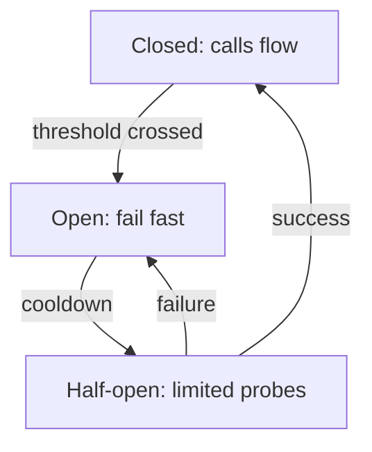

An API that works under normal load is not the same as an API that survives
abuse and partial failure. This chapter is the set of patterns that make the
difference — most of them cheap to add, and each one a direct answer to a
specific, named failure mode.

> [!WHY] A slow third-party call consumes a shared connection pool until
> unrelated requests fail too. The original dependency outage now takes
> healthy features down because waiting time and resource ownership were
> never bounded.

> [!GOALS]
>
> - Explain circuit-breaker recovery states
> - Choose a limiter for burst and sustained demand
> - Design isolation for a slow dependency

## Rate limiting algorithms

```text
  FIXED WINDOW        count requests per fixed interval
                       (100/minute, reset at :00)
                       → BOUNDARY BURST: 100 requests at
                         0:59, another 100 at 1:00 — 200
                         requests in under 2 seconds, both
                         "within limit"

  SLIDING WINDOW       a rolling window, not a fixed reset
  (LOG or COUNTER)     point — fixes the boundary burst

  TOKEN BUCKET         tokens refill at a steady rate, a
                       request consumes one, the bucket has a
                       max size — allows a BURST up to bucket
                       size, then throttles to the refill
                       rate
                       → the standard choice for APIs: bursts
                         are usually fine, sustained abuse
                         isn't
```

```text
  → 429 Too Many Requests, with a Retry-After header telling
    the caller exactly when to try again — a bare 429 forces
    the client to guess a retry delay.
```

## Timeouts

```text
  every network call needs an explicit timeout. no timeout
  means: a hung downstream dependency hangs YOUR request
  handler indefinitely, which — under enough concurrent
  requests — exhausts your own connection pool or thread
  pool, and now YOU are down too, because of someone else's
  outage.
```

```text
  → set a timeout on every outbound call — HTTP client, DB
    query, cache lookup. "the framework default" is often
    much longer (or infinite) than the caller can actually
    afford to wait.
```

## Retries and backoff

```text
  same shape as the Queues & Async Jobs chapter's
  backoff, applied synchronously: exponential backoff + jitter,
  and — critically — only retry on IDEMPOTENT operations
  (see the HTTP & the Web Platform chapter).

  retrying a non-idempotent POST blindly can duplicate the
  side effect the first attempt already caused.
```

## Circuit breakers

```text
  CLOSED  →  requests flow normally, failures are counted
     │
     │  failure rate exceeds threshold
     ▼
  OPEN   →  requests FAIL IMMEDIATELY, without even
             attempting the call, for a cooldown period
     │
     │  cooldown elapses
     ▼
  HALF-OPEN → let a small number of requests through as a
              probe
     │                              │
     │ succeed                     │ fail
     ▼                              ▼
  CLOSED                          OPEN (retry cooldown)
```

```text
  → the point isn't to help the FAILING dependency — it's to
    stop wasting YOUR resources (threads, connections,
    latency) on calls that are very likely to fail anyway,
    and to stop hammering an already-struggling dependency
    with load it cannot currently handle, which only delays
    its recovery.
```



## Bulkheads

```text
  named after a ship's bulkheads: compartmentalize so ONE
  breach doesn't sink the whole vessel.

    a single shared connection pool for every downstream
    dependency → one slow dependency exhausts the shared
    pool, and now requests to healthy dependencies fail too,
    purely from resource starvation

    → a SEPARATE pool (connections, threads) per dependency
      — dependency A being slow can only exhaust A's pool,
      leaving B's calls unaffected
```

## Idempotency keys, tied together

```text
  the REST API Design chapter introduced the
  header; this is the storage mechanic:

    Idempotency-Key: 3f29a1e4-...

    on receipt:
      1. has this key been seen? → return the STORED result
      2. else: process the request, store (key → result,
         status, expiry)

  → the store needs a UNIQUE CONSTRAINT on the key, so two
    concurrent requests with the same key racing each other
    don't both pass a "have I seen this?" check and both
    process — same atomicity requirement as the queue
    handler's check-and-mark.
```

## Composing these patterns

```text
  a single outbound call, hardened:

    rate limit (protect yourself from callers)
      → timeout (bound how long you'll wait)
      → circuit breaker (stop calling a failing dependency)
      → retry with backoff+jitter (survive a transient blip)
      → bulkhead (contain the blast radius if it doesn't recover)
```

```text
  → these are not alternatives to pick one of — each answers
    a DIFFERENT failure mode, and a production-grade client
    to an important dependency typically layers several of
    them together.
```

> [!PITFALL] A larger shared resource pool does not isolate a failing
> dependency; bulkheads change which requests can consume whose capacity.

> [!INTERVIEW] Name the failure each protection addresses: admission,
> bounded waiting, failing dependencies, safe retry and resource isolation
> compose rather than replace each other.

> [!CHECK] Why include Retry-After with a 429?
>
> It tells a throttled caller when to try again rather than making it
> guess.

> [!CHECK] Why does an idempotency-key store need a uniqueness constraint?
>
> Concurrent requests can both pass an unchecked lookup before either
> stores the result.

> [!CHECK] Why is an unspecified outbound timeout risky?
>
> A hung dependency can keep handlers and resources occupied indefinitely,
> exhausting the caller.

## What to take away

1. Token bucket is the standard rate-limiting choice because it allows a
   burst while still capping sustained rate — fixed windows have a
   boundary-burst flaw sliding windows fix.
2. Every outbound call needs an explicit timeout, or a hung dependency
   exhausts your own resources and turns their outage into yours.
3. Only retry idempotent operations — retrying a non-idempotent POST blindly
   can duplicate its side effect.
4. A circuit breaker's real purpose is protecting YOUR resources from calls
   likely to fail, and avoiding piling more load onto an already-struggling
   dependency.
5. A bulkhead (a separate resource pool per dependency) stops one slow
   dependency from starving requests to healthy ones — these patterns compose,
   they aren't alternatives to choose between.

## Exercises

> [!EXERCISE recall] Trace a circuit breaker from normal calls through
> failure and recovery probing. Why not restore all traffic immediately
> after cooldown?
>
> **Solution:** Closed allows calls and counts failures. Crossing the
> threshold opens it so calls fail immediately. After cooldown, half-open
> permits a small probe set; success closes it and failure reopens it.
> Probing tests recovery without immediately restoring the full load.

> [!EXERCISE apply] An API should permit occasional bursts of 30 requests
> but sustain at most 6 per second. Choose fixed-window or token-bucket
> limiting, set its parameters and reason about 40 simultaneous requests
> from a full bucket with no refill during the burst.
>
> **Solution:** Use a token bucket of capacity 30 refilling at 6 tokens
> per second. The initial burst consumes 30 tokens, so 30 requests can
> proceed and 10 must be throttled. Later sustained admission is bounded
> by refill. Fixed reset windows can admit adjacent-window bursts beyond
> their intended short-term allowance; the bucket directly models the
> desired burst-plus-rate policy.

> [!EXERCISE stretch] A slow reporting API shares a pool with a healthy
> checkout dependency. Recommend containment and reject simply increasing
> the common pool.
>
> **Solution:** Give the dependencies separate resource pools, explicit
> timeouts and a breaker for failing calls. Retry only when the operation
> is idempotent, with backoff and jitter. A weaker answer enlarges the
> shared pool: reporting can still exhaust it and starve checkout, merely
> at a higher resource cost.
