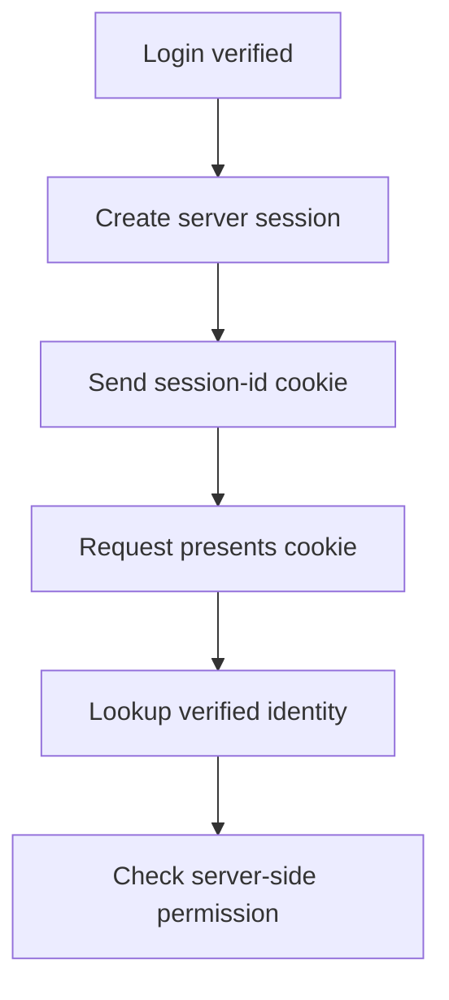

Authentication answers "who is this"; authorization answers "what may they do".
Conflating them is where most access-control bugs come from — a system that
checks identity carefully and then trusts a client-supplied role, or one that
enforces roles correctly but on a session that was never really verified.

> [!WHY] A server verifies a session but trusts an admin role supplied in
> the request body. Knowing who sent the request does not justify the
> requested privilege, so one edited field can turn a valid login into an
> access-control failure.

> [!GOALS]
>
> - Explain session and JWT revocation trade-offs
> - Choose trusted inputs for authorisation
> - Separate role rules from resource attributes

## Session-based auth

```text
  login  →  server creates a session record  →  session id
            set as an HTTP-only cookie

  every request:  cookie → look up session → identity
```

```text
  HttpOnly    JavaScript cannot read the cookie (blunts XSS
              token theft)
  Secure      cookie only sent over HTTPS
  SameSite    Strict/Lax — cookie NOT sent on a cross-site
              request (the primary CSRF defense)
```

```text
  → the session record lives SERVER-SIDE (in memory, Redis,
    or a table) — which is what makes instant revocation
    possible: delete the record, the session is dead on the
    next request. this is session auth's core trade-off
    against tokens, in both directions.
```



## Token-based auth (JWT)

```text
  header.payload.signature
  eyJhbGc...  .  eyJzdWI...  .  SflKxwRJ...

  the payload is BASE64, not encrypted — readable by anyone
  who has the token. the signature proves the server issued
  it; it does not hide the contents.
```

```text
  → never put a secret (a password, a raw card number) in a
    JWT payload. "the client can't read it" is false; only
    "the client can't forge it" is true.
```

```text
  self-contained: no server-side lookup needed to validate —
  verify the signature and trust the claims.

    → cannot be revoked before expiry without an extra
      mechanism (a denylist, defeating the "no lookup" appeal)
    → SHORT expiry (minutes) + a refresh token is the usual
      answer: the access token's damage window if stolen is
      capped by its own short life
```

```text
  session                          JWT
  server-side lookup, every        no lookup, self-contained
    request
  instant revocation                revocation needs a
                                     denylist or short expiry
  scales by session-store            scales by nothing —
    capacity                          horizontally free
```

## OAuth 2.0 — delegated authorization, not login

```text
  the problem OAuth solves: let app A act on a user's behalf
  against service B, WITHOUT the user giving A their B
  password.
```

```text
  AUTHORIZATION CODE FLOW  (the one to use for a server-side
                            or mobile app)

    user → B: "let A access my data?"  → user approves
    B → A: a short-lived CODE (via redirect)
    A → B (server-to-server): code + client secret
                              → access token

  the code is single-use and short-lived specifically so a
  leaked REDIRECT URL (browser history, a referrer header)
  cannot be replayed for a token — only the code leaks, and
  the code alone is useless without the client secret.
```

```text
  → "Sign in with Google" is OAuth used for AUTHENTICATION —
    Google vouches for identity, via OpenID Connect (an
    identity layer built on top of OAuth's authorization
    flow). OAuth itself is about ACCESS, not identity — the
    two got conflated by this exact use case.
```

## RBAC vs ABAC

```text
  RBAC   Role-Based       user → role → permissions
                          "editors can publish"
                          simple, coarse, easy to audit

  ABAC   Attribute-Based   permissions computed from
                            attributes of user + resource +
                            context
                          "the document's OWNER can edit it,
                          and only during business hours"
                          expressive, harder to audit — the
                          rule set is code, not a lookup table
```

```text
  → RBAC first. reach for ABAC only for a specific rule RBAC
    genuinely cannot express (ownership, time-of-day, a
    resource's own field) — not as a blanket replacement,
    because an unbounded ABAC rule set becomes as hard to
    reason about as scattered if-statements.
```

## The mistake that recurs

```text
  checking authorization on the CLIENT (hiding a button) and
  treating that as the control.

  → every authorization check must be re-enforced SERVER-SIDE,
    on every request that performs the action — a hidden
    button is a UX nicety, and an attacker calling the API
    directly never sees it.
```

```text
  the second recurring mistake: trusting a role or tenant id
  the CLIENT sends in the request body.

    POST /admin/users  {role: "admin", ...}   ✗

  → identity and role come from the verified session/token,
    never from a field the caller controls.
```

The Multi-Tenancy chapter is this same rule
applied to a tenant id specifically — a request's tenant must come from the
authenticated context, not a client-supplied field, or one tenant can read
another's data by editing a request.

> [!PITFALL] An authenticated request is not automatically authorised, and
> a client-controlled role is not a verified claim.

> [!INTERVIEW] Separate identity verification, revocation requirements and
> per-resource permission checks; explain which input is trusted for each
> decision.

> [!CHECK] Does a JWT signature hide its payload?
>
> No. The payload is readable; the signature supplies authenticity rather
> than encryption.

> [!CHECK] What does OpenID Connect add to OAuth’s access delegation?
>
> An identity layer for authentication; OAuth itself addresses delegated
> access.

> [!CHECK] Why is hiding a client button insufficient authorisation?
>
> A caller can invoke the API directly, so the action must be checked
> server-side on each request.

## What to take away

1. Authentication and authorization are different questions — verify identity
   before checking what it's allowed to do, and never conflate the two.
2. Sessions revoke instantly but need a server-side store; JWTs need no lookup
   but need a denylist or short expiry to revoke — the trade-off runs in both
   directions.
3. A JWT payload is readable, not encrypted — never put a secret in it.
4. OAuth's authorization-code flow keeps a leaked redirect URL harmless,
   because the code alone is useless without the client secret; OAuth is
   about access, and OpenID Connect is what layers identity on top.
5. Every authorization check must be enforced server-side on every request —
   a hidden client button and a client-supplied role or tenant id are both
   simply not controls.

## Exercises

> [!EXERCISE recall] Why do server-side sessions and self-contained access
> tokens have different revocation costs?
>
> **Solution:** Deleting a session record stops its next verified lookup,
> but requires that store on requests. A self-contained JWT can be checked
> without a lookup and remains usable until expiry unless an additional
> revocation mechanism such as a denylist is consulted.

> [!EXERCISE apply] A verified editor requests deletion of someone else’s
> draft and supplies role=admin and owner=true in JSON. The policy permits
> editors to edit, and only the actual document owner to delete a draft.
> Choose which inputs establish permission and decide whether the supplied
> fields can grant deletion.
>
> **Solution:** Use identity and role from the verified session or token,
> and ownership from the resource’s authoritative attributes. The JSON
> fields establish neither. Editor status supplies the editing role but
> does not satisfy the stated ownership rule for deletion. Evaluate that
> resource attribute server-side; without actual ownership, deny deletion
> rather than trust owner=true.

> [!EXERCISE stretch] A product has ordinary role permissions plus one
> ownership-sensitive operation. Recommend whether to replace every role
> lookup with an unrestricted attribute-rule engine.
>
> **Solution:** Keep RBAC for the simple audited role permissions and
> apply an attribute-based ownership rule where the role model cannot
> express the requirement. A weaker answer replaces all rules with
> unbounded ABAC immediately, adding code-like rule complexity without a
> need for it on ordinary role permissions.
