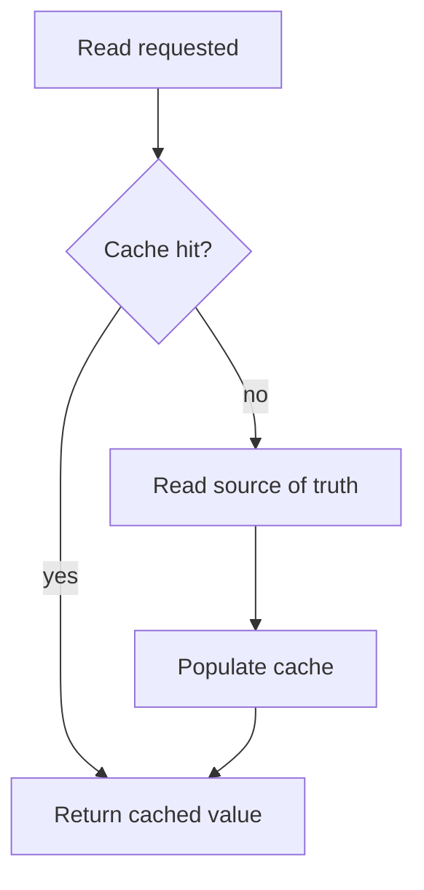

# Why caching exists

A cache is a bet that the same answer will be asked for again before it changes.
When the bet pays off you skip work; when it loses you serve something stale.
Every caching decision is a position on that trade, and the ones that go wrong
in production are almost always the ones taken without noticing a trade was
being made.

> [!WHY] A profile update succeeds in the database but the next screen
> shows an old cached value. The user retries an edit that was never lost,
> paying for a freshness decision the interface did not make explicit.

> [!GOALS]
>
> - Explain the freshness contract of a cache
> - Compute weighted latency to choose a target hit rate
> - Choose whether to fix a query before caching

## The numbers that motivate it

Approximate, and worth memorising — Back-of-Envelope Estimation uses them
constantly:

| Operation                      | Order of magnitude |
| ------------------------------ | ------------------ |
| L1 cache reference             | 1 ns               |
| Main memory reference          | 100 ns             |
| SSD random read                | 100 µs             |
| Round trip within a datacenter | 500 µs             |
| Disk seek                      | 10 ms              |
| Round trip across a continent  | 100 ms             |

An in-memory cache hit is roughly a thousand times cheaper than the database
query it replaces. That gap is why caches exist at all, and it does not shrink
with better hardware — it is largely the speed of light and the cost of a
syscall.

## Where a cache can sit

Requests pass through many places a result can be held:

```text
browser -> CDN -> load balancer -> app memory -> shared cache -> database
```

Each layer trades reach against freshness:

- **Browser / CDN** — cheapest by far (the request never arrives), but you have
  the least control over invalidation.
- **In-process memory** — nanoseconds, no network hop, but per-instance: ten app
  servers mean ten copies that can disagree.
- **Shared cache (Redis, Memcached)** — one copy every instance agrees on, at
  the cost of a network round trip.
- **Database buffer pool** — already there, already caching. Check that you are
  not adding a layer to fix a query that simply needs an index.

That last point deserves emphasis: **a cache in front of a slow query hides the
query rather than fixing it**, and it hides it in a way that fails hardest at
the moment the cache is cold — a deploy, a restart, an eviction storm — which is
exactly when the system is already under stress.

## What a cache is allowed to do

The useful mental discipline: a cache may return **a value that was correct at
some point in the past**. If your call site cannot tolerate that, you do not
want a cache; you want a faster source of truth.

Things that tolerate staleness well:

- Rendered pages, product catalogues, aggregate counts, feature flags.

Things that usually do not:

- Account balances, permission checks, inventory at the point of sale, anything
  a user just changed and expects to see changed.

That last case — _read your own writes_ — is the single most common cache bug in
web applications. The user updates their profile, the write goes to the
database, the read goes to a cache populated 30 seconds ago, and the app appears
to have lost their change. Consistency Models & CAP names this properly; here it
is enough to know it is the default failure and needs a deliberate answer.

## The hit rate is the whole story

A cache's value is `hit_rate × cost_saved`, minus the cost of maintaining it.
Some arithmetic worth doing before you build anything:

```text
90% hit rate, 100ms miss, 1ms hit  ->  avg 10.9ms
50% hit rate, 100ms miss, 1ms hit  ->  avg 50.5ms
```

Dropping from 90% to 50% costs you almost five times the average latency. This
is why cache sizing and eviction policy matter more than they look, and why "we
added a cache and it didn't help" is usually a hit-rate problem rather than an
argument against caching.

Measure the hit rate. A cache you are not measuring is a cache you cannot
reason about — and, in the worst case, one that is adding a round trip on every
request while returning nothing.



> [!PITFALL] A cache can hide a missing index until a cold start sends
> every request back to the slow source query.

> [!CHECK] What consistency issue appears when a write goes to the
> database and a following read uses an old cache entry?
>
> Read-your-own-writes fails: the user sees an earlier value after a
> successful change.

> [!CHECK] What is the trade between in-process and shared caches?
>
> In-process avoids a network hop but instances can disagree; a shared
> cache offers a common copy at the cost of a round trip.

## What to take away

1. A cache trades freshness for latency. Name what you are trading each time.
2. Put it as close to the reader as staleness allows — but no closer.
3. A cache over a missing index hides a bug and fails when it hurts most.
4. Read-your-own-writes is the default failure mode; plan for it.
5. Instrument the hit rate before you tune anything.

## Exercises

> [!EXERCISE recall] What promise may a cache make about the value it
> returns, and how should that shape the decision to cache a call site?
>
> **Solution:** It may return a value that was correct in the past. Use it
> only where that staleness is acceptable; a call requiring current
> authoritative state needs a faster source of truth or an explicit
> consistency answer rather than an unnoticed stale copy.

> [!EXERCISE apply] Misses cost 80 ms and hits cost 2 ms. Two cache sizes
> yield hit rates of 75% and 95%. Compute average latency for each and
> choose which satisfies an average below 10 ms, ignoring maintenance
> cost.
>
> **Solution:** At 75%, average is 0.75 × 2 + 0.25 × 80 = 1.5 + 20 = 21.5
> ms. At 95%, it is 0.95 × 2 + 0.05 × 80 = 1.9 + 4 = 5.9 ms. Only the 95%
> candidate meets the stated target. Measure the realised hit rate because
> a cache adds little if most requests still miss.

> [!EXERCISE stretch] A slow endpoint lacks a useful database index. A
> proposal adds a cache and declares the query fixed. Recommend an order
> of investigation.
>
> **Solution:** Inspect and improve the source query first, then add a
> cache only for a measured repeat-read benefit and acceptable staleness.
> A weaker answer hides the unindexed query behind a warm cache: a deploy,
> restart or eviction storm exposes the slow query precisely when the
> system is under stress.
