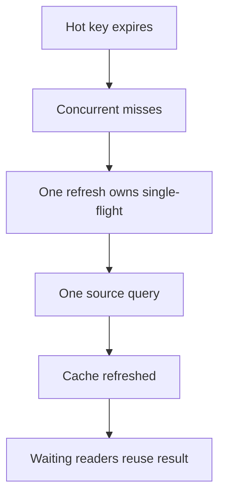

# Invalidation and stampedes

Writing to a cache is easy. Deciding when an entry stops being true is the hard
part, and the two ways it goes wrong at scale — stampedes and avalanches — are
worth recognising before you meet them at 3am.

> [!WHY] A popular entry expires and every waiting request recomputes it
> at once. A cache that was protecting the database suddenly concentrates
> a burst of identical queries onto it.

> [!GOALS]
>
> - Explain cache-aside and write-through placement
> - Choose separate stampede and avalanche defences
> - Design invalidation with a recovery backstop

## Three ways to write

**Cache-aside** (lazy loading) is the default, and what most application code
does:

```python
def get_user(user_id):
    key = f"user:{user_id}"
    cached = cache.get(key)
    if cached is not None:
        return cached
    user = db.query_user(user_id)          # miss: go to the source
    cache.set(key, user, ttl=300)
    return user
```

Simple, and the cache never holds anything nobody asked for. The cost is that
every miss pays full price, and the first request after a deploy always misses.

**Write-through** updates the cache as part of the write, so a read after a
write is always a hit. It keeps the cache fresh at the cost of writing data that
may never be read.

**Write-behind** acknowledges the write immediately and flushes to the database
asynchronously. Fastest writes, and the only one of the three where a crash can
lose acknowledged data — reach for it deliberately or not at all.

## Expiry versus invalidation

**TTL** is a bet on time: this is probably still true for five minutes. It is
robust because it is self-healing — a bug that writes a wrong value corrects
itself when the entry expires.

**Explicit invalidation** deletes the entry when the underlying data changes.
Fresher, and much easier to get wrong: every code path that writes must know
every key that write affects. Miss one and you serve stale data until something
else evicts it, which may be never.

In practice, use both: explicit invalidation for correctness, and a TTL
underneath as a backstop for the invalidation you forgot. Prefer deleting the
key to updating it — two concurrent writers updating a cache entry can leave it
holding a value that never existed in the database.

## Stampede (dogpile)

A popular key expires. A thousand in-flight requests miss simultaneously and all
of them query the database for the same row:

```text
t=0.000  key expires
t=0.001  1000 requests miss
t=0.002  1000 identical queries hit the database
t=0.400  database saturated; latency climbs; more requests pile up
```

The database was comfortably handling one query per five minutes for that key
and is now handling a thousand at once. Three standard defences:

- **Locking / single-flight** — the first miss takes a lock and recomputes;
  everyone else waits for it or serves the stale value.
- **Early recomputation** — refresh probabilistically as the TTL approaches, so
  one unlucky request refreshes before expiry rather than all of them after it.
- **Serve stale while revalidating** — return the expired value immediately and
  refresh in the background. The best option whenever slightly-stale beats slow.



## Avalanche

The same failure, one level up: a large set of keys expires at the same moment,
usually because they were all populated together (a deploy, a bulk warm, a
restart).

The fix is **jitter**. Never write a fixed TTL:

```python
ttl = base_ttl + random.randint(0, base_ttl // 10)
```

Ten percent of spread is enough to turn a cliff into a slope.

## Eviction

A full cache must discard something. **LRU** (least recently used) is the sane
default and matches how access patterns usually behave. **LFU** favours items
that are popular over a long window and resists a burst of one-off requests
flushing the working set. **TTL-only** eviction leaves the cache to fill and
then reject writes, which is almost never what you want.

Watch the eviction rate alongside the hit rate. A cache evicting heavily is
undersized, and a cache with a high hit rate _and_ heavy eviction is one
traffic spike away from a stampede.

> [!PITFALL] Identical TTLs across a bulk warm-up create an avalanche;
> one-key stampede protection does not spread those expiries.

> [!INTERVIEW] Distinguish one hot key’s stampede from many keys’
> avalanche, and explain the freshness trade before choosing
> stale-while-revalidate.

> [!CHECK] When can write-behind lose an acknowledged update?
>
> It acknowledges before asynchronously flushing to the database, so a
> crash before that flush can lose the write.

> [!CHECK] Which eviction policy resists one-off scans displacing
> long-term popular entries?
>
> LFU favours long-window frequency, unlike recency-only LRU.

## What to take away

1. TTL is self-healing; explicit invalidation is fresher. Use both.
2. Delete keys on write rather than updating them.
3. Stampedes are a _correct_ cache under load — defend with single-flight or
   stale-while-revalidate.
4. Always jitter TTLs.
5. Alert on hit rate and eviction rate, not just on cache latency.

## Exercises

> [!EXERCISE recall] How do cache-aside and write-through differ in when
> the cache is populated and what unnecessary work they can avoid or
> incur?
>
> **Solution:** Cache-aside fills on a miss, so it stores only requested
> data but misses pay source cost. Write-through updates cache as part of
> a write, improving read-after-write freshness but also caching data that
> may never be read.

> [!EXERCISE apply] One popular key attracts 120 concurrent misses on
> expiry; a nightly warm-up also gives thousands of unrelated keys
> identical expiry times. Choose defences for both symptoms and state the
> ideal recomputation count for the single key under coalescing.
>
> **Solution:** Use single-flight or serve-stale-while-revalidating for
> the popular key so one recomputation supplies the waiting readers
> instead of 120 identical queries. Add TTL jitter across the
> independently warmed keys to spread their expiries. Coalescing one key
> does not spread many keys, while jitter alone does not guarantee only
> one worker recomputes a hot miss.

> [!EXERCISE stretch] Two writers update a cached value after database
> writes, and invalidation paths sometimes miss a key. Recommend a safer
> cache-maintenance policy.
>
> **Solution:** Prefer deleting affected keys rather than racing value
> updates, and retain a TTL backstop so a missed invalidation eventually
> expires. A weaker answer extends TTL indefinitely to improve hits: it
> can preserve the missed invalidation forever and does not repair
> concurrent writers leaving an inconsistent value.
