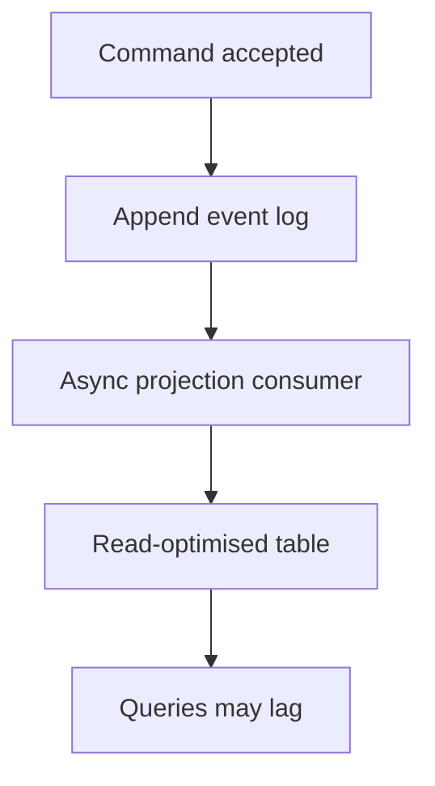

Every table this project uses so far stores CURRENT STATE: a row holds
whatever is true right now, and an update overwrites what was there before.
Event sourcing stores the opposite — a log of everything that happened — and
derives current state from replaying it. That single reversal is the whole
idea, and it has real, specific consequences.

> [!WHY] A support engineer needs to explain a balance change, but the
> current row contains only the final number. An append-only event history
> can answer how the state arose, at the cost of projections and
> long-lived event versions.

> [!GOALS]
>
> - Explain event history versus current state
> - Replay an event sequence into a projection
> - Choose a confirmation path despite projection lag

## The core reversal

```text
  MUTABLE ROW (the default)          EVENT LOG (event sourcing)

  accounts                            account_events
  id | balance                        id | account_id | type    | amount
  1  | 150                            1  | 1          | deposit | 100
                                       2  | 1          | deposit | 100
  → overwrites its own history        3  | 1          | withdraw| -50
                                       → balance = SUM(amount) = 150
                                       → the HISTORY is the data
```

```text
  → the account row never told you HOW it got to 150 — two
    deposits and a withdrawal, or one deposit of 150, look
    identical afterward. the event log preserves that
    distinction permanently, because nothing is ever
    overwritten — only appended.
```

## Why this is genuinely useful

```text
  AUDIT, BY CONSTRUCTION      the log IS the audit trail —
                              not a separate audit_log table
                              that can drift from what
                              actually happened, because there
                              is no "what actually happened"
                              other than the log

  TIME TRAVEL                 replay events up to any point
                              in the past → reconstruct state
                              AS OF that moment, which a
                              mutated row can never answer

  REPLAY / REBUILD             a bug in the projection logic
                              (see below) is fixable by fixing
                              the logic and REPLAYING — the
                              source data (the events) was
                              never wrong, only its
                              interpretation was
```

```text
  a soft-deletes discipline (this project's own rule) is a
  small step toward this same idea — never truly destroying
  data — without going all the way to a full event log.
```

## CQRS: separating writes from reads

```text
  Command Query Responsibility Segregation — the write model
  (the event log) and the read model (what queries actually
  run against) are DELIBERATELY DIFFERENT SHAPES:

    WRITE           append an event
    PROJECTION       a background process consumes events,
                     updates a READ-OPTIMIZED table (a plain
                     "accounts" table with a balance column,
                     kept in sync — never the source of truth,
                     always REBUILDABLE from the log)
    READ             query the projection, never the log
                     directly — replaying the whole log per
                     query would be far too slow
```

```text
  → the projection is DERIVED, exactly like a search index
    (backend.search) or a cache (backend.caching) — same
    "denormalized copy that can lag or need rebuilding"
    shape, applied to the read model itself rather than to a
    separate auxiliary store.
```



## Eventual consistency between write and read

```text
  a write appends an event; the projection updates
  ASYNCHRONOUSLY, shortly after — a query against the
  projection immediately after a write can see STALE state.

  → the same "read your own write" problem
    distributed.consistency covers for replication, showing up
    here as a consequence of the write/read split rather than
    of physical replication.
```

```text
  → for a UI that just performed the write, either read the
    write model directly for that one confirmation (bypassing
    the projection), or accept a brief lag and design the UI
    around it (an optimistic update, confirmed once the
    projection catches up).
```

## The real costs

```text
  ✗  QUERYING is harder, not easier — "all accounts with
     balance > 1000" needs the projection to already expose
     that; the event log itself cannot answer it without a
     full scan and replay

  ✗  SCHEMA CHANGE to an event means every past event is
     STILL the old shape forever — events are immutable by
     design, so "migrating" old events means the reading
     code must understand every version that was ever
     written, not the database

  ✗  a bug in projection logic requires REPLAYING THE ENTIRE
     LOG to fix derived state, which can be slow at real
     event volumes — this is expand/contract's problem
     (backend.migrations) shifted from schema changes to
     projection-logic changes, and it doesn't go away just
     because the source data is append-only
```

## When it's worth it

```text
  ✓  the audit trail IS the product requirement (financial
     ledgers, compliance-heavy domains)
  ✓  "what led to this state" is a real, recurring question
     (debugging, customer support needing history)
  ✓  genuinely different read shapes are needed from the same
     write (CQRS's projection flexibility)

  ✗  NOT a default architecture — most tables in most systems
     (including most of this project's own schema) are
     plain mutable rows, correctly, because they don't need
     any of the above and event sourcing's costs are real
```

> [!PITFALL] A stale projection is not evidence that an accepted event
> disappeared; read and write models can advance at different times.

> [!INTERVIEW] State the authoritative log, the projection’s lag and the
> event-version burden before presenting replay as a free benefit.

> [!CHECK] What does CQRS deliberately separate?
>
> The write model and a read-optimised projection, which is derived and
> rebuildable.

> [!CHECK] Why do immutable events complicate schema evolution?
>
> Old event shapes remain in the log, so readers must understand the
> versions already written.

> [!CHECK] When is event sourcing justified rather than a default?
>
> When audit history, reconstruction or distinct read models are real
> requirements worth its query and replay costs.

## What to take away

1. Event sourcing stores what happened, not just what's currently true — a
   mutated row can't distinguish "one big deposit" from "two small ones",
   the log always can.
2. The audit trail, time-travel, and replay-to-fix-a-bug benefits all follow
   from the same property: nothing is ever overwritten, only appended.
3. CQRS's projection is a derived, read-optimized table kept in sync with the
   log — the same "denormalized copy that can lag" shape as a cache or search
   index, applied to the primary read model itself.
4. The write/read split introduces its own read-your-own-write lag, separate
   from any physical replication lag.
5. Events are immutable forever, so schema changes accumulate as versions the
   reading code must understand — this is not a default architecture; reach
   for it only when the audit trail or the history genuinely is the
   requirement.

## Exercises

> [!EXERCISE recall] What distinction can an event log preserve that a
> current-value row cannot?
>
> **Solution:** Different sequences can produce the same final state.
> Appended deposits and withdrawals retain how a balance was reached,
> while an overwritten balance row loses that sequence and cannot
> independently reconstruct earlier states.

> [!EXERCISE apply] Starting from zero, an account records deposit 80,
> withdraw 25 and deposit 40. The projection consumed only the first two
> events. Compute the full balance and visible projection, and choose
> which is authoritative when rebuilding.
>
> **Solution:** Replay gives 0 + 80 = 80, then 80 − 25 = 55, then 55 + 40
> = 95. The lagging projection shows 55 because it has not consumed the
> final deposit. The immutable event log is authoritative; rebuilding a
> corrected projection replays those events rather than treating its stale
> 55 as source data.

> [!EXERCISE stretch] A customer writes successfully but an immediate read
> shows an old projection. Recommend a confirmation experience without
> pretending reads are synchronously updated.
>
> **Solution:** For confirmation, consult the write model for that
> operation or present an optimistic/pending view until the projection
> catches up. A weaker answer reads the same lagging projection and
> reports that the write failed: asynchronous projection lag is a separate
> fact from the accepted write. Also retain the cost of version-aware
> replay when choosing this architecture.
