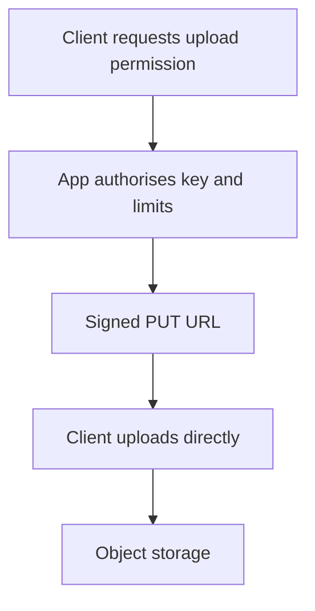

Files are different from the rest of a backend's data: they're large, they're
opaque to the database, and streaming them through your application server is
usually the wrong architecture. This chapter is the pattern for keeping the
server out of the byte stream while still controlling who can access it.

> [!WHY] A server buffers several large uploads before sending them to
> storage. File sizes multiply by concurrent requests, consuming memory
> for bytes the application often did not need to proxy at all.

> [!GOALS]
>
> - Explain what a signed URL authorises
> - Choose an upload path from byte-processing needs
> - Design private download expiry

## Object storage vs a filesystem

```text
  a local filesystem doesn't survive a server restart on
  most deploy platforms, doesn't scale beyond one machine's
  disk, and gives you no built-in replication.

  OBJECT STORAGE (S3, GCS, R2) — a flat key → blob store,
  durable, replicated, and reachable directly by a browser
  or mobile client, not just by your application.
```

```text
  → application servers should be STATELESS with respect to
    files: never write an uploaded file to local disk as a
    permanent home. treat local disk as scratch space at
    most, for the duration of one request.
```

## Signed URLs: keeping the server out of the byte stream

```text
  naive upload:
    client → app server → object storage
    → every byte of every upload passes through YOUR server,
      consuming its bandwidth and memory for work that adds
      no value

  signed URL upload:
    client → app server: "I want to upload a 4MB jpg"
    app server → client: a SIGNED URL, valid for N minutes,
                          scoped to exactly that key
    client → object storage: PUT directly, using the signed
                              URL — never touches the app
                              server
```

```text
  the signature encodes: which key, which method (PUT/GET),
  an expiry, and (for uploads) usually a content-type and
  size constraint — the app server authorizes the operation
  without proxying the bytes.
```

```text
  → the same pattern for DOWNLOAD: a private file gets a
    signed GET URL with a short expiry, rather than the app
    server streaming it through itself, or the bucket being
    public.
```



## Streaming uploads, when the server must be in the path

```text
  sometimes the server DOES need to see the bytes (virus
  scanning, transforming before storage) — stream them
  through rather than buffering the whole file in memory:

    request body → [stream, chunk by chunk] → object storage
    NOT: request body → buffer entire 500MB file in RAM → write
```

```text
  → a naive "read the whole upload into memory, then write
    it" implementation is a memory-exhaustion incident
    waiting for a large-enough file — this is a common
    failure mode with framework defaults that buffer bodies
    unless told not to.
```

## Image pipelines

```text
  ORIGINAL              stored once, immutable
  DERIVED VARIANTS       thumbnail, web-optimized, each
                         SIZE/FORMAT — generated, not stored
                         redundantly by hand
```

```text
  → generate variants ON UPLOAD (predictable set of sizes
    known in advance) or ON DEMAND with caching (arbitrary
    sizes, generated once then cached at the CDN) — on-demand
    without caching regenerates the same resize on every
    request, which is pure waste.
```

```text
  serve the resized/optimized variant, never the original, to
  a browser — an unresized multi-megabyte original served to
  a mobile client on a slow connection is a real, common
  performance bug, not an edge case.
```

## CDN delivery

```text
  object storage → CDN → browser

  the CDN caches the (already generated, already resized)
  bytes at edge locations close to the reader — this is
  literally the Caching chapter's
  "CDN" layer, applied specifically to media.
```

```text
  → cache-bust by CHANGING THE KEY on update (a content hash
    in the filename), not by trying to invalidate a CDN edge
    cache on every edit — an immutable key with a long
    max-age is simpler and more reliable than invalidation,
    and this is the same "prefer versioned keys over
    invalidation" idea the caching chapter covers generally.
```

## Access control on private files

```text
  a signed URL's expiry IS the access control — once issued,
  anyone holding that URL can use it until it expires,
  regardless of whether their session is later revoked.

  → keep the expiry SHORT (minutes, not days) for anything
    sensitive, and re-issue on each access rather than
    caching a long-lived signed URL client-side.
```

> [!PITFALL] Revoking a session does not retract an already-issued signed
> URL that remains valid until its expiry.

> [!INTERVIEW] Separate authorisation from byte transport, and state
> whether an issued URL’s remaining lifetime meets the sensitivity
> requirement.

> [!CHECK] Why should local disk not be the permanent upload home?
>
> It is tied to an instance and may not survive restarts or scale across
> machines.

> [!CHECK] How should repeated on-demand image resizing avoid redundant
> work?
>
> Cache generated variants so later requests reuse them.

> [!CHECK] How can updated media avoid fragile edge invalidation?
>
> Use a changed immutable object key, such as one containing a content
> hash.

## What to take away

1. Application servers should be stateless with respect to files — never a
   permanent home on local disk, and never a mandatory relay for every byte.
2. Signed URLs let a client upload or download directly against object
   storage while the app server stays only in the authorization step.
3. Stream large uploads through in chunks rather than buffering the whole
   body in memory — a naive buffer-then-write is a memory-exhaustion
   incident waiting for a large file.
4. Generate image variants once (on upload or on first demand, cached after)
   and serve the resized version — never the original — to a browser.
5. Cache-bust media by changing the key (a content hash in the filename),
   not by invalidating a CDN edge cache on every update.

## Exercises

> [!EXERCISE recall] Which dimensions does a signed file URL scope, and
> why can the application remain outside the byte path?
>
> **Solution:** It scopes an object key, HTTP method and expiry, with
> upload constraints such as type and size where supported. The
> application authorises the operation and issues the capability; the
> client transfers bytes directly to object storage.

> [!EXERCISE apply] A product accepts ordinary profile photos and also
> documents that require server-side scanning before storage. Choose a
> path for each; compare buffering four 250 MB scans with streaming
> chunks.
>
> **Solution:** Use signed direct uploads for photos when the server need
> not inspect bytes. For documents requiring in-path scanning, stream
> through the processing path into object storage rather than retaining
> whole bodies. Four fully buffered files require 4 × 250 = 1000 MB for
> payloads alone; streaming avoids that whole-file accumulation, with
> memory tied to the processing buffers rather than all file sizes.

> [!EXERCISE stretch] A sensitive file has a signed GET URL valid for
> days, and a team assumes session revocation disables it. Recommend a
> revised access policy.
>
> **Solution:** Issue short-lived signed URLs after authorising each
> access rather than retaining a long-lived URL. A weaker answer revokes
> only the application session while keeping the days-long URL valid:
> anyone holding the issued URL can still use it until expiry under this
> chapter’s capability model.
