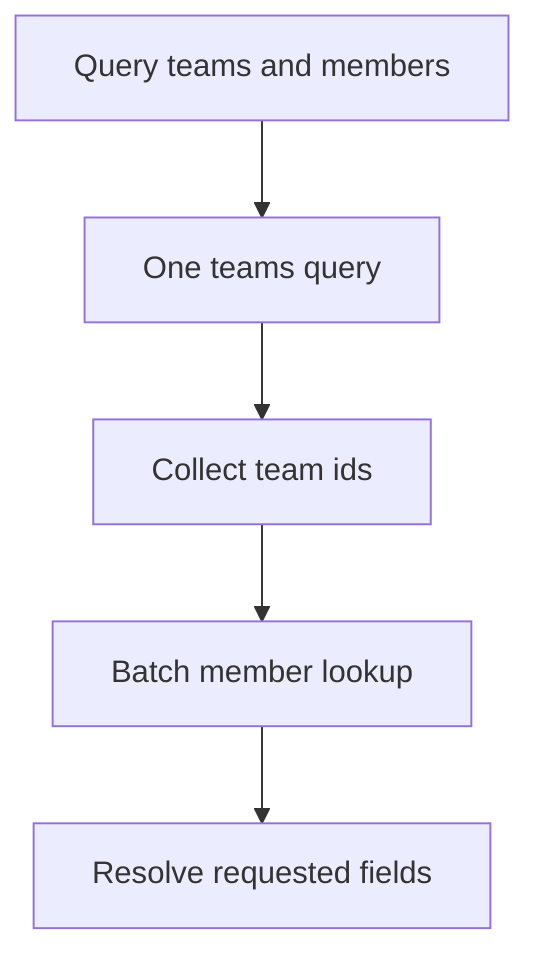

REST is a reasonable default; GraphQL and gRPC exist because two specific
problems with it kept recurring at scale — REST's rigid response shape, and
REST's per-call overhead for service-to-service traffic. Each fix brings its
own new failure mode, which is why neither has replaced REST outright.

> [!WHY] A screen makes one GraphQL request but its resolver layer issues
> a database query for every parent. Reducing browser round trips can
> still multiply backend work and make the new endpoint slower under load.

> [!GOALS]
>
> - Explain GraphQL and gRPC’s different benefits
> - Compute resolver fan-out and choose batching
> - Choose a protocol from client ownership

## GraphQL: solving over-fetching and under-fetching

```text
  REST:  GET /users/42          → the WHOLE user object,
                                   every field, whether the
                                   client wants it or not
                                   (over-fetching)

         a mobile screen needing user + their last 3 orders
           → GET /users/42
           → GET /users/42/orders?limit=3
           (under-fetching: two round trips for one screen)
```

```text
  GraphQL: ONE query, the client states exactly the fields
  it needs, across what would be several REST resources:

    query {
      user(id: 42) {
        name
        orders(limit: 3) { id, total }
      }
    }

  → one round trip, exactly the fields requested, no more
    and no less.
```

## The N+1 problem GraphQL introduces

```text
  a query for 20 users, each with their orders:

    resolve user.orders is called ONCE PER USER
    → 1 query for the 20 users + 20 queries for orders
    → this is the SAME N+1 shape as an ORM's lazy loading,
      but now built into the resolver architecture itself
      rather than an accident of one query
```

```text
  → DATALOADER: batch and cache resolver calls made within a
    single request tick. instead of 20 separate "get orders
    for user X" calls, batch them into one "get orders for
    users [1,2,3...20]" call.

  → without a batching layer, GraphQL's flexibility is a
    performance trap, not a win — this is not optional
    infrastructure, it is close to mandatory for any resolver
    with a one-to-many relationship.
```



## Query complexity as an attack surface

```text
  a REST endpoint has a bounded response shape by design. a
  GraphQL query is CLIENT-CONSTRUCTED, and can be:

    query {
      user(id: 1) { friends {
        friends { friends { friends { name } } } } } }
    }

  → nested arbitrarily deep, and each level multiplies the
    work. an unbounded query is a denial-of-service vector a
    REST API structurally doesn't have.
```

```text
  → enforce a maximum query DEPTH and a computed query COST
    (weighting expensive fields more) at the gateway, before
    execution. this is not optional hardening — it is the
    direct cost of exposing a client-constructed query
    language.
```

## gRPC: solving service-to-service overhead

```text
  gRPC is Protobuf (the Serialization & Schemas chapter)
  as the wire format, over HTTP/2, with generated typed
  clients and servers in every language from ONE .proto file.

    service OrderService {
      rpc GetOrder(GetOrderRequest) returns (Order);
      rpc StreamOrders(OrderFilter) returns (stream Order);
    }
```

```text
  → binary + generated code removes JSON's parse cost and REST's "read the
    docs, hand-write a client" step. the trade: it is NOT human-readable on
    the wire (no curl-and-read), and both ends need the SAME .proto — which
    is a non-issue for two services you own, and a real one for a public API
    where you don't control the caller's tooling.
```

## Streaming

```text
  gRPC supports four call shapes:

    unary                 request → response (like REST)
    server streaming       request → stream of responses
    client streaming        stream of requests → response
    bidirectional streaming  stream ↔ stream

  → server streaming fits "watch this resource for updates"
    naturally, without polling or a separate WebSocket
    (the Realtime & Streaming APIs chapter covers
    the browser-facing equivalent, since gRPC-Web support in
    browsers is limited).
```

## Choosing

```text
  REST         public API, unknown/diverse clients, need
               curl-debuggability and HTTP caching semantics
  GraphQL      client needs flexible, composed queries across
               many resources (mobile apps with varying
               screens, an internal BFF aggregating services)
  gRPC         internal service-to-service, high call volume,
               both ends are yours, streaming is useful
```

```text
  → none of these is a wholesale replacement for the others.
    a system commonly runs REST at its public edge, gRPC
    between internal services, and GraphQL as a BFF layer
    that aggregates several backend calls for a specific
    frontend — three protocols, three different jobs.
```

> [!PITFALL] One client round trip does not imply one backend query or
> bounded work.

> [!INTERVIEW] Count resolver data fetches as well as browser requests,
> and distinguish batching from the independent query-cost limit.

> [!CHECK] What does a DataLoader-style request batch combine?
>
> Separate relationship lookups made within the request into a lookup for
> the set of parent ids.

> [!CHECK] Why bound GraphQL query depth and cost?
>
> Nested client-specified fields can multiply execution work into an abuse
> path.

> [!CHECK] What gRPC call shape fits one request watching resource
> updates?
>
> Server streaming: one request followed by a stream of responses.

## What to take away

1. GraphQL fixes REST's over-/under-fetching by letting the client shape the
   response; gRPC fixes REST's per-call overhead for internal traffic with a
   binary format and generated clients.
2. GraphQL resolvers reproduce the N+1 problem structurally — a DataLoader
   (batching within a request tick) is close to mandatory for any one-to-many
   field, not optional tuning.
3. A client-constructed GraphQL query is an unbounded-depth attack surface
   REST doesn't have; enforce query depth and cost limits at the gateway.
4. gRPC trades human-readability and independent client tooling for speed and
   type safety — fine when you own both ends, a real cost for a public API.
5. The three protocols solve different problems and commonly coexist in one
   system rather than replacing each other.

## Exercises

> [!EXERCISE recall] How do GraphQL and gRPC address different REST
> trade-offs?
>
> **Solution:** GraphQL lets clients compose the fields and related
> resources they need. gRPC uses schema-generated typed calls and a binary
> format for controlled service-to-service traffic. Their flexibility and
> tooling costs differ, so neither is a universal REST replacement.

> [!EXERCISE apply] A query returns 35 teams, each with members. A naive
> resolver loads teams once and members separately per team. Compute query
> counts before and after one batched member lookup, and identify the
> separate protection still needed for deeply nested queries.
>
> **Solution:** Naive execution uses 1 + 35 = 36 database queries. One
> batch for all selected team ids reduces this to 1 + 1 = 2. Batching
> addresses N+1, not unbounded client-constructed work; enforce depth and
> computed cost limits before execution as a separate control.

> [!EXERCISE stretch] An API serves unknown external clients while
> internal services you own need high-volume typed streaming calls.
> Recommend whether to force both through one protocol.
>
> **Solution:** Keep a debuggable public REST interface where its HTTP
> semantics and diverse tooling fit, and use gRPC internally when
> generated clients, shared schemas and streaming justify it. A weaker
> answer moves the public edge wholesale to gRPC solely for binary
> efficiency, ignoring client tooling and human-readable debugging costs.
