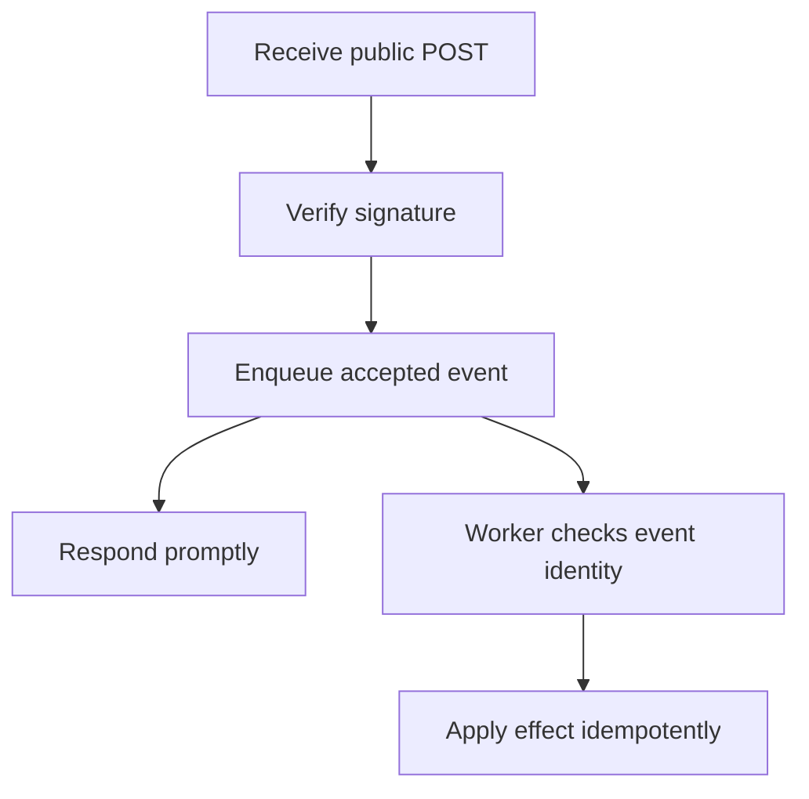

A webhook inverts the usual request direction: instead of your server polling
another service for updates, the other service calls YOU when something
happens. That inversion is convenient — and it means the caller is, by
definition, outside your control, which is where every pattern in this
chapter comes from.

> [!WHY] A webhook handler completes an update but times out before
> acknowledging it. The provider retries the same event, so a receiver
> that assumes one delivery can apply the update twice.

> [!GOALS]
>
> - Explain webhook authenticity checks
> - Design a fast duplicate-safe receive path
> - Choose recovery for an external API change

## Receiving a webhook

```text
  another service's server → POST https://yourapp.com/webhooks/stripe
                              {event data}

  → this endpoint is PUBLICLY REACHABLE by definition (the
    third party needs to reach it from the open internet) —
    it needs its own authentication scheme, since the caller
    can't use your normal session/token auth.
```

## Verifying a webhook is genuine

```text
  ANYONE can POST to a public URL claiming to be Stripe.
  → SIGNATURE VERIFICATION is what proves it actually came
    from Stripe:

    Stripe-Signature: t=1614556800,v1=5257a869e7...

    v1 = HMAC-SHA256(shared_secret, timestamp + "." + payload)

  → recompute the HMAC yourself using the shared secret both
    sides know, and compare — a request with a wrong or
    missing signature is rejected before its payload is
    trusted or acted on AT ALL.
```

```text
  → this is the AuthN and AuthZ chapter's "never trust a
    client-supplied identity" rule, applied to a caller that
    isn't a normal authenticated user at all — the shared
    secret substitutes for a session.
```

## Idempotency, again

```text
  the SAME event can be delivered more than once — this is
  webhooks' version of the Queues and Async Jobs chapter's
  at-least-once delivery, and for the identical reason: the
  sender retries on a timeout or a non-2xx response without
  knowing whether the first attempt was actually processed.

    → every webhook payload carries an EVENT ID; store
      processed ids and skip anything already seen — the same
      idempotency-key discipline as the Rate Limiting and
      Resilience chapter, applied to an inbound event instead
      of an outbound request.
```

## Responding fast, processing later

```text
  the sender expects a response (usually within a short
  window, often ~5-10 seconds) — and will treat a slow or
  missing response as FAILURE and retry, possibly duplicating
  the event.

    receive → ENQUEUE for background processing (the Queues
             and Async Jobs chapter) → return 200 IMMEDIATELY

  → do the actual work (updating records, sending
    notifications) in a worker, not inline in the webhook
    handler — a handler that does real work synchronously
    risks timing out under normal load, which then triggers
    the sender's retry, compounding the problem it's trying
    to avoid.
```



## Replay for recovery

```text
  most webhook providers offer a REPLAY mechanism — resend a
  specific past event, or every event since a timestamp —
  specifically because consumers' processing WILL fail
  sometimes (a deploy in progress, a bug, a database outage).

  → this only works if the receiving endpoint is genuinely
    idempotent (above) — replaying into a handler that isn't
    reprocesses side effects a second time.
```

## Sending your own webhooks

```text
  the same problems, from the other side:

    ✓  SIGN every payload (HMAC with a per-consumer secret) —
       your consumers need the same verification you need
       from your own providers
    ✓  RETRY with backoff on a failed delivery (a consumer's
       endpoint down or slow) — but CAP the retry window; an
       endpoint that's been down for a week doesn't need
       attempts continuing indefinitely
    ✓  give consumers a WAY TO VERIFY delivery — a dashboard
       of recent deliveries and their status, since "did my
       webhook actually fire" is the first thing every
       integration developer asks when debugging
```

## Depending on an API you don't control

```text
  a third-party API's contract can change: fields added
  (usually safe, per the Serialization and Schemas chapter's
  compatibility rules), fields deprecated or removed (breaks
  you, on THEIR schedule, not yours), rate limits tightened,
  or the service simply going down.
```

```text
  → treat every third-party call with the same hardening as
    an internal dependency (the Rate Limiting and Resilience
    chapter) — a timeout, a circuit breaker, and a fallback
    behavior for when the integration is unavailable — plus
    one thing internal dependencies don't need: DEFENSIVE
    PARSING of the response, since a field you depend on can
    vanish without a compatibility guarantee you'd get from a
    service you version together with.
```

> [!PITFALL] A quick 200 does not establish single delivery or eliminate
> the need for event-id deduplication.

> [!INTERVIEW] Explain authentication, acknowledgement timing and
> idempotent processing as separate parts of the webhook contract.

> [!CHECK] Why enqueue before doing lengthy webhook work?
>
> A slow synchronous response can trigger provider retries, compounding
> the same load.

> [!CHECK] What should outgoing webhook delivery offer beyond retries?
>
> Signed payloads, a bounded retry window and visible delivery status for
> consumers.

> [!CHECK] Why must recovery replay preserve event ids?
>
> The receiver needs the same identity to recognise work already processed
> instead of repeating effects.

## What to take away

1. A webhook receiver is a publicly reachable endpoint by definition and
   needs its own authentication — signature verification (HMAC against a
   shared secret) is what proves a request actually came from the claimed
   sender.
2. Webhook delivery is at-least-once, for the same reason a queue is — store
   processed event ids and skip duplicates rather than assuming single
   delivery.
3. Enqueue and return 200 immediately rather than processing inline — a slow
   synchronous handler risks a timeout, which triggers a retry and compounds
   the load.
4. A provider's replay mechanism for recovery only works correctly against a
   genuinely idempotent receiving endpoint.
5. Depend on a third-party API with the same hardening as an internal one
   (timeout, circuit breaker, fallback), plus defensive parsing — a field can
   vanish on the provider's schedule, with no compatibility guarantee.

## Exercises

> [!EXERCISE recall] Why does a webhook endpoint need signature
> verification rather than trusting its public URL or claimed sender name?
>
> **Solution:** Anyone can POST to the reachable URL. Recompute and verify
> the signed payload using the shared secret, rejecting missing or
> incorrect signatures before trusting or acting on the contents.

> [!EXERCISE apply] A provider delivers event k twice and event m once;
> processing each event takes longer than the sender’s response window.
> Choose the receive and worker sequence, and state which effects should
> occur.
>
> **Solution:** Verify authenticity first, enqueue accepted work and
> respond promptly rather than waiting for long processing. Workers use
> event ids to recognise processed events, so k’s intended effect occurs
> once despite repeated delivery and m’s occurs once. Persist processing
> outcomes under the idempotency discipline rather than assuming fast
> acknowledgement prevents all duplicate deliveries.

> [!EXERCISE stretch] A provider removes a response field during your
> deployment, and the integration starts crashing internally. Recommend
> resilience and recovery behaviour.
>
> **Solution:** Defensively parse at the external boundary, handle
> unavailable or incompatible data deliberately, and apply timeouts,
> breaker and a fallback for calls. A weaker answer trusts the old
> response shape everywhere and only retries: repeating the same
> incompatible payload does not restore the removed field. For failed
> inbound work, provider replay is useful only with an idempotent
> receiver.
