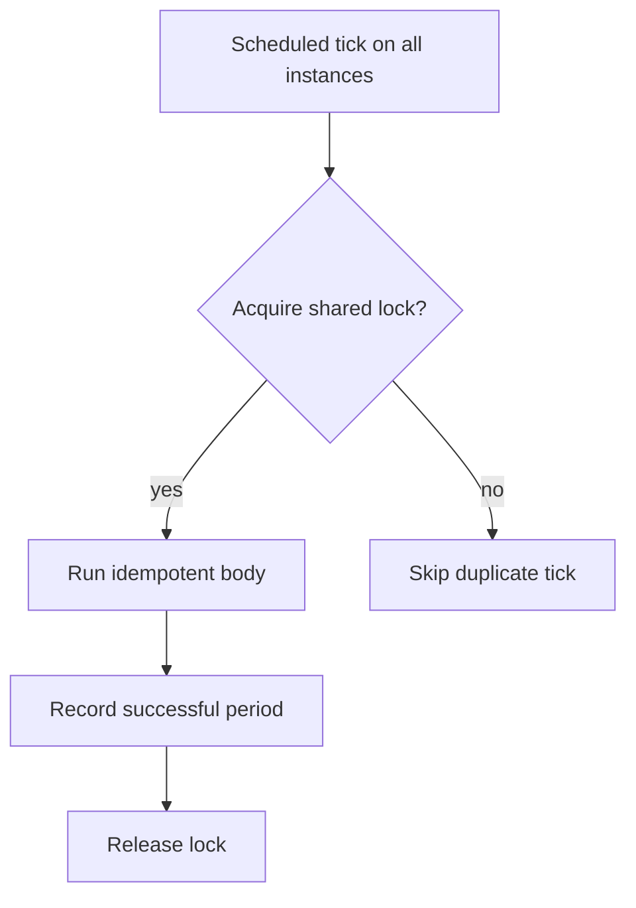

Scheduling looks like the simplest part of a backend — run this every hour —
until more than one instance of the app is running, at which point "every
hour" quietly becomes "every hour, from every instance, simultaneously" unless
something explicitly prevents it.

> [!WHY] A scheduled digest runs on every redundant app instance and sends
> customers several copies. High availability for the application has
> multiplied the schedule’s side effects because execution ownership was
> never coordinated.

> [!GOALS]
>
> - Explain fixed-clock scheduling versus finish-relative drift
> - Choose catch-up by the cost of a missed run
> - Design a job body for partial completion

## The single-instance illusion

```text
  a single cron job on a single server: trivial. it runs, it
  finishes, the next tick fires an hour later.

  the SAME job, deployed with 3 app instances for redundancy:

    instance A: cron fires the job
    instance B: cron fires the SAME job
    instance C: cron fires the SAME job

    → the job that was meant to send one digest email now
      sends three
```

```text
  → any recurring job on more than one instance needs a
    DISTRIBUTED LOCK: whichever instance's cron fires first
    acquires the lock and runs; the others see the lock held
    and skip this tick.

    acquire_lock("daily-digest", ttl=10min)
      if acquired: run the job, release on completion
      if not:      skip — someone else has it
```

```text
  → the lock needs a TTL, not just an acquire/release pair —
    if the instance holding the lock crashes mid-job, an
    unbounded lock never releases and the job never runs
    again, on any instance, until someone intervenes by hand.
```



## Drift

```text
  "run every 60 seconds" implemented as sleep(60) BETWEEN
  runs drifts: if the job itself takes 5 seconds, the actual
  interval is 65 seconds, and that error compounds over a
  long-running process.

  → schedule against a FIXED CLOCK (the next :00/:05/:10 boundary, or a cron
    expression evaluated against wall-clock time), not against "N seconds
    after the last run finished".
```

## Missed runs

```text
  the server hosting the scheduler is down from 2:58 to 3:04.
  the 3:00 job never fires.

  AT-MOST-ONCE     the missed run is simply lost — acceptable
  (fire and forget)  for work where a missed tick doesn't
                     matter (a routine cache warm)

  CATCH-UP          on restart, check "when did this last
                     successfully run" and fire once for the
                     missed tick(s) — needed for anything
                     where a gap is a real problem (a daily
                     billing job that MUST run once per day,
                     eventually, even if delayed)
```

```text
  → decide explicitly which behaviour a given job needs.
    the framework/library default is usually at-most-once,
    silently, which is wrong for the jobs where a missed run
    is a compliance or financial issue.
```

## Exactly-once-ish execution

```text
  true exactly-once is not achievable in general — the same
  underlying limit as
  the Queues & Async Jobs chapter's at-least-once
  delivery. the practical target is "exactly once, or
  detectably zero times, never silently more than once":

    a job crashes mid-run, AFTER partially completing side
    effects, BEFORE marking itself done → on retry (or the
    next tick, if the lock's TTL expired), it runs again

  → make the job's body IDEMPOTENT, the same discipline as a
    queue handler — check "have I already sent today's
    digest" before sending, not just "is it time to send".
```

## Timezone-aware scheduling

```text
  a job scheduled for "9am" needs to specify WHOSE 9am, and
  in which representation:

    "9am UTC"           unambiguous, but drifts relative to
                          any specific region's local morning
                          across DST transitions
    "9am America/New_York"  correct for that region's actual
                             morning, but the job's UTC
                             trigger time SHIFTS by an hour
                             twice a year (see
                             the Time, Dates & Money chapter's
                             DST section)
```

```text
  → most scheduling libraries offer both; pick UTC unless the
    job's purpose specifically requires local-time alignment
    (a "good morning" notification genuinely needs to land
    at the recipient's local morning, DST shift and all).
```

> [!PITFALL] A lock coordinates a run but cannot erase partial side
> effects from a crashed previous run.

> [!INTERVIEW] State the scheduled period, missed-run policy, lock
> lifetime and repeated-effect guard before claiming a job runs once.

> [!CHECK] Why must a distributed schedule lock expire?
>
> A crashed holder may never release it, so without a TTL all instances
> can remain blocked indefinitely.

> [!CHECK] When does an explicit regional timezone belong in a schedule?
>
> When the job’s purpose requires local-time alignment, such as a morning
> notification; otherwise UTC avoids that local-time dependency.

> [!CHECK] Why does scaling the app multiply naive cron executions?
>
> Each instance owns its own timer and fires the same job unless
> coordination chooses a runner.

## What to take away

1. Any recurring job running on more than one instance needs a distributed
   lock, or "every hour" becomes "every hour, from every instance,
   simultaneously".
2. The lock needs a TTL — an unbounded lock held by a crashed instance never
   releases, and the job silently stops running on any instance.
3. Schedule against a fixed clock boundary, not "N seconds after the last run
   finished", or the interval drifts by however long each run takes.
4. Decide explicitly whether a missed run should be dropped (at-most-once) or
   caught up on restart — the library default is usually at-most-once,
   which is wrong for jobs where a gap is a compliance or financial issue.
5. A scheduled job's body needs the same idempotency discipline as a queue
   handler, since exactly-once execution isn't achievable in general.

## Exercises

> [!EXERCISE recall] Why does sleeping for the interval after a job
> finishes drift relative to a fixed schedule?
>
> **Solution:** The execution time adds to every interval. A fixed clock
> boundary or wall-clock cron expression anchors the next run to the
> intended schedule rather than to the previous completion time.

> [!EXERCISE apply] After an outage spans two planned ticks, a cache-warm
> task and a daily billing task both restart. Choose missed-run policies
> for each and identify the state needed to catch up safely.
>
> **Solution:** A missed cache warm can be dropped when it is harmless;
> later traffic can repopulate it. Billing needs a catch-up policy based
> on the last successful scheduled period so the missed work eventually
> occurs. Record completion and make repeated execution safe; merely
> running once immediately without checking which periods succeeded can
> either miss a gap or repeat prior work.

> [!EXERCISE stretch] An instance sends some digests and crashes before
> marking the run done. Recommend a restart design beyond a distributed
> lock.
>
> **Solution:** Use an expiring lock for coordination and make the body
> idempotent, checking whether the relevant day’s digest was already sent
> before repeating that effect. A weaker answer relies only on the lock:
> after its TTL expires another run can repeat partially completed
> effects. An unbounded lock instead risks preventing future runs forever.
