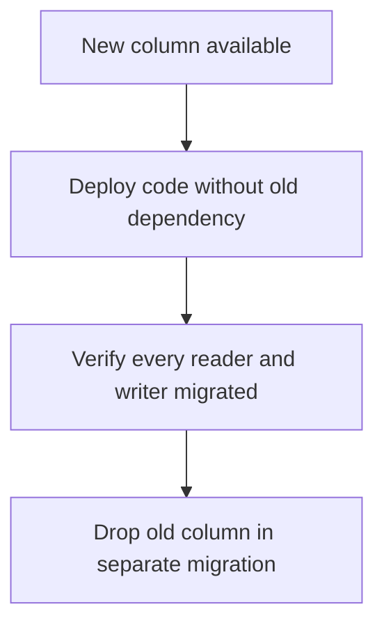

A schema migration that locks a table for even a few seconds is an outage on
any system with continuous traffic. The techniques in this chapter aren't
exotic SQL — they're a sequencing discipline for making a change land across
multiple deploys, each one individually safe.

> [!WHY] A column is dropped while an old application instance still reads
> it. A cleanup that looked local to SQL becomes an outage because a
> rolling deployment temporarily contains both schema expectations.

> [!GOALS]
>
> - Explain mixed-version migration constraints
> - Choose whether contraction is ready
> - Plan a resumable backfill

## Why a single ALTER TABLE isn't safe

```text
  ALTER TABLE orders ADD COLUMN status TEXT NOT NULL DEFAULT 'pending';

  on some databases (older Postgres, MySQL without INSTANT
  ADD COLUMN) this REWRITES EVERY ROW to add the default —
  on a 50M-row table, that's an exclusive lock held for
  however long the rewrite takes.
```

```text
  → modern Postgres (11+) makes ADD COLUMN with a constant
    default instant — check your actual database version and
    the specific operation, because the answer depends on
    both, and an assumption that's true for one is a locked
    table on another.
```

```text
  the operation that's ALWAYS dangerous regardless of
  version: adding a NOT NULL constraint to an EXISTING
  column on a large table — validating it against every
  existing row takes a full table scan under lock, unless
  done in the two-step form below.
```

## The expand/contract pattern

```text
  renaming a column safely — the naive single-step version
  breaks any code still deployed against the OLD name the
  instant the migration runs:

    EXPAND    add the NEW column, alongside the old one
              both exist; old code writes the old column,
              nothing yet reads the new one

    BACKFILL   copy existing data: old column → new column
              (in batches — see below, not one giant UPDATE)

    DUAL WRITE  deploy code that writes BOTH columns —
                old code paths still work untouched, new
                code paths start using the new column

    MIGRATE READS  deploy code that reads the NEW column

    CONTRACT   once nothing reads or writes the old column,
              drop it — a separate migration, separate deploy
```

```text
  → five steps, five deploys, for what looks like "just
    rename a column". the discipline exists because a rolling
    deploy runs OLD and NEW code simultaneously — the same
    constraint backend.serialization covers for message
    schemas, applied here to a live database schema instead.
```

## Backfilling in batches

```text
  UPDATE orders SET new_status = old_status;   -- ✗ one giant
                                                 transaction,
                                                 locks every
                                                 row it
                                                 touches until
                                                 commit

  → batch it: UPDATE ... WHERE id BETWEEN X AND X+1000,
    committing between batches, with a short pause — each
    batch's lock is brief, and other transactions get a
    chance to run between batches instead of queuing behind
    one enormous one.
```

```text
  a batched backfill is also RESUMABLE: if it's interrupted
  partway, track the last completed batch and continue from
  there, rather than restarting a multi-hour job from zero.
```

## Adding a NOT NULL constraint safely

```text
  the two-step version that avoids a full-table validating
  scan under an exclusive lock:

    1. ALTER TABLE ... ADD CONSTRAINT ... CHECK (col IS NOT
       NULL) NOT VALID;
       — adds the constraint for FUTURE rows instantly; does
       NOT validate existing rows yet

    2. ALTER TABLE ... VALIDATE CONSTRAINT ...;
       — validates existing rows, but takes only a SHARE lock
       (not exclusive) — concurrent reads and writes continue
```

## Removing a column safely

```text
  the mirror of expand: STOP writing and reading a column in
  the application first (a deploy), confirm nothing depends
  on it, THEN drop it (a separate deploy, separate migration).

  → dropping a column a still-deployed instance is reading
    from turns "cleanup" into an outage — the column removal
    step must come strictly after every instance is confirmed
    running the code that no longer touches it.
```



## Backward-compatible ORM/application code

```text
  the application code deployed DURING a migration must
  tolerate BOTH schema shapes — the old one (some instances
  haven't redeployed yet) and the new one (some have):

    read: prefer new_column if present, fall back to
          old_column
    write: write to whichever step the migration is
           currently at, per the expand/contract sequence
```

```text
  → this is why the migration and the application code
    change ship as SEPARATE, ordered deploys rather than one
    combined change — a single deploy that both adds a
    constraint AND assumes it's already enforced has no safe
    window during its own rollout.
```

> [!PITFALL] A successful backfill is not permission to drop a column that
> still-deployed code reads or writes.

> [!INTERVIEW] Describe the compatibility of each rollout stage, then
> state the observation that makes the destructive contract step safe.

> [!CHECK] Why inspect the database version as well as ALTER syntax?
>
> Lock and rewrite behaviour depends on the engine version and exact
> operation.

> [!CHECK] What is the chapter’s two-step validation discipline?
>
> Add an unvalidated check for future rows, then validate existing rows
> separately instead of assuming a large immediate constraint scan is
> cheap.

> [!CHECK] What should transitional readers tolerate?
>
> The relevant old and new schema shapes, using a fallback where the
> migration stage requires it.

## What to take away

1. Whether a schema change locks the table depends on the specific operation
   and database version — check both, rather than assuming any ALTER TABLE is
   instant or that all of them are dangerous.
2. Expand/contract splits a schema change into independently-safe steps (add,
   backfill, dual-write, migrate reads, drop) because a rolling deploy runs
   old and new code simultaneously.
3. Backfill in small, committed batches rather than one giant transaction — a
   batched backfill is also resumable if interrupted.
4. Add a NOT NULL constraint in two steps (NOT VALID, then VALIDATE) to avoid
   an exclusive lock during validation.
5. Application code deployed during a migration must tolerate both the old
   and new schema shapes, which is why the schema change and the code that
   depends on it ship as separate, ordered deploys.

## Exercises

> [!EXERCISE recall] Why must live schema changes be split into
> independently safe application and database steps?
>
> **Solution:** Old and new code run simultaneously during rollout. Each
> schema state must support the deployed readers and writers; adding a new
> dependency and removing its old form in one step can leave part of the
> fleet incompatible.

> [!EXERCISE apply] A new column exists and is backfilled. New readers use
> it, but some old instances still read the old column and one background
> writer still updates it. Choose whether to drop the old column, and
> state the evidence required before contraction.
>
> **Solution:** Do not drop it yet. Confirm every deployed reader and
> writer, including the background job, no longer depends on the old
> column. Finish the application rollout and verify those paths before a
> separate removal migration. Backfill completion alone establishes
> neither reader compatibility nor writer retirement.

> [!EXERCISE stretch] A large backfill is interrupted halfway and the
> proposed recovery restarts one full-table UPDATE. Recommend a more
> operationally bounded plan.
>
> **Solution:** Track the last completed batch, resume in small committed
> ranges and allow work between batches. A weaker answer restarts a giant
> transaction: it repeats completed work and holds touched-row locks until
> the whole transaction commits. Resumable batches reduce both recovery
> cost and uninterrupted lock time.
