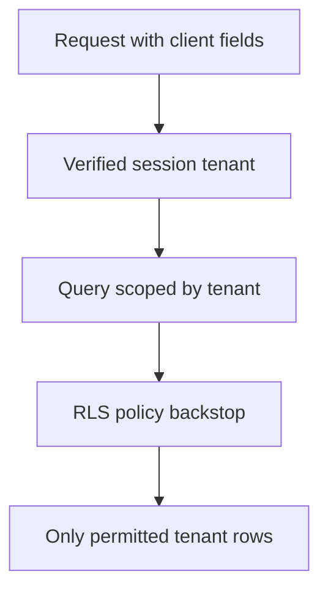

Multi-tenancy is the pattern behind nearly every B2B SaaS product: many
customers (tenants) sharing the same application and often the same database,
each believing — correctly, if the isolation is done right — that they have
the system to themselves.

> [!WHY] A globally unique order id is queried without tenant scope. The
> row exists, but returning it to a different tenant violates isolation
> even though the database lookup itself is perfectly valid.

> [!GOALS]
>
> - Explain isolation strength versus operational cost
> - Trace tenant scope from authenticated context
> - Design noisy-neighbour protection

## Isolation models

```text
  SHARED DATABASE,           every tenant's rows live in the
  SHARED SCHEMA               same tables, distinguished by a
                              tenant_id column
                              → cheapest to operate (one
                                database, one set of
                                migrations), weakest isolation
                                (a missing WHERE clause leaks
                                across tenants)

  SHARED DATABASE,            each tenant gets its own
  SEPARATE SCHEMA              Postgres schema (namespace)
                              within one database
                              → stronger isolation, migrations
                                must run against every
                                tenant's schema — N times the
                                migration work

  SEPARATE DATABASE            each tenant gets a fully
  PER TENANT                   separate database
                              → strongest isolation, most
                                operational overhead — N
                                databases to back up, monitor,
                                upgrade, and connection-pool
```

```text
  → shared schema by default, for the same reason a modular
    monolith beats microservices by default (the Services and
    Modular Monoliths chapter) — the isolation cost of the
    stronger models is real and ongoing, and most products
    don't need it until a specific tenant's compliance
    requirement demands it (a bank requiring its data
    physically separated, for instance).
```

## The tenant_id discipline

```text
  the single most important rule in shared-schema
  multi-tenancy: EVERY query touching tenant data filters by
  tenant_id, with NO EXCEPTIONS.

    SELECT * FROM orders WHERE id = 42;                 ✗
    SELECT * FROM orders WHERE id = 42 AND tenant_id = ?; ✓
```

```text
  the mistake this guards against: an order id is unique
  GLOBALLY in the table, but the APPLICATION'S invariant is
  that a caller may only see orders belonging to THEIR
  tenant — the database has no way to know that unless every
  query says so.
```

```text
  → the tenant_id comes from the AUTHENTICATED SESSION, never
    from a client-supplied field (the same rule the AuthN and
    AuthZ chapter ends on, applied specifically to tenant
    scoping) — a request body containing tenant_id is a
    request for a DIFFERENT tenant's data, trivially, if the
    server trusts it.
```



## Row-level security as a backstop

```text
  the tenant_id-on-every-query discipline is an APPLICATION
  convention — it can be violated by one missed WHERE clause
  in one code path, and the database has no idea anything
  went wrong.

  POSTGRES ROW-LEVEL SECURITY (RLS) enforces it at the
  DATABASE layer:

    CREATE POLICY tenant_isolation ON orders
      USING (tenant_id = current_setting('app.tenant_id'));

  → even a query that FORGOT the WHERE clause only sees rows
    matching the current session's tenant — RLS is what
    turns a discipline that can be violated by one bug into a
    guarantee enforced below the application entirely.
```

## Noisy neighbours

```text
  in a shared database, one tenant's workload can degrade
  EVERY tenant's performance:

    a tenant running an expensive report query saturates the
    database's connections/CPU → every other tenant's
    ordinary requests slow down too, with no relationship to
    THEIR usage
```

```text
  → per-tenant limits: a connection pool cap, a query
    timeout, a rate limit per tenant (the Rate Limiting and
    Resilience chapter's machinery, scoped per tenant instead
    of per API key) — without them, one tenant's usage spike
    is every tenant's incident.
```

## Per-tenant customization and limits

```text
  feature flags, plan-based limits (seats, storage, API rate)
  and tenant-specific configuration all need to be looked up
  by tenant — and, same as the query discipline above, looked
  up from the AUTHENTICATED tenant context, not a value the
  request supplies.
```

```text
  → these lookups are on the hot path of nearly every
    request — cache them (the Caching chapter) rather than
    querying a tenant_settings table on every single request,
    with the same invalidation discipline any cache needs
    when a tenant's plan changes.
```

## Tenant routing

```text
  how a request even KNOWS which tenant it's for:

    SUBDOMAIN    acme.myapp.com          → tenant = "acme"
    PATH          myapp.com/acme/...      → tenant = "acme"
    HEADER/TOKEN   resolved from the authenticated session,
                  not from the URL at all
```

```text
  → subdomain is the most common for B2B SaaS — it's visible,
    bookmarkable, and works cleanly with per-tenant custom
    domains later (acme.myapp.com → orders.acme.com) without
    an application-level redesign, just a routing change.
```

> [!PITFALL] A globally unique resource id identifies a row, not the
> caller’s permission to read that row.

> [!INTERVIEW] Trace tenant identity from verification to every data
> access, and separately explain how shared-resource usage is bounded.

> [!CHECK] What does RLS add beyond an application convention?
>
> A database-layer tenant filter even when a query forgets its own scope,
> under the configured tenant context.

> [!CHECK] Why cache tenant configuration on a hot path?
>
> Repeated plan and feature lookups affect most requests, but cached
> values still need invalidation when the plan changes.

> [!CHECK] Does a tenant subdomain alone replace authenticated tenant
> verification?
>
> No. Routing identifies context, while the trusted tenant and permissions
> must still be established through authenticated context.

## What to take away

1. Shared schema, separate schema, separate database is a spectrum of
   isolation strength traded against operational cost — default to shared
   schema, and move up the spectrum only for a specific requirement.
2. Every query touching tenant data must filter by tenant_id from the
   authenticated session, with no exceptions and never from a
   client-supplied field.
3. Row-level security turns the tenant_id discipline from an application
   convention one missed WHERE clause can violate into a guarantee enforced
   at the database layer.
4. A shared database means one tenant's expensive workload can degrade every
   other tenant's performance — per-tenant limits are what prevent that.
5. Cache per-tenant configuration and plan limits rather than querying them
   on every request, with the same invalidation discipline any cache needs.

## Exercises

> [!EXERCISE recall] How do shared-schema, per-schema and per-database
> tenancy change isolation and operations?
>
> **Solution:** Shared schema is cheap but depends on row scoping;
> per-tenant schemas separate namespaces while multiplying migrations;
> per-tenant databases provide stronger isolation while multiplying
> backups, monitoring, upgrades and pools.

> [!EXERCISE apply] A session establishes tenant A. A request for order 72
> includes tenant_id=B in its body; the order belongs to B. Choose the
> query scope and decide whether the global order id or supplied tenant
> changes access.
>
> **Solution:** Use the authenticated tenant A in the order query: id = 72
> AND tenant_id = A. The order for B does not match, regardless of its
> globally unique id or the body’s tenant choice. Keep RLS as a
> database-layer backstop so an accidental missing application predicate
> does not expose other tenants.

> [!EXERCISE stretch] One tenant’s reporting saturates the shared database
> and slows small tenants. Recommend whether moving every tenant
> immediately to a separate database is the first response.
>
> **Solution:** Apply per-tenant resource caps, query timeouts and rate
> limits, and evaluate stronger isolation where a specific requirement
> justifies its ongoing cost. A weaker answer leaves the pool unlimited
> and merely scales it: one tenant can continue consuming the enlarged
> shared budget. Splitting every database without a requirement adds
> operations before trying scoped protection.
