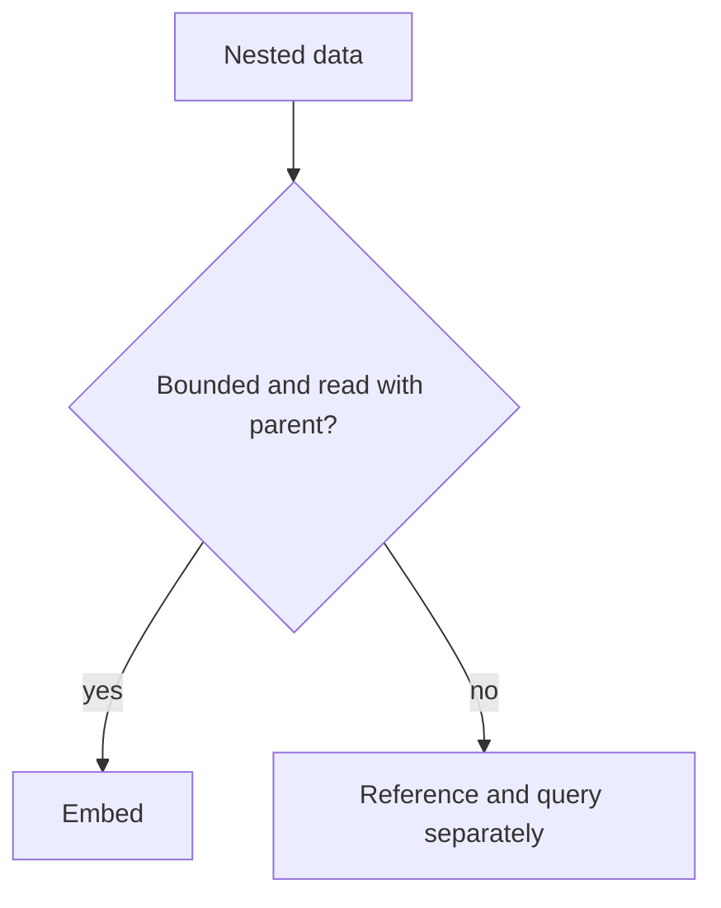

"NoSQL" is not one thing — it's four different data models that gave up
different parts of the relational model in exchange for a specific access
pattern. Choosing between them is choosing which access pattern you actually
have, not choosing a side in a SQL-vs-NoSQL debate.

> [!WHY] A document embeds every new comment and grows without bound. The
> initial no-join convenience eventually hits the document’s size limit,
> making the original access-pattern choice a production constraint.

> [!GOALS]
>
> - Explain access-pattern-first persistence
> - Choose embedding versus referencing
> - Evaluate polyglot storage against a concrete need

## The four shapes

```text
  DOCUMENT      MongoDB, Firestore
                a JSON-like blob per record; nested structure
                without a join
                → good fit: the record is naturally a tree
                  (a product with variants, a user profile)

  KEY-VALUE     Redis, DynamoDB
                get/put by key, nothing else guaranteed fast
                → good fit: lookups are always by a known id;
                  no query "by any other field"

  WIDE-COLUMN   Cassandra, HBase, Bigtable
                rows with a huge, sparse, dynamic set of
                columns, partitioned by a key
                → good fit: massive write volume, queries
                  always filter by the partition key
                  (time-series, event logs)

  GRAPH         Neo4j
                nodes and edges, traversal is the native
                operation
                → good fit: the QUERY is "find connected
                  things N hops away" — a social graph, a
                  recommendation path — which is a recursive
                  self-join in SQL and a single traversal here
```

## What you give up

```text
  the relational model buys ad-hoc queries: filter, join and
  aggregate on ANY column, planned by the query optimizer,
  without redesigning the schema.

  NoSQL stores generally give that up in exchange for
  PREDICTABLE performance at the access pattern they were
  built for — often by requiring the query shape to be
  decided at schema-design time, not query time.
```

```text
  DynamoDB, concretely: a table's partition key and sort key
  are chosen at creation, and "query by a different attribute"
  either needs a secondary index (created up front) or a full
  scan (the thing the database exists to avoid).

  → the SQL habit of "we'll just add a WHERE clause" doesn't
    transfer. the access patterns need to be known BEFORE the
    schema is designed, not discovered after.
```

## Joins, or the lack of them

```text
  a document store's answer to "products AND their reviews":
  embed reviews inside the product document, or store a
  review with a product_id and do the join IN APPLICATION
  CODE (N+1-shaped, deliberately) — there is no JOIN clause.
```

```text
  EMBED    when the nested data is always read together with
           the parent, and doesn't grow unboundedly (a
           product's variants)

  REFERENCE  when the nested data is large, grows without
             bound, or is read independently (a product's
             reviews — thousands of them, often queried alone)

  → embedding an unbounded array is the recurring NoSQL
    mistake: a document has a size limit, and "comments"
    embedded in a "post" document eventually hits it.
```



## Consistency, revisited

```text
  many NoSQL stores trade strict consistency for availability
  and partition tolerance (see
  the Consistency Models & CAP chapter) —
  DynamoDB and Cassandra default to EVENTUAL consistency on
  reads, with a stronger read available at extra cost
  (DynamoDB's "strongly consistent read", Cassandra's
  QUORUM).

  → "I just wrote this row and can't see it on the next read"
    is not always a bug — it may be the consistency model
    doing exactly what it says, and the fix is choosing the
    stronger read mode where the use case needs it, not
    filing an incident.
```

## Choosing, in practice

```text
  the honest default: relational, until a specific access
  pattern SQL serves badly shows up.

    session/cache data, ephemeral, key-only lookup
      → key-value (Redis)
    a catalog of heterogeneous, nested product types
      → document
    time-series metrics at write volumes SQL chokes on
      → wide-column
    "friends of friends who also follow X"
      → graph

  → polyglot persistence means picking the right store PER
    ACCESS PATTERN, not migrating an entire application off
    SQL. most systems in this project run several of these
    side by side for different tables, which is the normal
    shape, not a compromise.
```

> [!PITFALL] An unbounded embedded child collection turns future growth
> into a parent-document size problem.

> [!INTERVIEW] State the actual query and growth pattern before naming a
> database family; explain what ad-hoc flexibility the choice trades away.

> [!CHECK] What workload fits a key-value store?
>
> Lookups are by a known key without expecting arbitrary other fields to
> be equally fast.

> [!CHECK] What workload fits wide-column storage?
>
> Very high write volume with queries designed around the partition key,
> such as time-series data.

> [!CHECK] What should a read-your-own-write use case check in an
> eventually consistent store?
>
> Whether it needs an available stronger read mode instead of assuming the
> default immediately reflects the write.

## What to take away

1. NoSQL is four distinct data models, each traded against relational for a
   specific access pattern — pick by the pattern you actually have, not by
   "NoSQL vs SQL" as a single decision.
2. NoSQL stores generally require the access pattern to be known at
   schema-design time; the SQL habit of adding a WHERE clause later doesn't
   transfer.
3. Embed nested data that's always read with its parent and bounded in size;
   reference data that's unbounded or queried independently — an unbounded
   embedded array is the recurring mistake.
4. Many NoSQL stores default to eventual consistency on reads; "can't see my
   own write" may be the model working as designed, not a bug.
5. Polyglot persistence means choosing a store per access pattern and running
   several side by side — that's the normal shape, not a compromise.

## Exercises

> [!EXERCISE recall] What relational flexibility do specialised NoSQL
> access patterns often trade away?
>
> **Solution:** Ad-hoc filtering, joins and aggregation over arbitrary
> columns can give way to predictable performance for preplanned key,
> document, partition or traversal queries. A new attribute query may
> require an index or scan rather than just a WHERE clause.

> [!EXERCISE apply] A product has a small fixed collection of variants
> read with the product and a growing review history queried separately.
> Choose document embedding or references for each, and explain why using
> the same approach for both is risky.
>
> **Solution:** Embed bounded variants that are always read with their
> parent. Reference the independently queried, unbounded reviews so their
> growth does not inflate the product document indefinitely. Embedding
> both saves an initial join but ignores the different size and retrieval
> contracts.

> [!EXERCISE stretch] A team wants to migrate its whole relational
> application to a graph store because one recommendation query traverses
> relationships. Recommend a narrower decision.
>
> **Solution:** Keep relational storage for ordinary ad-hoc business
> queries and evaluate graph storage for the relationship traversal that
> benefits from it. A weaker answer migrates every table because one query
> fits graphs: it gives up unrelated relational strengths without
> demonstrating an access-pattern benefit. Polyglot persistence chooses
> per workload, not by a single platform slogan.
