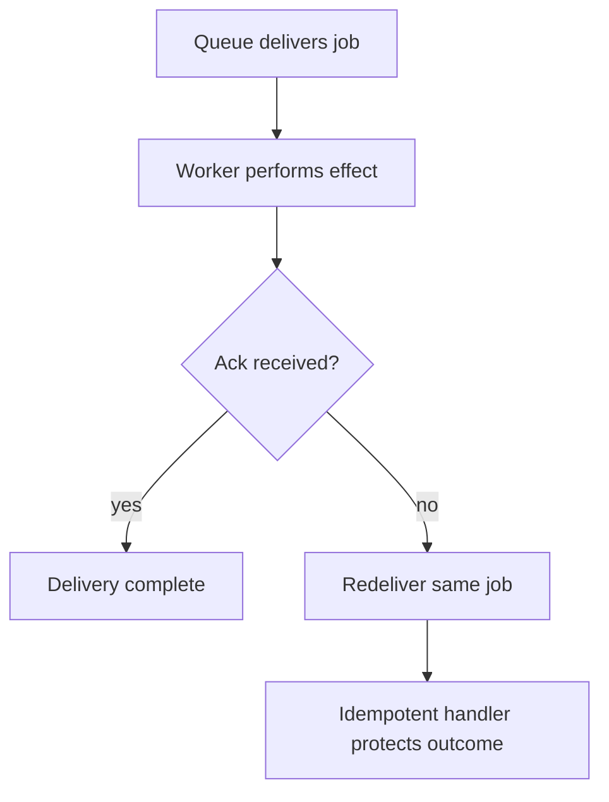

A queue exists to answer one question: does this work need to finish before
the response goes back to the caller? When the answer is no, moving it off the
request path improves latency and lets the work retry independently of the
request that triggered it — at the cost of a whole new set of failure modes.

> [!WHY] A worker completes a job and crashes before acknowledging it.
> Redelivery repeats the same side effect unless the handler’s outcome is
> safe to produce again.

> [!GOALS]
>
> - Explain at-least-once delivery
> - Choose a partition and visibility policy
> - Design recovery for repeated permanent failures

## Why move work off the request path

```text
  synchronous:  request → [resize image, 4s] → response
                → the caller waits 4 seconds for work they
                  don't need the RESULT of immediately

  async:        request → enqueue job → response (fast)
                                worker → [resize image, 4s]
                → the caller gets a fast response; the work
                  happens independently
```

```text
  → the test isn't "is this slow", it's "does the response
    need this work's OUTPUT". sending a confirmation email
    is async almost always; charging a card the response
    needs to confirm is not (or is async with the response
    reflecting a pending state, not silence).
```

## At-least-once delivery

```text
  the guarantee nearly every real queue makes is AT-LEAST-ONCE,
  not exactly-once:

    worker picks up job → crashes AFTER doing the work but
    BEFORE acknowledging it → the queue, having seen no ack,
    redelivers the job → the work runs TWICE
```

```text
  → exactly-once delivery is not achievable at the messaging layer in
    general (this is the same underlying problem as distributed consensus
    under network partitions — see the Consensus chapter). the practical
    answer is at-least-once delivery PLUS an idempotent handler, which
    composes into an effectively-once OUTCOME even though delivery itself is
    not exactly-once.
```



## Idempotency in the handler

```text
  processPayment(jobPayload) {
    charge(jobPayload.amount);   // ✗ runs again on redelivery
  }

  processPayment(jobPayload) {
    if (alreadyProcessed(jobPayload.idempotencyKey)) return;
    charge(jobPayload.amount);
    markProcessed(jobPayload.idempotencyKey);   // ✓
  }
```

```text
  → the check-and-mark must be a single atomic operation (a
    unique constraint on the idempotency key, or a
    transaction), or two redelivered copies processed
    concurrently both pass the check before either marks it
    done — the same race the check exists to prevent.
```

## Dead letters

```text
  a job that fails repeatedly (a permanently malformed
  payload, a downstream service that's genuinely down) will
  otherwise retry FOREVER, consuming worker capacity that
  healthy jobs need.

  → after N retries, move it to a DEAD LETTER QUEUE: stop
    retrying automatically, but keep the message for
    inspection rather than discarding it silently.
```

```text
  → a dead letter queue with nobody watching it is just a
    slower way to lose the job. it needs an alert and an
    owner, or it is not actually a safety net.
```

## Backoff and retry timing

```text
  FIXED         retry every 5s        → a downstream outage
                                          gets hammered by
                                          every failed job,
                                          simultaneously,
                                          every 5s
  EXPONENTIAL   5s, 10s, 20s, 40s...  → gives the downstream
                                          room to recover
  + JITTER      exponential ± random  → without jitter, many
                                          jobs that failed at
                                          the same moment
                                          retry in LOCKSTEP,
                                          recreating the exact
                                          load spike that
                                          caused the failure
```

## Ordering

```text
  most queues do NOT guarantee global order — only per-partition/per-key
  order, if that (SQS FIFO, Kafka per-partition).

  → "process events for user 42 in the order they happened"
    needs events for user 42 routed to the SAME partition/
    queue consistently (partition by user id) — global FIFO
    across all keys doesn't scale, so most systems don't
    offer it.
```

## Poison messages and the visibility timeout

```text
  a worker picks up a job (it becomes temporarily invisible
  to other workers, for a VISIBILITY TIMEOUT) and crashes
  mid-processing.

  → too short a timeout: the job becomes visible again while
    still legitimately being worked, and a second worker
    picks it up too — double processing from timing alone.
  → too long: a genuinely crashed job sits invisible and
    un-retried for a long time.

  → set it comfortably above the job's expected P99 duration,
    not its average.
```

## Where this connects

The Scheduling & Cron chapter is queues plus a clock — recurring work instead
of one-off. The Event Sourcing & CQRS chapter uses a queue's ordering and
at-least-once guarantees as its event log's delivery mechanism.

> [!PITFALL] A visibility timeout below legitimate processing duration
> creates duplicate work even when no worker has crashed.

> [!INTERVIEW] Separate ordering, acknowledgement, visibility and
> idempotent effects; none of these guarantees implies the others.

> [!CHECK] What decides whether work belongs off the response path?
>
> Whether the response needs its output, not merely whether the work is
> slow.

> [!CHECK] Why must idempotency check-and-mark be atomic?
>
> Concurrent copies can both observe not processed before either records
> completion.

> [!CHECK] Why add jitter to exponential retries?
>
> Jobs that failed together otherwise retry together and recreate the load
> spike.

## What to take away

1. Move work off the request path when the response doesn't need its output —
   not simply because the work is slow.
2. Real queues deliver at-least-once, not exactly-once; an idempotent handler
   turns repeated delivery into an effectively-once outcome.
3. The idempotency check-and-mark must be atomic, or two redelivered copies
   processed concurrently both pass the check.
4. A dead letter queue without an alert and an owner is just a slower way to
   lose the job.
5. Exponential backoff needs jitter, or every job that failed at the same
   moment retries in lockstep and recreates the load spike that caused the
   failure.

## Exercises

> [!EXERCISE recall] Why can a queue redeliver work that already happened,
> and where must repeated-effect safety live?
>
> **Solution:** A crash after the effect but before acknowledgement leaves
> the queue unable to distinguish completed work from an abandoned job.
> Delivery can repeat; the handler must preserve an idempotent outcome
> with atomic processing identity rather than assuming exactly one
> delivery.

> [!EXERCISE apply] Jobs update each account in event order; normal
> processing is fast but measured p99 is 45 seconds. A proposed queue
> mixes keys arbitrarily and uses a 5-second visibility timeout. Choose
> changes and state what each fixes.
>
> **Solution:** Route each account’s events consistently to the same
> ordered partition or queue where that guarantee is supported. Set
> visibility comfortably above the expected p99 rather than 5 seconds, so
> legitimate slow jobs are not redelivered while still running.
> Partitioning addresses per-account order; timeout tuning addresses
> duplicate concurrent processing and must still be paired with handler
> idempotency.

> [!EXERCISE stretch] Malformed jobs repeatedly fail and occupy workers
> while healthy jobs wait. Recommend a terminal retry and ownership
> policy.
>
> **Solution:** After a bounded retry budget, move them to a dead-letter
> queue, alert an owner and retain them for diagnosis and deliberate
> recovery. A weaker answer retries forever with a fixed delay: permanent
> payload errors do not repair themselves and healthy work keeps losing
> capacity. Backoff with jitter helps transient failures but is not an
> ownership process for dead letters.
