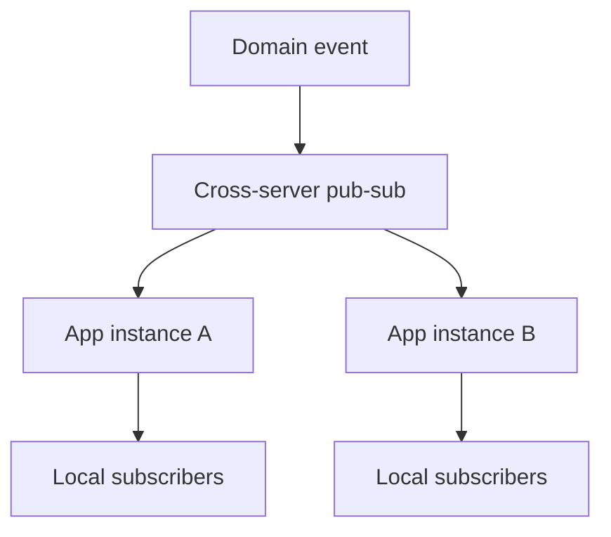

Every pattern so far assumed a client asks and a server answers, once, and the
connection closes. Realtime inverts that: the connection stays open, and the
server pushes updates on its own schedule. That single change is what
introduces backpressure and fan-out as real engineering problems.

> [!WHY] A browser on a slow connection falls behind a live feed and the
> server retains every update for it. Enough slow subscribers can exhaust
> server memory and disrupt clients whose connections were healthy.

> [!GOALS]
>
> - Explain cross-server fan-out
> - Choose a transport from direction of flow
> - Design bounded backpressure for a state stream

## The three mechanisms

```text
  POLLING          client asks "anything new?" every N
                    seconds
                    → simple, works everywhere, wastes most
                      requests on "no"

  LONG POLLING      client asks, server HOLDS the request
                    open until there's an answer (or a
                    timeout), client immediately re-asks
                    → fewer wasted round trips than polling,
                      still request-per-update under the hood

  SSE (Server-Sent  one HTTP connection, server streams
  Events)           events over it — one-directional,
                    server → client only
                    → built on plain HTTP, auto-reconnects
                      natively, simplest realtime option
                      when the client never needs to push
                      back

  WEBSOCKET          full-duplex, persistent connection —
                     both sides can send at any time
                     → needed when the CLIENT also pushes
                       (chat, collaborative cursors,
                       controls) — SSE cannot do this
```

```text
  → SSE first, if the data flow is genuinely one-directional
    (a live dashboard, a notification stream) — it rides on
    HTTP, works through the same infrastructure (proxies,
    load balancers) with no special handling, and reconnects
    on its own. reach for a WebSocket only when the client
    needs to send, not by default.
```

## Fan-out

```text
  one event, many subscribers:

    order.shipped  →  [order 42's 3 connected viewers]

  single server: hold a map of order id → connected sockets,
  push directly.

  MULTIPLE servers, and a client can be connected to ANY of
  them:

    order.shipped → [pub/sub layer: Redis, Kafka] →
      every app server subscribed → each pushes to ITS OWN
      locally-connected clients for that order
```

```text
  → without a pub/sub layer between app servers, an event
    only reaches clients connected to the SAME server that
    received it — this is the same problem
    the Case: Chat & Presence chapter
    solves with a session registry: know WHICH server holds
    a given client's connection, or broadcast to all servers
    and let each filter to its own connections.
```



## Backpressure

```text
  a server produces events faster than a slow client (a poor
  connection, a busy browser tab) can consume them.

  → the server's per-connection SEND BUFFER grows unbounded
    if nothing intervenes — eventually consuming enough
    memory, across many slow clients, to threaten the whole
    server, not just that one connection.
```

```text
  DROP           discard events for a slow client rather than
                 buffering forever — acceptable for data
                 where only the LATEST value matters (a live
                 price ticker; the client doesn't need every
                 intermediate tick, only the current one)

  DISCONNECT     close the connection once the buffer exceeds
                 a threshold — the client reconnects and
                 catches up via a fresh snapshot, rather than
                 the server holding a slow client's backlog
                 indefinitely

  BUFFER WITH     buffer up to a cap, THEN apply one of the
  A CAP           above — never an unbounded buffer
```

```text
  → decide, per event stream, whether missing an intermediate
    update is acceptable. it usually is (state, not a
    sequence of commands the client must apply exactly) —
    which is what makes "drop and let the client re-sync
    from a snapshot" the common, correct answer rather than
    a compromise.
```

## Presence

```text
  "who else is currently viewing/editing this" is not
  ordinary application state — it is EPHEMERAL and derived
  from connection state itself:

    on connect:    mark user present
    on disconnect:  mark user absent
    on a clean disconnect (tab closed via the WebSocket close
      handshake) this is immediate; on an UNCLEAN one (laptop
      lid closed, network drops) it relies on a HEARTBEAT
      timeout, since the server gets no close event at all
```

```text
  → presence should never be written to the durable database
    as regular state — it belongs in a fast, TTL-based store
    (an in-memory map, Redis with expiry) that naturally
    self-corrects if a disconnect event is ever missed,
    because a stale entry simply expires.
```

> [!PITFALL] Persistent connections need bounded per-client queues; one
> slow reader must not reserve unlimited server memory.

> [!INTERVIEW] State whether the stream carries replaceable state or
> indispensable commands before choosing drop, disconnect and snapshot
> recovery.

> [!CHECK] Why is polling often wasteful?
>
> Many periodic requests return no new data.

> [!CHECK] How does presence recover after an unclean disconnect?
>
> Heartbeat expiry removes stale connection-derived presence when no close
> event arrives.

> [!CHECK] Where should ephemeral presence live?
>
> A fast TTL-based store that expires missed disconnects, rather than
> ordinary durable application state.

## What to take away

1. Choose the mechanism by direction of data flow: SSE for server-to-client-only
   (simpler, rides on plain HTTP), a WebSocket only when the client also needs
   to push.
2. Fan-out across multiple app servers needs a pub/sub layer between them, or
   an event only reaches clients connected to the server that received it.
3. An unbounded per-connection send buffer to a slow client is a real memory
   risk across many slow clients — cap it, then drop or disconnect.
4. Dropping intermediate updates for a slow client is usually acceptable when
   the stream represents current state rather than a sequence the client must
   apply exactly — the client just re-syncs from a snapshot.
5. Presence is ephemeral, connection-derived state — store it in a fast,
   TTL-based store that self-corrects on a missed disconnect, never as
   regular durable state.

## Exercises

> [!EXERCISE recall] Why does a local map of resource ids to sockets fail
> to deliver every update across several app servers?
>
> **Solution:** It knows only connections held by that process. A pub/sub
> layer between servers or a registry of which server holds each
> connection is needed so events reach clients attached elsewhere.

> [!EXERCISE apply] One screen only receives live inventory totals;
> another continuously sends collaborative cursor movements while
> receiving other users’ movements. Choose a transport for each and
> describe how two app instances distribute updates.
>
> **Solution:** Use SSE for the one-way inventory stream and a full-duplex
> WebSocket for collaborative cursor traffic. Publish updates through a
> cross-server pub/sub layer; each instance forwards relevant events to
> its locally connected clients. Choosing a transport does not itself
> solve multi-instance fan-out.

> [!EXERCISE stretch] A current-price feed has clients consuming slower
> than updates are produced. Recommend a bounded memory policy and
> contrast retaining every intermediate price forever.
>
> **Solution:** Cap each connection’s send buffer, then drop superseded
> state updates or disconnect and let the client reconnect to a fresh
> snapshot. A weaker answer buffers every intermediate tick without limit:
> memory grows for slow readers even though the use case needs the latest
> price, not every state transition. A command stream would require a
> different loss decision.
