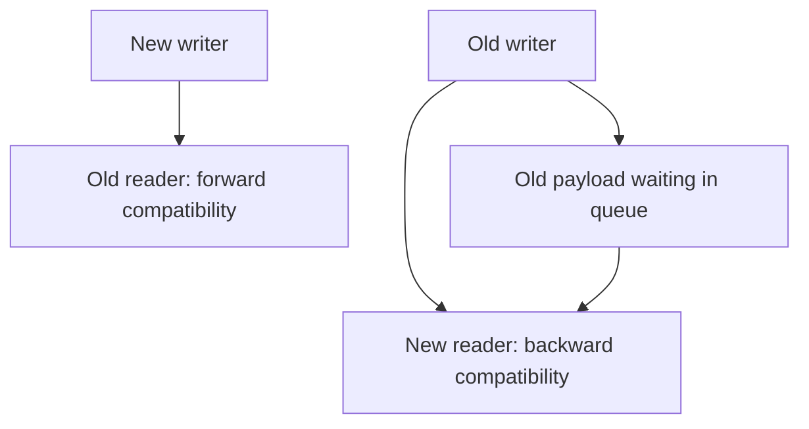

Every message that crosses a process boundary — an API response, a queued job,
a Kafka record — is bytes on the wire, and something on each side that agrees
on what those bytes mean. The format choice matters less than the compatibility
discipline, because the discipline is what lets the schema change after
callers already exist.

> [!WHY] A queued message survives longer than an application rollout,
> then reaches a worker that assumes every field uses the new shape. A
> compatible deploy must account for data still waiting in queues, not
> only currently running processes.

> [!GOALS]
>
> - Explain reader-writer compatibility directions
> - Choose a safe schema evolution
> - Design one trustworthy parsing boundary

## The format spectrum

```text
  JSON        text, self-describing, human-readable
              no schema enforcement — a typo in a field name
              is a silent bug, not a rejected message

  PROTOBUF    binary, schema-defined (.proto file), generates
              typed code in every target language
              smaller and faster to (de)serialize than JSON;
              requires the schema to read the bytes at all

  AVRO        binary, schema travels WITH the data (or is
              resolved via a schema registry) — built for
              systems where the schema changes often and
              readers may be on an older version
```

```text
  → JSON for public APIs (self-describing, debuggable with
    curl, no codegen step for a consumer you don't control).
    Protobuf/Avro for internal service-to-service and
    streaming, where both ends are yours and the size/speed
    win compounds across millions of messages.
```

## Schema evolution: the actual hard problem

```text
  a MESSAGE WRITTEN TODAY must still be readable by a reader
  compiled from TOMORROW'S schema, and a message written
  tomorrow must still be readable by a reader still running
  yesterday's code — because a rolling deploy runs both
  versions simultaneously.
```

```text
  BACKWARD COMPATIBLE    new reader, old data     — reading OLD
                                                     messages with a
                                                     NEW schema
  FORWARD COMPATIBLE     old reader, new data     — reading NEW
                                                     messages with an
                                                     OLD schema

  → a rolling deploy needs BOTH, simultaneously, for the
    whole rollout window
```

```text
  SAFE changes:
    ✓  add an OPTIONAL field with a default
    ✓  add a new value to an enum (if readers treat unknown
       values as "other" rather than crashing)
    ✓  widen a numeric type (int32 → int64)

  UNSAFE changes:
    ✗  remove a field a reader still expects
    ✗  rename a field (readers see it as removed + added)
    ✗  change a field's type (int → string)
    ✗  make an optional field REQUIRED
    ✗  reuse a Protobuf field NUMBER for something else
       (old binary data now deserializes as the wrong type,
       silently)
```

```text
  Protobuf's field numbers exist specifically to make
  rename-without-breaking possible: the WIRE format only ever references the
  number, never the name.

    message Order {
      string id = 1;
      string customer_name = 2;   // may be renamed to
    }                              // customer_display_name
                                    // freely — the number is
                                    // what's on the wire
```



## The rolling-deploy scenario, concretely

```text
  t0   all readers on schema v1
  t1   deploy begins: SOME readers on v2, some still v1
  t2   a v1 writer emits a message: v2 readers must
       understand it   (forward compat)
       a v2 writer emits a message: v1 readers must not
       crash on it      (backward compat)
  t3   all readers on v2
```

```text
  → this window is exactly why "just add the field and ship"
    is not casual — during t1..t3, BOTH schema versions are
    live in production simultaneously, for however long the
    rollout takes.
```

## Validation at the boundary

```text
  a schema (JSON Schema, a Protobuf message, a Zod/io-ts
  type) is a CONTRACT, and validating against it at the
  boundary is what turns "malformed input" from an internal
  crash three functions deep into a 400 at the edge, with a
  field name attached.
```

```text
  → validate once, at the boundary, and trust the shape
    inside. re-validating the same object at every internal
    layer is redundant work that also drifts — two validators
    for the same shape rarely stay in sync.
```

## Where this connects

The GraphQL & gRPC chapter is largely this chapter applied: gRPC's wire format
IS Protobuf, and GraphQL's schema plays the same "reader/writer contract" role
JSON Schema plays for a REST body. The Queues & Async Jobs chapter depends on
this directly — a queued job's payload schema evolves under the same
rolling-deploy constraint, except the "old reader" can be a message sitting in
the queue for hours before a worker picks it up, which makes the
compatibility window longer than a typical API rollout.

> [!PITFALL] A queue’s compatibility window can outlast the rollout
> because old bytes remain unread after all writers have upgraded.

> [!INTERVIEW] Describe compatibility by the ages of reader and data, and
> include queued historical payloads when choosing the evolution window.

> [!CHECK] What is JSON’s principal debugging advantage here?
>
> It is self-describing human-readable text without requiring generated
> clients to inspect it.

> [!CHECK] Why can a Protobuf field be renamed without changing its wire
> identity?
>
> The wire uses its field number rather than its source-code name.

> [!CHECK] When may adding an enum value be unsafe?
>
> When an older reader crashes on unknown values instead of handling an
> other/unknown case.

## What to take away

1. Format choice trades self-description and debuggability (JSON) against size
   and speed (Protobuf/Avro) — pick by who controls both ends.
2. A rolling deploy needs both backward and forward compatibility
   simultaneously, for the whole rollout window, not just one direction.
3. Adding an optional field is safe; renaming, retyping, or requiring a
   previously-optional field are not — Protobuf field numbers exist
   specifically to make renaming safe.
4. Validate at the boundary, once, and trust the shape internally — redundant
   re-validation at every layer drifts out of sync.
5. A queue payload's schema lives under the same compatibility constraint as
   an API's, except messages can sit unread far longer than a rollout takes.

## Exercises

> [!EXERCISE recall] Define backward and forward compatibility using
> reader and data ages. Why does a rolling deploy need both?
>
> **Solution:** Backward compatibility means a new reader can read old
> data; forward compatibility means an old reader can handle new data.
> Mixed readers and writers coexist during rollout, and queued old
> payloads can extend the required window beyond the deploy.

> [!EXERCISE apply] A message has an optional label and a Protobuf field
> number 4 used for owner id. Compare adding optional colour with a
> default, requiring label immediately, and reusing number 4 for another
> meaning. Choose the safe candidate under the chapter’s rules.
>
> **Solution:** Add optional colour with a default so old messages remain
> readable and old readers can ignore the new field under the stated
> compatibility contract. Requiring label breaks old messages that omitted
> it. Reusing field 4 changes the interpretation of existing binary data,
> so do not repurpose that number. Test old-data/new-reader and
> new-data/old-reader cases.

> [!EXERCISE stretch] Each internal layer adds a slightly different
> validator for the same external response. Recommend a boundary design.
>
> **Solution:** Parse and validate the external bytes once into the
> trusted internal shape, then use that contract inside. A weaker answer
> adds another near-duplicate validator at every layer: redundant rules
> drift apart and turn a single shape guarantee into conflicting
> interpretations. Keep external schema compatibility explicit rather than
> treating static annotations as byte validation.
