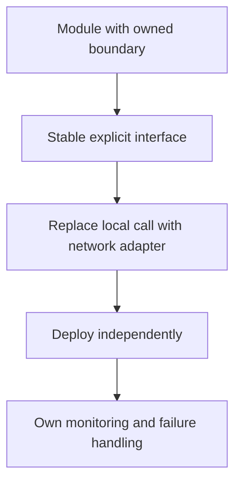

Splitting a monolith into services is often framed as a scalability question.
It's really a boundary-drawing question, and the code-organization benefit is
available at a fraction of the operational cost by drawing the boundary
inside one deployable instead of across a network.

> [!WHY] A team splits a module for cleaner code and then needs retries,
> schema compatibility and another on-call service. An organisational
> cleanup has created a recurring operational bill without an independent
> scaling requirement.

> [!GOALS]
>
> - Explain the cost of a network boundary
> - Choose whether a workload justifies extraction
> - Design a clean extraction path

## The modular monolith

```text
  ┌──────────────── one deployable ─────────────────┐
  │  ┌────────┐  ┌────────┐  ┌────────┐             │
  │  │ Module │  │ Module │  │ Module │             │
  │  │   A    │  │   B    │  │   C    │             │
  │  └───┬────┘  └───┬────┘  └───┬────┘             │
  │      │  in-process calls, same runtime │        │
  │      └──────────────┬──────────────────┘        │
  │                one database (or one per module)  │
  └────────────────────────────────────────────────┘
```

```text
  MyHub's own architecture is exactly this: modules
  communicate only through an Event Bus and never import each
  other's internals directly (CLAUDE.md's rule 1) — the
  BOUNDARY DISCIPLINE of microservices, without a network
  hop between every module.
```

```text
  → a modular monolith gets you the main benefit people reach
    for microservices FOR — enforced boundaries, independent
    reasoning about each module — while a function call stays
    a function call: no serialization, no network failure
    mode, no distributed transaction. this is not a
    stepping-stone architecture; it's frequently the right
    permanent answer.
```

## What a service boundary actually costs

```text
  every network hop between two things that used to be one
  function call turns into:

    ✗  a NEW FAILURE MODE (the network call can fail where a
       function call couldn't — timeouts, retries,
       partial failure now apply)
    ✗  a SERIALIZATION cost (backend.serialization) and a
       compatibility contract to maintain across independent
       deploys
    ✗  a DISTRIBUTED TRANSACTION problem for anything that
       used to be one local transaction (see
       backend.transactions → distributed.transactions)
    ✗  its own DEPLOYMENT, MONITORING, ON-CALL SURFACE —
       one more thing that can be down at 3am
```

```text
  → this bill is due on EVERY service split, regardless of
    how clean the resulting code looks. "cleaner code" is not
    sufficient justification on its own — the question is
    whether something else (independent scaling, independent
    deploy cadence, a genuinely separate team) is worth
    paying it for.
```

## When a real boundary is worth it

```text
  ✓  INDEPENDENT SCALING — one part's load profile is
     wildly different (a video transcoding service needs
     GPU workers; the rest of the app doesn't)
  ✓  INDEPENDENT DEPLOY CADENCE — a component genuinely
     needs to ship on its own schedule, decoupled from
     everything else's release train
  ✓  A GENUINELY SEPARATE TEAM — with its own on-call, its
     own roadmap, needing to move without coordinating every
     change with every other team
  ✓  a hard ISOLATION requirement (compliance, a different
     security boundary, a vendored/acquired component)
```

```text
  ✗  "it feels cleaner" — achievable inside a monolith via
     module boundaries, at none of the network cost
  ✗  "microservices are the modern way" — cargo-culting an
     architecture pattern without the problem it solves
  ✗  premature scaling for load that doesn't exist yet
```

## The database question

```text
  SHARED DATABASE, separate services
    → services can accidentally couple through the schema
      (one reads a table it doesn't own) just as easily as
      through code — the boundary discipline has to be
      enforced by convention, same as the monolith's rule 1,
      and is easier to violate silently once no import
      statement makes the coupling visible

  DATABASE PER SERVICE
    → real isolation, but "get customer + their recent
      orders" now needs TWO calls and either an API composition
      layer or a denormalized read model — see
      the Partitioning & Sharding chapter's
      cross-shard-query problem, which is the same shape
```

```text
  → a modular monolith with one database PER MODULE (not
    shared) gets most of database-per-service's isolation
    benefit without the network hop for reads that stay
    within a module.
```

## The extraction path

```text
  a module that outgrows the monolith is extracted, not
  rebuilt from scratch:

    1. the module already has a clean boundary (it does, if
       rule 1 was actually followed) and its own schema
    2. replace its IN-PROCESS calls with network calls behind
       the SAME interface
    3. deploy it separately

  → this is exactly why the boundary discipline matters even
    when nothing is being extracted TODAY: a monolith with
    tangled cross-module imports cannot be extracted cleanly
    later; one with enforced boundaries can, on demand, when
    (and only when) a real reason shows up.
```



> [!PITFALL] Cleaner file organisation does not by itself justify network
> failure modes and another deployment surface.

> [!INTERVIEW] State the independent scaling, deployment, ownership or
> isolation need that pays for extraction, and identify the boundary that
> makes it possible.

> [!CHECK] Is a modular monolith only a temporary step?
>
> No. Explicit boundaries inside one deployable can be the right permanent
> design.

> [!CHECK] Why can shared databases silently couple services?
>
> A service can depend on another owner’s tables without an import
> statement exposing the dependency.

> [!CHECK] What read complication can database-per-service introduce?
>
> Composing customer and order data may require multiple calls or a
> denormalised read model.

## What to take away

1. A modular monolith gets the main benefit people reach for microservices
   for — enforced boundaries — without paying for a network hop on every
   call; it's frequently the right permanent architecture, not a stepping
   stone.
2. Every service boundary costs a new failure mode, a serialization contract,
   a distributed-transaction problem, and its own deployment surface — due on
   every split regardless of code cleanliness.
3. Split into a real service for independent scaling, deploy cadence, team
   ownership, or an isolation requirement — not because it "feels cleaner" or
   is "the modern way".
4. A shared database across services can be coupled through the schema just
   as easily as through code, and it's easier to violate silently since no
   import statement makes it visible.
5. Enforced module boundaries inside a monolith are what make a later, real
   extraction clean — tangled cross-module imports make extraction painful
   whenever it eventually becomes necessary.

## Exercises

> [!EXERCISE recall] Which costs appear when an in-process boundary
> becomes a network boundary?
>
> **Solution:** Network failure and retry behaviour, serialization and
> compatibility, cross-service transaction coordination, and a separate
> deployment, monitoring and on-call surface. Clean code alone does not
> pay that bill.

> [!EXERCISE apply] A thumbnail module needs specialised GPU workers and
> independent scale; a small billing helper only has a confusing file
> layout. Choose which boundary may justify a service and which should
> first be improved inside the monolith.
>
> **Solution:** Independent hardware and load needs can justify extracting
> the thumbnail workload, with its operational costs explicitly accepted.
> Improve the billing helper’s module ownership and internal structure
> without adding a network hop merely for cleaner files. Different
> workload pressure, not identical code neatness, determines the split.

> [!EXERCISE stretch] A module now needs independent deployment but
> imports other modules’ internals and reads their tables. Recommend
> whether to replace its entry function with an HTTP call immediately.
>
> **Solution:** First restore explicit interfaces, ownership and schema
> boundaries, then replace in-process calls behind the same interface and
> deploy separately. A weaker answer wraps the tangled module in HTTP
> immediately: hidden cross-module imports and table dependencies remain
> and now couple nominally independent services through code or schema.
