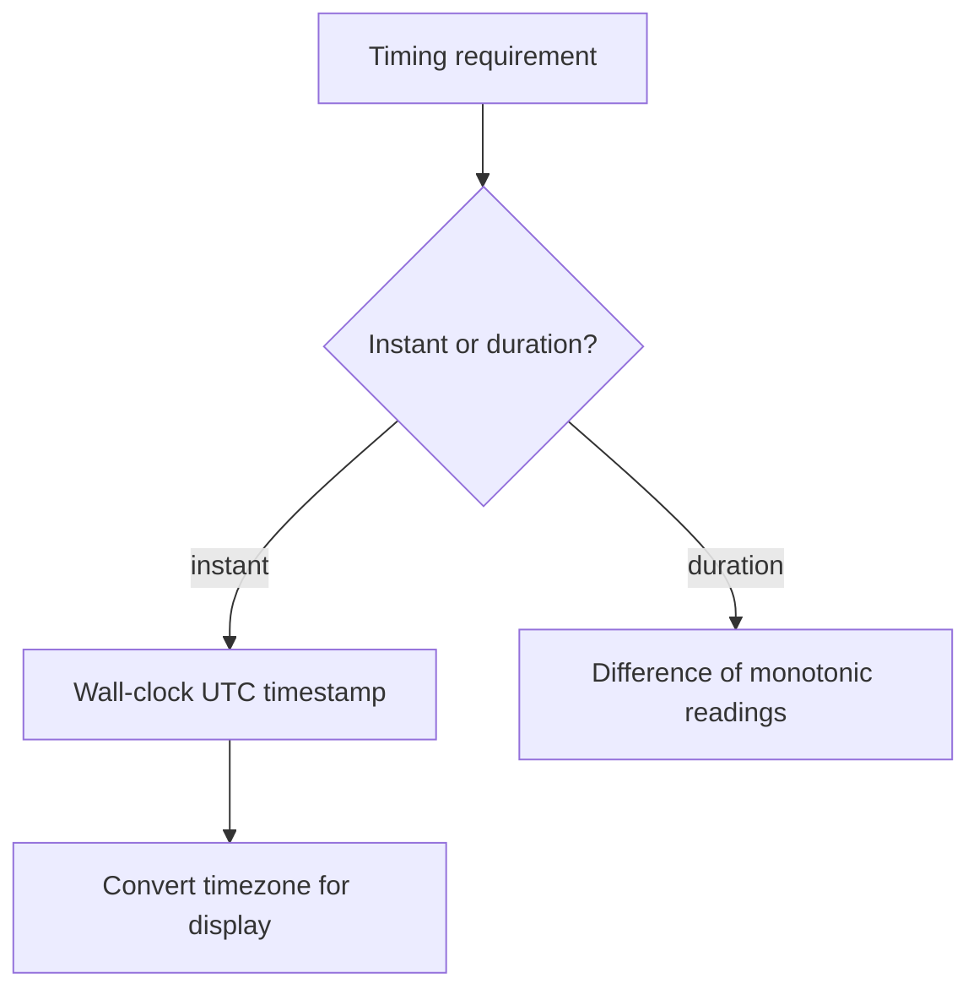

Timestamps and currency amounts appear in nearly every table in this schema,
and nearly every subtle correctness bug in a backend traces back to one of the
three trap categories below — not to an exotic algorithm, but to an assumption
about time or money that felt obviously true and wasn't.

> [!WHY] A bill split into rounded floating-point shares no longer adds up
> to the original total. An unstated remainder rule becomes a customer
> support dispute even though every individual share looks reasonable.

> [!GOALS]
>
> - Explain storage and display timezones
> - Compute exact shares with an explicit remainder rule
> - Choose a clock for duration measurement

## Timezones and DST

```text
  STORE:   UTC, always. a timestamp column with no timezone
           information is an incident waiting for a server
           to be deployed in a different region

  DISPLAY: convert to the viewer's timezone AT RENDER TIME,
           never at storage time
```

```text
  "3am doesn't exist" / "3am happens twice"

  spring forward:  2:59 AM → 4:00 AM  (2:xx never occurs)
  fall back:       1:59 AM → 1:00 AM  (1:xx occurs TWICE)

  → "schedule a job for 2:30 AM local time" is ambiguous or
    impossible twice a year, for any timezone that observes
    DST. a cron job pinned to local time either skips a day
    or double-fires.
```

```text
  → schedule recurring jobs in UTC, or in a timezone that
    does not observe DST, and treat "local time" as a
    DISPLAY concern only, resolved at the last possible
    moment.
```

## Monotonic vs wall clock

```text
  WALL CLOCK (Date.now(), System.currentTimeMillis())
    can jump — NTP correction, manual change, leap second
    smear — backwards or forwards

  MONOTONIC CLOCK (process.hrtime(), System.nanoTime())
    never goes backwards. only meaningful as a DIFFERENCE
    between two readings, never as an absolute time
```

```text
  measuring an operation's duration with the wall clock:

    const start = Date.now();
    await doWork();
    const elapsed = Date.now() - start;  // can be NEGATIVE
    // if NTP adjusted the clock mid-measurement

  → use a monotonic clock for elapsed-time measurement
    (timeouts, latency metrics, rate limiter windows); use
    wall clock only for "what time is it", never for "how
    long did that take".
```

This is also why the Time & Ordering chapter needs a
different tool (Lamport clocks, vector clocks) for ordering events across
machines — wall clocks on two different machines are not even guaranteed to
agree with each other, let alone stay monotonic.



## Leap seconds

```text
  occasionally, 23:59:60 exists. most systems "smear" it —
  spread the extra second across a window (e.g. noon-to-noon)
  so no timestamp ever shows :60 and no second repeats
  visibly.

  → almost never something you implement yourself; know that
    it is why "exactly 86400 seconds per day" is false, and
    why a library, not hand-rolled arithmetic, should own
    date math.
```

## Decimal money

```text
  0.1 + 0.2 === 0.30000000000000004    (IEEE 754 float)

  → NEVER store money as a float. two options:

    INTEGER CENTS      amount_cents: 1999   (= $19.99)
                        cheap, fast, the classic choice

    ARBITRARY-PRECISION DECIMAL   "19.99"  as a decimal type
                        needed once you have currencies with
                        non-2-decimal subunits (JPY has none;
                        some have 3) or fractional-cent
                        pricing (ad bidding, usage billing)
```

```text
  the rounding question doesn't go away — it moves to WHEN
  you round:

    split $10.00 three ways → $3.33 + $3.33 + $3.33 = $9.99

  → decide and document where the remaining cent goes (first
    share, last share, largest share) — a splitting function
    with no stated rounding rule will be inconsistent between
    implementations, and inconsistency in money code is a
    support ticket, not a rounding footnote.
```

```text
  currency is not optional metadata:

    amount: 1999, currency: "USD"

  arithmetic across currencies (adding a USD amount to a EUR
  amount) is not a bug in your code — it is a bug in the
  question being asked. convert explicitly, at a stated
  exchange rate and time, or refuse.
```

> [!PITFALL] A remainder policy is part of a money-splitting contract;
> rounding each share independently can change the total.

> [!INTERVIEW] State the time representation or currency unit, then the
> rounding or clock rule; apparently simple values still need explicit
> contracts.

> [!CHECK] Why is binary floating point a poor default for exact currency
> totals?
>
> Some decimal fractions are approximations, so integer subunits or an
> appropriate decimal representation avoids unintended rounding drift.

> [!CHECK] What must accompany a money amount before arithmetic?
>
> Its currency; different currencies require explicit conversion at a
> stated rate and time or rejection.

> [!CHECK] Why should date arithmetic belong to a library?
>
> DST and leap-second behaviour make fixed assumptions such as every day
> having exactly 86400 seconds unreliable.

## What to take away

1. Store every timestamp in UTC; convert to a viewer's local time only at
   render time, never at storage time.
2. Local-time scheduling is ambiguous or impossible around a DST transition —
   schedule recurring jobs in UTC.
3. Use a monotonic clock for measuring elapsed time; the wall clock can jump
   and produce a negative duration.
4. Never store money as a float — integer cents or an arbitrary-precision
   decimal type, chosen by whether the currency has fractional-cent
   requirements.
5. A rounding remainder in a money split needs a stated, documented rule
   (first/last/largest share) — an unstated one is inconsistent by
   construction.

## Exercises

> [!EXERCISE recall] Why store an instant in UTC and convert it only for
> display?
>
> **Solution:** Storage should represent one unambiguous instant
> independent of server or viewer location. Display conversion belongs to
> the viewer’s timezone at render time; storing already-localised values
> makes interpretation depend on an implicit region.

> [!EXERCISE apply] Split USD 17.00 across six shares using integer cents,
> allocating remainder cents to the earliest shares. Compute every share
> and verify the sum.
>
> **Solution:** 17.00 dollars is 1700 cents. Integer division gives 283
> cents each because 6 × 283 = 1698, leaving 2 cents. Give one extra cent
> to each of the first two shares: [284, 284, 283, 283, 283, 283]. The sum
> is 568 + 1132 = 1700 cents, exactly USD 17.00; the documented rule makes
> independent implementations agree.

> [!EXERCISE stretch] A latency metric subtracts wall-clock timestamps and
> sometimes becomes negative after clock correction. Recommend a
> measurement design without changing event timestamp storage.
>
> **Solution:** Use the difference between monotonic clock readings for
> elapsed duration, while retaining wall-clock UTC instants for event
> timestamps. A weaker answer clamps negative durations to zero: it hides
> jumps but still mismeasures operations when the clock moves. A monotonic
> duration is not an absolute cross-machine timestamp.
