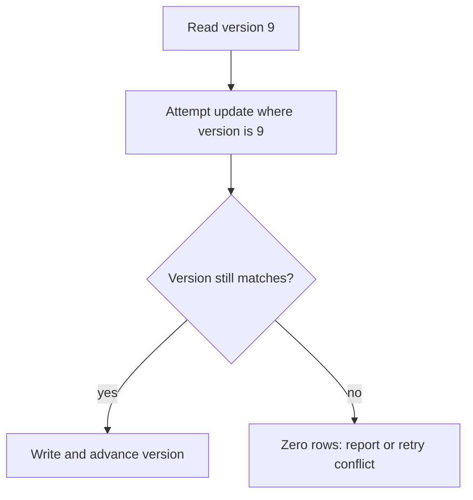

A transaction is a promise that a group of operations happens as one unit or
not at all. The interesting engineering is not the promise itself — it's that
the promise is expensive to keep fully, so every database offers weaker,
faster versions of it, and picking one means knowing exactly what you're
giving up.

> [!WHY] Two editors read the same row version and save different updates.
> Without a version condition, the later write can overwrite work neither
> editor intended to discard.

> [!GOALS]
>
> - Explain isolation anomalies
> - Trace an optimistic version check
> - Choose a lock strategy for contention

## ACID, as a checklist

```text
  ATOMICITY     all of a transaction's writes happen, or none
  CONSISTENCY   a transaction moves the database between
                valid states (this is mostly on YOUR schema's
                constraints, not the database's mechanism)
  ISOLATION     concurrent transactions don't see each
                other's uncommitted work — how MUCH isolation
                is the tunable part
  DURABILITY    once committed, survives a crash
```

## Isolation levels and the anomalies each permits

```text
  READ UNCOMMITTED   dirty reads possible
  READ COMMITTED     dirty reads prevented
  REPEATABLE READ     + non-repeatable reads prevented
  SERIALIZABLE         + phantom reads prevented
```

```text
  DIRTY READ           read another transaction's UNCOMMITTED
                        write — which might still roll back

  NON-REPEATABLE READ   read the same row twice in one
                        transaction, get different values —
                        another transaction committed a
                        change in between

  PHANTOM READ          re-run the same WHERE query, get a
                        DIFFERENT SET OF ROWS — another
                        transaction inserted or deleted a
                        matching row
```

```text
  → PostgreSQL's default is READ COMMITTED — not
    SERIALIZABLE. most application code runs at a weaker
    isolation level than "no anomalies possible" without
    anyone deciding that explicitly, because it's the
    default.
```

```text
  the concrete bug READ COMMITTED still allows:

    t1: SELECT balance FROM accounts WHERE id=1;  -- 100
    t2: UPDATE ... SET balance=50; COMMIT;
    t1: SELECT balance FROM accounts WHERE id=1;  -- 50 (!)
    t1: -- same transaction, same row, different answer

  → a report that reads a value twice and expects it to
    match needs REPEATABLE READ or higher, explicitly.
```

## Pessimistic vs optimistic concurrency

```text
  PESSIMISTIC   SELECT ... FOR UPDATE
                lock the row now, hold it until commit
                → correct under heavy contention, but a slow
                  transaction holding the lock blocks everyone
                  else waiting on that row

  OPTIMISTIC    read a version number, write back
                WHERE version = <the one you read>
                → no lock held; if the version moved, the
                  UPDATE affects 0 rows — the caller detects
                  the conflict and retries or fails
```

```text
  → optimistic where conflicts are RARE (most rows, most of
    the time) — the common case pays no locking cost.
    pessimistic where conflicts are FREQUENT and a caller
    would just retry into the same conflict repeatedly (a
    hot inventory counter under a flash sale).
```

This optimistic pattern is exactly what HTTP's `If-Match` conditional request
does at the API layer (the HTTP & the Web Platform chapter) — a version
or ETag read on GET, sent back on the write, rejected with 412 if it moved.
Same idea, two layers.



## Deadlocks

```text
  t1: locks row A, then wants row B
  t2: locks row B, then wants row A
  → neither can proceed. the database detects the CYCLE and
    kills one transaction (returning an error the caller must
    retry), rather than waiting forever.
```

```text
  → the practical defense is not detection (the database
    already does that) — it's LOCK ORDERING: if every
    transaction that touches both A and B always locks A
    before B, the cycle above cannot form. document and
    follow a consistent lock order for any code path that
    locks more than one row.
```

## Distributed transactions, briefly

```text
  TWO-PHASE COMMIT (2PC)
    prepare: every participant says "ready to commit"
    commit:  coordinator tells everyone to commit

  → a real protocol, but the coordinator is a single point of
    failure: if it crashes between prepare and commit,
    participants are stuck holding locks, uncertain, until it
    recovers.
```

```text
  → most systems avoid 2PC for cross-service work entirely,
    preferring an eventually-consistent SAGA (a sequence of
    local transactions with compensating actions) instead —
    covered in full in
    the Distributed Transactions chapter,
    which this chapter's single-database version sets up.
```

> [!PITFALL] Retrying a stale write without preserving its version check
> discards the concurrency protection.

> [!INTERVIEW] Name the anomaly and conflict rate, then justify locking or
> optimism and state how the caller handles a rejected write.

> [!CHECK] What does durability promise after commit?
>
> Committed data survives a crash under the database’s durability
> contract.

> [!CHECK] What can READ COMMITTED still allow in this chapter’s example?
>
> A second read of the same row sees a newer committed value, a
> non-repeatable read.

> [!CHECK] What happens if a 2PC coordinator fails between prepare and
> commit?
>
> Participants can remain uncertain and hold locks until the coordinator
> recovers, motivating other cross-service designs.

## What to take away

1. ACID's isolation guarantee is a spectrum, not a switch — READ COMMITTED
   (Postgres's default) still permits non-repeatable reads, and nobody
   decided that on purpose unless they set the level explicitly.
2. Know the three anomalies by name — dirty read, non-repeatable read,
   phantom read — and which isolation level rules each one out.
3. Optimistic concurrency (a version check on write) beats pessimistic
   locking when conflicts are rare; pessimistic locking wins when they're
   frequent enough that optimistic retries would just collide again.
4. Deadlocks are handled by detection, but prevented by a consistent lock
   ordering across every code path that locks more than one row.
5. Two-phase commit has a single-point-of-failure coordinator, which is why
   cross-service transactions usually reach for a saga instead.

## Exercises

> [!EXERCISE recall] Distinguish dirty, non-repeatable and phantom reads.
>
> **Solution:** A dirty read observes uncommitted data that may roll back.
> A non-repeatable read gets different committed values for the same row
> in one transaction. A phantom read gets a changed set of matching rows
> from repeating a predicate query.

> [!EXERCISE apply] A row is version 9 when clients A and B read it. A
> updates WHERE version=9 and advances it to 10. B then updates WHERE
> version=9. Trace affected-row counts and choose B’s recovery rather than
> overwriting unconditionally.
>
> **Solution:** A matches the current version and updates one row to
> version 10. B’s condition no longer matches, so it affects zero rows and
> must report a conflict or reread and retry deliberately. Removing the
> version condition would silently overwrite a value based on an obsolete
> read. HTTP If-Match expresses the same conditional-write idea at the API
> boundary.

> [!EXERCISE stretch] A hot inventory row causes frequent optimistic
> conflicts, and some transactions lock related rows in opposite orders.
> Recommend a strategy for both problems.
>
> **Solution:** Use pessimistic locking where high contention makes
> repeated optimistic attempts collide, keep the transaction bounded, and
> require the same row lock order across paths. A weaker answer leaves
> opposite lock ordering and only retries more aggressively: it preserves
> the deadlock cycle and adds contention. Low-conflict rows can still use
> optimistic checks rather than locking everything.
