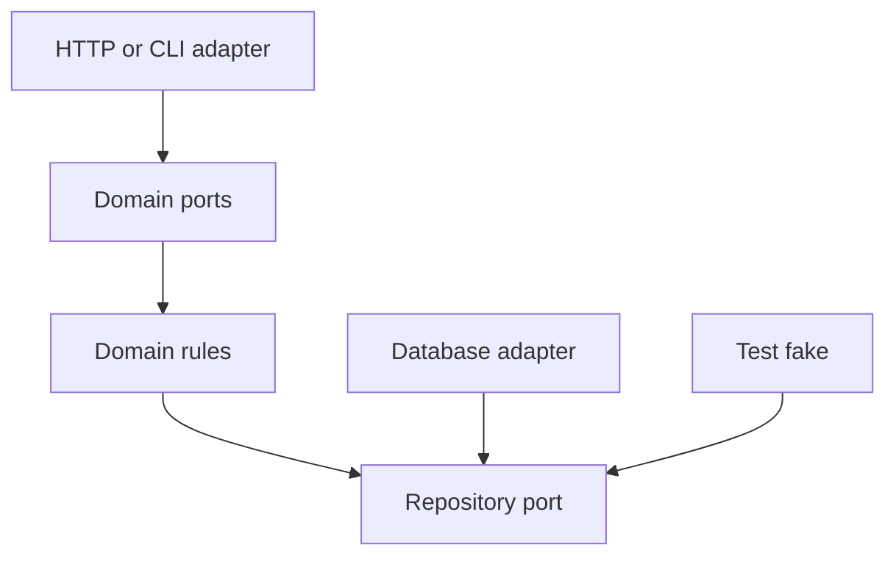

Architecture styles exist to answer one question at scale: when a codebase
gets big enough that no one holds it all in their head, what structure keeps
a change in one place from requiring understanding of everywhere else? Each
style answers that differently, and the right one depends on which kind of
change the system needs to make cheap.

> [!WHY] A controller embeds a query that later appears in several other
> endpoints. A schema change now requires finding scattered copies, so the
> location of the boundary directly increases maintenance cost.

> [!GOALS]
>
> - Explain ports and adapters
> - Choose architecture at two different scales
> - Separate models by bounded context

## Layered architecture

```text
  ┌─────────────────────┐
  │   PRESENTATION       │  UI, API controllers
  ├─────────────────────┤
  │   BUSINESS LOGIC      │  rules, calculations, workflows
  ├─────────────────────┤
  │   DATA ACCESS          │  repositories, queries
  └─────────────────────┘

  RULE: a layer may only depend on the layer BELOW it —
  presentation calls business logic, business logic calls
  data access, never the reverse, never skipping a layer.
```

```text
  → the failure mode this rule exists to prevent: a controller
    building SQL directly (skipping the layers meant to own
    that), which means a query's logic is now scattered across
    every controller that happens to need similar data, instead
    of living in one place.

  → the failure mode when overused: a trivial CRUD operation
    forced through three layers of pass-through code that adds
    nothing — for genuinely simple operations, the ceremony can
    cost more than the boundary buys.
```

## Hexagonal (ports and adapters)

```text
  the layered model still implicitly treats the DATABASE as
  central — everything ultimately depends downward toward it.
  hexagonal architecture inverts this: the DOMAIN is the
  center, and everything external (database, HTTP, a message
  queue) is a plugin at the edge.

         [HTTP adapter]     [CLI adapter]
                \\              //
                 \\            //
              ┌───────────────────┐
              │   DOMAIN (PORTS)   │   ← the core, knows
              │                    │      nothing about HTTP,
              └───────────────────┘      SQL, or any specific
                 //            \\        technology
                //              \\
      [Postgres adapter]   [Test fake adapter]
```

```text
  → the domain defines PORTS (interfaces — "a PaymentGateway port," "an
    OrderRepository port") and never imports a concrete implementation;
    ADAPTERS on the outside implement those ports for a specific technology.
    this is Dependency Inversion, from the OOP chapter, applied as a
    whole-application architecture rather than one class's dependency.

  → the payoff: the domain can be tested with a TEST ADAPTER
    (an in-memory fake) with ZERO real infrastructure, and
    swapping Postgres for a different database means writing
    a new adapter — the domain code doesn't change at all.
```



## Modular monolith

```text
  neither "layers within one codebase" nor "ports around one
  domain" — instead, the codebase is split into MODULES, each
  a self-contained vertical slice (its own logic, its own data
  access, sometimes its own layered/hexagonal internals),
  communicating with other modules only through an explicit
  boundary.

    Module: Orders          Module: Inventory
    ┌──────────────┐        ┌──────────────┐
    │ logic + data  │◄──────►│ logic + data │
    │ access, owned  │ event  │ access, owned│
    │ by this module │  bus   │ by this      │
    └──────────────┘        │ module        │
                             └──────────────┘
```

```text
  → this is this project's OWN architecture (CLAUDE.md's rule
    1 and the Backend track's Services and Modular Monoliths
    chapter): modules never import each other's internals,
    only communicate through an Event Bus — the boundary
    discipline of microservices, without the network hop.
```

## Domain-Driven Design's contribution

```text
  DDD's most widely useful idea, independent of adopting its
  full methodology: a BOUNDED CONTEXT — the same word can mean
  different things in different parts of a system, and forcing
  one shared model everywhere is itself a design mistake.

    "Customer" in the Sales context: name, deal history,
      lead score
    "Customer" in the Billing context: name, payment method,
      invoice history

  → these don't need to be the SAME class/table just because
    they share a name — modeling them as related-but-distinct
    concepts per context, connected by an explicit translation
    at the boundary, avoids a single bloated "Customer" model
    trying to serve every team's unrelated needs at once.
```

## Choosing

```text
  LAYERED               a straightforward CRUD-heavy app,
                         small team, the database genuinely IS
                         central to what the app does
  HEXAGONAL              the domain logic is complex and
                         valuable enough to test in complete
                         isolation from infrastructure, or
                         infrastructure is likely to change
                         (multiple database backends, a
                         planned migration)
  MODULAR MONOLITH        multiple distinct business domains
                          in one deployable, each cohesive
                          enough to reason about separately —
                          this project's own shape
```

```text
  → these aren't mutually exclusive — a modular monolith's
    individual modules can each be internally layered OR
    hexagonal; the styles operate at different SCALES (the
    whole app vs. one module) and commonly compose.
```

> [!PITFALL] A shared noun does not require a shared model across
> unrelated business contexts.

> [!INTERVIEW] Name the change you want to make cheap, then distinguish
> module boundaries from the layered or hexagonal structure inside a
> module.

> [!CHECK] What does skipping data-access boundaries in a controller
> encourage?
>
> Query logic spreads across callers instead of living in its owning
> layer.

> [!CHECK] What network cost does a modular monolith avoid?
>
> Modules communicate inside one deployable rather than through a service
> network hop.

> [!CHECK] When can layered ceremony outweigh its benefit?
>
> A trivial CRUD action may pass through layers that add no meaningful
> policy.

## What to take away

1. Layered architecture's rule (depend only downward) exists to keep query
   logic from scattering across every caller that needs similar data — but
   forcing trivial CRUD through three layers of pass-through can cost more
   than the boundary buys.
2. Hexagonal architecture puts the domain at the center and infrastructure
   at the edge as swappable adapters — the same Dependency Inversion idea
   from OOP design, applied at the whole-application scale.
3. A modular monolith splits by business domain into vertical-slice modules
   communicating only through an explicit boundary — this project's own
   architecture, and the boundary discipline of microservices without the
   network hop.
4. DDD's bounded context says the same word can mean different things in
   different parts of a system — forcing one shared model everywhere is
   itself a design mistake.
5. These styles operate at different scales and commonly compose — a modular
   monolith's individual modules can each be internally layered or hexagonal.

## Exercises

> [!EXERCISE recall] What does the domain know about a port versus its
> concrete adapter?
>
> **Solution:** The domain defines and depends on the port interface, not
> the concrete database, HTTP or queue implementation. An outside adapter
> implements the port and can be replaced or faked.

> [!EXERCISE apply] A single deployable contains subscriptions and
> fulfilment; fulfilment rules need tests without a real database, while
> subscriptions is mostly simple CRUD. Choose an overall structure and
> internal styles without imposing the same ceremony everywhere.
>
> **Solution:** Use a modular monolith for the separate business-domain
> slices and explicit inter-module boundaries. Give fulfilment ports and
> adapters so a fake can test its valuable rules in isolation. A simpler
> layered organisation can suit subscriptions. The whole-app boundary and
> each module’s internal style operate at different scales and can
> compose.

> [!EXERCISE stretch] Sales and billing both use the word Customer but
> need different histories. Recommend whether they must share one class
> containing every field.
>
> **Solution:** Keep distinct bounded-context models with explicit
> translation at the boundary. A weaker answer forces one shared Customer
> class because the name matches: unrelated sales and billing needs then
> accumulate in a bloated shared model.
