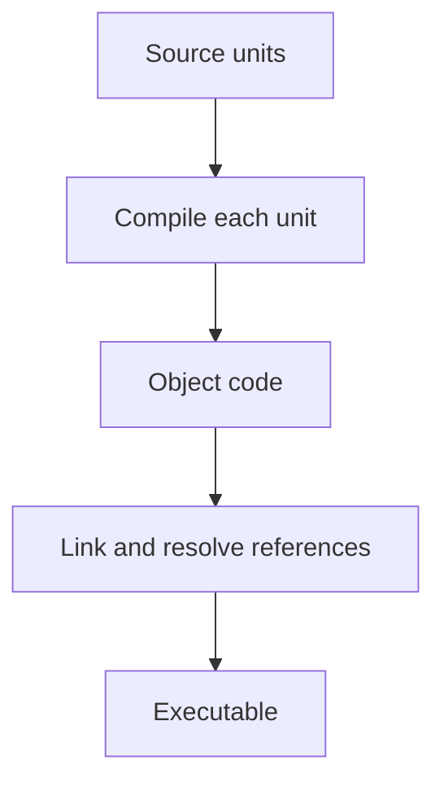

A build system's job is turning source into something runnable, the same way
every time, on every machine. Most of the confusing failures in this space —
"works locally, breaks in CI," a dependency update that silently breaks
production — trace back to one of a small number of guarantees this
machinery either provides or quietly doesn't.

> [!WHY] CI installs a newer transitive dependency than the developer
> tested and fails before the application starts. A version range without
> a pinned dependency tree makes yesterday’s successful installation poor
> evidence for today’s build.

> [!GOALS]
>
> - Explain dependency pinning versus semver
> - Choose accepted dependency versions
> - Design a reproducibility investigation

## Compilation and linking, briefly

```text
  SOURCE → COMPILE → OBJECT CODE → LINK → EXECUTABLE

  COMPILE   translates source into machine code (or bytecode),
            one file/module at a time — catches SYNTAX and
            TYPE errors

  LINK      combines compiled units and resolves references
            between them — catches "this function is called
            but never defined anywhere," which compiling a
            single file in isolation cannot see
```

```text
  → a language like TypeScript/JavaScript skips this two-step
    entirely at runtime (no separate link step — a bad import
    fails when that code path actually RUNS, not before) —
    which is part of why static analysis and a build step that
    actually type-checks everything matter more, not less, in
    the absence of a compiler catching it up front.
```



## Package managers and the dependency graph

```text
  your project depends on A and B; A depends on C@1.0; B
  depends on C@2.0 — which C does your code actually get?

  → package managers resolve this differently: npm/yarn
    historically NEST (each package can have its own C
    version, at the cost of duplication); some ecosystems
    FLATTEN and require compatible versions, refusing to
    resolve if they genuinely conflict.
```

```text
  → this is why "it works when I install fresh but breaks for
    a teammate" happens: without a lockfile, "install the
    dependencies in package.json" can resolve a DIFFERENT
    concrete version tree today than it did yesterday, if any
    dependency published a new version in between.
```

## Lockfiles

```text
  package.json        "react": "^18.2.0"     — a RANGE
  package-lock.json    "react": "18.2.4", resolved: "...",
                        integrity: "sha512-..."  — an EXACT
                        version, pinned, with a hash

  → the lockfile is what makes `npm install` DETERMINISTIC —
    the same lockfile produces the identical dependency tree
    on any machine, at any later date, even after newer
    versions of every dependency have been published since.
```

```text
  → commit the lockfile. "just install whatever package.json
    resolves to" is precisely the non-determinism that causes
    it to work in one environment and fail in another — CI
    should install FROM the lockfile (npm ci, not npm install)
    specifically to fail loudly if the lockfile and
    package.json have drifted apart, rather than silently
    re-resolving.
```

## Semver, and what it actually promises

```text
  MAJOR.MINOR.PATCH     e.g. 18.2.4

  PATCH   bug fixes, no API change           — safe to accept
                                                automatically
  MINOR   new functionality, BACKWARD          usually safe,
          COMPATIBLE                          worth a skim
  MAJOR   breaking change                     needs a real
                                                review
```

```text
  ^18.2.0   accepts anything up to (but not including) 19.0.0
  ~18.2.0   accepts anything up to (but not including) 18.3.0
  18.2.0    exact version only
```

```text
  → semver is a PROMISE, not a guarantee enforced by anything
    — a maintainer can publish a breaking change under a minor
    or patch bump by mistake (or by disagreeing about what
    counts as "breaking"). a lockfile protects you from an
    UNINTENDED automatic upgrade; it doesn't protect you from a
    maintainer's semver mistake the one time you DO update.
```

## Reproducible builds

```text
  the property beyond "the same dependencies get installed":
  building the SAME source with the SAME dependencies produces
  BIT-IDENTICAL output, regardless of when or where the build
  runs.

  → the usual things that break this without anyone intending
    it: embedding a BUILD TIMESTAMP in the output, iterating
    over an object whose KEY ORDER isn't guaranteed identical
    across runs, or depending on the SYSTEM'S LOCALE/timezone
    during the build.
```

```text
  → reproducibility matters for more than tidiness: it's what
    lets you verify a published artifact was actually built
    from the source it claims to be, rather than trusting the
    build pipeline blindly — a supply-chain security property,
    not just a convenience.
```

> [!PITFALL] A patch or minor version label is a promise that can be
> mistaken; intentional dependency updates still require verification.

> [!INTERVIEW] Distinguish an exact dependency tree from a reproducible
> artifact, and identify the environmental inputs before claiming the
> build is deterministic.

> [!CHECK] What error can linking catch beyond per-file compilation?
>
> A called function may have no definition in the combined compiled units.

> [!CHECK] Why can A and B carry different versions of C?
>
> A nesting package manager can install a separate transitive C beneath
> each dependency.

> [!CHECK] Why does reproducible output matter beyond convenience?
>
> It helps verify a published artifact corresponds to its claimed source,
> a supply-chain property.

## What to take away

1. Compilation catches errors within one file; linking catches errors between
   files — a language without a separate link step defers that class of
   error to runtime, which is why static analysis matters more without a
   compiler doing it upfront.
2. Without a lockfile, "install the dependencies" can resolve a different
   concrete version tree on different days — the lockfile is what makes an
   install deterministic.
3. Commit the lockfile, and have CI install from it (`npm ci`) rather than
   re-resolving, so a drifted lockfile fails loudly instead of silently.
4. Semver is a promise a maintainer can break by mistake — a lockfile
   protects against an unintended automatic upgrade, not against a
   maintainer's own semver error the one time you do update.
5. A reproducible build (bit-identical output from the same source) is a
   supply-chain security property, not just tidiness — build timestamps and
   unordered iteration are the usual things that quietly break it.

## Exercises

> [!EXERCISE recall] How do semver and a lockfile protect against
> different problems?
>
> **Solution:** Semver communicates a maintainer’s compatibility promise
> through version numbers. A lockfile records exact resolved versions and
> integrity values, preventing unintended re-resolution. It does not make
> an intentional update safe if the maintainer mislabeled a breaking
> change.

> [!EXERCISE apply] A package requires ^4.3.0; another configuration uses
> ~4.3.0. For candidates 4.3.7, 4.4.0 and 5.0.0, decide which ranges
> permit each and choose a CI installation mode when the manifest and
> lockfile disagree.
>
> **Solution:** ^4.3.0 permits 4.3.7 and 4.4.0 but excludes 5.0.0. ~4.3.0
> permits 4.3.7 but excludes 4.4.0 and 5.0.0. Install with npm ci so
> manifest-lockfile disagreement fails loudly rather than silently
> resolving another tree.

> [!EXERCISE stretch] Identical source and locked dependencies yield
> different artifact bytes each day. Recommend the next investigation
> instead of repeatedly pinning versions.
>
> **Solution:** Inspect embedded build timestamps, iteration order and the
> build’s locale or timezone. Dependency determinism is necessary but does
> not establish bit-identical output. A weaker answer regenerates the
> lockfile every run: it neither removes these environmental inputs nor
> preserves a fixed dependency tree.
