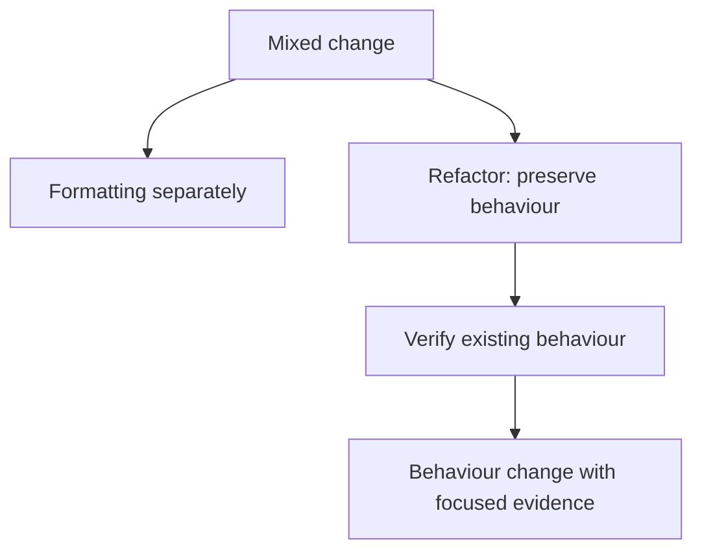

A code review is not a formality that happens to a diff — it's the closest
thing most teams have to real-time knowledge transfer and a second set of
eyes on a decision before it's permanent. This chapter is doing it well from
both sides: as the reviewer, and as the person whose diff is under review.

> [!WHY] A large pull request mixes moving code with changing its
> behaviour and formatting unrelated files. The reviewer must reconstruct
> three kinds of change at once, increasing delay and the chance a
> regression reaches users.

> [!GOALS]
>
> - Explain the three purposes of review
> - Split a mixed diff into reviewable changes
> - Resolve a disagreement with evidence

## What a review is actually checking

```text
  CORRECTNESS    does this do what it claims? are there edge
                 cases the tests don't cover? does it introduce
                 a regression?

  DESIGN         is this the right SHAPE for the change — the
                 right abstraction, the right boundary, in the
                 right file — not just "does it work"

  MAINTAINABILITY  will the next person who touches this
                   understand why it's built this way?
```

```text
  → these are different questions, and a review that only
    checks "does it run" is skipping the two that catch the
    expensive mistakes — a correctly-working change in the
    wrong place still costs the team later.
```

## Writing a reviewable diff

```text
  a 2,000-line PR mixing a refactor, a new feature, and a drive-by
  formatting fix gets one of two outcomes: a rubber-stamp approval nobody
  actually verified, or days of review latency while a reviewer tries to
  hold all three changes' context at once.
```

```text
  → SMALL, FOCUSED diffs — one logical change per PR — are
    reviewable in the time an actual human has for review, and
    a bug found in a 50-line diff is findable; a bug found in
    2,000 lines is usually found in production instead.

  → separate REFACTORING from BEHAVIOR CHANGE into different
    commits/PRs where practical — "I moved this AND changed
    what it does" forces a reviewer to hold both apart mentally
    on every line, when the diff itself could have kept them
    apart.
```

```text
  → a PR DESCRIPTION explaining the WHY (not just re-describing
    the diff) does for a reviewer what a commit message does
    for git blame — the reviewer's first question is usually
    "why is this needed," and a description that answers it
    upfront saves a full round trip of clarifying questions.
```



## Reviewing for design, not just style

```text
  a review that only leaves comments like "add a semicolon" or
  "this should be camelCase" is doing the part a LINTER should
  already be automating — the human review's marginal value is
  in the questions a linter cannot ask:

    "why is this logic in the controller instead of the
     service layer?"
    "this duplicates what X already does — reuse it?"
    "what happens if this list is empty?"
```

```text
  → automate style/formatting enforcement (a linter, a
    formatter) so human review time goes entirely to
    correctness and design — a review thread arguing about
    tabs vs spaces is a process gap, not a productive
    disagreement.
```

## Disagreeing productively

```text
  "This is wrong."                    ✗ states a conclusion,
                                          no reasoning, invites
                                          defensiveness

  "This will throw if `items` is
  empty — is that reachable from
  the checkout flow?"                  ✓ states the CONCERN,
                                           the REASONING, and
                                           asks rather than
                                           asserts
```

```text
  → phrase a concern as a QUESTION grounded in a specific
    scenario, not a verdict — it invites the author to either
    explain context the reviewer is missing, or recognize the
    issue themselves, both of which land better than being
    told they're simply wrong.
```

```text
  when a disagreement doesn't resolve after genuine back-and-forth: escalate
  to a quick synchronous conversation rather than a lengthening comment
  thread — written back-and-forth loses tone and takes longer to reach a
  shared understanding than five minutes of talking, and a long unresolved
  thread blocks the PR for everyone watching it.
```

## What a reviewer owes the author

```text
  → review PROMPTLY — a PR sitting unreviewed for days blocks
    the author's other work and encourages large, batched PRs
    to minimize how often they wait

  → approve what's GOOD along with flagging what isn't — a
    review that's only criticism, with no acknowledgment of
    what's solid, reads as harsher than intended and doesn't
    reflect what actually happened in most diffs
```

> [!PITFALL] A working change in the wrong boundary still creates design
> cost; “it runs” is not the whole review.

> [!INTERVIEW] Ground a review concern in a reachable input and its
> consequence, and state which observation would resolve the disagreement.

> [!CHECK] Who should enforce semicolons and formatting?
>
> Automated linting and formatting, freeing review attention for
> correctness and design.

> [!CHECK] Why does prompt review encourage smaller diffs?
>
> Authors need not batch changes to reduce repeated waits for review.

> [!CHECK] What should a PR description explain that the diff cannot?
>
> Why the change is necessary and the reasoning behind it.

## What to take away

1. A review checks correctness, design, and maintainability — three
   different questions, and skipping the last two lets the expensive
   mistakes (wrong shape, wrong place) through even when the code runs.
2. Small, focused diffs are reviewable in the time a human actually has;
   separating refactoring from behavior change keeps a reviewer from holding
   two kinds of change apart on every line.
3. A linter should own style and formatting comments entirely, so human
   review time goes to the questions only a human can ask.
4. Phrase a concern as a question grounded in a specific scenario rather than
   a verdict — it invites explanation or self-correction instead of
   defensiveness.
5. Escalate a genuinely unresolved disagreement to a quick synchronous
   conversation rather than letting a comment thread lengthen — and review
   promptly, since an author blocked on review tends toward larger, less
   reviewable PRs to minimize how often they wait.

## Exercises

> [!EXERCISE recall] How do correctness, design and maintainability ask
> different review questions?
>
> **Solution:** Correctness asks whether behaviour and edge cases are
> right. Design asks whether the change belongs in the right abstraction
> and boundary. Maintainability asks whether the next reader can
> understand why it was built that way.

> [!EXERCISE apply] A patch moves invoice calculation to another module,
> changes rounding and reformats several controllers. Choose a review
> sequence and describe what each diff should establish.
>
> **Solution:** Separate the formatting, the behaviour-preserving move and
> the rounding change. Review the move for unchanged observable behaviour
> and ownership; review rounding independently against its intended rule
> and edge tests. Describe why the rounding change is needed so it can be
> assessed without mentally subtracting the move and formatting.

> [!EXERCISE stretch] A thread disputes whether an empty result is
> reachable and has repeated the same positions. Recommend the next
> exchange and escalation.
>
> **Solution:** Ask a concrete question about the caller path and the
> empty-input consequence, using evidence rather than a verdict. If
> genuine back-and-forth remains unresolved, have a brief synchronous
> conversation and record the conclusion. A weaker answer keeps posting
> “this is wrong”: repetition neither supplies the missing scenario nor
> unblocks the review.
