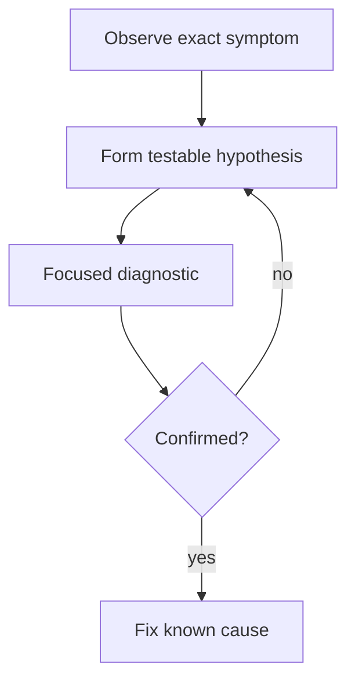

Debugging done badly looks like changing code at random and re-running to see
if the symptom goes away. Debugging done well is closer to a scientific
method: form a specific, falsifiable hypothesis about the cause, find the
fastest way to test it, and let the result actually change what you believe.

> [!WHY] A crash surfaces while reading an id, and a patch simply
> suppresses that access. If the invalid value originated earlier in the
> call chain, the patch can hide the symptom while leaving corrupted input
> flowing through the system.

> [!GOALS]
>
> - Explain evidence-driven debugging
> - Design a falsifiable diagnostic
> - Choose a profiling target from observed cost

## The hypothesis loop

```text
  1. OBSERVE     the actual symptom, precisely — not "it's
                 broken," but "calling X with input Y returns
                 Z instead of the expected W"

  2. HYPOTHESIZE  a SPECIFIC, testable explanation — "I think
                 the cache is returning a stale value because
                 the invalidation on write is missing"

  3. TEST         the FASTEST way to confirm or rule OUT the
                 hypothesis — often: add one log line or one
                 breakpoint at the exact point that would prove
                 or disprove it, not a broad rewrite

  4. UPDATE       if confirmed, you've found it; if not, the
                 FAILED hypothesis is still information — it
                 rules out one explanation and narrows the next
```

```text
  → "randomly try things" fails because a fix that happens to
    make the symptom go away without a confirmed cause often
    isn't actually the fix — the underlying bug can resurface
    under a slightly different input, having never been
    understood in the first place.
```



## Reading a stack trace

```text
  TypeError: Cannot read properties of undefined (reading 'id')
      at getUserName (user.js:42)
      at renderProfile (profile.js:18)
      at App (app.js:7)
```

```text
  → read TOP DOWN: the top frame is WHERE it broke (user.js:42
    — accessing `.id` on something undefined); the frames below
    are the CALL PATH that got there. the top frame tells you
    WHERE; the frames below tell you WHY something undefined
    arrived there in the first place — both matter, for
    different questions.
```

```text
  → the actual bug is often NOT at the top frame — the top
    frame is where the crash SURFACED (a null flows through
    three functions before something finally dereferences it),
    not necessarily where the null was WRONGLY produced. the
    call path below is where to look for the actual origin.
```

## Binary search over the problem space

```text
  the same principle as the Git and Version Control chapter's
  bisect, applied more generally: for ANY search over a large
  space of possible causes, cutting the space in half each
  time beats checking sequentially.

    a 10,000-row dataset causes a crash somewhere → binary
    search which HALF of the rows triggers it, not row-by-row

    a page renders wrong → comment out half the components,
    see if the bug persists, narrow to the remaining half
```

```text
  → this generalizes past git: any "which of N things is
    responsible" question is a binary search candidate, and
    most people default to linear scanning out of habit rather
    than recognizing the shape.
```

## Debuggers vs print statements

```text
  PRINT/LOG STATEMENTS    fast to add, works everywhere
                          (including production, with proper
                          log levels), but you have to GUESS
                          in advance what's worth printing

  A REAL DEBUGGER          set a breakpoint, inspect the ENTIRE
                          live state at that exact moment — no
                          need to have guessed what mattered
                          beforehand, at the cost of a slower
                          setup and (for some environments) not
                          being available at all in production
```

```text
  → neither is universally better — a debugger wins when you
    genuinely don't know what to look for yet; a log statement
    wins for a problem that only reproduces in production, or
    intermittently, where attaching a debugger isn't practical.
```

## Profiling and flamegraphs

```text
  a FLAMEGRAPH visualizes where TIME actually goes:

    main()               [========================] 100%
      handleRequest()    [==================]        75%
        queryDatabase()  [==============]             55%
        renderTemplate() [====]                       15%

  → WIDTH is time spent (including callees); reading it tells
    you queryDatabase() is the actual cost, not a guess based
    on which code LOOKS expensive to read.
```

```text
  → optimize what PROFILING shows costs the most, not what
    intuition suggests — the function that FEELS slow (a dense
    nested loop) is frequently not where the time actually
    goes (a single unindexed database query dominates
    everything else combined). this is the Performance
    Engineering chapter's starting discipline specifically:
    measure before optimizing, never the reverse.
```

> [!PITFALL] A symptom disappearing after a random edit does not confirm
> that the underlying cause was found.

> [!INTERVIEW] State the observed input and output, your hypothesis and
> the smallest observation that could disprove it before proposing a
> rewrite.

> [!CHECK] In this chapter’s JavaScript stack trace, what does the top
> frame locate?
>
> Where the exception surfaced; lower frames show the caller path that
> delivered the bad value.

> [!CHECK] When can logging beat an attached debugger?
>
> When failure is intermittent or only reproducible in production where
> debugger attachment is impractical.

> [!CHECK] Why halve a failing dataset rather than scan rows sequentially?
>
> Each observation can remove half the candidate causes, following a
> binary-search strategy.

## What to take away

1. Debugging is a hypothesis loop — observe precisely, hypothesize
   specifically, test the fastest way to confirm or rule it out, and treat a
   failed hypothesis as information rather than wasted effort.
2. A stack trace's top frame is usually where the crash surfaced, not
   necessarily where the bad value originated — the call path below is where
   to look for the actual cause.
3. Binary search generalizes far past git bisect — any "which of N things is
   responsible" question is a candidate for cutting the search space in half
   rather than scanning sequentially.
4. A debugger wins when you don't yet know what to look for; a log statement
   wins for something that only reproduces in production or intermittently.
5. A flamegraph shows where time actually goes, which is frequently not
   where intuition points — profile before optimizing, never the reverse.

## Exercises

> [!EXERCISE recall] What should happen to your belief when a focused test
> disproves a debugging hypothesis?
>
> **Solution:** Rule out that explanation and narrow the next hypothesis.
> A failed hypothesis is useful information; changing code until the
> symptom disappears does not establish a cause.

> [!EXERCISE apply] A profile endpoint intermittently shows an old address
> after an update. Suspect either stale cached data or a rendering
> mistake. Choose the fastest observation that distinguishes them and
> describe both possible next steps.
>
> **Solution:** Observe the value returned by the cache at the exact read
> boundary and compare it with the expected updated value. If it is old,
> inspect invalidation on write. If it is current, follow the value into
> rendering rather than rewriting the cache. This tests a specific
> boundary before changing either implementation.

> [!EXERCISE stretch] A profile attributes 65% of request time to a
> database query and 5% to a visually complex loop. Recommend the first
> optimisation investigation.
>
> **Solution:** Investigate the measured query cost and remeasure after a
> targeted change. A weaker answer rewrites the loop first because it
> looks complicated: even eliminating that loop cannot address the
> observed dominant query cost. The profile, rather than source
> appearance, chooses the target.
