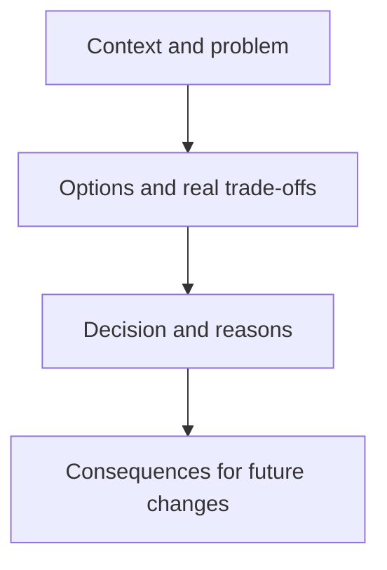

Code says what a system does. Documentation is the only place that says why —
and why is exactly what's gone once the person who made the decision leaves,
unless it was written down. This chapter is writing for that eventual reader,
who is often you, six months later, with no memory of the meeting where this
got decided.

> [!WHY] A departing engineer leaves a config note saying only “as
> discussed.” Months later a replacement cannot tell which values were
> intentional and risks undoing the workaround that kept requests working.

> [!GOALS]
>
> - Explain why rejected options belong in design records
> - Write a change rationale for a cold reader
> - Choose a useful README order

## The design doc / RFC

```text
  the structure that consistently works, roughly:

    CONTEXT       what problem exists, and why it matters now
                  — not "we should use X," but the SITUATION
                  that makes a decision necessary

    OPTIONS        the alternatives seriously considered,
                   each with its real trade-offs — INCLUDING
                   the one you didn't pick, and why not

    DECISION        what was chosen, and the specific reasons
                   (not just "this is best," but "this,
                   because Y mattered more than Z here")

    CONSEQUENCES     what this decision costs, commits to, or
                    rules out later — the parts a reader six
                    months from now needs to know before
                    undoing it
```

```text
  → the OPTIONS section is the one people skip, and it's the
    one that matters most later: a reader wondering "why
    didn't we just do the simpler thing" needs the doc to
    already have that reader's exact question anticipated and
    answered — the alternative's real trade-off, not a
    strawman version dismissed in one line.
```



## Commit messages

```text
  Fix bug                          ✗ tells a future git-blame
                                       reader nothing

  Fix the race in checkout          better, but still says
                                       WHAT without WHY

  Guard checkout against a           tells a reader what
  double-submit race                  changed AND why it
                                      mattered — this is the
  Two rapid clicks on submit          rest of the message:
  could both pass validation          the actual mechanism,
  before either write landed,         so a future reader
  double-charging the customer.       doesn't have to
  Adds a client-side disable-         reconstruct the bug
  on-submit plus a server-side        from the diff alone
  idempotency key.
```

```text
  → the commit message is documentation that lives BESIDE the
    code forever, surfaced automatically by `git blame` on
    exactly the lines that changed — for a subtle fix, it's
    frequently the only place the REASONING survives at all,
    since the code itself only shows the result.
```

## READMEs

```text
  the job of a README is answering, IN ORDER, the questions a
  new reader actually has:

    1. what IS this (one or two sentences, not a feature list)
    2. how do I RUN it (the fewest commands that work)
    3. how is it STRUCTURED, if that's non-obvious
    4. where do I go for MORE (a docs folder, an architecture
       doc, a specific person/channel)
```

```text
  → a README that leads with an exhaustive feature list before
    "how do I run this" has the order backwards — a new
    reader's first question is nearly always "can I get this
    running," and everything else can wait.
```

## Writing for the reader who doesn't have your context

```text
  the single biggest failure mode in technical writing: writing
  as though the reader already knows what YOU know right now,
  mid-project, with every recent Slack thread fresh in memory.

    "Update the config as discussed"    ✗ discussed WHERE,
                                            update it HOW,
                                            which config

  → name the specific file, the specific values, the specific
    reasoning — a reader arriving cold (a new hire, or you in
    eight months) has none of the context that made the vague
    version feel sufficient when you wrote it.
```

> [!PITFALL] Writing as though the future reader attended the meeting
> leaves the most important reasoning unavailable.

> [!INTERVIEW] Explain the rejected alternative and the cost accepted by
> the chosen option; a decision name alone does not preserve its
> rationale.

> [!CHECK] What four parts organise the chapter’s design doc?
>
> Context, options, decision and consequences.

> [!CHECK] Why is a commit message valuable beside git blame?
>
> It preserves reasoning beside the exact changed lines when the diff
> shows only the result.

> [!CHECK] What makes “update as discussed” insufficient?
>
> A cold reader lacks the meeting context, file, values and reasoning
> needed to act.

## What to take away

1. A design doc's options section — including the alternative you didn't
   pick and why — is what a future reader actually needs; it's also the
   section most commonly skipped.
2. A commit message's real value is the why a diff alone can't show — for a
   subtle fix, it's often the only place the reasoning survives at all.
3. A README should answer "what is this" and "how do I run it" before
   anything else — a feature list up front has the reader's actual priority
   backwards.
4. Write for a reader with none of your current context, not the version of
   the reader who was in the meeting where this got decided.
5. Documentation is the only place a system's "why" survives past the person
   who made the decision leaving — code alone only ever shows the "what."

## Exercises

> [!EXERCISE recall] Why should a design document preserve the seriously
> considered option that lost?
>
> **Solution:** A future reader will ask why the simpler or familiar
> alternative was not chosen. Its real trade-off and rejection reason
> preserve the decision context and prevent repeatedly reopening the same
> choice.

> [!EXERCISE apply] A commit changes a timeout after repeated upstream
> stalls, but its message is “update config.” Write a reviewable subject
> and body outline without inventing evidence the prompt does not supply.
>
> **Solution:** Use a subject such as “Adjust upstream timeout after
> repeated stalls.” Explain the observed stall situation, name the actual
> config file and old/new values when recording the real change, and state
> the decision’s consequence for callers. Do not claim a measured
> improvement or a root cause that has not been established. The outline
> records why and the mechanism instead of merely describing edited
> config.

> [!EXERCISE stretch] A README opens with a long feature catalogue while
> newcomers cannot find a working launch command. Recommend an order and
> contrast a weaker revision.
>
> **Solution:** Lead with what the project is, then the fewest working run
> commands, then non-obvious structure and pointers to more detail. A
> weaker answer merely expands the catalogue: it increases reading before
> answering the newcomer’s immediate “can I run it” question.
