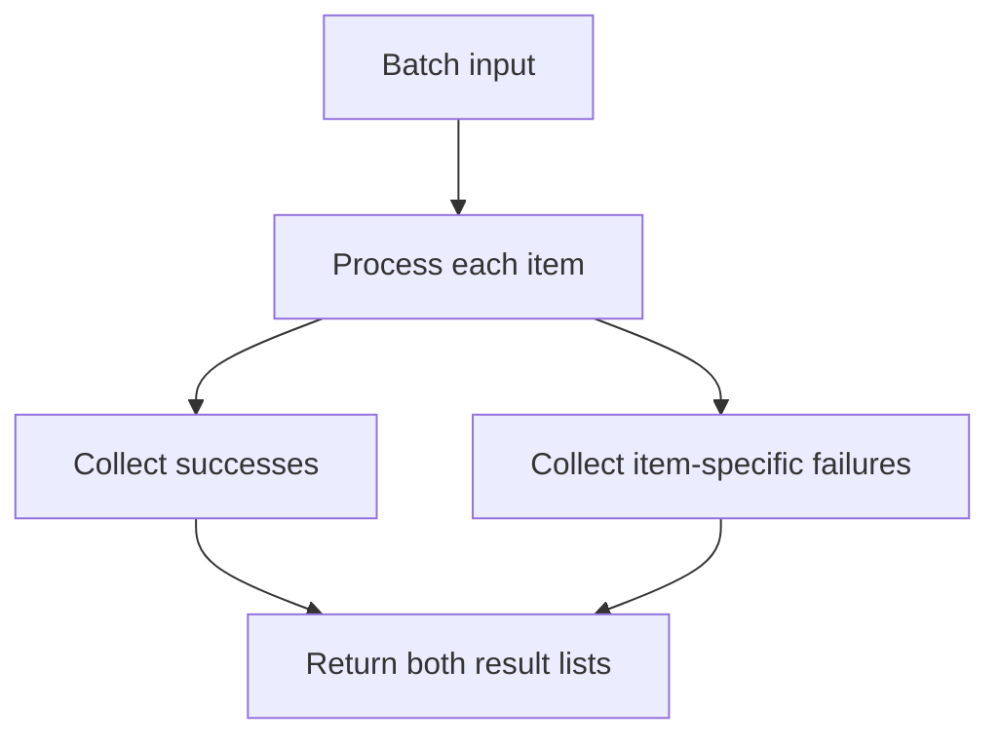

Error handling is usually treated as an afterthought bolted onto working
code, which is exactly why it tends to be the worst-designed part of most
codebases. This chapter treats it as a design decision on the same footing as
the happy path — because a caller's experience of failure is as much your
API's surface as its success case.

> [!WHY] A batch upload returns one exception after several records were
> already saved. The caller cannot distinguish committed progress from
> missing work, so a retry can repeat successes while still failing to
> repair the original item.

> [!GOALS]
>
> - Explain expected versus unexpected failure
> - Design a partial-success result
> - Choose retries by failure category

## Exceptions vs result types

```text
  EXCEPTIONS                          RESULT TYPES (Result<T, E>)

  function parse(s: string): Data {   function parse(s: string):
    if (!valid(s)) throw new Error();   Result<Data, ParseError> {
    return doParse(s);                   if (!valid(s))
  }                                        return err(new ParseError());
                                          return ok(doParse(s));
                                        }

  → INVISIBLE in the signature —      → VISIBLE in the signature —
    a caller has no way to know        a caller CANNOT get the
    this can throw without reading     value out without handling
    the implementation or docs         the error case, because the
                                        type forces it
```

```text
  → this is the type-design chapter's "parse, don't validate"
    applied specifically to failure — a Result type makes
    "this can fail" a fact the compiler enforces on every
    caller, where an exception makes it a fact a caller has to
    already know or discover by reading source.
```

```text
  → exceptions are still the right tool for TRULY exceptional,
    unrecoverable conditions (a programming bug, an assertion
    that should never fail) — the distinction is between
    EXPECTED failure (a user entered an invalid email — this
    is a normal outcome, model it as a value) and UNEXPECTED
    failure (a null reference where one should be impossible —
    this is a bug, let it crash loudly rather than silently
    returning a Result that hides the bug).
```

## Errors someone can act on

```text
  throw new Error("Invalid input");        ✗ WHICH input,
                                               invalid HOW

  throw new ValidationError(
    "email must contain '@'",
    { field: "email", value: rawInput }
  );                                        ✓ what's wrong,
                                               where, and what
                                               was actually
                                               received
```

```text
  → this is the same discipline as an API error body needing a
    machine-readable code (the REST API Design chapter) — an
    error a HUMAN reads needs the same specificity an error a
    PROGRAM reads needs; "something went wrong" tells neither
    what to do next.
```

## Retries and idempotency, from the caller's side

```text
  a caller receiving an error has to decide: retry, or give up?
  that decision needs the error to distinguish:

    TRANSIENT      a network blip, a timeout — retrying is
                   reasonable
    PERMANENT       a 400 Bad Request, a validation failure —
                   retrying identically will fail identically,
                   forever
```

```text
  → an error TYPE (or an explicit `retryable: boolean` field)
    that tells the caller which category it's in is what makes
    automatic retry logic (the Rate Limiting and Resilience
    chapter) safe to write generically — without it, a retry
    loop either retries everything (wasting time on permanent
    failures) or nothing (giving up on transient ones it could
    have recovered from).
```

## Partial failure

```text
  a batch operation processing 100 items where item 47 fails —
  what happens to items 1-46, and 48-100?

    FAIL FAST         stop entirely at the first error — safe,
                       loses partial progress
    BEST EFFORT        continue past the failure, collect
                       BOTH the successes and the failures,
                       report both
```

```text
  → "best effort" needs the RESULT SHAPE to represent partial
    success explicitly — {succeeded: [...], failed: [{item,
    error}, ...]} — not a single throw that discards which 46
    items actually succeeded. choosing between these two
    is a decision the caller needs to be told about
    explicitly, not one the function should make silently.
```



## Invariants: crash rather than continue wrong

```text
  function withdraw(account, amount) {
    account.balance -= amount;
    assert(account.balance >= 0, "balance went negative");
       // ✓ crash IMMEDIATELY at the point the invariant
       //   broke, with the exact state that broke it
  }
```

```text
  → an invariant violation caught LATER, three function calls
    downstream, is far harder to debug than one caught at the
    exact moment it happened — an assertion that crashes loudly
    right there is more useful than an if-check that logs a
    warning and lets execution limp forward with corrupted
    state.
```

> [!PITFALL] Best effort without a partial-success result silently
> discards information the caller needs to recover.

> [!INTERVIEW] State the failure category and whether earlier items
> committed before recommending retry or fail-fast behaviour.

> [!CHECK] How does a Result advertise failure to callers?
>
> Its signature includes an error case that must be handled before
> extracting the success value.

> [!CHECK] What should an actionable validation error identify?
>
> The specific rule and field, with appropriate diagnostic context rather
> than an unhelpful undifferentiated failure.

> [!CHECK] Why assert an invariant where it breaks?
>
> Immediate failure preserves the offending state and is easier to
> diagnose than downstream failure after continuing incorrectly.

## What to take away

1. A Result type makes "this can fail" visible in the function signature and
   enforced on every caller; an exception makes it a fact the caller has to
   already know from elsewhere.
2. Reserve exceptions for truly unexpected, unrecoverable conditions —
   expected failures (invalid input) are a normal outcome and read better as
   a value.
3. An error message needs the same specificity as a machine-readable API
   error code: what's wrong, where, and what was actually received —
   "something went wrong" serves neither a human nor a program.
4. Distinguishing transient from permanent failure in the error itself is
   what makes generic automatic retry logic safe — without it, a retry loop
   either wastes time or gives up on recoverable failures.
5. An invariant violation should crash immediately, at the exact point it
   broke — catching it three calls downstream, after execution limped
   forward on corrupted state, is far harder to debug.

## Exercises

> [!EXERCISE recall] Why does an expected validation failure fit a Result
> value while an impossible invariant failure should be treated
> differently?
>
> **Solution:** An expected outcome belongs in the public success/error
> shape so callers handle it deliberately. An unexpected invariant
> violation is a programming defect; allowing execution to continue with
> corrupted state hides the bug instead of safely recovering.

> [!EXERCISE apply] A best-effort import of records a, b, c and d saves a
> and c, while b and d fail validation. Design the returned result and
> explain why throwing only d’s error is insufficient.
>
> **Solution:** Return succeeded: [a, c] and failed: [{item: b, error:
> validationB}, {item: d, error: validationD}]. The caller can identify
> both successful effects and both repairs. Throwing only d’s error loses
> the earlier failure and the already-completed progress; it does not
> represent the chosen best-effort semantics.

> [!EXERCISE stretch] A generic retry wrapper treats timeouts and
> invalid-input errors identically. Recommend a policy and identify the
> weaker all-or-nothing choices.
>
> **Solution:** Distinguish transient from permanent failure in the error
> type or retryable field. Retry transient failures where the operation’s
> retry contract permits it and return permanent validation failures for
> correction. Retrying every invalid request is weaker because identical
> permanent input keeps failing; refusing all retries instead discards
> recoverable cases.
