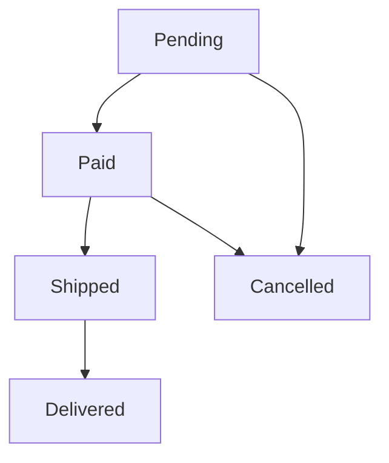

Testing checks specific examples; formal methods check EVERY possible
execution of a model, exhaustively, including the ones nobody thought to
write a test for. The trade is real — modeling costs time, and only a design
worth getting right before building pays for it — but for the designs where
it applies, it catches bugs no test suite finds.

> [!WHY] An order can be shipped twice through two different status
> handlers. Drawing permitted transitions and the single-shipment
> invariant before implementation exposes the expensive duplicate-delivery
> path.

> [!GOALS]
>
> - Explain bounded model checking versus sampling
> - Trace a lifecycle against an invariant
> - Choose when formal modelling earns its cost

## State machines as a design tool

```text
  most systems with meaningful STATE (an order's lifecycle, a
  connection's phases, a game's turns) are, whether or not
  anyone draws it explicitly, a state machine:

    PENDING → PAID → SHIPPED → DELIVERED
       │        │
       └──→ CANCELLED ←──┘
```

```text
  → drawing this EXPLICITLY, before writing the code that
    implements it, surfaces questions that ad-hoc "if this
    status equals X" code tends to skip silently:

    can a SHIPPED order be cancelled? (the diagram forces an
      explicit yes/no, where scattered if-statements might
      each answer differently, inconsistently, in different
      code paths)
    what happens on an invalid transition attempt (PENDING →
      DELIVERED, skipping two states) — reject it, or silently
      allow it?
```

```text
  → this is the type-design chapter's discriminated union,
    at the level of a whole entity's LIFECYCLE rather than one
    value's shape — a state machine diagram is a design tool
    even without any formal verification tooling behind it.
```



## Invariants: the property that must always hold

```text
  an invariant is a fact that must be true in EVERY reachable
  state, not just the ones a test happened to construct:

    "an account's balance is never negative"
    "every order has exactly one of {no shipment, one
     shipment}, never two"
    "the sum of a distributed ledger's entries always
     nets to zero"
```

```text
  → identifying invariants EXPLICITLY, even without a formal
    tool, is valuable on its own — it's precisely what the
    Errors and Failure Design chapter's "crash rather than
    continue wrong" assertion should check, and it's the
    property a formal model checker verifies exhaustively
    rather than sampling.
```

## Model checking: exhaustive rather than sampled

```text
  a UNIT TEST checks: does this SPECIFIC sequence of operations
  preserve the invariant?

  a MODEL CHECKER checks: does EVERY POSSIBLE sequence of
  operations (up to some bound), including every possible
  INTERLEAVING of concurrent actions, preserve the invariant?
```

```text
  → this is the exhaustive analogue of property-based testing's
    "check the property across generated inputs" — model
    checking goes further, checking every reachable STATE
    TRANSITION rather than sampling from the input space.
```

```text
  TLA+ (the best-known tool for this) specifies a system as a
  STATE MACHINE plus invariants, and its model checker exhausts
  every possible execution up to a given size, reporting the
  SPECIFIC sequence of steps that violates an invariant if one
  exists — not just "it's broken," but the exact trace that
  breaks it.
```

## Where this earns its cost

```text
  formal modeling has a real cost — writing and getting familiar
  with a TLA+-style specification takes real time, separate from
  (and before) any implementation work.

    ✓  DISTRIBUTED SYSTEMS with subtle concurrent interleavings
       — this is EXACTLY where the Consensus chapter's own
       history comes from: real consensus algorithms have
       shipped with bugs a model checker later found, because
       the number of possible interleavings is far too large
       for a human to reason through by hand or a test suite to
       sample adequately
    ✓  a design where a bug found AFTER deployment is
       extremely expensive (a financial settlement system, a
       safety-critical protocol)

  ✗  typical CRUD application logic, where the state space is
     small enough that ordinary testing genuinely covers it,
     and the cost of a bug is "fix and redeploy," not
     catastrophic
```

```text
  → this is a tool for a specific, narrow category of design
    risk — concurrent, subtly-interleaved systems where the
    cost of getting it wrong is high — not a general
    replacement for testing on typical application code.
```

> [!PITFALL] A state label alone does not establish an invariant; inspect
> the effects of every permitted transition.

> [!INTERVIEW] Name the invariant, reachable-state bound and violating
> interleaving you want the model to expose before selecting formal
> tooling.

> [!CHECK] What must an invariant cover?
>
> Every reachable state, not just the states chosen by tests.

> [!CHECK] What does drawing a lifecycle force you to decide?
>
> Which transitions are permitted and what happens to invalid transition
> attempts.

> [!CHECK] What evidence does TLA+-style model checking return for
> failure?
>
> A specific sequence of steps that violates an invariant, within the
> explored model.

## What to take away

1. Drawing a state machine explicitly, before writing the code, surfaces
   transition questions ad-hoc if-statement logic tends to answer
   inconsistently across different code paths.
2. An invariant is a fact that must hold in every reachable state, not just
   the ones a test happened to construct — identifying invariants explicitly
   is valuable even without formal tooling.
3. A model checker verifies every possible execution and interleaving up to
   a bound, exhaustively, rather than sampling from the input space the way
   a test or even a property-based test does.
4. TLA+ reports the specific sequence of steps that violates an invariant,
   not just that one exists — which is exactly how real consensus algorithms
   have had subtle bugs found after they'd already shipped.
5. This is a narrow tool for concurrent, subtly-interleaved systems where a
   post-deployment bug is extremely expensive — not a general replacement
   for testing on typical application code with a small, well-covered state
   space.

## Exercises

> [!EXERCISE recall] How does bounded model checking differ from unit and
> property-based testing?
>
> **Solution:** Unit tests check chosen executions, and property-based
> tests sample generated inputs. A model checker explores every reachable
> execution and concurrent interleaving within the model’s stated bounds,
> returning a violating trace if it finds one.

> [!EXERCISE apply] Model a reservation as free → held → confirmed, with
> held → free on release. Confirmation creates one booking. A proposed
> retry transition confirmed → confirmed creates another booking. Trace
> free, hold, confirm, confirm and decide whether the state label alone
> enforces at most one booking.
>
> **Solution:** After hold the state is held with zero bookings. First
> confirm reaches confirmed and creates booking 1. The proposed retry
> leaves the label confirmed but creates booking 2, violating the
> at-most-one-booking invariant. Reject that effectful retry transition or
> model it without an additional creation; a legal-looking state name
> alone does not prove the invariant.

> [!EXERCISE stretch] A team has a concurrency-sensitive settlement design
> and an ordinary editable CRUD screen. Recommend where to spend a limited
> formal-modelling budget.
>
> **Solution:** Prioritise the settlement protocol’s interleavings and
> costly post-deployment failures; use ordinary tests for the CRUD
> screen’s small, manageable behaviour. A weaker answer model-checks every
> screen first because exhaustive sounds stronger, spending effort where
> the additional design-risk reduction is small. A model’s bound also
> limits what its successful check establishes.
