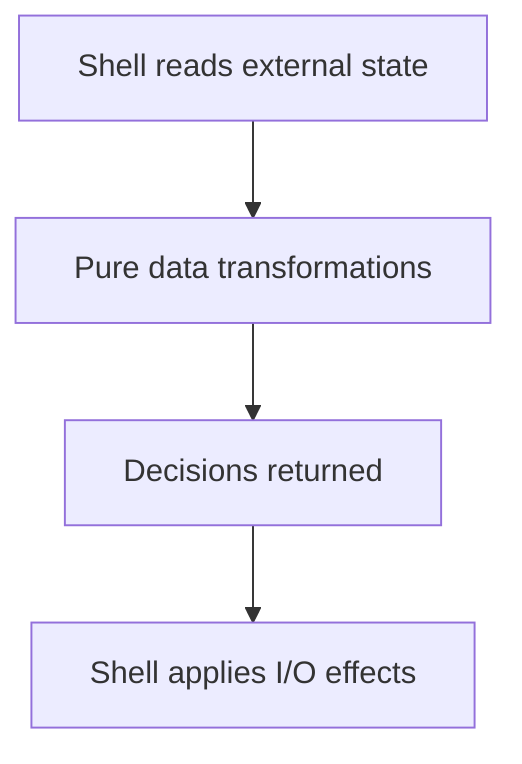

Functional programming's core claim is narrower than it sounds: a function
whose output depends only on its inputs, and which changes nothing outside
itself, is dramatically easier to reason about, test, and run concurrently
than one that doesn't make that promise. This chapter is that claim, and
where it's worth the discipline.

> [!WHY] A cart preview mutates the same items array used by checkout. An
> apparently local edit changes another caller’s total, making a
> predictable transformation depend on who touched the object first.

> [!GOALS]
>
> - Explain pure functions and hidden inputs
> - Build an immutable transformation pipeline
> - Choose when mutation is justified

## Pure functions

```text
  let taxRate = 0.08;
  function calculateTax(amount) {
    return amount * taxRate;    // ✗ depends on external
                                   state — same input, output
                                   can change if taxRate
                                   changes elsewhere
  }

  function calculateTax(amount, taxRate) {
    return amount * taxRate;    // ✓ PURE — same inputs
                                    ALWAYS produce the same
                                    output, and nothing
                                    outside the function
                                    changes
  }
```

```text
  → a pure function's entire behavior is visible in its
    SIGNATURE and body — no external state to track down, no
    "what else might have changed taxRate before this ran."
    this is what makes a pure function trivially testable: no
    setup beyond the arguments, no mocking anything.
```

## Immutability

```text
  function addItem(cart, item) {
    cart.items.push(item);   // ✗ MUTATES the caller's array —
    return cart;                anyone else holding a
  }                              reference to the original
                                 cart sees the change too,
                                 whether they expected it or
                                 not

  function addItem(cart, item) {
    return { ...cart, items: [...cart.items, item] };  // ✓
                                    returns a NEW object;
                                    the original is untouched
  }
```

```text
  → the mutation bug this prevents: two parts of a program
    holding what they each believe is "their own" reference to
    the same object, where one's change silently becomes
    visible to the other — a class of bug that simply cannot
    happen if nothing is ever mutated in place.
```

```text
  the trade: immutable updates ALLOCATE a new structure
  instead of modifying in place — for a small object this is
  free in practice; for a very large structure updated very
  frequently, this is a real cost, and PERSISTENT DATA
  STRUCTURES (structural sharing, only the changed path is new)
  are how libraries like Immer or Immutable.js make it
  affordable at scale.
```

## Higher-order functions

```text
  // imperative
  const adults = [];
  for (const p of people) {
    if (p.age >= 18) adults.push(p);
  }

  // functional — the LOOP is abstracted away entirely
  const adults = people.filter(p => p.age >= 18);
```

```text
  → map/filter/reduce aren't just shorter syntax — they name
    the INTENT (transform, select, accumulate) directly,
    where a for-loop makes the reader reconstruct the intent
    from the loop body's logic every time.
```

```text
  the composability payoff: functions that take and return
  functions let you build a pipeline out of small, separately
  testable, separately named pieces:

    const activeAdultEmails = people
      .filter(isAdult)
      .filter(isActive)
      .map(p => p.email);

  → each step is one clear operation; the sequence reads as a
    description of what happens, not how.
```

## Effects at the edges

```text
  the practical FP discipline for a real application (which
  has to do I/O eventually — read a file, call an API, write
  to a database):

    PURE CORE      the actual business logic — computing a
                   total, deciding what to do — as pure
                   functions, extensively unit-testable with
                   no mocking

    IMPURE SHELL   a thin layer at the edges that does the
                   actual I/O, calling into the pure core with
                   plain data
```

```text
  → push side effects to the boundary rather than scattering
    them through the logic — this is the same "logic separate
    from plumbing" shape as a repository pattern isolating
    database calls from business rules, applied at the
    function level instead of the module level.
```



## Where imperative still wins

```text
  ✗  performance-critical mutation of a large data structure
     in a tight loop — allocating a new array on every
     iteration can genuinely matter here
  ✗  code that's inherently about SEQUENCE and STATE CHANGE
     over time (a game loop, a state machine's transitions) —
     forcing this into a purely functional shape can obscure
     the thing that's actually happening rather than clarify it
```

```text
  → functional style is a tool for making DATA
    TRANSFORMATIONS predictable and testable, not a universal
    replacement for every other paradigm — most real codebases,
    including this project's own, mix functional data
    transformations with an imperative or object-oriented
    shell, deliberately.
```

> [!PITFALL] An immutable update that reuses and mutates the caller’s
> inner collection still exposes shared changes.

> [!INTERVIEW] Identify hidden inputs and observable effects first; choose
> pure transformations where they simplify reasoning rather than treating
> a style as universal.

> [!CHECK] What do map, filter and reduce communicate?
>
> Transformation, selection and accumulation rather than an unspecified
> loop mechanism.

> [!CHECK] How do persistent structures limit immutable-update copying?
>
> They share unchanged structure and allocate only the changed path.

> [!CHECK] What belongs in an impure shell?
>
> I/O such as reading a file, calling an API and writing a database, with
> plain data passed to a pure core.

## What to take away

1. A pure function's entire behavior is visible in its signature and body —
   no external state to track down, which is what makes it trivially
   testable.
2. Immutability prevents a specific class of bug: two parts of a program
   silently seeing each other's changes through a shared mutable reference.
3. Higher-order functions (map/filter/reduce) name intent directly, where a
   for-loop makes the reader reconstruct the intent from the loop body.
4. Push side effects to the edges of an application (an impure shell) and
   keep the actual logic as pure, easily-testable functions — the same
   separation a repository pattern applies at the module level.
5. Functional style is for making data transformations predictable, not a
   universal replacement — code that's inherently about state changing over
   time (a game loop, a state machine) often reads more clearly in an
   imperative shape.

## Exercises

> [!EXERCISE recall] Which promises make a function pure and easy to test
> without mocks?
>
> **Solution:** Its output depends only on supplied inputs and it has no
> observable effects outside returning. Tests provide arguments directly
> rather than arranging hidden state or external services.

> [!EXERCISE apply] Given people Ana(age 21, active), Bo(age 16, active)
> and Cy(age 24, inactive), choose filter/map steps for active adult
> emails. Explain how to add the resulting list to a new report without
> mutating the caller’s people array.
>
> **Solution:** Filter by adult age, retaining Ana and Cy; filter active,
> retaining Ana; map the remaining person to her email. Construct a new
> report object with that new emails list. Do not push onto or edit the
> caller’s people array; selection and mapping express the transformation
> while preserving the input.

> [!EXERCISE stretch] A tight loop repeatedly updates a huge internal
> buffer and copying dominates its measured cost. Recommend whether
> immutability should be imposed on every iteration.
>
> **Solution:** Keep controlled mutation in the performance-critical loop
> when it makes the state changes clearer and avoids measured allocation
> cost; preserve pure transformations and effect boundaries elsewhere. A
> weaker answer allocates a full new buffer on every step solely to follow
> a paradigm, ignoring the chapter’s large, frequently updated structure
> trade-off.
