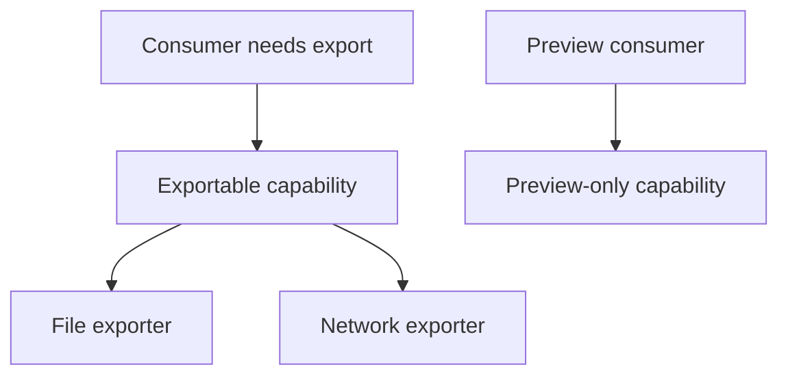

Object-oriented design principles are frequently taught as rules to follow
universally, which is precisely how they get misapplied. Each principle
below exists to solve a specific problem — knowing that problem is what lets
you recognize when the principle doesn't apply, rather than applying it
reflexively.

> [!WHY] A consumer accepts a base object but one subtype throws for a
> promised operation. Every caller now needs a subtype exception, so
> inheritance that looked reusable has spread conditional knowledge across
> the application.

> [!GOALS]
>
> - Explain encapsulation through invariant ownership
> - Choose capabilities that preserve substitution
> - Evaluate a speculative abstraction

## Encapsulation: hiding decisions, not just data

```text
  class BankAccount {
    balance: number;   // ✗ public — any caller can set it
                           to a negative number, bypass every
                           business rule
  }

  class BankAccount {
    #balance: number;
    withdraw(amount: number) {
      if (amount > this.#balance) throw new InsufficientFundsError();
      this.#balance -= amount;
    }
  }
```

```text
  → encapsulation isn't about hiding fields for its own sake
    — it's about making the OBJECT the only path to changing
    its own state, so every invariant (balance never negative)
    is enforced in exactly one place instead of trusted to
    every caller.
```

## Composition over inheritance

```text
  class FlyingBird extends Bird { fly() {...} }
  class Penguin extends Bird {
    fly() { throw new Error("Penguins can't fly"); }
  }
```

```text
  → the LISKOV SUBSTITUTION violation, concretely: any code
    that accepts a `Bird` and calls `fly()` now has to know
    which SUBCLASSES are secretly unsafe — inheritance
    promised "a Penguin IS-A Bird, usable anywhere a Bird is,"
    and this hierarchy breaks that promise.
```

```text
  the fix — model the CAPABILITY, not the taxonomy:

    interface Flyable { fly(): void; }
    class Sparrow implements Flyable { fly() {...} }
    class Penguin { swim() {...} }     // no fly() to violate

  → composition asks "what can this thing DO" rather than
    "what IS this thing" — a Sparrow HAS a Flyable behavior,
    rather than inheriting a fly() method it might not
    actually support.
```

```text
  → prefer composition by default; reach for inheritance only
    for a GENUINE is-a relationship where every subtype can
    honestly satisfy every promise the base type makes — the
    "favor composition over inheritance" advice exists because
    that condition is rarer in practice than it looks upfront.
```



## SOLID, briefly and with the failure mode each guards against

```text
  S  Single Responsibility   one REASON TO CHANGE per class —
                              not "one method," but one axis
                              of change (a class that handles
                              both business logic AND
                              formatting output changes for
                              two unrelated reasons)

  O  Open/Closed              open for extension, closed for
                              modification — adding a new
                              PaymentMethod shouldn't require
                              editing the existing switch
                              statement handling every OTHER
                              payment method

  L  Liskov Substitution      a subtype must be usable
                              anywhere its base type is
                              expected, without surprising the
                              caller (the Penguin problem above)

  I  Interface Segregation    many small, specific interfaces
                              beat one large one — a class
                              forced to implement methods it
                              doesn't need is a sign the
                              interface is doing too much

  D  Dependency Inversion     depend on an ABSTRACTION, not a
                              concrete implementation — a
                              service depending on "a
                              PaymentGateway interface" instead
                              of "Stripe's SDK directly" can be
                              tested with a fake and swapped
                              later
```

## Where each one stops applying

```text
  SRP taken too far        → a class per trivial field,
                              indirection with no payoff — "one
                              reason to change" is about
                              COHESIVE responsibility, not
                              minimum class size

  Open/Closed taken too far → speculative abstraction for
                              extension points that never get
                              used — an interface built for a
                              second implementation that never
                              arrives is unneeded indirection,
                              not foresight

  Dependency Inversion       → an interface with exactly ONE
  taken too far                implementation, forever, adds a
                              layer of indirection for no actual
                              flexibility gained
```

```text
  → SOLID principles solve REAL problems that show up as a
    codebase grows and changes — applying them to code that
    ISN'T growing or changing in the relevant dimension adds
    the cost (indirection, more files to navigate) without the
    benefit they exist to provide. this is the same "not every
    change needs an abstraction" judgment the project's own
    CLAUDE.md states directly for this codebase.
```

> [!PITFALL] A subtype that cannot keep a base operation’s promise makes
> every consumer compensate for a broken abstraction.

> [!INTERVIEW] Identify the promised capability and the actual reason to
> change before applying a SOLID principle or adding an inheritance layer.

> [!CHECK] What change axis does Single Responsibility address?
>
> One coherent reason to change, rather than one method or field per
> class.

> [!CHECK] What does Interface Segregation avoid?
>
> Forcing consumers or implementations to depend on operations they do not
> need.

> [!CHECK] How can Dependency Inversion aid a service test?
>
> Depend on a gateway interface so a fake can replace a concrete SDK.

## What to take away

1. Encapsulation's point is making an object the only path to changing its
   own state, so an invariant is enforced in one place instead of trusted to
   every caller.
2. Inheritance promises a subtype is usable anywhere its base type is
   expected — a subtype that can't honestly keep that promise (Liskov
   violation) is a sign composition, not inheritance, was the right tool.
3. Each SOLID letter guards against a specific failure mode a growing
   codebase hits — SRP against multi-reason classes, Open/Closed against
   edit-every-branch changes, Dependency Inversion against being locked to a
   concrete implementation.
4. Every SOLID principle has a point past which it adds indirection without
   benefit — a one-implementation-forever interface or a speculative
   extension point nobody uses is the principle costing more than it buys.
5. These principles solve problems that show up as code grows and changes —
   applying them where that growth isn't happening pays the indirection cost
   without the benefit.

## Exercises

> [!EXERCISE recall] How does encapsulation reduce the number of places
> trusted to maintain an invariant?
>
> **Solution:** Make the object’s methods the only path to state change
> and enforce the invariant there. Public mutable fields let every caller
> bypass the rule; hiding decisions is more valuable than merely making a
> field private.

> [!EXERCISE apply] An exporter base promises export(), but a PreviewOnly
> subtype throws because it can only render a preview. Design the
> capability split and decide which objects an export-all caller may
> accept.
>
> **Solution:** Separate Exportable with export() from a preview
> capability. Only objects honestly supporting export implement
> Exportable; PreviewOnly is usable by preview callers without pretending
> to support export. export-all accepts Exportable values and needs no
> special-case check for the unsupported subtype, preserving substitution.

> [!EXERCISE stretch] A stable utility has one implementation and no
> expected variation, yet a proposal adds an interface and several
> delegating classes for SOLID. Recommend whether to accept it.
>
> **Solution:** Keep the direct cohesive utility unless an actual axis of
> change or testing boundary justifies the abstraction. A weaker answer
> adds the hierarchy solely to satisfy a slogan: it pays navigation and
> indirection cost without a present flexibility benefit. Single
> responsibility means a coherent reason to change, not the smallest
> possible class.
