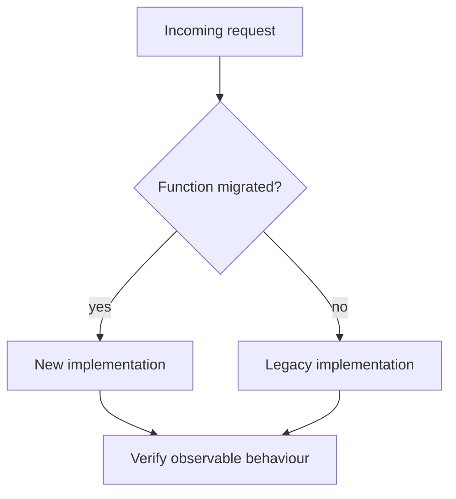

Refactoring has a precise meaning that's worth protecting: changing a
program's internal structure without changing its observable behavior. The
moment a "refactor" changes what the code does, it's no longer a refactor —
it's a rewrite wearing a refactor's name, and it needs a rewrite's scrutiny,
not a refactor's.

> [!WHY] A tidy rewrite removes a strange branch that encoded an old
> production fix. Without tests recording the current behaviour,
> structural cleanup can quietly restore the very bug the branch
> prevented.

> [!GOALS]
>
> - Explain behaviour-preserving refactoring
> - Create a test seam before restructuring
> - Choose an incremental replacement strategy

## Refactoring requires a safety net

```text
  the discipline only works with a way to verify "behavior
  unchanged" MECHANICALLY, not by inspection:

    change structure → run the existing tests → still green
    → behavior is (as far as the tests can see) unchanged

  → refactoring code with NO tests is not refactoring — it's
    changing code and hoping. the testing-strategy chapter's
    suite is the precondition this entire chapter assumes.
```

## Small, named, reversible steps

```text
  EXTRACT FUNCTION      pull a block out with a name
                        describing what it does
  RENAME                 a name that no longer describes
                        the thing, corrected
  INLINE                 the opposite of extract — a function
                        used once, adding indirection with
                        no reuse benefit, folded back in
  MOVE                    to the module/class that actually
                        owns the responsibility
```

```text
  → each step is SMALL enough to verify independently (run
    tests after each one, not after a batch of ten) and NAMED
    (a known refactoring, from Fowler's catalogue, has a
    specific mechanical recipe) — a giant unnamed restructuring
    done in one pass is much harder to verify or to back out of
    if something breaks partway through.
```

## Getting a seam into code with no tests

```text
  legacy code (defined here as "code with no tests," regardless
  of age) resists testing precisely because it has no SEAM — a
  point where behavior can be substituted without editing the
  code itself.

    function processOrder(order) {
      const db = new PostgresConnection();   // ✗ constructed
      db.save(order);                            INSIDE the
    }                                            function —
                                                  no way to
                                                  substitute
                                                  a fake
                                                  without
                                                  editing this
```

```text
  → the minimal, LOW-RISK change: extract the construction to
    a PARAMETER (dependency injection) — this alone doesn't
    change behavior (still constructs and uses a
    PostgresConnection by default), but it creates the SEAM a
    test needs to substitute a fake:

    function processOrder(order, db = new PostgresConnection()) {
      db.save(order);
    }
```

```text
  → this is the "characterization test" strategy in miniature:
    make the SMALLEST structural change needed to get ANY test
    around the code, write a test that captures CURRENT
    behavior (even if that behavior includes a known bug — the
    test's job right now is "don't make it worse," not "fix
    it"), and only then refactor or fix under that new safety
    net.
```

## The strangler fig pattern

```text
  replacing a large legacy system WITHOUT a big-bang rewrite
  (which the next section covers why to avoid):

    old system  ←── traffic ──→  [router]
                                     │
                                new system (handles what's
                                been migrated so far)

  → route traffic for MIGRATED functionality to the new system,
    everything else still to the old one — gradually, feature
    by feature, until the old system handles nothing and can be
    deleted. named after a fig that grows around a host tree
    until the host is no longer needed.
```



## Why a full rewrite is usually the wrong call

```text
  the rewrite trap: the existing system, however messy,
  encodes YEARS of accumulated edge-case handling — bug fixes
  for real production incidents, business rules discovered the
  hard way — most of which is INVISIBLE in the code's structure
  and easy to silently drop while rewriting from a clean
  design.

  → a rewrite frequently re-introduces bugs the original system
    already fixed, because the FIX is visible in the old code
    but the REASON for it often isn't documented anywhere else.
```

```text
  → prefer incremental refactoring (strangler fig, or plain
    small refactors under tests) over a full rewrite for a
    system that's currently working, however unpleasant its
    internals — a working system's accumulated correctness is
    real value, even when it's illegible.
```

> [!PITFALL] A clean rewrite can lose accumulated correctness hidden in
> ugly edge-case handling.

> [!INTERVIEW] Separate the smallest substitution seam, the
> current-behaviour test and the later behaviour change; explain what each
> diff proves.

> [!CHECK] Why run tests after each small refactoring step?
>
> A failure can be associated with one reversible structural change rather
> than a large batch.

> [!CHECK] What is a seam?
>
> A point where behaviour or a dependency can be substituted without
> editing the consuming code.

> [!CHECK] Should a characterization test immediately correct an existing
> quirk?
>
> Its first job is to record current behaviour; correction can follow
> under the new safety net as an explicit change.

## What to take away

1. Refactoring means changing structure without changing behavior — the
   moment behavior changes, it's a rewrite and needs a rewrite's scrutiny,
   not a refactor's confidence.
2. Refactoring requires an existing test suite as its safety net; changing
   structure with no tests is changing code and hoping, not refactoring.
3. Small, named, independently-verified steps (extract, rename, inline, move)
   are easier to verify and back out of than one large unnamed restructuring.
4. Legacy code resists testing because it has no seam — the minimal fix is
   often just extracting a dependency to a parameter, which creates a
   substitution point without changing behavior.
5. A working system's messy internals encode years of edge-case fixes that
   are invisible in its structure — a full rewrite tends to silently drop
   them, which is why incremental refactoring (or a strangler fig migration)
   usually beats a rewrite for something already working.

## Exercises

> [!EXERCISE recall] What distinguishes a refactor from a behaviour
> change, and what is the test suite’s practical limit?
>
> **Solution:** Refactoring changes internal structure while preserving
> observable behaviour. Existing tests mechanically check the behaviour
> they cover; green tests do not establish untested behaviour, so a
> behaviour change deserves separate scrutiny.

> [!EXERCISE apply] A receipt sender constructs its database inside the
> function and has no tests. Plan the smallest step that allows a fake,
> then order characterization and cleanup work.
>
> **Solution:** Move construction to a parameter with the existing real
> database as the default, preserving current callers’ behaviour. Inject a
> fake to capture the sender’s existing observable result, including known
> quirks. Once characterization exists, make small named refactors and run
> tests after each; fix a known bug as a separate behavioural change.

> [!EXERCISE stretch] A working legacy service is messy but cannot stop
> serving users while replacement is built. Recommend migration versus a
> big-bang rewrite.
>
> **Solution:** Route migrated functionality to a new implementation and
> keep remaining operations on the old system, replacing incrementally
> until nothing needs the old path. A weaker answer rewrites everything
> before switching: undocumented edge-case fixes can disappear together
> and the whole replacement must be trusted at once.
