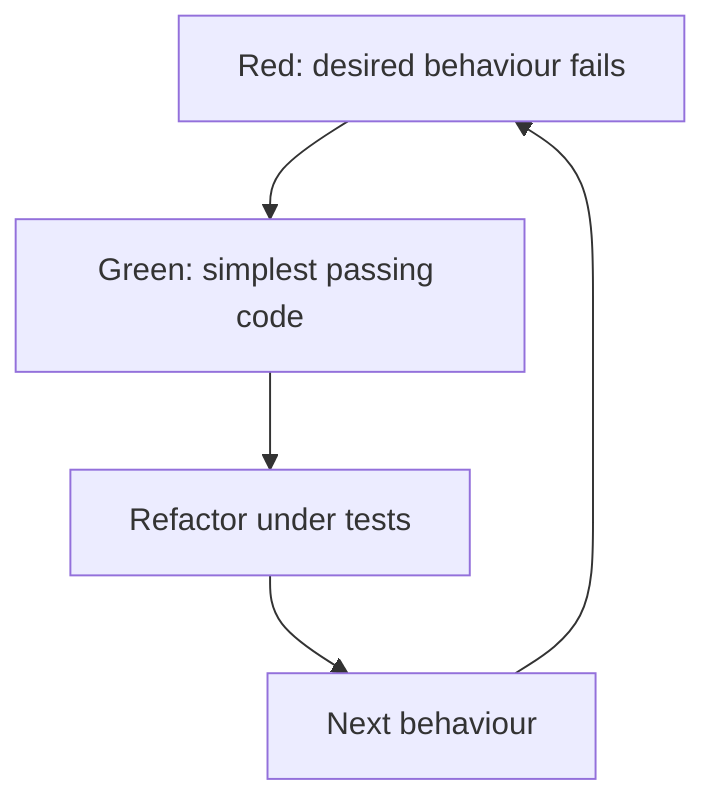

Test-driven development is frequently sold as "writing tests," which misses
the actual mechanism — writing the test FIRST forces you to design the
interface from the caller's perspective before any implementation exists to
bias that design. The test doubles that make isolated testing possible carry
real, distinct meanings worth keeping straight.

> [!WHY] A service interface becomes awkward only after several callers
> depend on it. A caller-first test can reveal excessive setup and
> confusing arguments before implementation makes that interface expensive
> to change.

> [!GOALS]
>
> - Explain the design value of test-first work
> - Choose the right test doubles
> - Choose when to defer TDD

## Red-green-refactor

```text
  RED       write a test for behavior that doesn't exist yet
            — it FAILS, because there's nothing to pass it

  GREEN     write the SIMPLEST code that makes it pass — not
            the most elegant, not the most general, the
            simplest thing that satisfies the test right now

  REFACTOR   NOW clean it up — the test is a safety net; any
            structural change that keeps the test green is
            safe by definition
```

```text
  → the GREEN step being deliberately minimal is the part
    people skip, and it's the point: writing the simplest
    passing implementation first, then refactoring under a
    passing test, catches over-engineering before it happens —
    you build only as much generality as the next RED test
    actually demands.
```



## Why writing the test first changes the design

```text
  writing the test AFTER the implementation tends to test
  whatever the implementation already does, shaped by however
  it happened to be built.

  writing the test FIRST forces you to imagine calling code
  that doesn't exist yet — which surfaces awkward APIs
  immediately: if the test is painful to write (excessive
  setup, an awkward call signature), the API itself is
  probably awkward, and you find that out BEFORE building
  around it, not after.
```

```text
  → this is TDD's actual design value — not "more tests get
    written," but "the interface gets shaped by how it's
    actually used, before an implementation exists to make
    changing it expensive."
```

## Test doubles: precise meanings, often blurred

```text
  DUMMY    passed in because a parameter is required, never
           actually used — exists purely to satisfy a
           signature

  STUB     returns CANNED, hardcoded answers to calls made
           during the test — "when asked for the user, return
           this fixed object" — makes no assertions of its own

  FAKE     a WORKING, simplified implementation (an in-memory
           database standing in for a real one) — behaves
           correctly, just not production-grade (no
           persistence, no real network)

  MOCK     records HOW it was called, and the TEST asserts on
           those calls afterward — "verify charge() was called
           exactly once, with these arguments"
```

```text
  → mixing these up matters in practice: over-using MOCKS
    (asserting on calls) instead of STUBS/FAKES (just
    providing data) is precisely the "testing implementation
    instead of behavior" trap the testing-strategy chapter
    warns about — a test built entirely from mock assertions
    breaks on every refactor that preserves behavior but
    changes internal call patterns.
```

```text
  → prefer a FAKE over a MOCK where practical — an in-memory
    fake repository lets a test call real methods and assert
    on real returned state, which survives refactoring far
    better than asserting the repository's methods were called
    in a specific sequence.
```

## What TDD is not good for

```text
  ✗  exploratory work where the shape of the solution is
     genuinely unknown — writing a test for an interface you
     haven't figured out yet just produces a test you'll throw
     away with the first design
  ✗  UI layout and visual work, where "correct" is a human
     judgment about appearance, not an assertion a test can
     make
  ✗  a one-off script or throwaway analysis with no expected
     future life
```

```text
  → TDD earns its cost on code with a STABLE, KNOWABLE
    interface and real future maintenance — exploratory
    spikes are better done UN-test-driven, then given tests
    retroactively once the design has actually settled.
```

> [!PITFALL] Overusing mock call sequences can test the implementation
> rather than the behaviour the caller relies on.

> [!INTERVIEW] Explain which contract is stable enough for test-first
> design, and choose doubles by what the test actually needs to prove.

> [!CHECK] What must the green step optimise for?
>
> The simplest implementation that satisfies the current test, postponing
> unnecessary generality.

> [!CHECK] How does a dummy differ from a stub?
>
> A dummy merely satisfies an unused parameter; a stub supplies canned
> behaviour or data.

> [!CHECK] Why can a fake survive a refactor better than mock call-order
> assertions?
>
> It lets tests assert observable returned state without pinning an
> internal sequence of method calls.

## What to take away

1. The deliberately minimal GREEN step is TDD's over-engineering guard —
   building only as much as the current test demands, then refactoring under
   a passing safety net.
2. Writing the test first surfaces an awkward API before an implementation
   exists to make changing it expensive — that's TDD's actual design value,
   not simply "more tests."
3. Dummy, stub, fake, and mock are distinct: a mock asserts on how it was
   called, while a stub or fake just supplies behavior or data without
   making assertions of its own.
4. Prefer a fake over a mock where practical — asserting on real returned
   state survives refactoring better than asserting on a specific call
   sequence.
5. TDD earns its cost on stable, knowable interfaces with real future
   maintenance — exploratory work is usually better left un-test-driven
   until the design settles.

## Exercises

> [!EXERCISE recall] Why does a failing caller-first test shape an
> interface differently from a test written after implementation?
>
> **Solution:** It requires imagining how the interface should be used
> before implementation biases it. Painful setup or an awkward signature
> becomes evidence about API design while it is still cheap to revise.

> [!EXERCISE apply] A service test needs a fixed user lookup, a repository
> that saves and retrieves changing records, and evidence that an external
> charge is issued once. Choose a double for each and explain what should
> be asserted.
>
> **Solution:** Use a stub for the fixed lookup, a working in-memory fake
> for repository state changes, and a mock where the charge interaction
> itself is the required observable effect. Assert returned or saved state
> for repository behaviour; assert the specified charge count and
> arguments for the interaction. Do not turn every internal repository
> call into a mock-sequence requirement.

> [!EXERCISE stretch] A team is exploring an unknown interaction design
> but demands a full test-first interface before prototyping. Recommend a
> sequence.
>
> **Solution:** Allow an exploratory spike until the design becomes stable
> and knowable, then give the settled interface meaningful tests and use
> red-green-refactor for maintained logic. A weaker answer locks tests to
> each speculative interface immediately: they may be discarded with the
> first design and do not provide the intended caller-first value.
