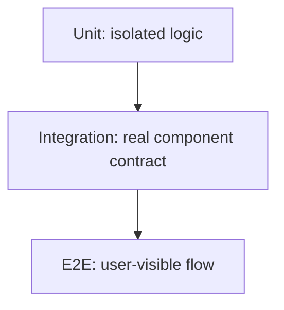

"We have tests" says nothing about what those tests actually prove. A suite
of a thousand unit tests that all mock the database can pass while the real
database integration is broken — this project's own history has exactly that
incident on record. This chapter is choosing the right proof for the right
risk.

> [!WHY] A repository’s mocked tests stay green while a real database
> constraint rejects every write. The suite proves the mock’s assumptions,
> leaving users to discover the integration it never exercised.

> [!GOALS]
>
> - Explain what each test layer proves
> - Choose tests for a concrete integration risk
> - Replace a flaky timing assumption

## The pyramid, and what each layer actually proves

```text
        ▲
       / \        E2E — few, slow, proves the SYSTEM works
      /---\       end to end, through real interfaces
     /     \
    /-------\     INTEGRATION — proves components work
   /         \    TOGETHER (a real database, a real HTTP
  /-----------\   call between two of your own services)
 /             \
/---------------\ UNIT — many, fast, proves ONE function/
                    class does what it claims, in isolation
```

```text
  UNIT        does this function compute the right output for
              this input? fast enough to run on every save,
              cheap enough to write hundreds of

  INTEGRATION does this repository actually round-trip
              through a REAL database? — a mocked database
              only proves your mock's imagined behavior
              matches your code's expectations, and mocks can
              be wrong in exactly the ways that matter (a
              constraint the real database enforces that the
              mock doesn't)

  E2E         does the whole system work through a REAL
              browser and REAL — or realistically faked —
              backend, the way a user actually experiences it?
```

```text
  → the shape is a PYRAMID, not a rectangle, because of cost:
    E2E tests are slow and flaky in proportion to how many
    real systems they touch — a suite that's mostly E2E is
    slow to run and unreliable to trust, while one that's
    entirely unit tests can be green while the real
    integration between pieces is broken.
```



## What a mock actually proves — and doesn't

```text
  test('processOrder charges the customer', () => {
    const mockGateway = { charge: jest.fn().mockResolvedValue({ok: true}) };
    processOrder(order, mockGateway);
    expect(mockGateway.charge).toHaveBeenCalledWith(order.total);
  });
```

```text
  this proves: processOrder CALLS charge() with the right
  argument.

  this does NOT prove: the real payment gateway's charge()
  method has that signature, handles that argument correctly,
  or behaves the way the mock assumes — a mock is a STAND-IN
  built from your own assumptions about the real thing, and
  those assumptions can simply be wrong.
```

```text
  → this is why a system with heavy mocking needs SOME
    integration tests hitting the real dependency, even a
    small number — the mocked unit tests catch regressions in
    YOUR code's logic; the integration tests catch drift
    between your mock's assumptions and reality.
```

## Testing behavior, not implementation

```text
  test('sorts the list', () => {
    const spy = jest.spyOn(arr, 'quickSort');
    sortItems(arr);
    expect(spy).toHaveBeenCalled();     // ✗ tests HOW
  });

  test('sorts the list', () => {
    expect(sortItems([3,1,2])).toEqual([1,2,3]);  // ✓ tests
                                                       WHAT
  });
```

```text
  → a test asserting on internal calls/methods BREAKS the
    moment you refactor the implementation, even when the
    behavior stays identical — which defeats testing's whole
    purpose of letting you change code with confidence. assert
    on OUTPUTS and OBSERVABLE EFFECTS, not on how the function
    got there.
```

## Flaky tests: worse than no test

```text
  a test that fails ~5% of the time for reasons unrelated to
  a real bug (timing, network, unseeded randomness, execution
  order) trains the team to re-run failures instead of
  investigating them — and eventually, to ignore a real
  failure because "it's probably just flaky."
```

```text
  the usual causes:
    ✗  a hardcoded sleep() racing real async work — waiting
       200ms hoping an operation finished, rather than waiting
       for the operation's actual completion signal
    ✗  shared mutable state between tests (one test's leftover
       data affects the next)
    ✗  real system time (Date.now()) instead of an injected,
       controllable clock
    ✗  unseeded randomness producing a different input each run
```

```text
  → a flaky test gets FIXED or DELETED, not silently retried
    forever — a retry-until-green CI step hides exactly the
    signal a flaky test exists to protect.
```

## Coverage as a floor, not a target

```text
  100% line coverage proves every line EXECUTED at least once
  during the suite — it says nothing about whether the
  ASSERTIONS actually check the right thing:

    function divide(a, b) { return a / b; }
    test('divide', () => { divide(4, 2); });  // 100% line
                                                  coverage,
                                                  ZERO
                                                  assertions
```

```text
  → coverage is useful for finding UNTESTED code (a branch
    nobody exercises at all) — it is not a proxy for test
    QUALITY, and optimizing for a coverage number directly
    produces exactly the hollow test above.
```

> [!PITFALL] A mock’s green test does not validate the real dependency’s
> schema or behaviour.

> [!INTERVIEW] Name the failure risk and select the test layer that can
> observe it; explain what mocking would leave unproved.

> [!CHECK] What does 100% line coverage establish by itself?
>
> That every line executed; it does not establish meaningful assertions or
> correctness.

> [!CHECK] Why assert sorted output instead of a quicksort spy call?
>
> Output is the behaviour; a different valid sort should not break the
> test.

> [!CHECK] Why is a pyramid usually cheaper than a suite dominated by E2E?
>
> Isolated tests are fast, while system-level tests pay for more real
> components, timing and external interactions.

## What to take away

1. Unit, integration, and E2E tests prove different things — a suite that's
   entirely unit tests with mocked dependencies can be green while a real
   integration is broken.
2. A mock proves your code calls it correctly; it does not prove the mocked
   assumption matches reality — which is why heavy mocking needs some real
   integration coverage alongside it.
3. Assert on outputs and observable effects, not on internal method calls —
   testing implementation details breaks tests on every refactor, even ones
   that don't change behavior.
4. A flaky test is worse than no test at all, because it trains people to
   ignore failures — fix the root cause (unseeded randomness, races, shared
   state) or delete it, never auto-retry it into silence.
5. Coverage is a floor for finding untested code, not a target — a fully
   covered function can still have zero real assertions.

## Exercises

> [!EXERCISE recall] How do unit, integration and E2E tests divide their
> evidence?
>
> **Solution:** Unit tests check isolated logic, integration tests check
> real components and dependency contracts together, and E2E tests
> exercise a user flow through the system. A mocked dependency does not
> prove the real dependency behaves like the mock.

> [!EXERCISE apply] A new signup path calculates a display label, writes
> through a repository and shows confirmation in a browser. The suspected
> regression is a real database uniqueness constraint. Choose the smallest
> useful set of test layers and explain what each establishes.
>
> **Solution:** Use unit tests for the label calculation, a real-database
> repository integration test for the uniqueness constraint and
> round-trip, and a small browser flow for visible signup and error
> handling. The integration test directly addresses the suspected
> constraint risk; adding only more mocked unit cases cannot establish
> that the real write succeeds or fails as required.

> [!EXERCISE stretch] An async test sleeps for a fixed delay and fails
> under load. Recommend a deterministic replacement rather than
> retry-until-green.
>
> **Solution:** Wait for the operation’s actual completion signal or
> observable finished state, isolate test data and control time or
> randomness when they influence the result. A weaker answer increases
> retries: it hides timing failures and trains the team to distrust real
> failures rather than repairing the race.
