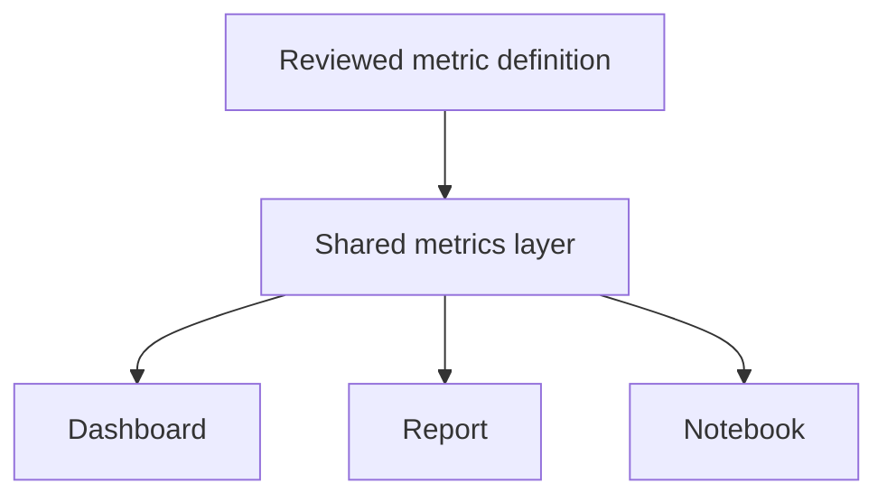

Analytics engineering is what happens when a discipline that used to live
entirely in ad hoc, hand-run SQL scripts — and in a hundred slightly
different spreadsheet formulas across a company — gets treated with the
same rigor software engineering has applied to application code all along.

> [!WHY] Finance and Sales bring different revenue totals to the same
> planning meeting. Without a shared definition, the argument consumes the
> meeting while both dashboards continue to look internally correct.

> [!GOALS]
>
> - Explain the role of a shared metrics layer
> - Compute a metric using explicit refund rules
> - Choose tests for transformation output

## The problem this discipline exists to solve: five different "revenue" numbers

```text
  Sales's dashboard:      revenue = SUM(deal_value)
  Finance's report:         revenue = SUM(deal_value) -
                                        refunds - discounts
  Marketing's spreadsheet:    revenue = SUM(deal_value) WHERE
                                        deal closed this
                                        quarter (a subtly
                                        DIFFERENT date filter
                                        than the other two)
```

```text
  → THREE different teams, THREE genuinely different numbers,
    all called "revenue," each independently correct according
    to ITS OWN author's private, undocumented, unreviewed logic
    — and a meeting where two people cite conflicting "revenue"
    figures, each one confident their own number is right,
    is a real, common, and entirely avoidable failure this
    entire chapter exists specifically to prevent.
```

## Transformations as version-controlled code

```text
  -- models/revenue.sql
  SELECT
    order_id,
    amount - COALESCE(refund_amount, 0) AS net_revenue
  FROM orders
  LEFT JOIN refunds USING (order_id)

  → this SQL file lives in GIT (the Git and Version Control
    chapter's discipline), goes through CODE REVIEW (the Code
    Review chapter's discipline, applied to a transformation
    query instead of application code) before merging, and is
    the SINGLE, tracked, reviewable definition of "net revenue"
    — not an ad hoc query someone ran once in a SQL client and
    never looked at, thought about, or reviewed again.
```

```text
  → tools like dbt made this workflow specifically PRACTICAL at
    scale: SQL transformations organized as a genuine DAG (the
    Discrete Mathematics chapter's structure, once again) of
    dependent MODELS, each one buildable, TESTABLE (the Data
    Quality chapter's assertions, applied directly to these
    exact models), and DOCUMENTED — analytics SQL, finally
    treated with the same rigor application code has had all
    along.
```

## The metrics layer: one definition, many consumers

```text
  metric: net_revenue
    sql: amount - refund_amount
    filters: [status = 'completed']

  dashboard A → queries "net_revenue"
  dashboard B → queries "net_revenue"
  a data scientist's notebook → queries "net_revenue"
```

```text
  → a METRICS LAYER (a semantic layer sitting between raw
    tables and the various tools that actually consume them)
    defines a metric like "net_revenue" ONCE, CENTRALLY — every
    downstream consumer (a BI dashboard, an ad hoc query, an ML
    feature) references the SAME underlying definition, rather
    than each tool independently reimplementing its own private
    version of the calculation, with its own subtly different
    assumptions baked silently into each separate copy.
```

```text
  → this is the exact same "single source of truth, referenced
    everywhere, changed in one place" principle as the Frontend
    Engineering track's design tokens (the Styling Systems
    chapter) — there, changing the accent color meant editing
    ONE token; here, changing HOW discounts are handled in
    revenue means editing ONE metric definition, and every
    dashboard/report/model that references it updates
    automatically and consistently, together.
```



## Testing transformation logic

```text
  → the Data Quality and Contracts chapter's assertions apply
    DIRECTLY here, at the MODEL level specifically: does
    net_revenue ever come out NEGATIVE (a real bug, or a
    genuinely legitimate case that needs explicit handling
    either way)? does EVERY order_id in the source table
    actually appear, unchanged, exactly once, in the
    transformed output? a transformation is CODE, computing a
    real, consequential result — and it deserves the exact
    same TESTING discipline any other genuinely important code
    in this curriculum has had applied to it throughout.
```

## Documentation as part of the model, not a separate afterthought

```text
  -- models/revenue.sql
  -- Net revenue excludes refunds processed within 30 days of
  -- the original order. Refunds processed later are NOT
  -- subtracted here — see finance_adjustments for those.

  → this is precisely the Technical Writing chapter's "why, not
    what" comment discipline, applied to a business-logic
    definition specifically — a future analyst reading THIS
    exact query six months from now needs to know the 30-day
    boundary was a DELIBERATE modeling choice, not simply
    trust the SQL alone and potentially "fix" what looks, on
    the surface, like an inconsistency but is in fact
    intentional, documented business logic.
```

> [!PITFALL] Putting SQL in git does not resolve a business-rule
> disagreement unless consumers use the agreed definition.

> [!INTERVIEW] State the metric’s filters and date boundaries before
> comparing totals.

> [!CHECK] Why review a transformation like application code?
>
> It computes consequential business results, so logic changes need
> tracked review rather than an unrecorded ad hoc query.

> [!CHECK] What does a model DAG make explicit?
>
> Dependencies among transformation models, enabling them to be built,
> tested and documented together.

> [!CHECK] Why document the reason for a refund cutoff?
>
> A future analyst must distinguish deliberate business policy from a bug
> rather than silently changing the meaning.

## What to take away

1. Different teams independently computing their own "revenue" with subtly
   different, undocumented logic is a real, common failure — the exact
   problem this whole discipline exists to prevent.
2. Treating a SQL transformation as version-controlled, code-reviewed code
   (not an ad hoc query run once and forgotten) is the same discipline
   application code has had all along, applied to analytics.
3. A metrics layer defines a metric once, centrally, so every dashboard and
   report references the same definition instead of each tool
   reimplementing its own subtly different version.
4. A centralized metric definition is the same single-source-of-truth
   principle as a frontend design token — change it once, and every
   consumer updates consistently together.
5. A transformation model deserves the same testing and why-not-what
   documentation discipline as any other consequential code in this
   curriculum — a deliberate business-logic choice needs to be
   distinguishable from an actual bug.

## Exercises

> [!EXERCISE recall] How does a metrics layer prevent independent
> dashboards drifting?
>
> **Solution:** It defines the metric centrally and consumers reference
> that definition instead of maintaining separate formulas. Changing the
> shared definition then updates dependent consumers consistently.

> [!EXERCISE apply] For this exercise, net revenue subtracts only refunds
> processed within 30 days of the order, as in the documented policy
> example. Three completed orders are $120 with a $20 refund on day 12,
> $80 with a $10 refund on day 35, and $50 without a refund. Compute this
> metric and compare a dashboard subtracting every refund.
>
> **Solution:** Under the stated rule the orders contribute $100, $80 and
> $50, totalling $230. The all-refund dashboard reports ($120 − $20) +
> ($80 − $10) + $50 = $220. The $10 difference comes from the late refund,
> not arithmetic. Keep its treatment in the separately documented
> adjustment logic rather than silently mixing definitions.

> [!EXERCISE stretch] A transformation’s output has plausible totals but
> may duplicate orders or omit some. Recommend model tests.
>
> **Solution:** Assert every source order_id appears unchanged exactly
> once in the transformed output, and explicitly investigate unexpected
> negative net revenue under the model’s business rules. A weaker answer
> checks only that the SQL executes: duplicated or missing orders can
> still produce plausible totals without an exception.
