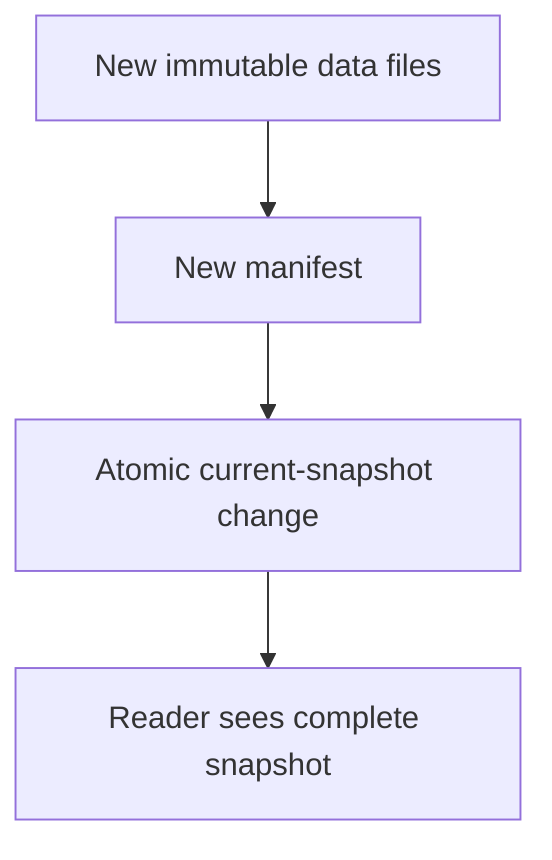

The Warehouses, Lakes and Lakehouses chapter described columnar storage and
ACID-on-object-storage as ideas. This chapter is the specific, concrete file
formats those ideas are actually built from — the files a query engine
reads, and the metadata layer that turns a folder of files into something
that behaves like a real, transactional table.

> [!WHY] A writer crashes halfway through publishing new analytical files,
> and a reader reports a mixture of old and new rows. Faster column scans
> cannot fix the missing table-level snapshot boundary.

> [!GOALS]
>
> - Explain Arrow’s role relative to Parquet
> - Use row-group statistics to prune reads
> - Choose snapshot semantics for concurrent readers

## Parquet: columnar storage as an actual file format

```text
  a Parquet file, internally: data grouped into ROW GROUPS,
  each row group storing each COLUMN's values TOGETHER and
  COMPRESSED (the previous chapter's columnar idea, as actual
  bytes on disk) — plus a FOOTER containing METADATA: min/max
  values per column PER ROW GROUP, among other statistics.

  → that footer metadata is what enables PREDICATE PUSHDOWN:
    a query filtering WHERE price > 1000 can check each row
    group's STORED min/max for price and SKIP an entire row
    group WITHOUT reading its actual data at all, if the
    group's max is already below 1000 — this is the SAME
    partition-pruning idea from the warehouse chapter, applied
    at a FINER grain, WITHIN a single file rather than across
    entire files/partitions.
```

## Arrow: a format for memory, not disk

```text
  → Parquet is optimized for DISK: compressed, optimized for
    STORAGE size and I/O. ARROW is a DIFFERENT columnar format,
    optimized for MEMORY: uncompressed, laid out so a CPU can
    operate on it DIRECTLY without a deserialization step first.

  → the concrete payoff: two DIFFERENT systems (say, a Python
    pandas process and a Spark JVM process) that BOTH support
    Arrow can share data with ZERO serialization/deserialization
    cost between them — this is the Languages and Compilers
    chapter's intermediate-representation idea, applied to DATA
    interchange between systems instead of to a compiler
    pipeline's internal stages: Arrow is the common, standard
    "IR" multiple analytical tools all speak.
```

## The problem neither Parquet nor Arrow solves: transactions on a folder of files

```text
  a folder of Parquet files, with no additional metadata layer,
  is just... a folder of files. it has NO transactional
  guarantees at all:

    ✗  a WRITER crashing HALFWAY through writing new files
       leaves the table in an inconsistent, PARTIALLY-updated
       state — some new files present, others not, with no
       record of which write was "in progress"
    ✗  a READER querying WHILE a writer is actively adding new
       files can see an inconsistent, PARTIAL snapshot —
       some but not all of a batch's new files, which is
       exactly the "dirty read" anomaly the Transactions and
       Isolation chapter already named for a database, now
       reappearing for a folder of files with no isolation
       mechanism at all
```

## Table formats: ACID transactions layered on top of plain files

```text
  Iceberg / Delta Lake / Hudi (the TABLE FORMATS the previous
  chapter referenced) solve EXACTLY this, by adding a
  METADATA LAYER that tracks, via VERSIONED MANIFEST files:

    ✓  which DATA files currently belong to the table (a
       SNAPSHOT — an atomic, point-in-time definition of "the
       table," at each version)
    ✓  COLUMN STATISTICS per file (predicate pushdown, at the
       whole-FILE granularity, one level above Parquet's own
       internal row-group granularity)
    ✓  SCHEMA EVOLUTION history — safely adding, renaming, or
       removing a column over time
```

```text
  → a WRITE atomically SWAPS which manifest is "current" —
    readers querying at ANY moment see one COMPLETE, CONSISTENT
    snapshot (either the old one or the new one, in full, NEVER
    a partial mix of the two) — this is the Database Internals
    chapter's MVCC idea, reimplemented at the FILE-SYSTEM level
    instead of inside a traditional database engine, which is
    precisely what makes ACID transactions possible on top of
    what's fundamentally still just a folder of immutable files
    in object storage.
```



## Time travel: a direct consequence of keeping old snapshots

```text
  SELECT * FROM orders VERSION AS OF '2026-01-15'

  → because OLD manifests/snapshots aren't immediately deleted on a write
    (only eventually garbage-collected, once nothing references them and a
    retention window has passed), a table format can query the table AS IT
    EXISTED AT A PAST POINT IN TIME — this is the Database Internals
    chapter's write-ahead-log-enables-point-in-time-recovery idea, appearing
    again in a genuinely different, adjacent context: versioned snapshots
    instead of a replayable log, but the same underlying payoff — being able
    to reconstruct a specific past state on demand.
```

## Schema evolution: changing a table's shape without rewriting history

```text
  → adding a column to an OLD Parquet file with no table-format
    metadata layer generally means historical files simply don't
    HAVE that column at all — a table format tracks schema
    CHANGES explicitly, by COLUMN ID rather than by column
    POSITION/name, so OLD files (missing a newer column) are
    still read correctly (the missing column reads as NULL for
    those old rows) — this is the Serialization and Schemas
    chapter's backward/forward compatibility discipline,
    reappearing for a data lake's schema instead of an API's.
```

## Choosing between them

```text
  Parquet + Arrow ALONE (no table format)    fine for
                                              small/simple/
                                              single-writer
                                              data, or when
                                              transactional
                                              guarantees
                                              genuinely aren't
                                              needed

  a table format (Iceberg/Delta/Hudi) on top    needed the
                                              moment MULTIPLE
                                              writers, real
                                              transactional
                                              guarantees, or
                                              schema evolution
                                              over time actually
                                              matter — which,
                                              in practice, is
                                              most real
                                              production data
                                              lakes eventually
```

> [!PITFALL] A directory of Parquet files supplies columnar layout, not an
> atomic table update.

> [!INTERVIEW] Distinguish the in-memory format, on-disk format and table
> metadata layer.

> [!CHECK] How does a table format read an old file missing a new column?
>
> Its explicit schema history permits the missing column to read as NULL
> for those old rows.

> [!CHECK] What enables time travel?
>
> Retained old manifests/snapshots define past table states until
> retention and garbage collection remove them.

> [!CHECK] Why track columns by identity rather than only position?
>
> Stable column identity lets schema changes be interpreted across files
> written under different schemas.

## What to take away

1. Parquet's per-row-group min/max metadata enables predicate pushdown at a
   finer grain than the warehouse chapter's file/partition-level pruning —
   the same skip-without-reading idea, one level deeper.
2. Arrow is optimized for memory rather than disk, letting different
   systems share data with zero serialization cost — the same
   intermediate-representation idea from compilers, applied to data interchange.
3. A folder of plain Parquet files has no transactional guarantees at all —
   a crashed writer or a concurrent reader can see an inconsistent, partial
   state, the exact dirty-read anomaly transactions already named for
   databases.
4. A table format's atomic manifest swap is MVCC reimplemented at the
   filesystem level, which is what makes ACID transactions possible on top
   of a folder of immutable files.
5. Retained old snapshots enable time travel (the database chapter's
   point-in-time recovery, reappearing here), and column-id-based schema
   tracking is the serialization chapter's compatibility discipline applied
   to a data lake's schema instead of an API's.

## Exercises

> [!EXERCISE recall] Why might an analytical system use both Parquet and
> Arrow?
>
> **Solution:** Parquet optimizes compressed disk storage and I/O; Arrow
> supplies a common in-memory representation systems can operate on
> without serializing between compatible tools. They solve different
> stages rather than replacing one another.

> [!EXERCISE apply] A query filters price > 700. Row-group price ranges
> are A: 10–500, B: 500–900, C: 701–950, D: 0–700. Choose which groups can
> be skipped from min/max alone and which need further work.
>
> **Solution:** Skip A because max 500 is below the threshold, and D
> because max 700 cannot satisfy the strict > 700 predicate. B may contain
> matching rows, so it cannot be skipped; its individual values still need
> filtering. C’s range is entirely above 700 and cannot be skipped.
> Reading metadata can eliminate two of four groups without scanning their
> data, but says nothing about equal byte sizes.

> [!EXERCISE stretch] Readers run continuously while a writer adds a
> multi-file batch. Recommend a representation that prevents partial-batch
> reads.
>
> **Solution:** Use the table-format metadata layer to publish a complete
> snapshot through an atomic current-manifest change. Readers see one
> complete old or new version. A weaker answer only compresses the files
> as Parquet: columnar compression does not establish a transaction
> boundary across a directory of files.
