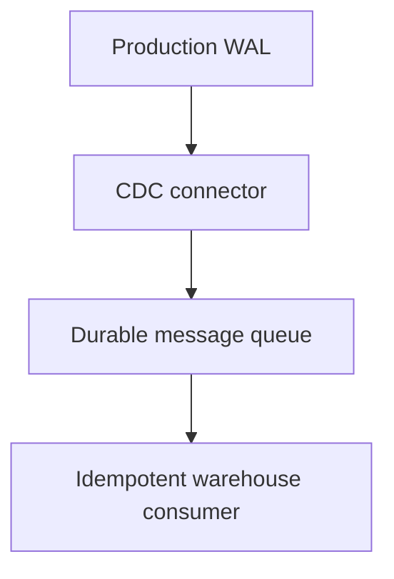

Every warehouse chapter so far assumed data was already there. This chapter
is how it actually arrives — and the naive approach (just query the
production database repeatedly) creates a genuine conflict between the
system that needs to stay fast for real users and the system that wants to
read all of it for analytics.

> [!WHY] A frequent extraction job slows customer requests and still
> misses rows deleted between runs. Reading changed rows from the live
> table cannot reconstruct a deletion that is no longer present.

> [!GOALS]
>
> - Explain CDC’s treatment of deletes
> - Apply idempotency to repeated change events
> - Design a complete snapshot-to-stream handoff

## Batch extraction: the simple, naive starting point

```text
  SELECT * FROM orders WHERE updated_at > '2026-01-01';

  → periodically querying for ROWS THAT CHANGED since the last
    extraction — simple to reason about, and genuinely fine at
    small scale.

  → the problem at real scale: this query runs AGAINST THE SAME
    production database real users' requests are hitting — a
    large analytical extraction query competes for the SAME
    resources (the Database Internals chapter's buffer pool,
    connection slots) as production traffic, and a naive,
    frequent, unbounded extraction query is a genuine, common
    cause of production slowdowns that have NOTHING to do with
    actual user load.
```

## Change Data Capture: reading the write-ahead log instead of querying the table

```text
  the Database Internals chapter's WAL already records EVERY
  write, in order, DURABLY, for crash recovery — CDC's genuinely
  clever move: read THAT SAME LOG, as a STREAM of change events,
  instead of separately QUERYING the table for what changed.

    INSERT order 42     → {op: "insert", table: "orders",
                            after: {...}}
    UPDATE order 42       → {op: "update", before: {...},
                            after: {...}}
    DELETE order 42        → {op: "delete", before: {...}}
```

```text
  → this SIDESTEPS the batch-query problem structurally: reading
    a WAL is a fundamentally CHEAP, SEQUENTIAL, append-only-log
    operation the database ALREADY performs for its own crash
    recovery — it adds essentially NO extra query load to
    production, because it's not a QUERY against the table at
    all; it's the database's own durability mechanism, read a
    second time, for a second purpose.
```

```text
  → CDC ALSO captures DELETES correctly, which a naive
    `updated_at > X` batch query structurally CANNOT — a
    deleted row simply isn't THERE anymore to be selected by any
    query; the WAL, by contrast, has an explicit DELETE event
    recorded, because the database needed that record for its
    own crash-recovery correctness regardless of any downstream
    analytical consumer.
```

## CDC events flow through a message queue

```text
  production DB's WAL → CDC connector (Debezium is the
  well-known example) → Kafka/a message queue (the Messaging
  and Event Streaming chapter's territory) → the warehouse

  → this is the Queues and Async Jobs chapter's at-least-once
    delivery guarantee, reappearing here: a CDC pipeline can
    deliver the SAME change event more than once, which means
    the WAREHOUSE-SIDE consumer needs the SAME idempotent-write
    discipline (an upsert keyed on a unique event id, rather
    than a blind append) that any other at-least-once consumer
    needs.
```



## Schema drift: the production database changes, and the pipeline has to notice

```text
  → a column added, renamed, or removed in the SOURCE production
    database is a REAL, RECURRING operational event for an
    ingestion pipeline — not a rare edge case. this is the
    Serialization and Schemas chapter's compatibility problem,
    reappearing here specifically because the SOURCE system
    (the production application) and the DOWNSTREAM system (the
    warehouse) are maintained by DIFFERENT people, on DIFFERENT
    release schedules, who may not even know the other exists
    or depends on this exact shape.
```

```text
  → the practical response: DETECT a schema change automatically
    (rather than a downstream job silently breaking or silently
    dropping a new column with no alert at all), and either
    adapt automatically for a SAFE, additive change (a new
    optional column) or ALERT loudly for a BREAKING one (a
    column renamed or removed) — silent, undetected schema
    drift is a genuinely common, real cause of a dashboard
    quietly showing WRONG numbers for weeks before anyone
    notices something's off.
```

## Backfills: loading history that predates the pipeline

```text
  → a NEWLY built pipeline typically needs to load HISTORICAL
    data that existed BEFORE the pipeline itself started running
    — a ONE-TIME batch load of everything that already existed,
    followed by ONGOING incremental CDC for everything NEW from
    that point forward.

  → the genuinely tricky part: correctly handling the
    HANDOFF between the one-time backfill and the ongoing
    stream, without either DUPLICATING data that both captured
    (the backfill AND the stream both covering the same
    transition-period rows) or LOSING data that fell in the
    genuine gap between exactly where the backfill's snapshot
    ended and exactly where the stream's capture began —
    getting this boundary precisely right is a real, common
    source of subtle, hard-to-detect data-completeness bugs in
    a newly launched pipeline.
```

> [!PITFALL] A successful updated_at extraction does not prove deleted
> rows were captured.

> [!INTERVIEW] Explain both the production-load effect and the correctness
> of the transition into continuous capture.

> [!CHECK] Why can frequent extraction hurt user traffic?
>
> It competes for the production database’s buffer, connections and other
> query resources.

> [!CHECK] How should schema drift be handled?
>
> Detect changes automatically, adapt to safe additive changes and alert
> on breaking renames/removals rather than dropping data silently.

> [!CHECK] Why can CDC replay create duplicate effects?
>
> At-least-once delivery may deliver the same change more than once, so
> blind append is unsafe.

## What to take away

1. A naive batch extraction query competes for the same production database
   resources as real user traffic — a genuine, common cause of production
   slowdowns unrelated to actual user load.
2. CDC reads the database's own write-ahead log instead of querying the
   table, which is fundamentally cheap because it's the database's existing
   crash-recovery mechanism read a second time, not a new query against
   production data.
3. CDC captures deletes correctly where a naive `updated_at` batch query
   structurally cannot — a deleted row isn't there to be selected, but the
   WAL has an explicit delete event.
4. A CDC pipeline delivers at-least-once, which means the warehouse-side
   consumer needs the same idempotent-upsert discipline as any other
   at-least-once queue consumer.
5. Undetected schema drift between a production database and a downstream
   pipeline is a real, common cause of a dashboard quietly showing wrong
   numbers for weeks — detecting it automatically, and distinguishing safe
   additive changes from breaking ones, is the practical response.

## Exercises

> [!EXERCISE recall] Why does WAL-based CDC see a hard delete that
> updated_at polling misses?
>
> **Solution:** The row is gone and cannot be selected by a later query,
> but the database’s durability log contains an explicit delete event for
> the change.

> [!EXERCISE apply] A test consumer receives e1 insert order 8, e2 update
> order 8, e2 again, and e3 delete order 8. Assume ordered processing and
> idempotent effects keyed by unique event id. Trace accepted events and
> the final order state; contrast blindly appending every receipt.
>
> **Solution:** Apply e1 once to create the order, e2 once to update it,
> ignore the repeated e2 effect, and apply e3 once to delete it. Four
> deliveries represent three unique changes; the final state has no order 8. Blindly appending receipts produces four records including a
> duplicate update and does not by itself produce the correct
> current-state deletion.

> [!EXERCISE stretch] A new pipeline loads an old snapshot and starts its
> live stream later, with an unspecified interval between them. Recommend
> the handoff requirement.
>
> **Solution:** Define and verify the boundary between snapshot contents
> and continuous capture so every transition-period change is covered, and
> handle overlap idempotently. A weaker answer starts the stream whenever
> the batch happens to finish: writes in the uncovered gap may be lost
> even if both stages report success.
