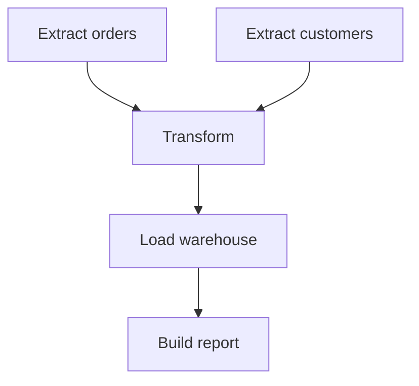

A single batch job rarely runs alone — it's usually one step in a pipeline
of dependent jobs (extract, then transform, then load, then a downstream
report), each one needing the previous step's output. This chapter is the
system that coordinates that whole pipeline, and the one property that
makes coordinating it survivable when something inevitably fails partway
through.

> [!WHY] A morning report job succeeds after its readers have already made
> their decisions. Checking only for task exceptions misses the
> operational failure: useful data arrived too late.

> [!GOALS]
>
> - Explain sensor-based readiness
> - Compute completion time from a dependency graph
> - Design idempotent historical backfills

## The DAG: dependencies as an explicit graph, not implicit ordering

```text
  extract_orders ──┐
                    ├──> transform_orders ──> load_warehouse
  extract_customers ┘                              │
                                                     ▼
                                              build_report
```

```text
  → this is the Discrete Mathematics chapter's DAG, again —
    a task's PREREQUISITES are explicit edges, not an implicit
    "runs after the previous line in a script" ordering. this
    explicitness is what makes PARALLELISM safe and automatic:
    extract_orders and extract_customers have NO dependency on
    each other, so an orchestrator can run them CONCURRENTLY
    without anyone having to notice that opportunity and
    hand-code it — the graph structure itself reveals which
    tasks are genuinely independent.
```



## Idempotent tasks: the property that makes retry safe

```text
  load_warehouse() { INSERT INTO orders SELECT * FROM staging; }

  → if this task FAILS PARTWAY through (after inserting SOME
    rows but not all) and the orchestrator RETRIES it, the
    retry INSERTS THE SAME ROWS A SECOND TIME — DUPLICATING
    data, silently, unless something explicitly prevents it.

  load_warehouse() {
    DELETE FROM orders WHERE batch_id = ?;
    INSERT INTO orders SELECT * FROM staging WHERE batch_id = ?;
  }

  → this version is IDEMPOTENT: running it once or running it
    five times (after four failed, partial attempts) produces
    the IDENTICAL final result — this is precisely the Queues
    and Async Jobs chapter's idempotency discipline, and it's
    what makes "just retry the failed task" a SAFE, routine
    operation rather than something that requires a human to
    first manually verify exactly how far the failed attempt
    got before deciding whether retrying is even safe.
```

## Backfills: rerunning history, not just handling failure

```text
  → beyond simple failure-retry, orchestration needs to support
    reprocessing an ENTIRE HISTORICAL DATE RANGE deliberately
    — a bug fixed in the transform logic needs last MONTH's
    data reprocessed with the CORRECTED logic, not just going
    forward from today.

  → this is EXACTLY why idempotent tasks matter even MORE for
    backfills than for ordinary failure-retry: a backfill
    reruns MANY historical task instances DELIBERATELY, and a
    NON-idempotent task would duplicate EVERY SINGLE historical
    day's data on every backfill, rather than correctly
    OVERWRITING each day's output with the corrected version —
    idempotency is what makes "rerun the last 90 days with the
    fixed logic" a safe, well-defined operation instead of a
    dangerous one.
```

## SLAs on data arrival: the orchestration-specific alerting question

```text
  → the Observability and SLOs chapters covered alerting on a
    SERVICE's symptoms (error rate, latency) — a data
    pipeline's equivalent, genuinely different question:
    "did TODAY's data arrive and finish processing by the time
    a DOWNSTREAM consumer (a dashboard a stakeholder checks
    every morning, an ML model retraining job) actually NEEDS
    it?"

  → a task that SUCCEEDS but finishes LATE (an upstream source
    was slow, a dependency queued behind other jobs contending
    for the same cluster) can be just as real an operational
    problem as a task that fails outright — a data-freshness
    SLA alert specifically catches THIS case, which a plain
    "did the task error" check structurally cannot, since a
    late-but-successful task never actually errors at all.
```

## Sensors: waiting for an external condition, not a fixed schedule

```text
  wait_for_file("s3://bucket/orders/2026-01-15/_SUCCESS")

  → some tasks shouldn't run on a FIXED time schedule at all
    — they should run once a specific external CONDITION is
    met (a file has genuinely finished arriving, an upstream
    team's OWN pipeline has completed and published its output).
    a SENSOR polls for that condition and only then triggers the
    downstream task — this decouples "when this task is
    SCHEDULED to check" from "when the actual DEPENDENCY is
    genuinely, actually ready," which a fixed-time schedule
    alone (running exactly at 2am regardless of whether the
    upstream data has actually arrived by then) cannot express
    at all.
```

## Retries and backoff: the same discipline, at pipeline scale

```text
  → this is directly the Queues and Async Jobs chapter's
    exponential-backoff-plus-jitter discipline, applied to
    PIPELINE TASKS instead of individual queue messages — a
    task that failed because an upstream API was briefly
    overloaded should back off before retrying (giving the
    upstream system room to recover), not hammer it again
    immediately in a tight retry loop that makes the
    upstream problem measurably worse.
```

> [!PITFALL] A green task status is not evidence that a downstream data
> deadline was met.

> [!INTERVIEW] Describe dependencies and consumer deadlines before
> choosing a fixed schedule.

> [!CHECK] Why can independent extraction tasks run concurrently?
>
> The explicit DAG has no dependency edge between them; both must complete
> before their dependent transform runs.

> [!CHECK] Why back off and add jitter after an overloaded upstream
> failure?
>
> Immediate synchronized retries can worsen the upstream overload rather
> than allowing recovery.

> [!CHECK] Why is a blind INSERT unsafe on retry?
>
> A failed attempt may already have inserted some rows, so repeating the
> append can duplicate them.

## What to take away

1. A DAG makes task dependencies explicit as a graph rather than implicit
   script ordering, which is what lets an orchestrator safely parallelize
   genuinely independent tasks without anyone hand-coding that opportunity.
2. Idempotent tasks are what make "just retry the failed step" a safe,
   routine operation — the same discipline as a queue handler, applied to a
   pipeline task that might have partially completed before failing.
3. Idempotency matters even more for deliberate backfills than for ordinary
   retry, since a backfill reruns many historical instances on purpose, and
   a non-idempotent task would duplicate every single one.
4. A data-freshness SLA catches a task that succeeded but finished too late
   for a downstream consumer to use it in time — a case a plain
   did-it-error check structurally cannot detect.
5. A sensor decouples "when a task is scheduled to check" from "when its
   actual dependency is ready," which a fixed-time schedule alone can't
   express when upstream data arrival is genuinely variable.

## Exercises

> [!EXERCISE recall] What does a sensor express that a fixed clock time
> does not?
>
> **Solution:** It waits for an actual external readiness condition, such
> as a completed source file, instead of assuming the dependency exists at
> the scheduled time.

> [!EXERCISE apply] At 01:00, two independent extracts start and take 12
> and 20 minutes. The transform needs both and takes 8 minutes, loading
> takes 5, and the report takes 4. Assume no queueing. When is the report
> ready, and does it meet a 01:35 deadline? Compare serial extraction.
>
> **Solution:** Parallel extracts finish at 01:12 and 01:20. Transform
> ends at 01:28, load at 01:33, report at 01:37: two minutes late. Serial
> extraction would consume 12 + 20 = 32 minutes, then 8 + 5 + 4 = 17 more,
> finishing at 01:49. Parallelism saves 12 minutes but does not meet the
> deadline; successful tasks alone do not establish freshness.

> [!EXERCISE stretch] A transform bug requires rerunning last month, and
> the current load appends every row each time. Recommend a prerequisite
> for safe backfill.
>
> **Solution:** Make each historical task instance idempotent, replacing
> or otherwise safely rewriting its own batch output so repeated execution
> converges to the same result. A weaker answer simply schedules the month
> again: blind appends duplicate historical data rather than correcting
> it.
