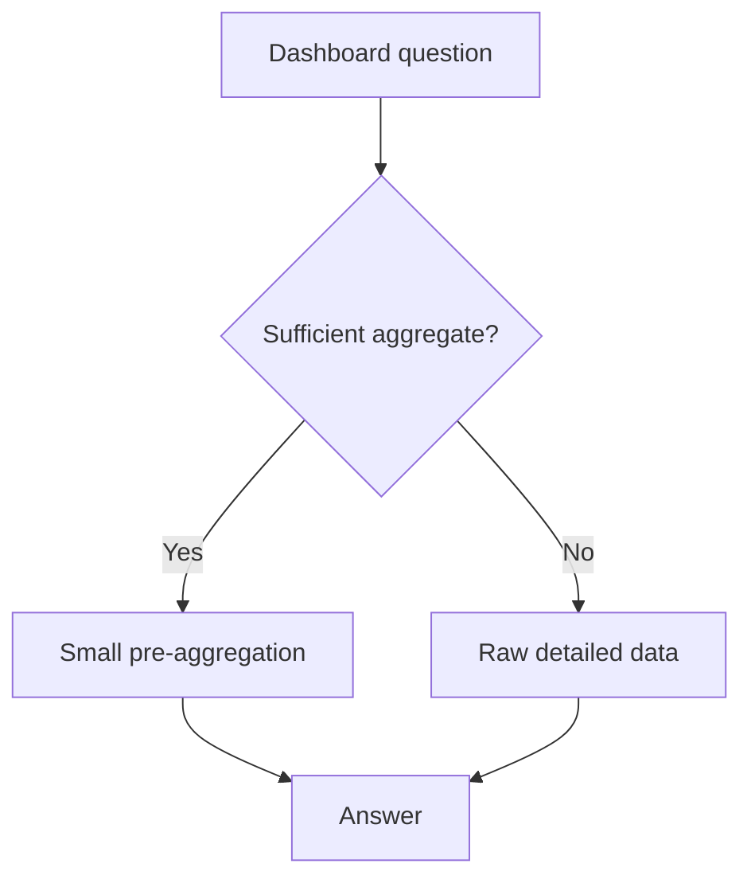

Every chapter in this track built toward analyzable, well-modeled,
trustworthy data. This final chapter is the last mile: a human is actually
looking at a dashboard right now, waiting for it to load — and a query that
takes 30 seconds against a well-modeled warehouse is still a genuinely
broken user experience, even though nothing about the data itself is wrong.

> [!WHY] A correct warehouse query takes half a minute each time a
> dashboard filter changes. Repeating the full raw scan makes data
> correctness irrelevant to users who abandon the interaction.

> [!GOALS]
>
> - Explain access patterns for warehouses and OLAP engines
> - Choose sufficient pre-aggregation grain
> - Design result caching around freshness

## The gap between "a correct warehouse query" and "an interactive dashboard"

```text
  a warehouse query scanning a billion-row fact table, even
  with EVERY optimization from the Warehouses chapter (columnar
  storage, partition pruning, predicate pushdown) applied
  correctly, might still take 5-30 SECONDS — genuinely fine for
  an ANALYST running an ad hoc, exploratory query, and
  completely unacceptable for a DASHBOARD a user expects to
  load, interactively, in under a second, the moment they open
  it or change a filter.
```

```text
  → this is a REAL, distinct requirement from "the query is
    correct and reasonably fast" — a dashboard specifically
    needs interactive, near-instant responsiveness, and getting
    there generally needs work done BEFORE the query even runs,
    not merely a faster way of running the SAME exact
    computation against the SAME full-scale raw data every
    single time it's requested.
```

## Pre-aggregation: computing the expensive part in advance

```text
  raw fact table: 1 BILLION individual order-line rows

  pre-aggregated: "revenue by region by day" — maybe 10,000
  rows TOTAL (365 days × ~30 regions), computed ONCE, in
  advance, by a periodic batch job

  → a dashboard querying the PRE-AGGREGATED table reads 10,000
    rows instead of a billion — genuinely instant, because the
    expensive aggregation work already HAPPENED, offline, on
    the batch job's own schedule, well before any user ever
    actually looked at the dashboard and had to wait for it.
```

```text
  → the real, deliberate trade-off: pre-aggregation only
    answers the SPECIFIC questions it was built for in advance
    — "revenue by region by day" cannot answer "revenue by
    INDIVIDUAL CUSTOMER" (that granular detail was deliberately
    discarded, on purpose, during aggregation) — this is
    directly the Grain chapter's "a coarser grain can't answer
    a finer question" point, resurfacing here as a genuine
    engineering design choice rather than an accidental
    limitation nobody intended.
```

## OLAP engines: purpose-built for exactly this trade-off

```text
  → specialized engines (Druid, ClickHouse, Pinot) are
    architected SPECIFICALLY for "many small, fast, aggregate
    queries against pre-indexed, often pre-aggregated data" —
    genuinely different from a general-purpose warehouse engine
    (Snowflake, BigQuery) that's optimized for FLEXIBLE, ad
    hoc, exploratory queries against RAW, unaggregated data,
    where the exact question being asked isn't fully known in
    advance.

  → this is the SAME general shape as the NoSQL and Polyglot
    Persistence chapter's "choose by access pattern"
    reasoning, resurfacing here: a warehouse for flexible
    EXPLORATION, an OLAP engine for FAST, KNOWN, repeated
    dashboard queries — genuinely different tools for
    genuinely different, distinct jobs, not one being simply a
    faster or slower version of the other.
```

## Semantic layers: consistency AND speed, together

```text
  → the Analytics Engineering chapter's semantic/metrics layer ALSO plays a
    role here specifically: a semantic layer can intelligently ROUTE a query
    to whichever pre-aggregation is ACTUALLY sufficient to answer it
    correctly (this exact question can be answered from the fast, small,
    pre-aggregated table) or fall back to the raw, full-scale data when
    genuinely necessary (this specific question needs detail no
    pre-aggregation happens to have retained) — largely TRANSPARENTLY to
    whoever's actually asking the question, who never needs to manually know
    or choose which underlying table to query.
```



## Caching: the last layer, for the truly repeated question

```text
  → the Caching chapter's discipline, one more time, at the
    VERY top of this entire stack: if the EXACT SAME dashboard
    query runs repeatedly (many different USERS opening the
    SAME shared dashboard, or one person simply refreshing the
    same page) — CACHE the RESULT itself, not merely the
    already-fast pre-aggregated DATA underneath it, and skip
    querying the OLAP engine at all for a genuinely repeated,
    identical request.

  → this is the SAME cache-invalidation question the Caching
    chapter already covered in full — HOW FRESH does this
    number genuinely need to be? a real-time operations
    dashboard needs a very SHORT cache TTL (or none at all); a
    "revenue this quarter" executive summary can reasonably
    tolerate being cached for HOURS, since a number like that
    is never actually changing meaningfully minute to minute
    anyway.
```

> [!PITFALL] A region/day aggregate cannot recover customer detail that
> was discarded before the query.

> [!INTERVIEW] State the required grain and freshness before promising a
> fast cached answer.

> [!CHECK] What makes pre-aggregation fast at query time?
>
> The expensive grouping was done earlier; the interactive query scans a
> much smaller result.

> [!CHECK] What can a semantic layer route automatically?
>
> Queries to sufficient pre-aggregations or to raw data when required
> detail is missing.

> [!CHECK] Why cache the result above an already-fast aggregate?
>
> Identical repeated questions can skip the engine query altogether within
> the allowed freshness window.

## What to take away

1. A dashboard's interactive responsiveness is a distinct requirement from
   "the query is correct and reasonably fast" — getting there generally
   needs work done before the query runs, not a faster way to run the same
   full-scale computation every time.
2. Pre-aggregation trades detail for speed deliberately — a table
   aggregated by region and day genuinely cannot answer a per-customer
   question, the grain chapter's coarser-can't-answer-finer point
   resurfacing as an intentional engineering choice.
3. OLAP engines and general-purpose warehouses are genuinely different
   tools for different jobs (fast known repeated queries vs flexible
   exploration), the same access-pattern-driven choice as picking a
   database.
4. A semantic layer can transparently route a query to whichever
   pre-aggregation actually suffices, or fall back to raw data when
   necessary, without whoever's asking needing to know which table to query.
5. Caching a dashboard's actual result, on top of already-fast
   pre-aggregated data, is the same TTL-freshness trade-off the caching
   chapter covers — how fresh a number genuinely needs to be determines how
   long it's safe to cache.

## Exercises

> [!EXERCISE recall] Why choose different serving paths for exploration
> and repeated dashboards?
>
> **Solution:** A warehouse supports flexible ad hoc raw-data questions;
> an OLAP engine is designed for fast known aggregate access patterns. The
> workload, not a universal ranking, decides which path fits.

> [!EXERCISE apply] Available data includes revenue by region/day and raw
> order lines with customer ids. Choose a sufficient source for monthly
> regional revenue, individual-customer revenue and daily global revenue;
> explain any aggregation.
>
> **Solution:** Monthly regional revenue can sum the region/day table
> across days within the month. Individual-customer revenue needs raw
> lines because the aggregate has no customer grain. Daily global revenue
> can sum the aggregate across regions for each day. Only route a question
> to the fast table when its retained dimensions can answer it correctly.

> [!EXERCISE stretch] A real-time operations dashboard and a quarterly
> summary share a proposed hours-long result cache. Recommend a policy.
>
> **Solution:** Choose cache freshness separately by consumer need: a very
> short TTL or no cache for real-time operations, and a longer cache only
> where the quarterly summary tolerates it. A weaker answer applies the
> same hours-long TTL everywhere because both are dashboards: it can serve
> operationally stale numbers even when query latency looks excellent.
