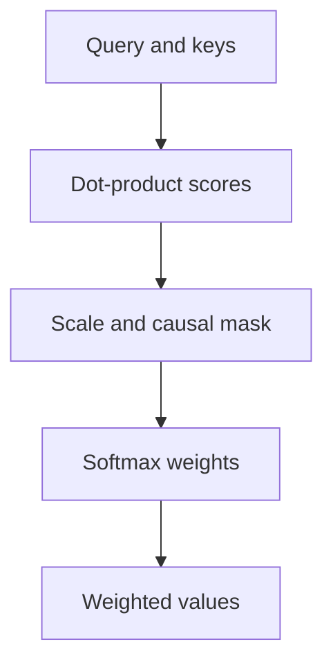

Attention lets every position look directly at every other position, weighted by
learned relevance. It replaced recurrence because it is parallel, because it has
no information bottleneck, and because the path between any two positions is a
single step rather than a chain.

> [!WHY] A decoder’s validation improves after a masking change, but the
> change lets each position read future tokens. The apparent gain
> disappears during generation, when those tokens do not exist yet.

> [!GOALS]
>
> - Explain query-key-value soft lookup
> - Compute a masked weighted-value output
> - Choose an exact attention-memory optimization

## The mechanism

```text
  Attention(Q, K, V) = softmax(QKᵀ / √d) V
```

```text
  the database analogy, which is the useful one

    QUERY   what this position is looking for
    KEY     what each position offers
    VALUE   what each position contributes if selected

  → compute the match between the query and every key
  → normalise the matches into weights
  → return the weighted sum of values

  a SOFT lookup: instead of retrieving one entry, retrieve a
  weighted blend of all of them.
```

```text
  step by step, for one query position

    scores  = q · kᵢ  for every position i     [N]
    scaled  = scores / √d
    weights = softmax(scaled)                  sums to 1
    output  = Σ weightsᵢ · vᵢ
```

**The √d scaling is not cosmetic.** Dot products of d-dimensional vectors have
variance proportional to d, so without scaling the softmax saturates for large d —
one weight approaches 1, the rest approach 0, and the gradient vanishes. Dividing
by √d keeps the scores in a range where softmax has useful gradients.



## Self-attention versus cross-attention

```text
  SELF-ATTENTION      Q, K, V all from the SAME sequence
                      → positions attend to each other

  CROSS-ATTENTION     Q from one sequence, K and V from
                      another
                      → the decoder attends to the encoder;
                        a language model attends to image
                        features
```

## Multi-head attention

```text
  instead of one attention over d dimensions,
  run h attentions over d/h dimensions each, in parallel,
  and concatenate.

    head 1: syntactic dependencies
    head 2: coreference
    head 3: positional/local patterns
    ...
```

```text
  → different heads specialise on different relationships
  → the same total compute, because each head is narrower
  → more expressive than one large attention
```

The specialisation is real and observable — interpretability work has identified
heads that track specific syntactic relations — though it is emergent rather than
designed, and heads are far less cleanly separable than the tidy story suggests.

## Causal masking

```text
  a decoder must not see the future.

    positions:   1    2    3    4
       1        ✓    ✗    ✗    ✗
       2        ✓    ✓    ✗    ✗
       3        ✓    ✓    ✓    ✗
       4        ✓    ✓    ✓    ✓

  set masked scores to −inf before the softmax, so their
  weight is exactly zero.
```

```text
  this is what allows PARALLEL TRAINING on a sequence:

    every position predicts its next token SIMULTANEOUSLY,
    each seeing only its own prefix.
    → one forward pass gives N training signals
```

That property — N training examples from one pass — is a large part of why
next-token prediction scales so well, and it is entirely a consequence of the
mask.

## The cost

```text
  the attention matrix is [N × N]

    N = 1,000     1M entries
    N = 10,000    100M
    N = 100,000   10 BILLION entries per head per layer

  compute and memory are QUADRATIC in sequence length.
```

```text
  the responses, from the GPU and architecture topics

  FLASHATTENTION     never materialise the matrix; tile through
                     shared memory with an online softmax
                     → O(N) memory, several times faster,
                       and MORE arithmetic
  SLIDING WINDOW     attend only to the last W tokens
  SPARSE PATTERNS    strided, local + global
  LINEAR ATTENTION   approximate the softmax to get O(N)
                     → weaker in practice
  GQA / MQA / MLA    reduce the KV cache, not the compute
```

FlashAttention is the one that changed practice, because it is exact — it does not
approximate attention, it computes the same result with a different memory access
pattern. Approximate methods trade quality; FlashAttention does not.

## Why attention works well

```text
  □  PATH LENGTH 1 between any two positions
     → an RNN needs O(N) steps for the same connection
  □  fully PARALLEL across positions
  □  CONTENT-BASED routing — the model decides what to
     attend to, dynamically, per input
  □  weak inductive bias — learns structure from data,
     which is a weakness at small scale and a strength at
     large
```

```text
  attention is best understood as LEARNED, DYNAMIC ROUTING.

    a convolution has a fixed connectivity pattern.
    attention computes its connectivity per input.
```

That reframing explains why attention generalises across modalities: routing
information between positions is a generic operation, and text, images and audio
all need it.

## Encoder, decoder, or both

```text
  ENCODER-ONLY (BERT)
    bidirectional attention; masked-token pretraining
    → classification, retrieval, embedding
    → cannot generate

  DECODER-ONLY (GPT, Llama)
    causal attention; next-token pretraining
    → generation, and everything else via prompting
    → THE dominant architecture

  ENCODER-DECODER (T5, translation)
    encoder reads, decoder generates with cross-attention
    → sequence-to-sequence tasks
```

**Decoder-only won**, and the reason is generality: a decoder can do
classification by generating a label, retrieval by generating an embedding, and
translation by generating the target — while an encoder cannot generate at all.
One architecture, one pretraining objective, all tasks.

## Interpretability, honestly

```text
  attention weights are OFTEN visualised as explanations.

  be careful:
    □  high attention weight ≠ causal importance
    □  information also flows through the residual stream and
       the FFN
    □  different heads disagree, and averaging them is
       meaningless
    □  a model can attend to a token and ignore its content
```

Attention maps are _suggestive_ and not explanations. This is the same caution as
the reasoning topic's warning about traces: an observable internal quantity that
looks like an explanation is not necessarily the computation.

> [!PITFALL] An attention heatmap is not by itself a causal explanation of
> the prediction.

> [!INTERVIEW] Separate score computation, masking and value aggregation,
> then name which resource an optimization changes.

> [!CHECK] How do self- and cross-attention differ?
>
> Self-attention takes Q, K and V from one sequence; cross-attention takes
> queries from one and keys/values from another.

> [!CHECK] Why divide scores by the square root of dimension?
>
> It controls score scale so the softmax is less likely to saturate and
> lose useful gradients.

> [!CHECK] How can multiple heads keep the same overall compute scale?
>
> Each head operates in a narrower share of the total dimensionality
> rather than adding a full-width attention independently.

## What to take away

1. Attention is a soft lookup: query against keys, normalise, return a weighted
   blend of values — and the √d scaling prevents softmax saturation.
2. Multiple heads specialise on different relationships at the same total compute.
3. Causal masking is what allows N training signals from one forward pass, which is
   central to why next-token pretraining scales.
4. Cost is quadratic in sequence length; FlashAttention removes the memory cost
   exactly rather than approximately.
5. Attention is learned, dynamic routing — which is why it transfers across
   modalities where a fixed connectivity pattern would not.
6. Decoder-only won on generality, and attention weights are suggestive rather than
   explanatory.

Next: what the representations inside these models are for.

## Exercises

> [!EXERCISE recall] What do the query, key and value contribute to a soft
> lookup?
>
> **Solution:** The query expresses what is sought, keys express what
> positions offer, and values supply the content blended according to
> normalized query-key matches.

> [!EXERCISE apply] At query position 2, raw scores for positions 1, 2 and
> 3 are [4,4,100], with d=4. Their values are [(2,0),(0,6),(100,100)].
> Apply a causal mask including the current position, then find weights
> and output. Equal unmasked scores receive equal softmax weights.
>
> **Solution:** Use scaled scores = scores/sqrt(d), then mask forbidden
> positions before softmax. sqrt(4)=2, so the scores are [2,2,50]; masking
> the future position gives [2,2,−inf]. Normalization gives weights
> [0.5,0.5,0]. Output = sum_i weights_i×v_i =
> 0.5×(2,0)+0.5×(0,6)+0×(100,100) = (1,0)+(0,3)+(0,0) = (1,3). The large
> future score must not influence the result.

> [!EXERCISE stretch] A long-sequence run runs out of memory materializing
> the attention matrix, but the team wants to preserve exact attention.
> Recommend an approach and its limit.
>
> **Solution:** Use FlashAttention’s tiled computation to avoid
> materializing the full matrix while preserving the attention result. A
> weaker answer substitutes an approximate linear-attention rule and calls
> it identical: that changes the computation. The exact memory improvement
> does not make full attention’s arithmetic linear in sequence length.
