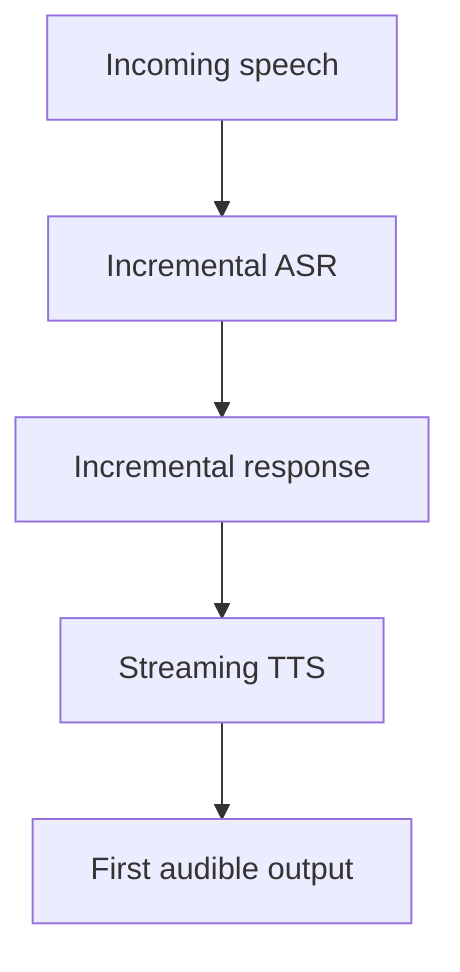

Audio is a one-dimensional signal sampled tens of thousands of times per second.
Modelling it directly at that rate is expensive, so nearly every system transforms
it into something coarser first — and understanding that transformation explains
most of the architecture choices.

> [!WHY] A voice assistant waits for complete transcription, complete text
> generation and only then speech synthesis. Individually fast stages can
> still create an awkward silence when every stage waits for the previous
> one.

> [!GOALS]
>
> - Explain the role of audio tokenization
> - Evaluate a staged conversational latency budget
> - Design endpointing tests for natural pauses

## Representations

```text
  RAW WAVEFORM       16,000–48,000 samples per second
                     → one second is 16k+ values
                     → modelling directly is possible
                       (WaveNet) and expensive

  SPECTROGRAM        short-time Fourier transform: a
                     time × frequency image
                     → 2D, so vision architectures apply

  MEL SPECTROGRAM    frequency bins spaced by human perception
                     → the standard input; ~100 frames/second
                       instead of 16,000 samples

  LEARNED /
  DISCRETE TOKENS    a neural codec compresses audio into
                     discrete tokens
                     → audio becomes a SEQUENCE OF TOKENS, so
                       language-model machinery applies
                       directly
```

```text
  the trend is the last one:

    audio → discrete tokens → a transformer over them

  which is why "multimodal language model" now genuinely
  includes audio, rather than bolting a separate system on.
```

## The tasks

```text
  ASR (speech to text)
    → mature. Whisper-class models are robust across accents,
      noise and languages.
    → encoder-decoder or CTC-based

  TTS (text to speech)
    → near-human quality; typically text → mel spectrogram →
      vocoder → waveform
    → voice cloning from seconds of audio is now routine,
      with the obvious misuse implications

  SPEECH TO SPEECH
    → no text intermediate: preserves prosody, emotion and
      timing, and avoids cumulative transcribe-then-synthesise
      errors
    → lower latency; the direction of travel for conversation

  AUDIO UNDERSTANDING
    → classification, event detection, speaker diarisation,
      music analysis
```

## Streaming and latency

```text
  the constraint that shapes conversational systems

    a natural turn-taking gap is ~200 ms.
    a pipeline of ASR → LLM → TTS, each waiting for the
    previous to complete, is seconds.
```

```text
  the techniques

  STREAMING ASR       transcribe incrementally, revising as
                      more audio arrives
  ENDPOINTING         detect when the speaker has finished —
                      harder than it sounds, and the main
                      source of awkward interruptions
  STREAMING TTS       begin speaking before the full text is
                      generated
  SPEECH-TO-SPEECH    remove the pipeline entirely
```

**Endpointing is the underrated difficulty.** Deciding that a person has stopped
talking rather than paused mid-thought determines whether a voice interface feels
natural or rude, and it is a genuinely hard signal-processing and modelling
problem that a demo never exposes.



## Practical notes

```text
  □  SAMPLE RATE must match what the model expects —
     resampling mismatches degrade accuracy silently
  □  NOISE and reverberation dominate real-world accuracy;
     augment with them
  □  ACCENT and language coverage vary enormously between
     models and are a fairness issue
  □  audio is LARGE: a minute of 16 kHz mono is ~2 MB;
     transport and storage matter
  □  VOICE IS BIOMETRIC data — consent, retention and
     deletion obligations apply, per the privacy topic
  □  ALIGNMENT (which word at which timestamp) is needed for
     captions and editing, and not all models provide it
```

The sample-rate point is a specific and common bug: passing 44.1 kHz audio to a
model expecting 16 kHz, or resampling with a poor algorithm, produces measurably
worse transcription with no error message.

> [!PITFALL] A sample-rate mismatch can degrade transcription without
> raising an explicit processing error.

> [!INTERVIEW] Distinguish time to first audible output from time to
> finish processing the entire turn.

> [!CHECK] Why can a spectrogram use vision machinery?
>
> It represents audio as a time-by-frequency image rather than only a
> one-dimensional waveform.

> [!CHECK] What information does word alignment add?
>
> Which word occurs at which timestamp, useful for captions and editing.

> [!CHECK] Why test noise, reverberation and accent slices?
>
> Real-world audio conditions and coverage can dominate accuracy even when
> a clean demo works.

## What to take away

1. Raw audio is too high-rate to model directly at scale; mel spectrograms and
   learned discrete tokens are the practical representations.
2. Discrete audio tokens let ordinary transformer machinery apply, which is what
   makes genuinely multimodal audio models possible.
3. ASR is mature; TTS is near-human and makes voice cloning routine, with the
   misuse implications that follow.
4. Speech-to-speech removes the pipeline's cumulative errors and latency, and is
   the direction of travel for conversation.
5. Endpointing — knowing when someone has finished speaking — is the underrated
   difficulty in voice interfaces.
6. Match the sample rate exactly, augment with noise and reverberation, and treat
   voice as biometric data.

Next: state space models.

## Exercises

> [!EXERCISE recall] How do learned discrete audio tokens make
> language-model machinery applicable?
>
> **Solution:** A neural codec converts the waveform into a coarser
> sequence of discrete symbols, so a transformer can operate over tokens
> instead of modeling every raw sample directly.

> [!EXERCISE apply] In a hypothetical turn, complete ASR takes 80 ms,
> complete text generation 90 ms, and TTS needs 70 ms after it starts to
> emit first sound. Sequential stages start only after the prior stage
> completes. With streaming partial outputs, text generation can instead
> start at 40 ms and TTS at 110 ms. Compare first-sound times against a
> 200 ms budget.
>
> **Solution:** Sequential first-sound time is ASR duration+generation
> duration+TTS first-sound latency = 80+90+70 = 240 ms, exceeding 200 by
> 40 ms. Under the stipulated streaming start times, text generation
> finishes at 40+90=130 ms while TTS can start from partial text at 110
> ms. First sound is TTS start+its latency = 110+70=180 ms, leaving
> 200−180=20 ms. This is the assumed schedule’s first sound, not a
> guarantee that all stages or speech output are complete.

> [!EXERCISE stretch] A demo cuts speakers off whenever they pause briefly
> within a sentence. Recommend an evaluation before changing the language
> model.
>
> **Solution:** Test endpointing against natural pauses and genuine
> end-of-turn cases, since deciding whether the speaker finished
> determines interruptions. A weaker answer only accelerates text
> generation: it does not repair a detector that wrongly decides the user
> has already stopped speaking.
