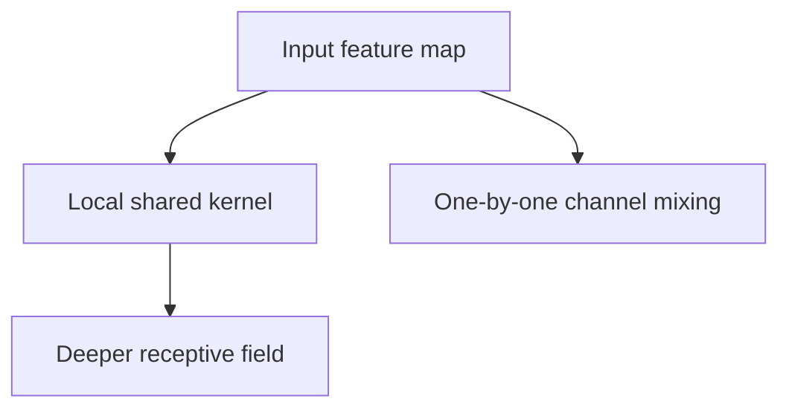

A convolution encodes two assumptions about images — that features are local, and
that a feature is the same wherever it appears. Those assumptions are correct
enough that CNNs dominated vision for a decade, and understanding them explains
both their strength and where they were superseded.

> [!WHY] A vision block needs to reduce channel width but adds another
> spatial convolution by habit. Choosing the operation from the required
> mixing can reduce parameters without changing the block’s intended role.

> [!GOALS]
>
> - Explain convolutional locality and sharing
> - Compare channel-only and spatial parameter counts
> - Choose a small-data vision starting point

## The convolution

```text
  slide a small kernel over the input, computing a dot
  product at each position.

    input          kernel      output
    ┌─┬─┬─┬─┐      ┌─┬─┐       ┌─┬─┬─┐
    │ │ │ │ │  ×   │ │ │   =   │ │ │ │
    ├─┼─┼─┼─┤      ├─┼─┤       ├─┼─┼─┤
    │ │ │ │ │      │ │ │       │ │ │ │
    └─┴─┴─┴─┘      └─┴─┘       └─┴─┴─┘
```

```text
  the two properties, and why they matter

  LOCAL CONNECTIVITY   each output depends on a small
                       neighbourhood
                       → far fewer parameters than a dense
                         layer

  WEIGHT SHARING       the SAME kernel everywhere
                       → translation equivariance: a cat
                         detected in the corner uses the same
                         weights as one in the centre
                       → and it is a massive parameter saving
```

```text
  a dense layer on a 224×224×3 image with 1000 outputs
    = 150 million parameters

  a 3×3 convolution with 64 filters
    = 1,728 parameters

  → four orders of magnitude, because of sharing
```

## The building blocks

```text
  STRIDE        step size; stride 2 halves spatial dimensions
  PADDING       preserve size at the edges
  POOLING       downsample (max or average)
                → increasingly replaced by strided convolutions
  RECEPTIVE
  FIELD         how much of the input one output sees;
                grows with depth
  1×1 CONV      no spatial mixing; mixes CHANNELS and changes
                their count — a cheap way to control width
  DEPTHWISE
  SEPARABLE     spatial and channel mixing SPLIT into two
                cheap steps
                → 8–9× fewer operations; the basis of mobile
                  architectures
```

The receptive field is the concept that ties depth to capability: a single 3×3
convolution sees 3 pixels, two stacked see 5, and a deep stack sees the whole
image. Depth is how a CNN builds global understanding out of local operations.



## The architectural progression

```text
  LeNet (1998)      convolutions work
  AlexNet (2012)    depth + GPUs + ReLU + dropout → the
                    result that started the era
  VGG (2014)        uniform 3×3 stacks; simple and deep
  ResNet (2015)     RESIDUAL connections → 100+ layers
                    trainable. the most important idea here.
  Inception         multiple kernel sizes in parallel
  DenseNet          every layer connected to every later layer
  MobileNet         depthwise separable → mobile deployment
  EfficientNet      systematic scaling of depth, width and
                    resolution together
  ConvNeXt (2022)   a CNN modernised with transformer design
                    choices — competitive with ViT
```

**ResNet is the one that matters most**, and for the reason the backprop chapter
gave: the identity path gives the gradient a derivative-1 route to early layers.
That single change took trainable depth from ~20 layers to hundreds.

## Vision transformers

```text
  split the image into patches, treat each as a token,
  and run a standard transformer.

  ┌───┬───┬───┐
  │ p │ p │ p │  →  [patch embeddings + position]  →  transformer
  ├───┼───┼───┤
  │ p │ p │ p │
  └───┴───┴───┘
```

```text
  CNN                              ViT
  strong inductive bias            weak inductive bias
  (locality, translation           (learns spatial structure
   equivariance built in)           from data)

  data-efficient                   DATA-HUNGRY — needs large
  good on small datasets            pretraining to beat CNNs
  local receptive field grows      GLOBAL attention from
  with depth                        layer 1
```

```text
  the finding that matters:

    with ENOUGH data, the learned bias beats the built-in one.
    with LITTLE data, the built-in bias wins.

  → ViTs dominate at scale; CNNs remain the better choice for
    small datasets and for edge deployment
```

Hybrid architectures (convolutional stems feeding transformer blocks) capture much
of both, and ConvNeXt showed that a CNN given transformer-era design choices —
larger kernels, fewer normalisations, GELU, inverted bottlenecks — closes most of
the gap. The lesson is that much of the ViT advantage was training recipe rather
than architecture.

## The tasks

```text
  CLASSIFICATION     one label per image
  DETECTION          boxes + labels
                     → YOLO (one-stage, fast),
                       Faster R-CNN (two-stage, accurate),
                       DETR (transformer, set prediction)
  SEGMENTATION       per-pixel labels
                     → U-Net (encoder-decoder with skip
                       connections), Mask R-CNN, SAM
  POSE / DEPTH /
  TRACKING           structured spatial outputs
```

U-Net's skip connections are worth noting as a general pattern: an
encoder-decoder that concatenates encoder features into the decoder preserves fine
spatial detail that pooling destroyed, which is why it dominates medical imaging
and appears inside diffusion models.

## Transfer learning

```text
  □  take a model pretrained on a large dataset
  □  replace the final layer
  □  fine-tune — the whole thing, or just the head

  → works remarkably well; early layers learn edges and
    textures that transfer across essentially all image tasks
```

**Almost nobody trains a vision model from scratch.** Pretrained features are so
transferable that fine-tuning a pretrained backbone on a few thousand images beats
training from scratch on far more. This is the single most useful practical fact
in computer vision.

## Practical guidance

```text
  □  START with a pretrained model
  □  augmentation matters more than architecture for small
     datasets
  □  match preprocessing to the pretrained model exactly
     (normalisation statistics, input size)
  □  for edge deployment: MobileNet/EfficientNet-Lite, not a
     shrunk server model
  □  for small data: a CNN, not a ViT
  □  for large data and scale: a ViT or a hybrid
  □  measure at the RESOLUTION you will deploy at
```

The preprocessing point causes a specific and common bug: a pretrained model
expects inputs normalised with particular per-channel means and standard
deviations, and feeding it differently-normalised inputs degrades accuracy
substantially with no error.

> [!PITFALL] A pretrained backbone can lose accuracy silently if
> deployment normalization or input size differs from its training recipe.

> [!INTERVIEW] Say whether a block needs spatial mixing, channel mixing or
> both before choosing a kernel.

> [!CHECK] Why do residual paths help deep CNNs train?
>
> They give early layers an identity gradient path rather than only a long
> product of transformations.

> [!CHECK] How does a vision transformer construct its sequence?
>
> It embeds image patches with position information and applies a
> transformer to those tokens.

> [!CHECK] Why can U-Net-style skips help segmentation?
>
> They pass encoder spatial detail to the decoder that downsampling would
> otherwise discard.

## What to take away

1. Convolutions encode locality and translation equivariance, and weight sharing
   saves four orders of magnitude of parameters versus a dense layer.
2. Depth is how local operations build global understanding — the receptive field
   grows with it.
3. ResNet's identity path is the most important architectural idea here; it took
   trainable depth from ~20 layers to hundreds.
4. ViTs have weaker inductive bias and need more data; with enough of it the
   learned bias beats the built-in one, and ConvNeXt showed much of the gap was
   training recipe.
5. Almost nobody trains vision models from scratch — pretrained features transfer
   remarkably well.
6. Match preprocessing to the pretrained model exactly; mismatched normalisation
   degrades accuracy silently.

Next: sequences, and the models that preceded attention.

## Exercises

> [!EXERCISE recall] What assumptions do local connectivity and weight
> sharing encode?
>
> **Solution:** Nearby image values interact, and the same feature can be
> recognized at different positions using the same kernel. These provide
> spatial inductive bias and avoid a separate weight set at every
> position.

> [!EXERCISE apply] A block has 16 input channels and needs 8 output
> channels at unchanged spatial size. It only needs channel mixing.
> Compare bias-free 1×1 and 3×3 convolutions, with unit stride and
> suitable padding, and choose an operation.
>
> **Solution:** A shared kernel has
> kernel_height×kernel_width×input_channels×output_channels weights. The
> 1×1 choice has 1×1×16×8=16×8=128. The 3×3 choice has
> 3×3×16×8=9×128=1,152. Ratio = 1,152/128=9. Choose 1×1 for the stated
> channel-only job; the larger kernel adds spatial mixing that is not
> required. These are parameter counts, not a measured latency guarantee.

> [!EXERCISE stretch] A team has a small labelled vision dataset and
> proposes training a new large ViT from scratch. Recommend a first
> experiment.
>
> **Solution:** Start from a pretrained CNN or otherwise appropriate
> pretrained backbone, match its preprocessing and use suitable
> augmentation before escalating architecture scale. A weaker answer
> assumes weak-bias ViT training will discover structure from little data
> merely because it wins at large pretraining scale.
