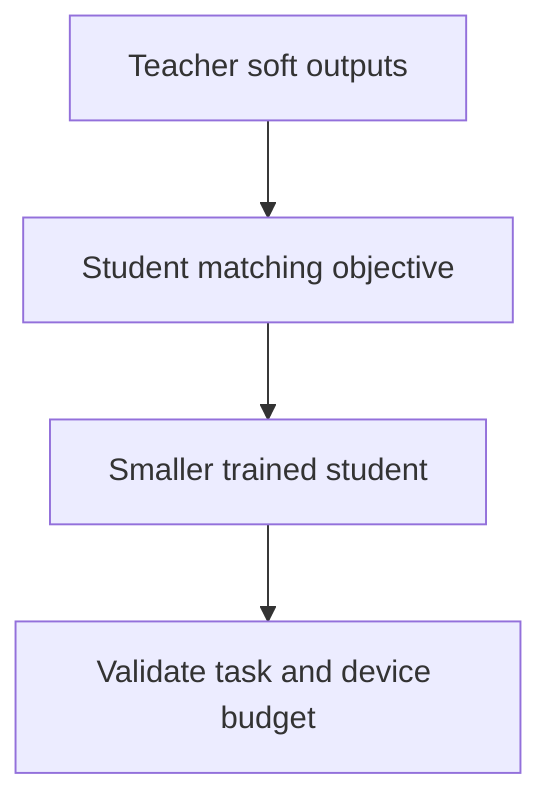

A trained model is usually far larger than it needs to be for the accuracy it
achieves. Three families of technique exploit that: removing parameters, training
a smaller model to imitate a larger one, and searching for a better architecture
under an explicit budget.

> [!WHY] A release reports high sparsity while device latency stays
> unchanged. Removing weights on paper does not reduce the dense kernel’s
> work unless the execution path exploits that structure.

> [!GOALS]
>
> - Explain information in a teacher distribution
> - Choose a compressed model against measured constraints
> - Evaluate the scope of a distilled model’s claims

## Pruning

```text
  UNSTRUCTURED          zero individual weights, usually by magnitude
                        ✓ 80–95% sparsity with little accuracy loss
                        ✗ NO SPEEDUP on standard hardware — a sparse
                          matrix stored densely does the same work

  STRUCTURED            remove whole channels, heads or layers
                        ✓ a REAL speedup — the tensor is genuinely smaller
                        ✗ more accuracy loss at equal sparsity

  2:4 SEMI-STRUCTURED    exactly 2 of every 4 weights zero
                        ✓ ~2× on Ampere+ tensor cores, hardware supported
                        ✓ the practical middle ground
```

```text
  the trap worth stating plainly:

    "we achieved 90% sparsity" means nothing for latency
    unless the sparsity PATTERN is one the hardware or the
    kernel exploits.
```

```text
  the procedure

    train → prune → FINE-TUNE to recover → repeat

  iterative pruning with recovery beats a single aggressive
  pass by a wide margin.
```

**The lottery ticket hypothesis** is the interesting theoretical result here: a
randomly initialised network contains a sparse subnetwork that, trained from *the
same initialisation*, matches the full network. It suggests much of training is
finding which subnetwork to use — and it has not translated into a practical way
to skip the dense training phase.

## Distillation

```text
  TEACHER (large) ──▶ soft outputs / features / rationales
                            │
                            ▼
  STUDENT (small)  trained to match the TEACHER, not just
                   the hard labels
```

```text
  why it beats training the small model directly

    a hard label says "cat".
    the teacher's distribution says "70% cat, 25% lynx,
    5% dog" — which teaches SIMILARITY STRUCTURE the label
    does not contain.

  → the teacher's uncertainty is itself information
```

```text
  the variants

  LOGIT MATCHING     match the output distribution
                     (temperature-softened)
  FEATURE MATCHING   match intermediate representations
  SEQUENCE-LEVEL     train on the teacher's generated outputs
  RATIONALE          train on the teacher's reasoning, not
                     just its answers
```

```text
  the honest assessment

    on a NARROW task, a well-distilled small model routinely
    matches its teacher.
    on BROAD general capability, it does not.
```

**Distillation is the most under-used compression technique**, as the
inference-optimization topic said, because it looks like a modelling project
rather than an efficiency one. A distilled model that meets the bar is 10×
cheaper permanently, which no serving optimisation matches.



## Neural architecture search

```text
  search a space of architectures for one that maximises
  accuracy under a CONSTRAINT.

  EVOLUTIONARY     mutate and select
  RL-BASED         a controller proposes architectures
  DIFFERENTIABLE   relax the discrete choice; optimise by
  (DARTS)          gradient — far cheaper
  ONE-SHOT         train one supernet; evaluate subnetworks
                   without retraining
```

```text
  the lesson that matters for practice:

    search under a LATENCY constraint measured ON THE TARGET
    DEVICE, not under a FLOPs proxy.

  FLOPs poorly predicts real latency — memory access
  patterns and operator support dominate, as the edge topic
  showed.
```

NAS produced MobileNet-class and EfficientNet-class architectures and is expensive
enough that most teams should use its *results* rather than run it. The exception
is deployment to unusual hardware where published architectures were not searched
for your constraints.

## Choosing

```text
  need a smaller model
    │
    ├─ is there a good pretrained SMALL model already?
    │     → use it. seriously — this is the common answer.
    │
    ├─ narrow task, teacher available?
    │     → DISTIL. usually the largest win.
    │
    ├─ need modest size reduction, minimal effort?
    │     → QUANTISATION first (from the GPU topic)
    │
    ├─ have hardware sparsity support?
    │     → 2:4 structured pruning
    │
    └─ unusual hardware constraints, and budget?
          → architecture search under a measured latency
            constraint
```

**Quantisation before pruning** is the usual right order: it is simpler, better
supported, and gives 2–4× with little accuracy cost, where pruning gives a real
speedup only with hardware support.

> [!PITFALL] Unstructured zeros stored and computed densely do not
> establish a latency reduction.

> [!INTERVIEW] Use measurements on the actual deployment device instead of
> treating sparsity or FLOPs as latency.

> [!CHECK] Why does structured pruning make real tensor dimensions
> smaller?
>
> It removes channels, heads or layers instead of only setting individual
> entries to zero.

> [!CHECK] Why fine-tune between pruning rounds?
>
> Recovery lets the network regain quality instead of taking one large
> unrecovered removal step.

> [!CHECK] What constraint should architecture search use?
>
> Measured latency on the target device, because operator support and
> memory access can defeat a FLOPs proxy.

## What to take away

1. Unstructured pruning reports impressive sparsity and gives no speedup without a
   hardware-exploitable pattern; 2:4 semi-structured is the practical middle
   ground.
2. Iterative prune-then-recover beats a single aggressive pass.
3. Distillation works because the teacher's output distribution carries similarity
   structure that a hard label does not.
4. Distilled small models match their teachers on narrow tasks and not on broad
   capability.
5. Architecture search must be constrained by measured latency on the target
   device, because FLOPs poorly predicts it.
6. Try an existing small model first, then quantisation, then distillation — and
   pruning only with hardware support.

That completes the Deep Learning track. It connects to **LLMs & Frontier AI** for
what these components are assembled into, and to **ML Systems** for training and
serving them.

## Exercises

> [!EXERCISE recall] What can a teacher’s soft distribution teach that one
> hard label does not?
>
> **Solution:** It describes similarity and uncertainty among
> alternatives, giving the student structure beyond a single correct-class
> indicator.

> [!EXERCISE apply] For a narrow task, the deployment limit is 5 ms and
> minimum measured accuracy is 0.93. On the target device: A has 90%
> unstructured sparsity, 9 ms, accuracy 0.95; B has structured pruning, 6
> ms, accuracy 0.92; C is a distilled student, 4 ms, accuracy 0.94. Choose
> a candidate and identify why the others fail.
>
> **Solution:** C satisfies both constraints: 4 ms is within 5 ms and 0.94
> is at least 0.93. A meets quality but fails latency despite impressive
> sparsity. B fails both latency and minimum quality. Choose from measured
> task/device performance rather than selecting the largest sparsity
> percentage; the figures are this scenario’s measurements, not generic
> compression guarantees.

> [!EXERCISE stretch] A student matches a teacher on a narrow benchmark
> and the team claims that it now matches the teacher’s broad general
> capability. Recommend a validation claim.
>
> **Solution:** Limit the claim to the validated narrow task and evaluate
> any broader intended use separately. A weaker answer promotes one
> narrow-task result into general equivalence: the chapter distinguishes
> successful narrow distillation from preserving a teacher’s broad
> capability.
