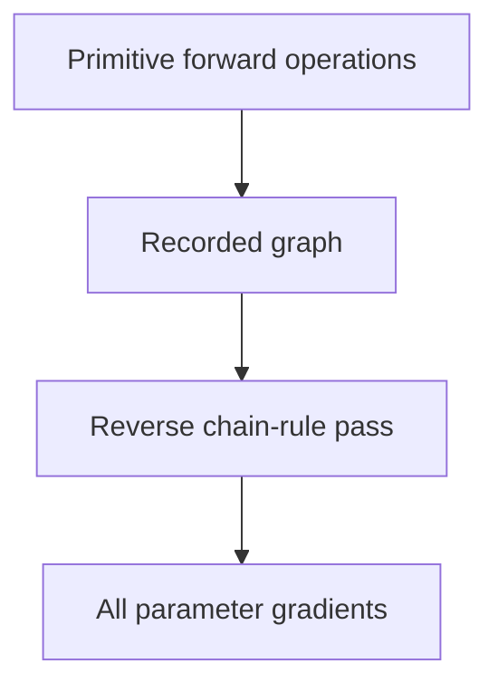

You write a forward pass; the framework produces gradients. The mechanism is
worth understanding because its shape explains most of the surprises — memory
growth, missing gradients, and why some operations break differentiability.

> [!WHY] A training process runs out of memory only after many batches,
> although each batch’s tensor shapes are unchanged. A metric accumulator
> can keep every backward graph alive instead of storing just a detached
> value.

> [!GOALS]
>
> - Explain reverse-mode efficiency for training
> - Trace gradients through primitive operations
> - Diagnose unintended graph retention

## Automatic differentiation

```text
  NOT symbolic differentiation (deriving a formula)
  NOT numerical differentiation (finite differences)

  AUTODIFF: build a GRAPH of primitive operations during the
  forward pass, each with a known local derivative, then
  apply the chain rule backwards through it.
```

```text
  y = (a * b) + c

  forward, recording:
    t = a * b       ∂t/∂a = b,  ∂t/∂b = a
    y = t + c       ∂y/∂t = 1,  ∂y/∂c = 1

  backward from ∂L/∂y:
    ∂L/∂c = ∂L/∂y
    ∂L/∂t = ∂L/∂y
    ∂L/∂a = ∂L/∂t · b
    ∂L/∂b = ∂L/∂t · a
```

```text
  REVERSE MODE (what frameworks use)
    one backward pass gives gradients for ALL inputs
    → efficient when outputs ≪ inputs, which is exactly
      training: one scalar loss, millions of parameters

  FORWARD MODE
    one pass per input
    → efficient when inputs ≪ outputs; used for Jacobians
      and some higher-order applications
```



## Define-by-run versus define-and-run

```text
  DEFINE-AND-RUN (TF 1.x)         DEFINE-BY-RUN (PyTorch)
  build a static graph, then      the graph is built as the
  execute it                      code runs

  ✓ optimisable ahead of time     ✓ ordinary control flow works
  ✓ deployable without Python     ✓ debuggable with a debugger
  ✗ awkward control flow          ✓ dynamic shapes
  ✗ hard to debug                 ✗ per-op Python overhead
```

Define-by-run won on developer experience, and the frameworks then recovered the
performance with compilation: `torch.compile` traces the dynamic graph and
compiles it, giving fused kernels and ahead-of-time optimisation without giving up
the eager programming model.

```text
  torch.compile's main win is KERNEL FUSION — the
  memory-bound elementwise chains from the GPU topic get
  fused into single kernels, typically 1.3–2× on real models.
```

## The tensor

```text
  a tensor is
    □  a data pointer
    □  a SHAPE
    □  a STRIDE (how far to step per dimension)
    □  a dtype and a device
```

```text
  strides explain views:

    x.T is not a copy — it is the same data with swapped
    strides.
    → free, and NON-CONTIGUOUS
    → some kernels require contiguous memory, which is why
      .contiguous() exists and sometimes makes code much
      faster
```

```text
  BROADCASTING

    [3,1] + [1,4] → [3,4]

  convenient, and a common source of silent bugs: a shape
  mismatch that should be an error becomes a broadcast, and
  the loss is computed over the wrong thing.

  → assert shapes explicitly in non-obvious places
```

## The training loop

```text
  for batch in loader:
      optimizer.zero_grad()        # gradients ACCUMULATE by
                                   # default — omitting this is
                                   # the classic bug
      out = model(batch.x)
      loss = criterion(out, batch.y)
      loss.backward()              # populates .grad
      optimizer.step()             # applies the update
```

```text
  the three classic mistakes

  □  forgetting zero_grad()  → gradients from all previous
     steps accumulate; the model diverges
  □  loss_total += loss      → retains the whole graph;
     memory grows every step until OOM.  use .detach()
  □  forgetting model.train() / model.eval()
     → dropout and batch-norm behave differently, so
       evaluation with dropout active gives wrong numbers
```

## Where gradients stop

```text
  □  .detach()                  deliberately cuts the graph
  □  with torch.no_grad()       no graph is built
  □  .item(), .numpy()          leaves the graph entirely
  □  in-place ops on tensors
     needed for backward         → an error, or silent
                                   wrongness
  □  non-differentiable ops
     (argmax, sampling, rounding)
                                → the gradient is zero or
                                  undefined
```

**Non-differentiable operations are the interesting case.** Sampling a discrete
token is not differentiable, which is why training through a sampling step needs
either a policy-gradient estimator (as RL and RLHF use) or a continuous relaxation
(Gumbel-softmax). The straight-through estimator — forward through the hard
operation, backward as if it were the identity — is the pragmatic trick used in
quantisation-aware training.

> [!PITFALL] A convenient broadcast can compute a plausible loss over the
> wrong shape rather than raising an error.

> [!INTERVIEW] Inspect graph connectivity and tensor shapes before
> assuming a missing gradient is an optimizer problem.

> [!CHECK] Why can a transpose be free but affect kernel execution?
>
> It swaps strides over shared data instead of copying, leaving a
> potentially non-contiguous view.

> [!CHECK] What is the consequence of omitting zero_grad between ordinary
> optimizer steps?
>
> Gradients accumulate across previous steps rather than representing only
> the intended current update.

> [!CHECK] Why call model.eval for evaluation?
>
> Dropout and batch normalization have different training/evaluation
> behaviour, so the training mode can change reported predictions.

## What to take away

1. Autodiff records a graph of primitives during the forward pass and applies the
   chain rule backwards; reverse mode gives all parameter gradients in one pass.
2. Define-by-run won on developer experience, and compilation recovered the
   performance — mostly through kernel fusion.
3. Tensors are pointer plus shape plus stride, which is why transposes are free and
   non-contiguous, and why broadcasting can silently hide shape bugs.
4. Gradients accumulate by default; forgetting `zero_grad`, retaining the graph via
   `+= loss`, and forgetting `eval()` are the three classic loop bugs.
5. Gradients stop at detach, `no_grad`, and non-differentiable operations.
6. Training through a discrete choice needs a policy-gradient estimator, a
   continuous relaxation, or a straight-through estimator.

Next: making training actually converge.

## Exercises

> [!EXERCISE recall] Why is reverse-mode differentiation suited to a
> scalar training loss with many parameters?
>
> **Solution:** One backward pass propagates that output’s gradient to all
> inputs by reusing local derivatives. Forward mode would need separate
> passes per input direction in that setting.

> [!EXERCISE apply] For y=(a×b)+c, use a=3, b=−2, c=4 and upstream
> derivative dL/dy=5. Compute the forward intermediates and derivatives
> with respect to a, b and c.
>
> **Solution:** Forward: t=a×b=3×(−2)=−6; y=t+c=−6+4=−2. Backward rules:
> dL/dc=dL/dy=5 and dL/dt=dL/dy=5. Then dL/da=(dL/dt)×b=5×(−2)=−10;
> dL/db=(dL/dt)×a=5×3=15. The shared dL/dt is reused rather than
> recomputed by separate forward passes.

> [!EXERCISE stretch] A dashboard metric uses loss_total += loss each
> batch and memory grows steadily. Recommend a correction that preserves
> training gradients where needed.
>
> **Solution:** Detach the value used for reporting rather than retaining
> every loss graph in the accumulator; retain the actual training loss
> path for backward. A weaker answer detaches the model’s output before
> computing the training loss: it removes the gradient path the optimizer
> needs instead of only freeing metric history.
