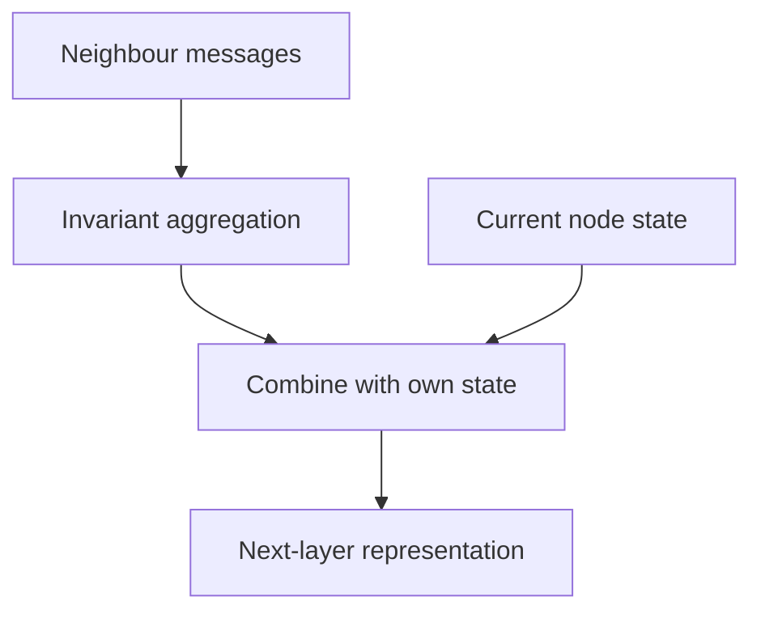

Some data is natively relational: molecules, social networks, knowledge graphs,
code, road networks, recommendation bipartite graphs. Flattening those into
sequences or grids discards the structure that matters, and graph neural networks
operate on it directly.

> [!WHY] A graph model gets deeper but node representations become less
> distinguishable. Adding layers to reach distant information can trade
> away the very local differences the downstream prediction needs.

> [!GOALS]
>
> - Explain permutation-invariant aggregation
> - Trace synchronous message passing over hops
> - Choose a graph split matching deployment

## Message passing

Almost every GNN is an instance of one framework.

```text
  for each node, at each layer:

    1. MESSAGE   each neighbour computes a message
    2. AGGREGATE combine the messages (sum, mean, max,
                 attention-weighted)
    3. UPDATE    combine with the node's own state

  h_v^(k+1) = UPDATE( h_v^(k), AGG({ MSG(h_u^(k)) : u ∈ N(v) }) )
```

```text
  after k layers, each node's representation incorporates
  information from k hops away.

        ●───●         layer 1: immediate neighbours
       ╱ ╲ ╱ ╲        layer 2: two hops
      ●   ●   ●       layer 3: three hops
```

**The aggregation function must be permutation-invariant**, because neighbours
have no order. That constraint is what distinguishes a GNN from applying an MLP to
a concatenated neighbour list, and it is what makes the model generalise to graphs
of different sizes and shapes.



## The variants

```text
  GCN         mean aggregation with degree normalisation
              → simple, strong baseline

  GraphSAGE   SAMPLE a fixed number of neighbours
              → scales to large graphs where full
                neighbourhoods are enormous

  GAT         ATTENTION-weighted aggregation
              → learns which neighbours matter

  GIN         sum aggregation with an MLP
              → provably as expressive as the
                Weisfeiler-Lehman test, which is the
                theoretical ceiling for message passing
```

## The characteristic problems

```text
  OVERSMOOTHING
    with many layers, every node's representation converges
    to the same value — repeated averaging is a diffusion
    process.
    → most GNNs are 2–4 layers, which is shallow by deep
      learning standards
    → residual connections and normalisation help

  OVERSQUASHING
    information from an exponentially growing neighbourhood
    is compressed into a fixed-size vector
    → long-range dependencies are lost

  SCALABILITY
    a node with a million neighbours cannot be aggregated
    naively; neighbourhoods explode with depth
    → sampling (GraphSAGE), clustering, or subgraph batching

  EXPRESSIVITY LIMIT
    standard message passing cannot distinguish some
    non-isomorphic graphs (the WL bound)
    → positional encodings, or higher-order methods
```

Oversmoothing is the one that most shapes practice: **GNNs are shallow**, and a
practitioner coming from vision expecting to stack fifty layers will find quality
degrading after three.

## Where they are used

```text
  MOLECULES          property prediction, drug discovery
                     → the clearest success; molecules ARE
                       graphs
  RECOMMENDATION     the user-item bipartite graph
  FRAUD              transaction networks; relational signal
                     is what catches rings
  KNOWLEDGE GRAPHS   link prediction, entity resolution
  TRAFFIC / ROUTING  road networks
  CODE               abstract syntax trees, call graphs
  PHYSICS            particle interactions, mesh simulation
```

## The honest assessment

```text
  □  GNNs win clearly where the graph structure carries
     information a flat representation cannot — molecules
     most of all
  □  for many tabular-with-relations problems, a gradient-boosted tree on
     hand-engineered graph FEATURES (degree, neighbour aggregates, PageRank)
     is competitive and far simpler
  □  transformers with positional encodings can be applied to
     graphs and are increasingly competitive at scale
  □  the tooling is less mature and the training less stable
     than for vision or text
```

**Try graph features in a standard model before a GNN.** Computing a node's
degree, its neighbours' average label, its PageRank and its cluster id, and
feeding those to a gradient-boosted tree, is a strong baseline that takes an
afternoon and frequently wins.

## Practical guidance

```text
  □  start with 2–3 layers
  □  add graph FEATURES as node attributes; they help
  □  sample neighbourhoods for large graphs
  □  watch for oversmoothing: if deeper is worse, that is it
  □  split by NODE or by EDGE deliberately — a random split
     leaks, because a test node's neighbours are in training
  □  compare against a non-graph baseline, honestly
```

The split point is the leakage trap specific to graphs: in a transductive setting
the model sees the test nodes' connections during training, which is legitimate
for some problems and leakage for others. Deciding which you are in is a framing
question, not a technical one.

> [!PITFALL] A transductive split can be legitimate or leakage depending
> on what connections will be available in deployment.

> [!INTERVIEW] Name what a new layer can reach and what information the
> evaluation lets the model see.

> [!CHECK] What is oversmoothing?
>
> Repeated aggregation makes node representations converge and loses
> useful distinctions.

> [!CHECK] How is oversquashing different?
>
> An expanding neighbourhood’s information must fit in a fixed-size
> vector, losing long-range detail.

> [!CHECK] How can GraphSAGE control huge neighbourhoods?
>
> It samples a fixed number of neighbours rather than aggregating every
> reachable neighbour naively.

## What to take away

1. Nearly every GNN is message passing: neighbours send messages, a
   permutation-invariant function aggregates them, the node updates.
2. Permutation invariance is what makes the model generalise across graph shapes.
3. Oversmoothing keeps GNNs shallow — 2–4 layers — which is unusual coming from
   vision or language.
4. Oversquashing and the Weisfeiler-Lehman expressivity bound are the other
   structural limits.
5. Graph features fed to a gradient-boosted tree are a strong, simple baseline that
   often wins outside molecules.
6. Graph data splits leak in ways tabular ones do not; decide deliberately whether
   the transductive setting is legitimate for your problem.

Next: audio, state space models and compression.

## Exercises

> [!EXERCISE recall] Why must neighbour aggregation be
> permutation-invariant?
>
> **Solution:** A graph’s neighbours have no intrinsic list order.
> Reordering them should not change the aggregate, unlike concatenating an
> arbitrary ordered neighbour list into an MLP.

> [!EXERCISE apply] Use an undirected path A—B—C—D with initial scalar
> states 1,2,4,8. Instantiate the chapter’s framework with identity
> messages, sum aggregation and UPDATE(own,sum)=own+sum. Updates use only
> the previous layer. Compute A after two layers and say whether D’s
> initial state can influence it yet.
>
> **Solution:** The instantiated rule is h_v_next=h_v+sum of neighbour
> states. First A_1=1+2=3. To get its next neighbour value, B_1=2+1+4=7.
> Then A_2=A_1+B_1=3+7=10. D is three edges from A, so two message-passing
> layers cannot yet carry D’s initial state to A. Synchronous updates must
> not reuse an already-updated state within the same layer.

> [!EXERCISE stretch] A model will score entirely new nodes whose future
> connections are not known during training, but evaluation exposes those
> connections through a transductive graph. Recommend a split.
>
> **Solution:** Construct evaluation around the information actually
> available for new-node deployment, deliberately holding out the relevant
> nodes/edges rather than benefiting from unavailable test connections. A
> weaker answer accepts a random split simply because it is convenient:
> the visible graph structure can make performance optimistic for the
> intended task.
