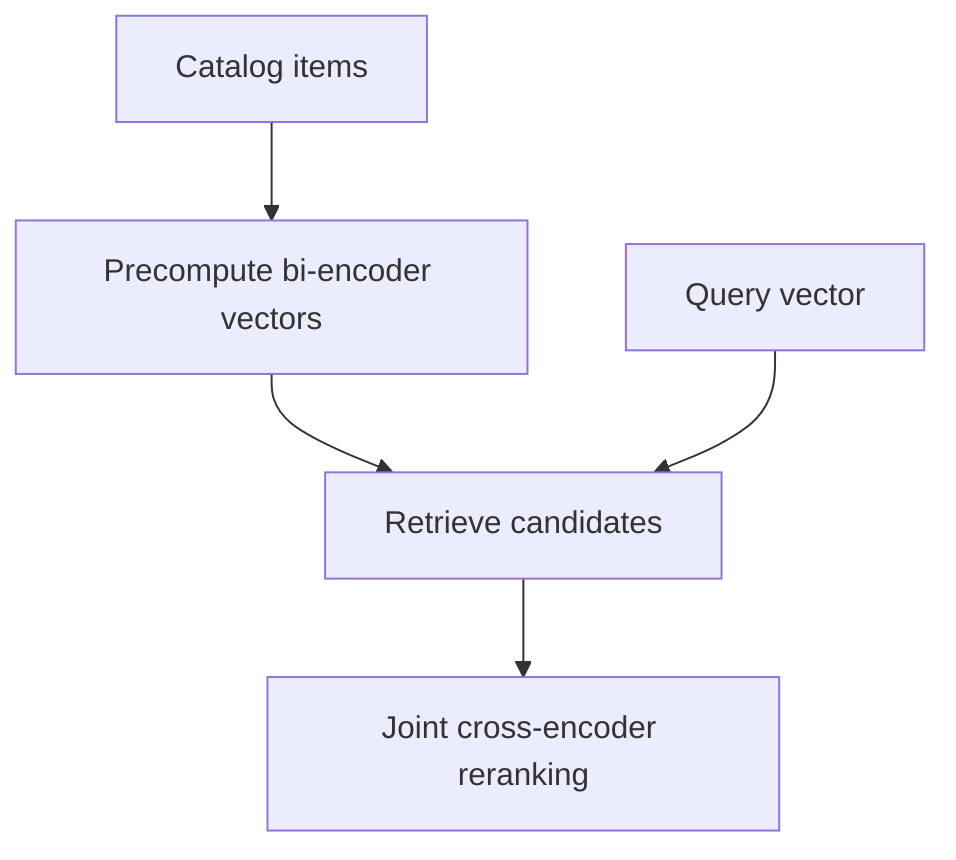

An embedding maps something — a word, an image, a user — to a vector, such that
geometric relationships in the vector space correspond to semantic ones. Almost
every retrieval, recommendation and similarity system rests on getting that space
right.

> [!WHY] A search service builds its index with one embedding model and
> silently switches only the query encoder to another. Similar vector
> dimensions do not make the resulting geometry comparable.

> [!GOALS]
>
> - Explain contrastive positive and negative design
> - Choose bi-encoder retrieval and cross-encoder reranking
> - Plan a consistent embedding-model change

## What a good embedding space has

```text
  □  similar things are CLOSE
  □  dissimilar things are FAR
  □  directions carry meaning
  □  it generalises to items unseen during training
```

```text
  the classic demonstration

    vec("king") − vec("man") + vec("woman") ≈ vec("queen")

  → the space encodes RELATIONSHIPS as directions, not just
    proximity
```

That analogy result is often over-stated — it works for some relations and not
others, and depends on the evaluation setup — but the underlying claim holds:
structure in the data becomes geometry in the space.

## How they are learned

```text
  SUPERVISED             train a classifier; take the
                         penultimate layer
                         → the representation is shaped by the
                           label set, so it may discard
                           anything the labels do not need

  SELF-SUPERVISED        create a task from the data itself
                         → no labels needed; the dominant
                           approach

  CONTRASTIVE            pull positives together, push
                         negatives apart
                         → the workhorse for embeddings
```

```text
  the self-supervised tasks

  MASKED PREDICTION   hide part of the input, predict it
                      → BERT, masked autoencoders
  NEXT-TOKEN          predict what follows
                      → language models
  CONTRASTIVE         is this pair related?
                      → SimCLR, CLIP
```

## Contrastive learning

```text
  InfoNCE loss

    L = −log[ exp(sim(a, p)/τ) / Σ exp(sim(a, nᵢ)/τ) ]

    a  anchor      p  positive      nᵢ  negatives
    τ  temperature
```

```text
  the components that decide quality

  POSITIVE PAIRS    two augmentations of the same image;
                    an image and its caption; a query and its
                    clicked result
  NEGATIVES         everything else
                    → HARD negatives (similar but wrong)
                      teach far more than random ones
  TEMPERATURE       low τ sharpens the distribution and
                    emphasises the hardest negatives
```

**Hard negative mining is the highest-leverage lever**, as the recommendation
topic said. Random negatives are trivially distinguishable, so the model learns
only coarse structure; negatives that are genuinely similar but wrong force fine
distinctions.

```text
  IN-BATCH NEGATIVES

    use the other examples in the batch as negatives —
    free, and it makes LARGE BATCHES valuable for
    contrastive learning specifically.

  → which is why contrastive training runs use much larger
    batches than the loss alone would suggest
```

## CLIP and multimodal alignment

```text
  train an image encoder and a text encoder so that matching
  (image, caption) pairs are close and non-matching pairs
  are far.

  ┌──────────┐        ┌──────────┐
  │  image   │        │  text    │
  │ encoder  │        │ encoder  │
  └────┬─────┘        └────┬─────┘
       └────── same space ──┘
```

```text
  what falls out

  ✓  ZERO-SHOT classification — embed the class names as
     text, compare with the image embedding
  ✓  cross-modal retrieval in both directions
  ✓  a shared space other systems can build on

  → and it is trained on web image-alt-text pairs, so it
    needs no labelled dataset at all
```

CLIP is worth understanding because its shared-space idea underlies most
multimodal systems: once two modalities are in one space, everything that works
for one works across both.

## Bi-encoders and cross-encoders

The distinction from the retrieval topic, stated from the representation side:

```text
  BI-ENCODER            encode each item independently
                        → embeddings can be PRECOMPUTED and
                          indexed
                        → fast; less accurate
                        → retrieval

  CROSS-ENCODER         encode the PAIR jointly
                        → the two can interact at every layer
                        → accurate; cannot be precomputed
                        → reranking
```

The architecture is chosen by whether precomputation is required, not by which is
better — and that constraint is what produces the retrieve-then-rank funnel
everywhere.



## Practical use

```text
  □  NORMALISE embeddings; then cosine and dot product agree
     and are cheapest
  □  DIMENSIONALITY: 384–1536 typical; larger is not
     automatically better and costs storage and search time
  □  MATRYOSHKA embeddings are trained so a PREFIX is a valid
     smaller embedding — one model, several sizes, truncate
     to trade quality for cost
  □  embeddings from different models are INCOMPARABLE
  □  fine-tune on your domain when the general model
     underperforms — often a large win for specialised
     vocabulary
```

The Matryoshka property is genuinely useful and under-used: index at 1536
dimensions for reranking, search at 256 for speed, using the same vectors.

## Failure modes

```text
  ANISOTROPY          embeddings occupy a narrow cone, so all
                      similarities are high and undiscriminative
                      → whitening or contrastive fine-tuning

  DIMENSIONAL
  COLLAPSE            training collapses to a low-dimensional
                      subspace
                      → usually insufficient or too-easy
                        negatives

  DOMAIN MISMATCH     a general model on specialised text
                      (legal, medical, code)
                      → fine-tune

  BIAS                the embedding encodes social biases
                      present in the training data, and they
                      propagate to every downstream use
```

The bias point matters practically because embeddings are infrastructure: a biased
embedding space affects search ranking, recommendations and classification
simultaneously, and the effect is hard to trace back to its source.

> [!PITFALL] Embeddings from different models are not interchangeable
> merely because their dimensions match.

> [!INTERVIEW] State whether representations must be precomputed before
> deciding which encoder architecture fits.

> [!CHECK] Why can a supervised representation discard useful information?
>
> Its label set shapes what it needs to retain, so details irrelevant to
> those labels may be lost.

> [!CHECK] What does Matryoshka training make possible?
>
> A vector prefix can serve as a valid smaller embedding, allowing a
> quality/cost trade within the same trained representation.

> [!CHECK] Why normalize embeddings for similarity search?
>
> Normalization makes cosine and dot-product comparisons agree, enabling
> the cheaper equivalent comparison.

## What to take away

1. A good embedding space makes similarity geometric, and encodes relationships as
   directions rather than only proximity.
2. Contrastive learning with hard negatives is the workhorse; hard negative mining
   is the highest-leverage lever.
3. In-batch negatives make large batches specifically valuable for contrastive
   training.
4. CLIP's shared space is what makes zero-shot classification and cross-modal
   retrieval fall out for free, trained on web pairs with no labels.
5. Bi-encoders exist because embeddings must be precomputable; cross-encoders are
   accurate and cannot be — which produces the retrieve-then-rank funnel.
6. Normalise embeddings, remember they are incomparable across models, and use
   Matryoshka truncation to trade quality for cost with one index.

Next: generative models.

## Exercises

> [!EXERCISE recall] Why do hard negatives teach finer distinctions than
> random negatives?
>
> **Solution:** They are similar but wrong, so separating them requires
> meaningful local structure rather than an easy coarse separation.
> Positive-pair design determines what should be pulled together in the
> first place.

> [!EXERCISE apply] A catalog stage must precompute item representations
> before queries arrive, while a later stage may jointly score a small
> retrieved candidate list. Choose bi- or cross-encoders for each stage
> and explain why swapping them is not a free accuracy upgrade.
>
> **Solution:** Use independent bi-encoder embeddings for catalog
> retrieval because they can be precomputed and indexed. Use a
> cross-encoder for the smaller reranking stage when joint query/item
> interaction is affordable. Making the first stage a cross-encoder
> removes the required precomputed item-only representation; making
> reranking independent gives up its joint interaction. The access
> constraint decides the architecture.

> [!EXERCISE stretch] A new embedding model is ready, and the team
> proposes keeping old item vectors while encoding new queries with the
> new model. Recommend a transition criterion.
>
> **Solution:** Keep query and item representations in a consistent model
> space, rebuilding/revalidating the index for the new encoder rather than
> mixing incompatible geometries. A weaker answer checks only equal vector
> length: equal dimensionality does not align the meanings of coordinates
> across models.
