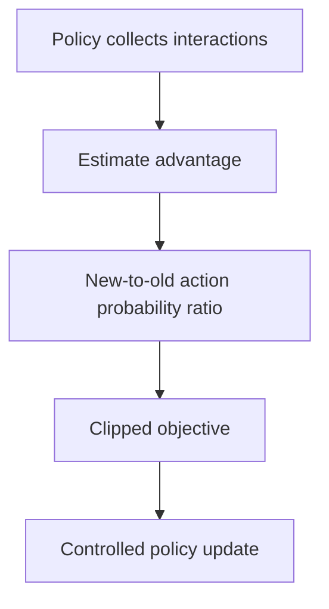

Reinforcement learning learns a policy by acting and observing consequences, with
no labelled correct action. It is the framework behind game-playing systems,
robotics and — most relevantly now — the alignment and reasoning training of
language models.

> [!WHY] A policy update improves the sampled objective but moves far from
> the behaviour that collected the data. Large shifts can destroy the
> working policy before the next expensive interaction cycle reveals the
> damage.

> [!GOALS]
>
> - Explain policy-dependent data and delayed credit
> - Compute both signs of the clipped PPO objective
> - Choose when full RL is justified

## The setup

```text
  ┌──────────┐   action    ┌──────────────┐
  │  AGENT   │────────────▶│ ENVIRONMENT  │
  │          │◀────────────│              │
  └──────────┘ state,      └──────────────┘
               reward

  the goal: maximise cumulative discounted reward
    G = r₀ + γr₁ + γ²r₂ + ...
```

```text
  what makes it hard, compared with supervised learning

  □  no labels — only a scalar reward
  □  DELAYED reward — which of the last 200 actions was
     responsible?  (credit assignment)
  □  EXPLORATION vs EXPLOITATION — you must try things to
     learn, and trying costs
  □  the DATA DISTRIBUTION depends on the policy, which
     changes as you learn — a moving target
```

The last is the deepest difference: supervised learning has a fixed dataset, and
RL's dataset is generated by the thing being trained. That non-stationarity is why
RL is so much less stable.

## The two families

```text
  VALUE-BASED         learn Q(s,a) — the expected return of
                      taking action a in state s
                      → act greedily with respect to Q

    Q-learning, DQN
    ✓ sample-efficient; off-policy (can reuse old data)
    ✗ awkward for continuous action spaces

  POLICY-BASED        learn π(a|s) directly

    REINFORCE, PPO
    ✓ handles continuous actions; can be stochastic
    ✗ higher variance; usually on-policy (data must come
      from the current policy)

  ACTOR-CRITIC        both: a policy plus a learned value
                      function to reduce variance
                      → what most modern methods are
```

## PPO

The algorithm you will meet, because it is what RLHF used.

```text
  the problem it solves: a policy-gradient step that is too
  large destroys the policy, and there is no validation set
  to catch it.

  PPO's answer: CLIP the objective so a single update cannot
  move the policy too far from the one that collected the data.

    L = min( ratio · A,  clip(ratio, 1−ε, 1+ε) · A )

    ratio = π_new(a|s) / π_old(a|s)
    A     = advantage — how much better than expected
```

```text
  ✓ stable enough to be a default
  ✓ works on continuous and discrete actions
  ✗ on-policy: data from the current policy only, so it is
    sample-inefficient
  ✗ many hyperparameters
```

**GRPO** is the variant used for reasoning training: instead of a learned value
function, it samples a _group_ of responses to the same prompt and uses their mean
reward as the baseline. That removes the value network — which is a large
simplification and part of why reasoning RL became practical at scale.



## Exploration

```text
  ε-GREEDY            random action with probability ε
  ENTROPY BONUS       reward the policy for being uncertain
  OPTIMISTIC INIT     assume unknown actions are good
  CURIOSITY           reward visiting novel states
  THOMPSON SAMPLING   sample from the posterior over values
```

```text
  the exploration problem is fundamental: an agent that
  never tries an action never learns its value, and an
  agent that tries everything learns slowly.

  → and in the real world, exploration has a COST that is
    not paid in a simulator
```

That last point is why RL is dominant in games and rare in production systems:
games allow unlimited cheap exploration, and a recommendation system exploring
badly costs real users a bad experience.

## Where RL is used, honestly

```text
  ✓  GAMES — perfect simulator, unlimited cheap exploration,
     clear reward
  ✓  ROBOTICS — with simulation and sim-to-real transfer
  ✓  LLM ALIGNMENT — RLHF and its successors
  ✓  REASONING TRAINING — against verifiable rewards
  ✓  RECOMMENDATION — as bandits, mostly, rather than full RL

  ✗  most business problems: no simulator, exploration is
     expensive, the reward is unclear, and supervised
     learning on logged data is usually better
```

```text
  the honest heuristic:

    if you can frame it as SUPERVISED learning on logged
    data, do that instead.

  RL earns its complexity when the action affects the FUTURE
  STATE and you can afford to explore.
```

## RL for language models

```text
  the mapping

    state       the conversation so far
    action      the next token (or the whole response)
    reward      a preference model, or a verifiable check
    policy      the language model
```

```text
  what makes it work here, when it fails elsewhere

  □  a strong PRETRAINED initialisation — you are not
     exploring from scratch
  □  a KL penalty to the reference model, which bounds how
     far the policy can move
  □  short episodes (one response)
  □  and, for reasoning: a VERIFIABLE reward that cannot be
     hacked
```

The verifiable-reward point, from the reasoning topic, is the crucial one. RLHF
against a learned preference model is limited by reward hacking; RL against "do
the tests pass" is not, which is why reasoning training could be pushed orders of
magnitude further.

> [!PITFALL] A simulator’s cheap exploration does not imply that trying
> poor actions on real users is equally cheap.

> [!INTERVIEW] Name the state, action, reward and exploration cost before
> selecting RL.

> [!CHECK] What does an actor-critic combine?
>
> A policy and a learned value function, with the value estimate reducing
> policy-gradient variance.

> [!CHECK] How does GRPO replace the value-network baseline?
>
> It uses a group of sampled responses to a prompt and their mean reward
> as the baseline.

> [!CHECK] Why use a reference-model KL penalty for language-model RL?
>
> It limits departure from a strong pretrained policy rather than
> exploring without that anchor.

## What to take away

1. RL learns from a scalar reward with delayed credit and a data distribution that
   changes as the policy does — that non-stationarity is why it is unstable.
2. Value-based methods are sample-efficient and awkward for continuous actions;
   policy-based handle them at higher variance; actor-critic combines both.
3. PPO clips the update so a single step cannot destroy the policy; GRPO removes the
   value network by using a group of samples as the baseline.
4. Exploration is fundamental and has real cost outside a simulator, which is why RL
   dominates games and is rare in production.
5. If the problem can be framed as supervised learning on logged data, do that
   instead — RL earns its complexity when actions affect future state.
6. RL works for language models because of a strong pretrained start, a KL bound,
   short episodes, and — for reasoning — verifiable rewards.

Next: graphs, audio, state space models and compression.

## Exercises

> [!EXERCISE recall] Why is RL’s data distribution a moving target, and
> why does delayed reward complicate learning?
>
> **Solution:** The changing policy generates the observations it later
> trains on. A reward after many actions also leaves the learner to assign
> credit to the actions responsible rather than receiving a correct-action
> label.

> [!EXERCISE apply] Use epsilon=0.2. Compute L=min(ratio×A,
> clip(ratio,1−epsilon,1+epsilon)×A) for case P with ratio=1.4 and A=2,
> and case N with ratio=0.6 and A=−2. Show both branches before taking the
> minimum.
>
> **Solution:** Use L=min(ratio×A, clip(ratio,1−epsilon,1+epsilon)×A). The
> clipping interval is [1−0.2,1+0.2]=[0.8,1.2]. P: raw=1.4×2=2.8; clipped
> ratio=1.2, so clipped branch=1.2×2=2.4; L=min(2.8,2.4)=2.4. N:
> raw=0.6×(−2)=−1.2; clipped ratio=0.8, so clipped branch=0.8×(−2)=−1.6;
> L=min(−1.2,−1.6)=−1.6. The negative advantage changes which
> multiplication is more negative; do not substitute a maximum.

> [!EXERCISE stretch] A business task has useful logged labels, no
> affordable simulator, an unclear long-term reward and expensive
> real-world exploration. Recommend a first formulation.
>
> **Solution:** Prefer supervised learning on the available logged data
> where that answers the task; justify full RL only if future-state
> consequences and affordable exploration earn its complexity. A weaker
> answer selects RL merely because actions are being chosen: that ignores
> reward quality, interaction cost and a simpler adequate formulation.
