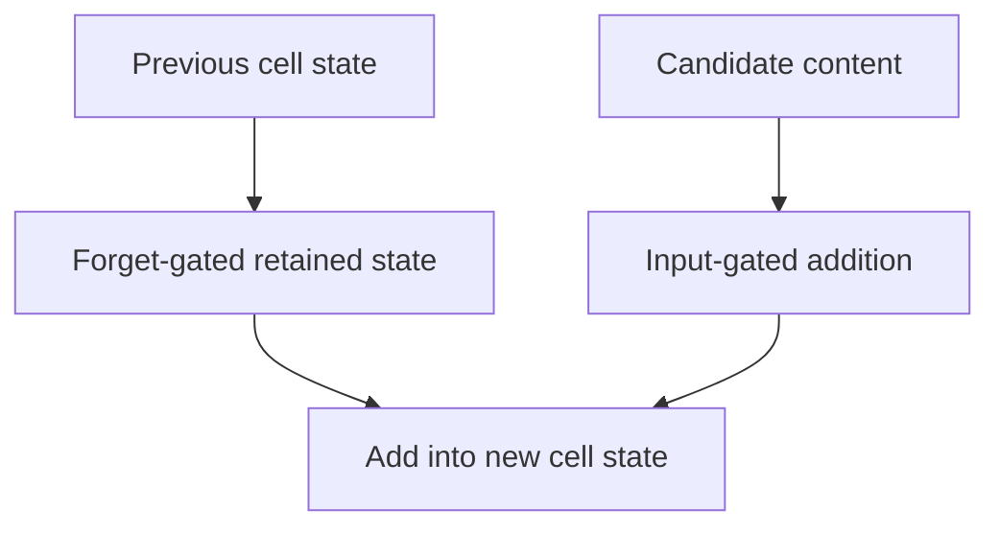

Before attention, sequences were processed recurrently: one element at a time,
carrying a hidden state forward. Recurrent models are largely historical for
language, and understanding their limitations is what makes the transformer's
design choices legible.

> [!WHY] A streaming model must preserve a bounded state while processing
> an arbitrarily long input. Replacing it with unrestricted attention
> changes the memory requirement even if the new model improves an offline
> benchmark.

> [!GOALS]
>
> - Explain recurrent sequential dependence
> - Compute an LSTM cell-state update
> - Choose a model under streaming-state constraints

## The recurrent idea

```text
  h_t = f(h_{t-1}, x_t)
  y_t = g(h_t)

  x₁ ──▶ [f] ──▶ h₁ ──▶ [f] ──▶ h₂ ──▶ [f] ──▶ h₃
          ▲              ▲              ▲
          x₁             x₂             x₃

  ONE hidden state carries everything the model knows about
  the past.
```

```text
  the appeal
    ✓ handles variable-length input naturally
    ✓ parameters are shared across positions
    ✓ constant memory per step — O(1) state regardless of
      sequence length
```

## Why plain RNNs fail

```text
  VANISHING / EXPLODING GRADIENTS through time

    the gradient at step 1 is a product of ~T Jacobians.

    each < 1  →  vanishes exponentially
    each > 1  →  explodes exponentially

  → in practice a plain RNN cannot learn dependencies more
    than ~10 steps apart
```

## LSTM and GRU

The fix: an additive path for information to flow along, plus learned gates
controlling what enters and leaves it.

```text
  LSTM

    FORGET gate   what to drop from the cell state
    INPUT gate    what new information to add
    OUTPUT gate   what to expose as the hidden state

    c_t = f_t ⊙ c_{t-1} + i_t ⊙ c̃_t
          └─── ADDITIVE, not multiplicative ───┘
```

```text
  the additive cell-state update is the whole trick:

    ∂c_t/∂c_{t-1} = f_t

  when the forget gate is near 1, the gradient passes through
  essentially unchanged — the same insight as a residual
  connection, arrived at independently and earlier.
```

**GRU** merges the cell and hidden state and uses two gates instead of three:
fewer parameters, comparable quality, and simpler. It is the sensible default when
you want a recurrent model at all.

```text
  even so: LSTMs manage hundreds of steps, not thousands,
  and the fundamental problem remains.
```



## The constraint that killed them

```text
  SEQUENTIAL DEPENDENCE

    h_t depends on h_{t-1}
    → step t cannot be computed until t-1 is done
    → the sequence CANNOT be parallelised across time
```

```text
  RNN, sequence length 1000
    → 1000 sequential steps, each waiting for the last

  transformer, sequence length 1000
    → ONE parallel operation over all positions
```

That is the decisive difference. On the hardware described in the GPU topic —
thousands of cores that need thousands of simultaneous threads — a model that
forces serial execution cannot use the machine. **Attention won on parallelism at
least as much as on quality.**

The second limitation is the **information bottleneck**: everything about a
sequence must pass through one fixed-size hidden state. Attention removes it by
letting the model look directly at any earlier position.

## Encoder-decoder and the origin of attention

```text
  seq2seq (2014)

    ENCODER  reads the input, produces a context vector
    DECODER  generates the output from it

    "the cat sat" ──▶ [encoder] ──▶ c ──▶ [decoder] ──▶
                                    ▲      "le chat..."
                          a SINGLE vector for the whole
                          input — the bottleneck
```

```text
  ATTENTION (2015) was introduced to fix exactly this:

    let the decoder look at ALL encoder states, weighted by
    relevance to the current output position.

  → no bottleneck
  → and, incidentally, interpretable alignments
```

Attention began as a patch on recurrence. *Attention Is All You Need* removed the
recurrence and kept the patch — which is a useful reminder that architectural
progress often comes from noticing that the auxiliary mechanism was doing the
work.

## Where recurrence still applies

```text
  ✓  very long sequences where O(N²) attention is prohibitive
  ✓  streaming with strict constant-memory requirements
  ✓  small models on constrained hardware
  ✓  time-series forecasting, where they remain competitive
  ✓  as a component in hybrid architectures
```

**State space models** (Mamba and successors) are the modern return of this idea:
linear-time recurrence with a state formulation that *can* be parallelised during
training via a scan, recovering the training efficiency that killed RNNs while
keeping constant-memory inference. They are covered in their own topic, and they
are the reason recurrence is worth understanding rather than merely remembering.

> [!PITFALL] A fixed-size hidden state is an information bottleneck as
> well as a memory advantage.

> [!INTERVIEW] Separate training parallelism from inference-state size
> when comparing sequence models.

> [!CHECK] What does an LSTM output gate control?
>
> What part of the cell state is exposed as hidden state, distinct from
> retention and addition.

> [!CHECK] How does a GRU simplify the recurrent state?
>
> It combines cell and hidden state and uses fewer gates with fewer
> parameters.

> [!CHECK] What did attention add to an encoder-decoder bottleneck?
>
> A decoder can look at all encoder states instead of depending on only
> one summary vector.

## What to take away

1. Recurrence carries a single hidden state forward, giving variable-length
   handling and constant memory per step.
2. Plain RNNs cannot learn long dependencies because the gradient is a product of
   many Jacobians; LSTM's additive cell-state update is the fix, and is the same
   insight as a residual connection.
3. Sequential dependence is what killed recurrence for language: it cannot be
   parallelised across time, so it cannot use modern accelerators.
4. The fixed-size context vector was an information bottleneck, and attention was
   introduced specifically to remove it.
5. Attention began as a patch on recurrence; removing the recurrence and keeping
   the patch produced the transformer.
6. State space models recover parallel training with constant-memory inference,
   which is why recurrence is worth understanding rather than merely remembering.

Next: attention itself, in detail.

## Exercises

> [!EXERCISE recall] Why does a plain recurrent model prevent parallel
> computation across time?
>
> **Solution:** Its next state depends on the previous state, so a later
> position cannot be computed until the earlier one finishes. Shared
> parameters do not remove that dependency.

> [!EXERCISE apply] For one scalar LSTM cell, c_previous=4, forget gate
> f=0.75, input gate i=0.5 and candidate c_tilde=−2. Compute the new cell
> state and the direct cell-path derivative with gate values held fixed.
>
> **Solution:** Use c_new=f×c_previous+i×c_tilde. Retained state is
> 0.75×4=3; added content is 0.5×(−2)=−1; c_new=3+(−1)=2. Along the
> explicit cell-state path, dc_new/dc_previous=f=0.75 with gates held
> fixed. This is that local path derivative, not a claim about every
> indirect gate dependency in the full network.

> [!EXERCISE stretch] A device needs strict constant-memory streaming over
> long sequences. Recommend what to compare before adopting full
> attention.
>
> **Solution:** Compare a suitable recurrent model and an SSM/hybrid
> designed for bounded inference state, evaluating the task’s memory and
> recall trade-off. A weaker answer assumes a full-attention benchmark win
> preserves constant-state inference: its retained past context changes
> the deployment constraint.
