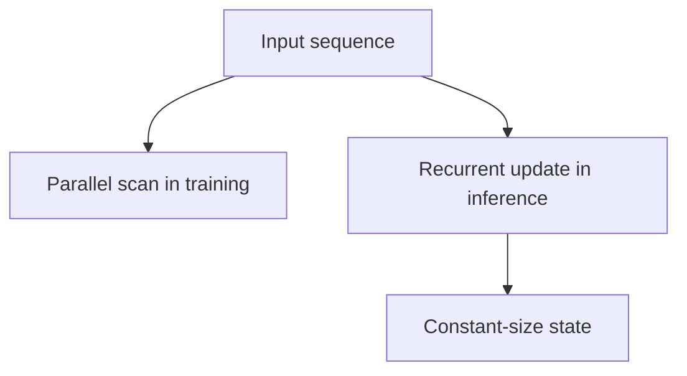

Attention is quadratic in sequence length. That cost is acceptable at a few
thousand tokens and prohibitive at a million, which has driven a search for
architectures with linear scaling. State space models are the most successful
attempt, and they work by making recurrence trainable in parallel.

> [!WHY] A long-stream deployment cannot retain an ever-growing attention
> cache. A constant-state model can fit the memory budget, but the
> decision still needs evidence about precise recall of earlier content.

> [!GOALS]
>
> - Explain the parallel-training and recurrent-inference duality
> - Compute a linear state-space trajectory
> - Choose efficiency versus precise recall deliberately

## The problem being solved

```text
  ATTENTION
    ✓ any position can reach any other in one step
    ✓ fully parallel training
    ✗ O(N²) compute and memory
    ✗ inference state (the KV cache) GROWS with sequence
      length

  RECURRENCE (RNN)
    ✓ O(N) compute
    ✓ CONSTANT inference state
    ✗ cannot be parallelised across time in training
    ✗ struggles with long dependencies
```

```text
  the goal: recurrence's inference properties with
  attention's training parallelism.
```

## The state space formulation

```text
  a continuous linear system, discretised:

    h_t = A·h_{t-1} + B·x_t        state update
    y_t = C·h_t                    output

  → a linear recurrence
```

```text
  the crucial property: because the recurrence is LINEAR,
  it can be unrolled into a CONVOLUTION and computed with a
  parallel SCAN.

    training   → parallel over the sequence, like attention
    inference  → sequential with CONSTANT state, like an RNN
```

That dual form is the whole idea. A nonlinear recurrence must be computed step by
step; a linear one has an associative structure that a parallel scan exploits, so
the same model has two execution modes.



## Mamba's contribution

```text
  the weakness of earlier SSMs: A, B and C were FIXED,
  independent of the input.

  → the model could not decide what to remember based on
    what it was reading — it had no content-based selection,
    which is precisely what attention does well.
```

```text
  MAMBA makes B, C and the discretisation step INPUT-DEPENDENT.

  → the model can selectively remember or forget based on
    content
  → which recovers much of what attention provides
  → at the cost of the simple convolution form, requiring a
    hardware-aware parallel scan implementation instead
```

```text
  the resulting profile

    training      O(N), parallel
    inference     O(1) state per step — no growing KV cache
    long context  scales far better than attention
    recall        WEAKER than attention at precise retrieval
                  from long context
```

## The honest position

```text
  where SSMs win
    ✓ very long sequences — genomics, audio, high-resolution
      time series
    ✓ constant-memory streaming inference
    ✓ edge deployment, where a growing KV cache is fatal

  where attention still wins
    ✓ precise recall of specific earlier content
      ("what was the number in paragraph 3?")
    ✓ in-context learning from examples
    ✓ the ecosystem: tooling, kernels, pretrained models
```

```text
  → HYBRID architectures are what actually ship:
    mostly SSM layers with a few attention layers
    interleaved, so precise recall is available where
    needed and the bulk of the sequence is handled linearly.
```

**Attention has not been replaced.** The recall weakness is real and matters for
the tasks language models are used for, and the practical outcome has been hybrids
rather than substitution — which is a common pattern when a more efficient method
is not strictly better.

## The other linear approaches

```text
  LINEAR ATTENTION    replace softmax with a kernel that
                      allows reordering the matrix products
                      → O(N); consistently weaker quality

  RWKV                an RNN formulation trainable in
                      parallel, with transformer-like quality

  RETNET              a retention mechanism with parallel,
                      recurrent and chunked forms

  SLIDING WINDOW      keep attention, bound the window
                      → the simplest linear-cost option, and
                        the most widely deployed
```

Sliding-window attention is worth noting as the pragmatic baseline: it requires no
new architecture, it is supported everywhere, and combined with attention sinks it
handles long contexts adequately for many purposes.

> [!PITFALL] A constant-size state does not promise attention’s exact
> access to every earlier token.

> [!INTERVIEW] Name both sequence-length scaling and the recall behaviour
> the task actually requires.

> [!CHECK] What makes Mamba’s state selection content-dependent?
>
> Input-dependent parameters and discretization let it decide what to
> retain from the content.

> [!CHECK] Why does that selection lose the simple fixed convolution form?
>
> The parameters depend on input, requiring a hardware-aware scan rather
> than only a fixed convolution.

> [!CHECK] What pragmatic alternative keeps attention while bounding its
> cost?
>
> A sliding window restricts which previous positions are attended to
> without introducing a wholly new architecture.

## What to take away

1. Attention is quadratic and its inference state grows; recurrence is linear with
   constant state but cannot be parallelised in training.
2. A *linear* recurrence has an associative structure that a parallel scan can
   exploit, giving parallel training and sequential constant-memory inference from
   one model.
3. Mamba's contribution is making the state parameters input-dependent, recovering
   content-based selection at the cost of needing a hardware-aware scan.
4. SSMs win on very long sequences and streaming; attention still wins on precise
   recall and in-context learning.
5. Hybrids — mostly SSM with a few attention layers — are what actually ship.
6. Sliding-window attention remains the pragmatic linear-cost baseline because it
   needs no new architecture.

Next: making trained models smaller.

## Exercises

> [!EXERCISE recall] How can one state-space model train in parallel yet
> infer recurrently?
>
> **Solution:** The linear recurrence has an associative structure that
> can be evaluated as a parallel scan during training. During inference it
> updates a fixed-size state one step at a time.

> [!EXERCISE apply] Use scalar A=0.5, B=2, C=3, h_0=0 and inputs x_1=2,
> x_2=−1. Apply h_t=A×h_previous+B×x_t and y_t=C×h_t for both steps.
>
> **Solution:** Use h_t=A×h_previous+B×x_t and y_t=C×h_t. First
> h_1=0.5×0+2×2=0+4=4; y_1=3×4=12. Then h_2=0.5×4+2×(−1)=2−2=0; y_2=3×0=0.
> The second output uses the updated recurrent state, not a fresh
> computation from x_2 alone.

> [!EXERCISE stretch] A product needs very long streaming context but also
> must retrieve specific earlier details accurately. Recommend an
> architecture evaluation.
>
> **Solution:** Evaluate a hybrid that handles much of the stream with
> efficient SSM layers while retaining attention where precise recall
> matters. A weaker answer replaces every attention layer solely from the
> scaling curve: the chapter identifies precise retrieval as a real SSM
> weakness that efficiency alone does not resolve.
