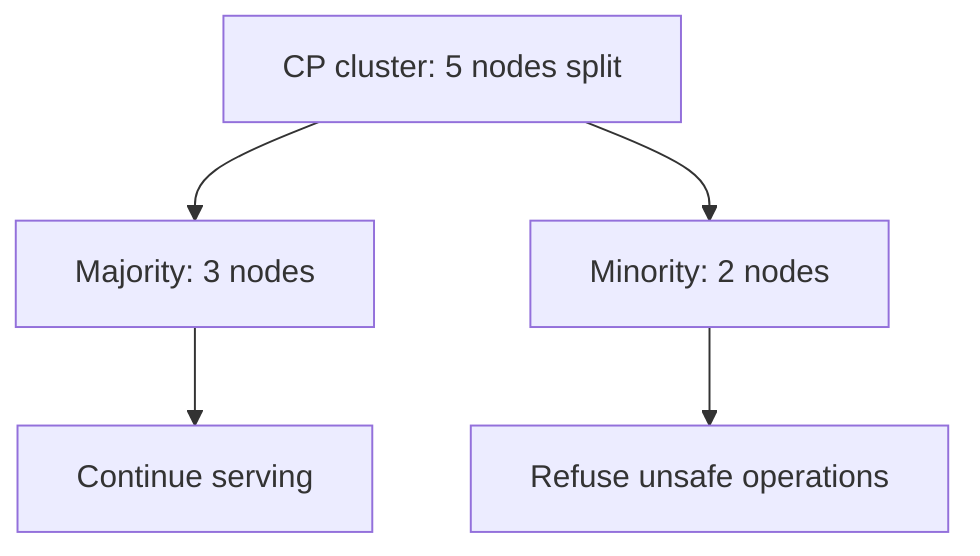

CAP is the most cited and most misunderstood result in distributed systems. The
popular version — "pick two of consistency, availability, partition tolerance" —
is wrong in a way that leads to real architectural mistakes. The actual theorem
is narrower, and once stated precisely it is both obviously true and much less
dramatic.

> [!WHY] A network cut separates a five-node service into two groups, and product owners ask whether every endpoint should keep answering. The right behavior depends on whether a stale answer or a refusal is worse for each operation.

> [!GOALS]
>
> - State CAP's partition-time trade using linearizability and availability precisely
> - Choose CP or AP behavior for operations with different invariants
> - Explain why response latency is separate from CAP availability

## The theorem

Formalised by Gilbert and Lynch in 2002, from Brewer's 2000 conjecture:

> In an asynchronous network where messages may be lost, it is impossible to
> implement a read/write register that is both **available** and **linearizable**.

With precise definitions of each term:

```text
  C — CONSISTENCY = LINEARIZABILITY, specifically.
      not ACID's C, not "the data is correct."

  A — AVAILABILITY = EVERY request to a NON-FAILING node receives a
      NON-ERROR response, eventually.
      not "high availability", not "99.9% uptime."
      one node returning an error breaks it.

  P — PARTITION TOLERANCE = the system continues to operate despite
      arbitrary message loss between nodes.
      not "we survive a node dying."
```

Read together: **if the network partitions, you must choose between answering
requests on both sides (giving up linearizability) and refusing to answer on at
least one side (giving up availability).**

## Why "pick two" is wrong

> [!KEY] **Partitions are not a choice.** They are a property of networks. Cables are cut,
> switches reboot, a security group is misconfigured, a data centre loses
> connectivity. You do not get to decide whether partitions happen; you only decide
> what your system does when one does.

So "CA" — consistent and available, not partition tolerant — is not a system
design. It is a bet that the network never fails, and that bet loses.

```text
  the honest statement:

    P is not optional. Given a partition, choose:

      CP  →  refuse requests that cannot be made linearizable
             (the minority side returns errors or blocks)

      AP  →  answer anyway, accept divergence, reconcile later
```

**And CAP only applies during a partition.** In normal operation — which is
almost all the time — you can have both. A CP system is fully available when the
network is healthy. A system's CAP classification describes its behaviour during
a rare event, not its everyday character.

That is why the framing is misleading in a second way: it presents as a permanent
architectural identity something that is actually a rule for handling an
exception.

## Which side systems choose, and what it looks like

```text
  CP — consistency over availability

    a minority partition REFUSES to serve.

    ┌──────────────┐  ╳  ┌───────────────────┐
    │  2 nodes     │     │  3 nodes          │
    │  (minority)  │     │  (majority)       │
    │  ✗ errors    │     │  ✓ serving        │
    └──────────────┘     └───────────────────┘

    ZooKeeper, etcd, Consul, Spanner, CockroachDB,
    HBase, MongoDB (default), Kafka (with min.insync.replicas)

  AP — availability over consistency

    BOTH sides keep serving; they diverge; they reconcile later.

    ┌──────────────┐  ╳  ┌───────────────────┐
    │  ✓ serving   │     │  ✓ serving        │
    │  (diverging) │     │  (diverging)      │
    └──────────────┘     └───────────────────┘

    Cassandra, Riak, DynamoDB, CouchDB, DNS, most CDNs
```



The right choice follows from the domain, and both choices are correct
somewhere:

- **A shopping cart** should be AP. Amazon's original argument: refusing to let a
  customer add an item costs a sale; a rare merge conflict costs almost nothing.
- **A bank ledger** should be CP. Refusing a transaction is an inconvenience;
  allowing a double-spend is a loss.
- **A configuration store** should be CP. Two halves of a cluster operating on
  different configurations is worse than half of it pausing.
- **A CDN** should be AP. Stale content beats no content, obviously.

## The subtlety: CP systems are still available, mostly

A common misreading is that CP means "unavailable". It means the _minority_ side
is unavailable. With five nodes and a 3–2 split, three-fifths of the cluster
keeps serving normally.

And "unavailable" in CAP's formal sense includes returning an error promptly,
which is often the _better_ user experience than silently serving stale data.
A clear "temporarily unavailable, retry" is something a client can handle; a
plausible-looking wrong balance is not.

## Three more things CAP does not say

**It says nothing about latency.** A system can be perfectly linearizable and
perfectly available and take ten seconds per request. CAP is silent on this, and
latency is the cost that actually shapes designs day to day — which is what
PACELC, the next chapter, addresses.

**It is about a single register.** The formal result concerns one read/write
register. Real systems have transactions, multiple objects, and richer
operations, and the practical trade-offs are correspondingly richer.

**It is binary; real systems are not.** A system can be linearizable for some
operations and eventual for others, in the same cluster, chosen per request. The
theorem's binary framing does not capture that, and modern systems live in the
space it does not describe.

## What actually happens during a partition

The theory says "choose". Production is messier, and the messiness is worth
knowing:

```text
  1. DETECT — but you cannot distinguish a partition from a slow
     network or a dead node. Detection is a timeout, so the system
     spends the timeout period in an undefined state.

  2. DECIDE — which side is the majority? With an even number of
     nodes, neither is, which is why odd cluster sizes exist.

  3. DEGRADE — the minority must do something. Reject? Serve stale
     reads with a warning? Queue writes for later? This is a design
     decision and it is often unspecified until an incident.

  4. RECOVER — reconcile divergence, catch up, resume. This is
     usually the longest phase and the least tested.
```

Step 3 is where the interesting product decisions live, and it is the one that
tends to be left to default behaviour. A deliberate design might say: reads are
served from the minority side with a staleness header; writes are rejected with a
clear error; a specific subset of critical writes is queued locally and replayed.
That is far better than whatever the database happens to do.

## The practical checklist

```text
  □  Which operations genuinely need linearizability?  (a short list)
  □  For everything else, which weaker model is sufficient?
  □  During a partition, what does the minority side do —
     specifically, per operation?
  □  How is the partition detected, and after how long?
  □  Odd number of nodes, so a majority always exists?
  □  How is divergence reconciled afterwards, and who verifies it?
  □  Has this been TESTED with an actual injected partition?
```

The last line is the one that matters most. Most systems' partition behaviour is
undocumented and unexercised, and the first time anyone learns what it does is
during an incident.

> [!CHECK] In the five-node CP example with a 3-2 split, why is CAP availability
> lost even though three nodes serve?
>
> The majority of three continues serving, but the minority of two refuses
> requests it cannot make linearizable. CAP availability requires a
> non-error response for every request to every non-failing node, so that
> refusal violates the formal availability property.

> [!CHECK] Why is a prompt error different from a stale balance under CAP?
>
> A prompt error deliberately gives up CAP availability while preserving
> the linearizable contract. A non-error stale balance keeps answering but
> gives up that contract. The domain decides which failure is acceptable;
> speed of the response is a separate issue.

Next: PACELC, which adds the question CAP leaves out — what you trade when there
is no partition at all.

## What to take away

1. CAP says: in an asynchronous network with message loss, you cannot have both
   availability and _linearizability_. C means linearizability specifically, and A
   means every non-failing node answers.
2. "Pick two" is wrong — partitions are not a choice. The real choice is what to
   do _when_ one occurs: CP (minority refuses) or AP (both sides serve and
   diverge).
3. CAP applies only during a partition. Both properties are available in normal
   operation, which is nearly all the time.
4. CP does not mean unavailable — only the minority side is, and a prompt error is
   often better for users than plausible stale data.
5. CAP says nothing about latency, concerns a single register, and is binary
   where real systems choose per operation.
6. The valuable work is specifying, per operation, what the minority side does
   during a partition — and testing it with an injected partition.

## Exercises

> [!EXERCISE recall] Precisely name CAP's C and A, and state when the theorem forces a choice.
>
> **Solution:** C is linearizability, and A means every non-failing node returns a non-error response. The trade appears during a network partition in an asynchronous system with message loss; it is not a permanent choice made for ordinary healthy operation.

> [!EXERCISE apply] A healthy system returns a linearizable read after ten seconds. A reviewer says CAP availability guarantees a fast response. Explain whether CAP supports that conclusion.
>
> **Solution:** No. CAP's availability property is about returning a non-error response from every non-failing node, not a latency bound. A ten-second response may be slow, but CAP is silent about that cost; PACELC addresses the healthy-network latency-versus-consistency trade.

> [!EXERCISE stretch] A slide says a system must “pick any two of consistency, availability and partition tolerance” as a permanent architecture choice. Correct it and explain what a weaker answer misses.
>
> **Solution:** A partition is a network condition, not a feature to opt out of. During one, the system chooses whether to refuse some operations to preserve linearizability (CP) or answer on both sides and reconcile later (AP); in healthy operation it can provide both properties. A weaker answer repeats “pick two”; it misses when CAP applies and that C specifically means linearizability.
