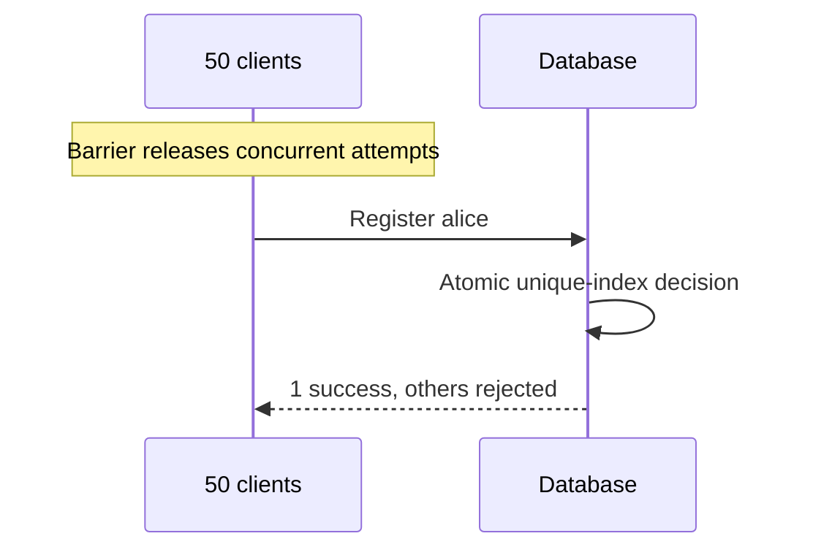

Everything so far is vocabulary. This chapter is the procedure: how to decide
what each operation needs, how to record the decision so it survives, and how to
find out whether the system actually does what you believe.

> [!WHY] “We use strong consistency” sounds reassuring until a replica read, failover setting or database default silently weakens the guarantee. The team needs to name each invariant, the mechanism enforcing it, and a test that can break it.

> [!GOALS]
>
> - Choose a consistency level per operation from its invariant and failure cost
> - Connect each invariant to an explicit API, schema or infrastructure mechanism
> - Design concurrency and fault tests that can expose a broken guarantee

## The decision procedure

For each operation, in order. Stop at the first "yes".

```text
  1. Does this operation enforce an INVARIANT across concurrent
     operations?  (uniqueness, non-negative balance, one seat one
     booking, exactly one lock holder)
        └─ YES ──▶ LINEARIZABLE. no cheaper option is correct.

  2. Is this a multi-object transaction where a partial view would
     break an invariant?  (transfer between accounts, double-entry)
        └─ YES ──▶ SERIALIZABLE, or strict serializable if recency
                   also matters.

  3. Will the SAME USER read this immediately after writing it?
        └─ YES ──▶ READ-YOUR-WRITES. usually a token or leader read.

  4. Would data appearing to move BACKWARDS be confusing here?
        └─ YES ──▶ MONOTONIC READS. sticky routing.

  5. Are there causal relationships between records here?
     (replies, threads, edits to a document)
        └─ YES ──▶ CAUSAL. keep them in one partition, or track
                   dependencies.

  6. Otherwise
        └───────▶ EVENTUAL. state a staleness bound if a user could
                  notice.
```

Two observations from applying this to real systems. Almost everything ends at
step 6 — which is why replication and caching work at all. And the operations
that stop at step 1 are usually a _short, enumerable list_ — a dozen or so in a
large product. Writing that list down is most of the work.

## Write it down where it cannot rot

A consistency decision that lives only in someone's head is a decision that will
be violated by the next person to touch the code. Three places to record it, in
increasing order of durability:

> [!KEY] **In the type or the API.** The strongest, because it cannot be ignored:

```python
# the level is a required argument — no default to forget
balance = accounts.read(id, consistency=LINEARIZABLE)
profile = profiles.read(id, consistency=EVENTUAL)
```

**In the schema or the infrastructure.** A table whose replication settings
enforce the requirement, a topic whose partition key guarantees the ordering,
`min.insync.replicas` set so an under-replicated write is refused.

**In a document that lists the invariants.** One page per service naming every
invariant and the mechanism enforcing it. This is what a new engineer reads
before changing anything, and it is what an incident review checks against.

```text
  INVARIANT                        ENFORCED BY
  ─────────────────────────────    ──────────────────────────────
  usernames are unique             unique index on the single-leader
                                   users table
  account balance >= 0             serializable transaction in the
                                   ledger service
  one active lock per resource     etcd lease + fencing token checked
                                   by the storage layer
  a reply is never visible
    before its parent              both in the same Kafka partition
                                   keyed by thread_id
```

That table is worth more than any amount of prose, because it makes the
enforcement mechanism auditable. An invariant with an empty right-hand column is
an invariant that is not enforced.

## Verification

The gap between the guarantee you believe you have and the one you have is where
incidents live. Four techniques, in increasing strength.

**1. Read the fine print, and the defaults.** Databases document their guarantees
precisely and configure themselves loosely. The specific things to check:

```text
  □  What is the DEFAULT isolation level, and is it what you assumed?
     (Postgres defaults to READ COMMITTED, not SERIALIZABLE)
  □  Are reads served from replicas? By default? Silently?
  □  What is the write concern / acks setting?
     (Kafka acks=1 acknowledges before replication)
  □  What does the driver retry, and is that safe for your operation?
  □  What happens on failover — is data loss possible, and how much?
```

Most consistency surprises trace to a default nobody chose.

**2. Test the invariant under concurrency.** For each row of your invariant
table, write a test that hammers the operation from many threads and asserts the
invariant afterwards:

```python
def test_username_uniqueness_under_concurrency():
    barrier = threading.Barrier(50)
    results = []
    def register():
        barrier.wait()                       # maximise the collision window
        results.append(try_register("alice"))
    run_threads(register, count=50)
    assert sum(1 for r in results if r.ok) == 1     # EXACTLY one
```



The barrier matters: without it the threads start at slightly different times and
the race window is missed. Tests written without one pass on broken code.

**3. Inject faults.** The interesting failures only appear when something is
broken. The minimum set worth exercising:

```text
  □  partition the cluster (majority / minority, and a full split)
  □  kill the leader mid-write
  □  pause a process for longer than the failure-detector timeout
     (SIGSTOP — it simulates a long GC pause exactly)
  □  skew a node's clock beyond the configured tolerance
  □  slow the network rather than breaking it (the harder case)
```

The SIGSTOP case is the most under-used and finds the most bugs, because a paused
process resumes believing it still holds its lease.

**4. Check histories.** Record operations with their invocation and response
times under fault injection, and check whether a valid linearization exists.
This is what Jepsen does, and the reason so many published consistency claims
were corrected over the last decade. You are unlikely to build one, but you
should read the Jepsen report for any database you depend on — they are freely
available, specific, and frequently surprising.

## Failure modes to watch for in your own designs

Patterns that repeatedly turn out to be consistency bugs:

**Check-then-act across a network.**

```python
if not db.exists(username):      # ← a gap here
    db.insert(username)          # ← someone else inserted in the gap
```

The only fix is to make the database decide atomically — a unique constraint, or
a conditional write. Never a check followed by an act.

**Reading from a replica inside a write transaction.** Common with ORMs and read
-write splitting: the write goes to the leader, a subsequent read in the same
logical operation goes to a replica, and sees pre-write state.

**Cache invalidation racing the write.** Invalidate, write, and a concurrent
reader repopulates the cache from the old value in between. Invalidating _after_
the write, and again a moment later, is the usual mitigation.

**Two sources of truth.** The same fact in the database and in a cache, a search
index, or another service, with no single owner. They will diverge, and there is
no principled way to decide which is right unless one is designated the source.

**Assuming a message queue preserves order across keys.** Covered in the RPC
topic; it reappears here because the resulting bug looks like a consistency bug
in the datastore.

## The summary table

| If you need           | Use                             | Cost                        |
| --------------------- | ------------------------------- | --------------------------- |
| Uniqueness            | Single leader + unique index    | Write goes to one place     |
| One lock holder       | Consensus store + fencing token | A round trip                |
| Non-negative balance  | Serializable transaction        | Contention, retries         |
| See your own writes   | Position token or leader read   | Leader load                 |
| No time travel        | Sticky routing                  | Reduced replica flexibility |
| Replies after parents | Same partition                  | Partition key constraint    |
| Everything else       | Eventual, with a stated bound   | Almost nothing              |

> [!PITFALL] A network check followed by a write is not an atomic decision. Another
> request can insert in the gap; put uniqueness in a database constraint
> or conditional write rather than an application-side existence check.

> [!INTERVIEW] Name the invariant, the mechanism enforcing it and the documented
> default you verified. Then describe the concurrency barrier and injected
> pause or partition that could falsify the guarantee; a vendor label
> alone is not evidence.

> [!CHECK] What does the barrier in the fifty-client username test accomplish?
>
> It releases all fifty contenders together so their register attempts
> collide. The expected success count is exactly one; without the barrier,
> staggered requests can miss the race window and let broken
> check-then-act code appear correct.

> [!CHECK] Why pause a process longer than its failure-detector timeout during
> verification?
>
> A SIGSTOP pause simulates a long GC pause: the lease can expire and
> another holder can take over while the old process remembers its
> previous role. Resuming it tests whether stale actions are rejected, a
> failure that ordinary healthy traffic does not exercise.

## What to take away

1. Decide per operation with a fixed procedure; almost everything ends at
   "eventual", and the linearizable list is short and enumerable.
2. Record every invariant beside the mechanism that enforces it — an invariant
   with no named mechanism is not enforced.
3. Encode the level in the API so it cannot be defaulted away, and back it with
   schema and infrastructure settings.
4. Most consistency surprises are defaults nobody chose; check isolation level,
   replica reads, write concern and failover behaviour explicitly.
5. Test invariants under concurrency with a barrier, and inject faults —
   especially SIGSTOP, which simulates the GC pause that breaks lease
   assumptions.
6. Check-then-act across a network is never correct; let the database decide
   atomically.

That completes consistency models. Next in the track: **consensus** — how a set
of nodes agrees on a single value, which is the machinery underneath every CP
system described here.

## Exercises

> [!EXERCISE recall] What should be recorded beside each invariant, and what two testing techniques does the chapter use to expose consistency bugs?
>
> **Solution:** Record the mechanism that enforces the invariant, such as an atomic condition, schema rule or infrastructure setting. Test concurrent histories with synchronized contenders and inject faults such as a process pause, then verify that stale actions are rejected.

> [!EXERCISE apply] A ticketing API must keep remaining inventory nonnegative even when two buyers request the last tickets concurrently. Name the invariant, choose an enforcement mechanism, and specify the consistency strength the write path needs.
>
> **Solution:** The invariant is that remaining inventory never falls below zero. Enforce it with an atomic conditional database update that succeeds only when enough inventory remains, and use a linearizable write path so concurrent decisions share one order. State this requirement in the API and schema rather than relying on a check-then-act read.

> [!EXERCISE stretch] An engineer proposes linearizable reads for every field to eliminate all consistency surprises. Recommend a review method and explain what a weaker answer misses.
>
> **Solution:** List each user-visible invariant and decide which operation needs linearizability; use weaker models for fields where stale values are acceptable. Bind each guarantee to an API or schema mechanism and test it under concurrency and injected faults. A weaker answer accepts one global default; it misses the latency cost and leaves the actual invariant-to-mechanism mapping unexamined.
