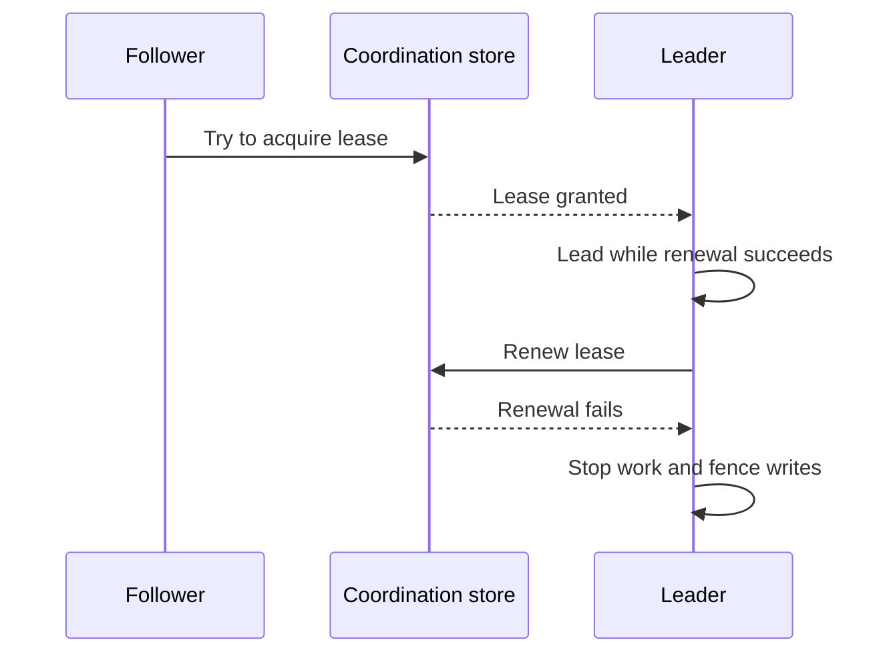

Leader election is a lock with a longer lease and a different failure profile.
It shows up whenever exactly one instance of a replicated service should do
something: run a scheduler, drive a migration, be the write path, own a shard.
The election itself is easy; staying correct while leadership *changes underneath
you* is the part that needs care.

> [!WHY] A scheduler can reach its database after losing contact with the coordination store. The leader must stop acting unless leadership is confirmed, or a successor may already be writing.

> [!GOALS]
>
> - Identify when a service needs one leader and when work can be partitioned.
> - Compute approximate failover time from lease TTL, election round trip and warm-up.
> - Explain how fencing protects writes from a stale leader.

## Why elect at all

```text
  ✓  a singleton scheduler — one instance runs the cron, N serve traffic
  ✓  a shard owner — exactly one node writes to a partition
  ✓  a coordinator for a migration, a rebalance, a compaction
  ✓  a stateful cache warmer where duplicate work is expensive
  ✗  distributing ordinary request traffic — that is load balancing
  ✗  anything that can be partitioned by key instead
```

The last exclusion is the important one. **Electing one leader for the whole
system is a bottleneck and a failure domain.** Electing one leader per partition
gives you the same guarantee with parallelism, which is exactly what every
partitioned database does. Prefer many small leaderships to one big one.

## The standard implementation

```python
LEASE_TTL = 15

def run():
    while True:
        lease = etcd.lease(LEASE_TTL)
        acquired = etcd.put_if_absent("/service/leader", NODE_ID, lease=lease)

        if acquired:
            with keep_alive(lease, interval=LEASE_TTL // 3) as alive:
                lead(until=alive.lost)      # stops when renewal fails
        else:
            # watch, do not poll — react the moment the key disappears
            etcd.watch_once("/service/leader", event="delete")
```

Three details are doing real work:

- **Renewal at ttl/3** — two chances to survive a blip before expiry.
- **`lead(until=alive.lost)`** — leadership loss is a *signal into the work*, not
  something checked at the top of a loop.
- **Watch, not poll** — a follower learns the leader is gone in milliseconds
  rather than on the next poll, which is the difference between a 200 ms failover
  and a 30 s one.



## The four ways leadership is lost silently

This is the part that produces incidents.

**1. The lease expires while you are paused.** GC, a descheduled VM, a blocked
syscall. You resume believing you lead. Same as the lock case, same answer:
**fence every consequential write.**

**2. The renewal fails and the code retries instead of stopping.** A `try/except`
around the keep-alive that logs and continues is a split-brain generator.

**3. Network partition.** You can reach your work but not the coordination store.
From your side nothing is wrong. The correct behaviour is to **stop working when
you cannot confirm leadership**, which feels wrong — you are healthy! — and is
the only safe choice.

**4. Clock skew shortens or lengthens the lease.** If your clock runs fast you
give up leadership early (harmless); if it runs slow you hold on past expiry
(dangerous). Leases should be computed from a **monotonic** clock, per the clocks
topic, and the store's expiry is what actually decides.

```text
  the invariant that survives all four:

    NEVER act on leadership you have not confirmed,
    and make every action carry a token so that acting on
    stale leadership FAILS rather than corrupts.
```

## Failover time, and the trade in it

```text
  detection    lease TTL           the dominant term
  election     one round trip      milliseconds
  warm-up      state rebuild       often the largest term in practice

  total failover ≈ TTL + RTT + warm-up
```

Shortening the TTL speeds failover and increases spurious elections — the same
trade as every failure detector. The usual range is 10–30 seconds for a service
whose work is interruptible, and shorter only when the leadership is cheap to
move.

**Warm-up is the term people forget.** A newly elected leader that must rebuild
30 GB of state is unavailable for minutes regardless of how fast the election
was. The fix is a **standby that is already warm**:

```text
  ┌──────────┐   ┌──────────┐   ┌──────────┐
  │  LEADER  │   │  STANDBY │   │  STANDBY │
  │  active  │   │  warm:   │   │  warm    │
  │          │   │  follows │   │          │
  │          │   │  state,  │   │          │
  │          │   │  acts on │   │          │
  │          │   │  nothing │   │          │
  └──────────┘   └──────────┘   └──────────┘

  failover = election only. state is already there.
```

That is the standard design for anything with meaningful state, and it is why
"hot standby" exists as a term.

## Preventing flapping

A leadership that oscillates between two nodes is worse than a slightly slower
failover: each transition costs a warm-up and may abort in-flight work.

```text
  □  BACKOFF after losing leadership — do not immediately re-contend
  □  HYSTERESIS — a node that just lost leadership waits longer than
     one that has been a follower all along
  □  PRIORITY / affinity — prefer a specific node when it is healthy,
     so the cluster converges rather than rotating
  □  ALERT on election rate. as with Raft, near-zero is the only
     acceptable steady-state value.
```

## Doing it without a coordination store

Two lighter options when you do not want an etcd dependency.

**A database row as the lock**, which is often the right answer:

```sql
-- one row, held by whoever last successfully updated it
UPDATE leader_election
   SET holder = :node_id, expires_at = now() + interval '15 seconds'
 WHERE name = 'scheduler'
   AND (holder = :node_id OR expires_at < now());
-- 1 row updated → you are the leader
-- 0 rows        → someone else holds it
```

Correct because the database serialises the update, uses infrastructure you
already run and monitor, and — critically — is **transactional with your
application data**, so leadership and the work it protects can commit together.
Its limits: polling rather than watching (slower failover), and load on the
database proportional to the number of contenders.

**Static assignment**, which is not election at all:

```text
  index 0 of a StatefulSet is the leader.
  or: the node whose hash of (job, epoch) is lowest.
```

No coordination, instant "failover" by definition, and no guarantee of mutual
exclusion during a partition — the old pod may still be running. Adequate for
efficiency purposes, never for correctness.

## Checklist

```text
  □  Could this be partitioned instead, so there are many small
     leaderships rather than one?
  □  What is the acceptable failover time, and does warm-up fit in it?
  □  Does losing leadership stop work immediately?
  □  Does every consequential write carry a fencing token?
  □  Are standbys warm?
  □  Is there an alert on election rate?
  □  Is the coordination store's outage survivable — does the current
     leader keep leading, or does everything stop?
```

> [!INTERVIEW] Explain why election is the easy part: after winning, a leader must stop on unconfirmed leadership loss and fence each consequential write so a stale leader cannot corrupt state.

That last question deserves a deliberate answer. Two defensible designs: keep
leading until the lease genuinely expires (favours availability), or stop
immediately on losing contact (favours safety). Choose knowingly; the default in
most libraries is the first.

> [!CHECK] Why does a warm standby matter when estimating failover time?
>
> Total failover is approximately TTL plus election round trip plus warm-up. A standby that already has the state removes the potentially dominant rebuild time.

> [!CHECK] What should a follower do after losing the leader key in the standard implementation?
>
> Watch for deletion instead of polling so it reacts as soon as the key disappears, and acquire the lease through the coordination store before doing leader work.

## What to take away

1. Prefer many per-partition leaderships to one global leader — one leader is a
   bottleneck and a failure domain.
2. Renew at ttl/3, watch rather than poll, and thread leadership loss into the
   work as a signal rather than a periodic check.
3. Leadership is lost silently through pauses, retried renewals, partitions and
   clock skew — the invariant is to never act on unconfirmed leadership and to
   fence every write.
4. Failover time is TTL plus election plus warm-up, and warm-up usually dominates;
   keep standbys warm.
5. Prevent flapping with backoff, hysteresis and affinity, and alert on election
   rate.
6. A database row with a conditional update is often the better implementation,
   because it is transactional with the work it protects.

Next: the other coordination primitives — barriers, semaphores, rate limits and
counters.


## Exercises

> [!EXERCISE recall] Which three terms make up the chapter's approximate failover-time estimate?
>
> **Solution:** Failover time is approximately the lease TTL plus the election round trip plus warm-up; state rebuild time is often the dominant term.

> [!EXERCISE apply] A service uses a 20-second lease TTL, an election round trip of 150 ms, and a warm standby that needs 35 seconds to become ready. Estimate total failover time.
>
> **Solution:** Convert the round trip: 150 ms = 0.15 s. Add the terms: 20 s + 0.15 s = 20.15 s; 20.15 s + 35 s = **55.15 seconds**.

> [!EXERCISE stretch] The current leader cannot reach the coordination store during a network partition but can still reach the database. Recommend its behavior and explain what a weaker answer misses.
>
> **Solution:** Stop work when leadership cannot be confirmed and ensure writes carry a fencing token that the resource checks. A weaker answer keeps writing because the process is healthy; it misses that a successor may already own the lease and that the old leader can corrupt shared state.
