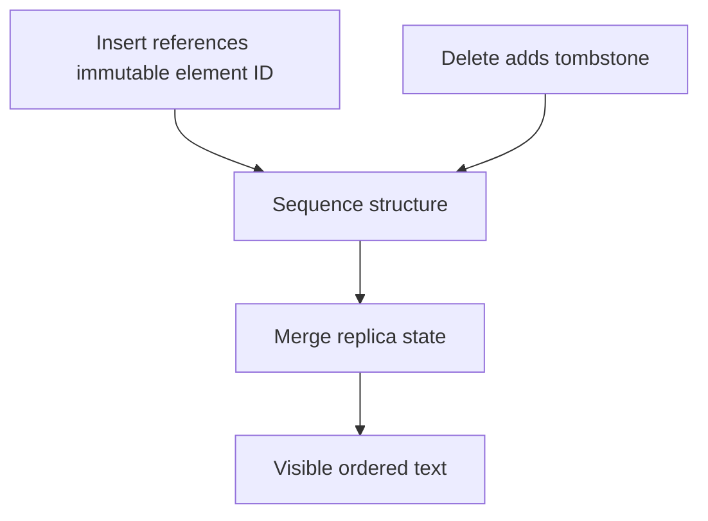

A conflict-free replicated data type is a data structure whose merge operation is
commutative, associative and idempotent — which means replicas that have seen the
same set of updates hold the same value, regardless of the order they arrived in,
how they were batched, or how many times each was delivered. No coordination, no
transformation, no server.

> [!WHY] An offline permission editor uses an add-wins set and reports a successful revocation. A concurrent addition can preserve the permission on merge, so a mathematically convergent result can still violate the product’s security intent.

> [!GOALS]
>
> - Explain delta-state delivery and monotonic removals
> - Compute an idempotent G-Counter merge
> - Choose data types whose conflict semantics match the product

## The mathematics, briefly

The state-based formulation rests on a **join-semilattice**: a partially ordered
set where any two elements have a least upper bound.

```text
  merge(a, b) = the least upper bound of a and b

  it follows automatically that merge is:
    commutative   lub(a,b) = lub(b,a)
    associative   lub(lub(a,b),c) = lub(a,lub(b,c))
    idempotent    lub(a,a) = a

  and updates must be MONOTONIC — they only move state UP
  the lattice, never down.
```

Those three properties are precisely what makes the network's misbehaviour
irrelevant, as the first chapter noted. And the monotonicity requirement is the
CALM theorem from the coordination topic, showing up as a design constraint:
**you can build a coordination-free type exactly when its updates are monotonic.**

That constraint is why "delete" is the hard operation in every CRDT below.
Removing something moves state _down_, which the lattice forbids — so every CRDT
that supports removal does it by adding something (a tombstone, a remove-set)
rather than by subtracting.

## Two formulations

```text
  STATE-BASED (CvRDT)               OPERATION-BASED (CmRDT)

  send the WHOLE STATE;             send the OPERATION;
  receivers merge it                receivers apply it

  + tolerates ANY message loss,     + tiny messages
    duplication and reordering      - requires exactly-once,
  + no delivery requirements          causally-ordered delivery
  - messages are large              - the delivery layer must
                                      provide those guarantees
```

**Delta-state CRDTs** are the practical hybrid used in production: send only the
_changed part_ of the state, but merge it with the state-based function — small
messages with state-based robustness. This is what modern libraries implement.

## The catalogue

### Counters

```text
  G-COUNTER (grow-only)
    state: one count per replica
      { A: 5, B: 3, C: 7 }
    increment:  bump your OWN entry
    merge:      per-key MAX
    value:      SUM of all entries

  why max-then-sum? because taking the max per replica is
  idempotent (a re-delivered state cannot double-count), while
  summing across replicas gives the total.
```

```text
  PN-COUNTER (increment and decrement)
    two G-Counters: one for increments, one for decrements
    value = sum(P) − sum(N)

  → decrement is expressed as an ADDITION to a second counter,
    keeping every update monotonic
```

That trick — express a non-monotonic operation as a monotonic one over a richer
state — is the pattern behind every CRDT that follows.

### Sets

```text
  G-SET       add only. merge = union. trivially correct.

  2P-SET      an add-set and a remove-set. merge = union of both.
              value = adds − removes.
              ✗ once removed, an element can NEVER be re-added.

  OR-SET      (observed-remove) — the useful one.
              each ADD carries a unique tag.
              a REMOVE removes only the tags it has OBSERVED.
              value = elements with at least one unremoved tag.
```

The OR-Set resolves the concurrent add/remove case the way users expect:

```text
  A: add("x")     → tag t1
  B: add("x")     → tag t2       (concurrent, different tag)
  A: remove("x")  → removes only t1, the tag A had seen

  merge: "x" still has t2 unremoved  →  "x" is PRESENT

  intuition: B's add was concurrent with A's remove, so A could
  not have intended to remove it. add wins over a concurrent
  remove.
```

Compare this with the Dynamo shopping cart from the replication topic, where
merging by union made deleted items reappear. The OR-Set is that problem solved
properly: it distinguishes "removed the thing I saw" from "removed the thing in
general".

### Registers

```text
  LWW-REGISTER    a value plus a timestamp; higher timestamp wins.
                  simple, and inherits every clock problem from
                  the clocks topic. one concurrent write is LOST.

  MV-REGISTER     keeps ALL concurrently-written values.
                  the application resolves. nothing is lost, and
                  the application must handle a set of values.
```

Same trade as before: LWW is convenient and loses data; multi-value is honest and
pushes the work upward.

### Maps

```text
  OR-MAP    keys form an OR-Set; each value is itself a CRDT.
            → nested, composable structure
            → the basis of Automerge and Yjs documents
```

Composition is the important property: a CRDT whose values are CRDTs is a CRDT.
That is what lets a whole JSON-shaped document be one, with counters, sets and
text nested inside it.

## Sequences: the hard one

Text needs an _ordered_ sequence, and this is where CRDTs get genuinely
intricate. The core idea replaces integer indices with **immutable identifiers**
that carry their own ordering.

```text
  instead of  "insert at index 3"
  say         "insert AFTER the element with id (5, siteA)"

  the reference is to an IDENTITY, not a position — and identities
  never change, no matter what is inserted around them.
```

Two families:

```text
  DENSE POSITION IDS (LSEQ, Logoot)
    every element gets a fractional position between its
    neighbours: 0.5, then 0.25, then 0.375 ...
    + simple ordering: sort by position
    - identifiers GROW as you insert repeatedly in one place
      (typing forward in a paragraph is exactly that case)

  LINKED / TREE STRUCTURES (RGA, YATA, Fugue)
    each element points at the element it was inserted after;
    concurrent inserts at the same point are ordered by a
    deterministic tie-break
    + identifiers stay a constant size
    - the structure is more complex, and a naive traversal is slow
```

RGA-style structures are what production libraries use. Yjs's YATA and
Automerge's RGA variant both take this approach.

**Deletion is a tombstone**, for the monotonicity reason above: a deleted
character is marked rather than removed, because removing it would leave dangling
"insert after" references and would move state down the lattice.

> [!PITFALL] An add-wins set can converge correctly while preserving a revoked permission. Check whether its conflict policy matches the product’s safety requirement.



## The metadata problem

The genuine cost, and the honest weakness of text CRDTs:

```text
  a 100 KB document, heavily edited over years

    visible text:            100 KB
    per-character identity:  ~10–20 bytes each
    tombstones for every
      deleted character:     potentially far more than the
                             surviving text
    ────────────────────────────────────────────
    total state:             often MEGABYTES
```

A document where someone typed a paragraph and deleted it still carries every
deleted character. This was the standing objection to text CRDTs, and it has been
substantially addressed:

```text
  RUN-LENGTH ENCODING    consecutive characters inserted together
                         by the same site are stored as one run
                         → typing a sentence costs one entry,
                           not fifty

  TOMBSTONE GC           safe once every replica has seen the
                         deletion — requires knowing that, which
                         is the matrix-clock question from the
                         clocks topic

  BINARY ENCODING        Yjs's document format is remarkably
                         compact in practice, often smaller than
                         the equivalent OT history
```

Modern libraries (Yjs especially) have brought overhead down to the point where it
is no longer the deciding factor for most applications. The theoretical worst case
remains, and it matters for documents with extreme edit histories.

## Choosing a CRDT

```text
  a count that only rises          G-Counter
  a count that rises and falls     PN-Counter
  a set, additions only            G-Set
  a set with removals              OR-Set
  a single value, LWW acceptable   LWW-Register
  a single value, nothing lost     MV-Register
  a structured document            OR-Map of CRDTs
  ordered text                     RGA / YATA sequence
```

And the questions to ask before reaching for one at all:

```text
  □  Is there genuinely concurrent modification of the same item?
     (if one writer owns it, you need nothing)
  □  Is the CRDT's built-in merge semantics what users expect?
     (add-wins is right for a cart, and wrong for a permission list)
  □  Can you tolerate the metadata?
  □  Does the operation set fit an existing type, or are you
     inventing one? (inventing a CRDT is a research task —
     the merge properties must be PROVED, not assumed)
```

The second question is the one that catches people. A CRDT's merge is _a_ correct
answer, not necessarily _the desired_ answer. An add-wins set means that when one
admin revokes a permission while another edits the same group, the permission
survives — which is convergent, provable, and a security bug.

> [!CHECK] Why does a PN-Counter keep separate positive and negative G-Counters?
>
> Decrementing the visible value becomes an increase in negative state. Both underlying counters remain monotonic and merge with per-replica maximums.

> [!CHECK] Why can a sequence CRDT not simply erase every deleted character immediately?
>
> Other operations may still reference the character’s identity. Tombstones preserve those references until garbage collection is known to be safe.

## What to take away

1. A CRDT's merge is commutative, associative and idempotent, which makes
   reordering, batching and duplication irrelevant — the three things a network
   does.
2. Updates must be monotonic, which is why every removal is expressed as an
   addition (a tombstone or a remove-set) rather than a subtraction.
3. State-based tolerates any delivery behaviour, operation-based needs causal
   exactly-once delivery, and delta-state is the practical hybrid.
4. The OR-Set's observed-remove semantics solve the concurrent add/remove case the
   way users expect, which is what the Dynamo cart got wrong.
5. Sequence CRDTs replace indices with immutable identities and mark deletions as
   tombstones; run-length encoding and binary formats have largely tamed the
   metadata cost.
6. A CRDT's merge is a correct answer, not necessarily the desired one — add-wins
   on a permission set is convergent and a security bug.

Next: building a real collaborative application with these pieces.

## Exercises

> [!EXERCISE recall] How do delta-state CRDTs reduce payload while keeping state-based merge robustness, and why are removals represented by added information?
>
> **Solution:** They send changed portions of state and merge them using the state-based function. State must advance monotonically; a removal therefore records additional information such as tombstones or observed removed tags rather than simply subtracting knowledge.

> [!EXERCISE apply] Two G-Counter replicas hold {A: 4, B: 2} and {A: 3, B: 6}. Compute the merged state and visible value, then merge the first state into the result again. Does the visible total change?
>
> **Solution:** Take per-replica maxima: A = max(4, 3) = 4 and B = max(2, 6) = 6. The state is {A: 4, B: 6}, so the value is 4 + 6 = 10. Merging {A: 4, B: 2} again gives max(4, 4) = 4 and max(6, 2) = 6, still 10. Summing received totals instead would double-count duplicates.

> [!EXERCISE stretch] A cart should preserve a concurrent addition, while a permission list must not silently preserve a revoked grant. Should both use the chapter’s add-wins OR-Set?
>
> **Solution:** Use the OR-Set for the cart if observed-remove add-wins matches user intent. Reject that same semantics for revocation-sensitive permissions and require a policy that satisfies the security requirement before choosing a type. Applying the OR-Set to both merely because it converges is weaker: convergence proves agreement, not that a surviving permission is authorised.
