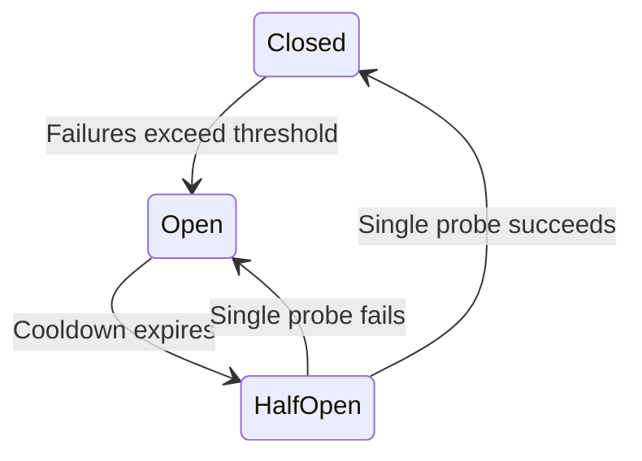

Timeouts and retries are the first reliability tools anyone reaches for, and
they are also, configured naively, one of the most common *causes* of large
outages. A retry is additional load applied at exactly the moment a system is
least able to absorb it. This chapter is about getting the parameters right,
because the difference between a system that rides out a blip and one that
collapses is almost entirely in these numbers.

> [!WHY] A dependency's p99 latency rises during a traffic spike, while every client retries at the same fixed interval. A timeout chosen without measurements can cut off healthy slow work and then add more load to the service already struggling.

> [!GOALS]
>
> - Derive a timeout from a dependency's measured latency distribution
> - Choose retry behavior from error type and operation idempotence
> - Calculate exponential backoff ceilings and apply full jitter
> - Bound retry amplification with a single retry layer and a budget

## Choosing a timeout

A timeout is a claim: "if it has not answered by now, it is not going to."
Getting it wrong in either direction is expensive.

```text
  too short ──▶ you abandon requests that would have succeeded
                the callee still does the work (wasted)
                the caller retries → MORE load on a struggling service

  too long  ──▶ threads/connections pile up waiting
                the caller's own resources exhaust
                failure propagates upward as a hang, not an error
```

The procedure:

1. **Measure the dependency's latency distribution.** You need p50, p99, p99.9 —
   not an average, which hides everything that matters.
2. **Set the timeout somewhere around p99.9, or 2–3× p99.** You are trying to
   catch genuine hangs while not cutting off the slow tail of real work.
3. **Re-derive it when the dependency changes.** A timeout set two years ago
   describes a service that no longer exists.

A timeout with no measurement behind it — 30 seconds because that was the
default, 2 seconds because it felt right — is the most common configuration
defect in service architectures.

### Timeouts must be layered and shrinking

If A calls B calls C, and every layer uses the same timeout, the outer layers
give up before the inner ones can report anything useful:

```text
  BAD                                   GOOD (deadline propagation)

  A: timeout 5s ─┐                      A: budget 5s  ─┐
  B: timeout 5s ─┤ all identical        B: budget 4.5s ─┤ each hop passes
  C: timeout 5s ─┘                      C: budget 4.0s ─┘ the REMAINING time

  A gives up at 5s while B is still     C knows it has 4s left and gives up
  waiting on C. B and C keep working    on time. Work stops everywhere when
  on a request nobody will read.        the caller stops caring.
```

**Deadline propagation** — passing an absolute deadline down the call chain,
rather than each hop starting a fresh timer — is what makes this work. gRPC has
it built in; in HTTP it is a header you set by convention. Its real benefit is
not tidiness: it stops a struggling system doing work whose result is already
discarded, which is precisely the work you cannot afford during an incident.

The rule of thumb: **each layer's timeout should be shorter than its caller's**,
with room for the caller to do something with the failure.

## When to retry, and when not to

Retrying the wrong thing is worse than not retrying.

| Error | Retry? | Why |
| --- | --- | --- |
| Connection refused | **Yes** | Nothing happened; probably a restarting instance |
| Timeout | **Carefully** | May have succeeded — only if idempotent |
| 429 Too Many Requests | **Yes**, after `Retry-After` | Explicitly asked to |
| 503 Service Unavailable | **Yes**, with backoff | Transient by definition |
| 500 Internal Server Error | **Maybe** | Could be a deterministic bug — retrying repeats it |
| 400 Bad Request | **Never** | The request is malformed; it will always be |
| 401 / 403 | **Never** | Retrying will not grant permission |
| 404 | **Never** | It is not there |

The distinction is **transient versus permanent**. Retrying a permanent error is
pure waste that turns one failure into five, and on a 4xx it is often a signal
that your client is broken in a way retries will hide.

And the precondition that overrides all of this: **retry only what is safe to
repeat.** A timeout on a non-idempotent operation is the case where a retry
charges the card twice. Idempotency keys, from the previous chapter, are what
make the "carefully" row safe.

## The three things that must go together

Backoff, jitter and a cap. Missing any one of them produces a known failure
mode.

### Exponential backoff

Fixed-interval retries apply constant load to a service that is already failing.
Exponential backoff gives it room to recover:

```text
  fixed 1s:       ▌▌▌▌▌▌▌▌▌▌▌▌▌▌▌▌▌▌▌▌   constant pressure
  exponential:    ▌ ▌  ▌    ▌        ▌   pressure decays

  attempt 1:  wait 100 ms
  attempt 2:  wait 200 ms
  attempt 3:  wait 400 ms
  attempt 4:  wait 800 ms
  attempt 5:  wait 1600 ms
```

### Jitter, which is not optional

Without randomisation, every client that failed at the same moment retries at
the same moment. The service gets a synchronised wave, fails again, and the
clients synchronise harder.

```text
  WITHOUT JITTER                     WITH FULL JITTER

  load                               load
   │    █         █                   │  ▁▂▃▂▁  ▂▁▂▃▂▁
   │    █         █                   │ ▁█████▁ ██████▁
   │ ───█─────────█───  capacity      │ ─────────────── capacity
   └──────────────────                └──────────────────
    thundering herd                    smoothed
```

The AWS Architecture Blog's analysis of this is the standard reference, and its
conclusion is blunt: **full jitter** — picking uniformly from the whole interval
rather than adding a small random offset — performs best.

```python
def backoff_delay(attempt, base=0.1, cap=20.0):
    #      exponential growth, capped
    ceiling = min(cap, base * (2 ** attempt))
    #      FULL jitter: uniform over [0, ceiling], not ceiling ± a bit
    return random.uniform(0, ceiling)
```

### The cap, and the attempt limit

Unbounded exponential growth reaches absurd delays (2³⁰ seconds is 34 years).
Cap the interval — 20–60 seconds is typical — and cap the number of attempts,
usually at 3–5. Beyond that you are not retrying a blip, you are hammering a
dependency that is genuinely down, and the request should fail so the caller can
do something else.

## Retry amplification: the arithmetic that causes outages

The failure mode people do not see coming. Retries at multiple layers
**multiply**:

```text
  client        3 attempts
    └─ gateway     3 attempts
         └─ service A  3 attempts
              └─ service B  3 attempts

  one user request ──▶ 3 × 3 × 3 × 3 = 81 requests to service B
```

Service B, already struggling, receives **81× its normal load** exactly when it
is least able to serve it. This turns a brief degradation into a total outage,
and it is a leading cause of large-scale incidents.

The defences:

1. **Retry at ONE layer.** Usually the outermost one that has enough context to
   decide, or the one closest to the failure — but not both. Every layer that
   retries must know that the layers around it do not.
2. **Retry budgets.** Cap retries as a *fraction of total traffic* — for example
   "retries may not exceed 10% of requests in the last minute". Under normal
   conditions the budget is never touched; under widespread failure it stops the
   amplification cold. This is the mechanism gRPC and Envoy expose, and it is
   strictly better than a per-request attempt limit, because it bounds the load
   the dependency sees rather than the effort one caller makes.
3. **Circuit breakers.** Stop calling a dependency that is clearly down.

## Circuit breakers

A state machine that stops sending requests to a failing dependency, so the
caller fails fast instead of queueing up threads on something that will not
answer.

```text
         failures exceed threshold
    ┌──────────────────────────────────┐
    │                                  ▼
 ┌──────┐                        ┌────────┐
 │CLOSED│                        │  OPEN  │
 │      │                        │        │
 │ pass │                        │ reject │
 │through                        │immediately
 └──────┘                        └────────┘
    ▲                                  │
    │ probe succeeds                   │ after a cooldown
    │                    ┌────────────┐│
    └────────────────────│ HALF-OPEN  │◀┘
                         │ let ONE    │
      probe fails ──────▶│ request try│
      (back to OPEN)     └────────────┘
```

- **Closed** — normal. Count failures over a rolling window.
- **Open** — fail immediately without making the call. This is the point: it
  protects *the caller* from exhausting its threads, and it protects *the
  callee* from load while it recovers.
- **Half-open** — after a cooldown, allow a single trial request. Success closes
  the circuit; failure opens it again. Letting all traffic through at once would
  re-kill a service that had just come back.

What to do while open matters as much as opening: serve stale cached data,
return a degraded response, or fail with a clear error. A circuit breaker that
opens and then throws an unhandled exception has converted a slow dependency
into a broken feature, which may not be an improvement.



## Load shedding: the server's side of the same problem

Retries and circuit breakers are client-side. The server needs its own defence,
because a server that accepts more work than it can do produces a queue in which
everything times out — the worst outcome, because the work is done and then
discarded.

```text
  ACCEPT EVERYTHING              SHED EARLY

  queue: ████████████████       queue: ████
  all requests wait 30s         some requests: fast success
  all time out                  excess: immediate 429/503
  0% success                    80% success
```

Shedding is counter-intuitive — deliberately rejecting work — and it is what
keeps the success rate above zero under overload. The refinements that matter:

- **Reject cheaply and early**, before parsing a body or acquiring a connection.
- **Prioritise.** Shed background and retry traffic before user-facing traffic;
  shed a free tier before a paying one. A request marked as a retry can be
  dropped first, which also breaks amplification.
- **Drop expired work.** If a request has been queued past its deadline, do not
  start it. Nobody is listening.
- **Send `Retry-After`** so well-behaved clients back off by an amount you chose
  rather than one they guessed.

## Putting the parameters together

A defensible default for a service-to-service call, as a starting point to be
tuned with real measurements:

```text
  timeout            ~2× the dependency's p99, propagated as a deadline
  retries            3 attempts maximum, and only on transient errors
  backoff            100 ms base, ×2 per attempt, capped at 20 s
  jitter             full — uniform(0, interval)
  retry budget       ≤10% of request volume
  circuit breaker    open at >50% errors over 20+ requests; 30 s cooldown
  idempotency        client-generated key on every non-idempotent write
  load shedding      queue-depth or latency-based, shedding retries first
```

The most common real-world configuration failures, in order: no jitter, retries
at every layer, timeouts with no measurement behind them, and retrying
non-idempotent operations.

> [!PITFALL] Retry amplification: independent retries at every layer
> multiply load on the dependency that is already failing. Backoff alone
> does not bound that load; choose one retry layer and enforce a budget.

> [!CHECK] How do four layers with three attempts each produce 81 requests at the
> dependency?
>
> Each outer attempt triggers up to three attempts at the next layer.
> Multiplication gives 3 × 3 × 3 × 3 = 81. Retry at one layer and impose
> a traffic-level retry budget to bound the amplified load.

> [!CHECK] Why must half-open admit only one probe?
>
> Opening removes load while the dependency recovers. A single
> successful probe closes the circuit; a failed probe reopens it.
> Releasing all waiting traffic during the probe can overload the
> recovering service again.

## What to take away

1. A timeout should come from a measured p99, and deadlines should be propagated
   so inner layers stop when the caller stops caring.
2. Retry only transient errors, and only operations that are safe to repeat.
   4xx errors are not transient.
3. Backoff, jitter and a cap must all be present; full jitter beats a small
   random offset.
4. Retries multiply across layers — four layers at three attempts is 81× load.
   Retry at one layer, and bound it with a retry budget.
5. Circuit breakers protect the caller's resources as much as the callee's, and
   half-open must admit exactly one probe.
6. A server under overload should shed early and prioritise, because accepting
   everything means completing nothing.

Next: how to measure any of this honestly — tail latency, and why the average is
the least useful number you can compute.

## Exercises

> [!EXERCISE recall] What must accompany exponential backoff, and why is a retry budget different from a per-request attempt limit?
>
> **Solution:** Backoff needs jitter and a cap, as well as a maximum attempt count. Full jitter spreads clients across the wait interval, and the cap avoids absurd delays. A per-request limit bounds one caller's effort; a retry budget caps retries as a fraction of total traffic and therefore bounds amplified load on the dependency.

> [!EXERCISE apply] A dependency has measured p99 latency of 120 ms. Set a starting timeout at 2× p99 and calculate the exponential backoff ceilings for the first three retry delays with a 100 ms base. State the jitter interval for each delay.
>
> **Hint:** Double the p99 for the timeout; double the backoff ceiling after each retry.
>
> **Solution:** The starting timeout is 2 × 120 ms = **240 ms**. The retry ceilings are 100 ms, 100 × 2 = **200 ms**, and 200 × 2 = **400 ms**. With full jitter, the actual waits are drawn uniformly from 0–100 ms, 0–200 ms and 0–400 ms respectively; the chapter's 20 s cap does not bind for these delays.

> [!EXERCISE stretch] An API client retries both 400 errors and timed-out payment writes at three layers with fixed one-second delays. Propose a safer policy and explain what a weaker answer misses.
>
> **Solution:** Never retry a 400 because the request is permanently malformed. Retry a timed-out payment only with the same idempotency key, and put retries at one layer with exponential backoff, full jitter, a cap and a traffic-level retry budget. A weaker answer only lengthens the delay; it misses that permanent errors waste work, a timeout may follow a completed charge, and retries at multiple layers multiply load.
